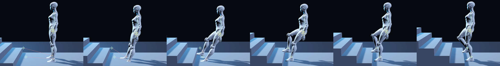
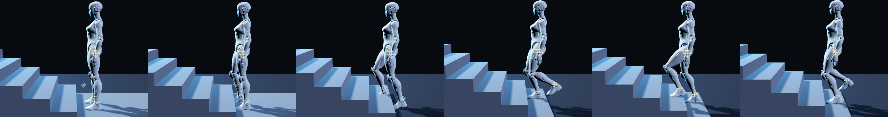

# Investigation: stair-entry glide (agent: Claude, 2026-11-24)

The report beside this file (README.md) is the human side: the note, the moment and ADDA's evidence near it. This is what an agent did with it, as an end-to-end example of the workflow. **The person decides whether it looks right; nothing below says it does.**

Note: the note text is an outside reviewer's description relayed by Pedro, typed into *Report this moment* by script (the same code path as the button), because nobody was at the machine.

## 1. Reproduce

`.\tools\adda.ps1 run -Scenario contacts -Character mira_0 -Unarmed -Detail full` (game values, no drafts). ADDA's only finding near 0.60 s: *Left Foot settles onto its foothold late, 30.3 mm, LOW*. That does not match what the reviewer saw (a long glide), so ADDA alone was not enough here.

## 2. Measure what the person sees

ADDA compares the ankle with the stair PLAN, and only once the plan has taken full hold of the leg (weight 0.9 or more). The person sees the foot against the TREAD. The bench is a treadmill (the stairs move, the character stays), so a foot that holds its tread must move exactly as the stairs do. `tools/quality/stair_tread_probe.gd` measures that.

Before (commit 8a749f3 plus the uncommitted work of the day, game values):

| Planted run | Foot against the floor/tread | The plan against the tread | Ankle to plan, worst |
|---|---|---|---|
| 0.02 to 0.70 s, left (the entry) | **840 mm** | 39 mm | 778 mm |
| each later stance | 41 to 53 mm | the same | 0 mm |

The recorded rows at the entry: the plan calls the left foot planted from the first frame at a point **0.77 m ahead** of the ankle (the first hold, half a tread before the first riser), while its weight ramps from 0.01 to 1.00 over 0.37 s. The leg is pulled out to the hold as the stairs approach: the glide.

## 3. Hypotheses tested

| Hypothesis | Test | Result |
|---|---|---|
| H1: the rig's stair weight ramps in too early for hosts that start at the lower cell centre (the tactical route and the bench do; the exploration host starts one tread before the first riser) | clamp the rig's ramp to the exploration host's span | **refuted for the bench**: entry slide 877 mm, the next stance worse (121 mm, 58 mm off its plan). Reverted. The bench approach has NO step cycle (the idle clip plays while the floor moves), so a later ramp only leaves the idle feet sliding longer |
| H2: the bench starts the stair walk 0.83 m before the first hold, an approach no host shows with the idle clip | start the bench's walk where the exploration host starts it (`riser_s(1) - tread_depth`) | entry slide **214 mm** (from 840), worst ankle-to-plan 135 mm (from 778); later stances unchanged. Small MIRA: 218 mm |
| H3: the 40 to 53 mm per later stance is a slide | switch the planned stance roll off (`stance_motion_enabled = false`) | it goes to **0.0 mm**: it is the designed heel-to-toe roll, not a slide. Whether the roll looks right is a person's call (Tune > Stairs > Stance roll) |

## 4. The change

`tools/animation_workbench/pose_workbench.gd`, `start_stair_demo`: the walk starts at `riser_s(1) - tread_depth`. Workbench only: no game code changed.

## 5. Verification

* `adda compare` before/after (contacts, MIRA unarmed): **MIXED**. Improved: left foot error at full hold 30.3 to 0.0 mm (the late-settle finding is resolved). Regressed: left foot worst slide against its plan 7.6 to 10.3 mm (under the 15 mm line; no finding). New LOW finding: right foot settles late. ADDA does not measure the foot against the tread, so it neither shows the 840 to 214 mm change nor contradicts it.
* Tests: see the commit message.
* Strips for a person: `strip_before.png`, `strip_after.png` (side view, 0.05 / 0.15 / 0.25 / 0.35 / 0.45 / 0.60 s, made by `tools/quality/animation_strip.gd ... contacts mira_0 unarmed 0.05,0.15,0.25,0.35,0.45,0.6 2.6,1.0,0.35:0,0.55,0.35`). Before: the legs reach far ahead while the body leans back. After: the feet stay under the body and step onto the first tread.

## 6. Still open (not done, evidence only)

* The remaining 214 mm: the plan's hold still ramps in during the first stance, with the first hold 0.17 m ahead. The exploration game enters the same way, so it is a game behaviour, not a bench one. A next experiment: ramp the hold in during a swing instead of a stance.
* The tactical route starts the stair walk at the lower cell centre too, but there the locomotion cycle is playing, not the idle clip. Not reproduced: there is no tactical stair scenario in the Workbench.
* ADDA does not measure a planted foot against the surface under it. This report shows that measurement would have found the defect directly. Adding it is a decision for the owner, not done here.

