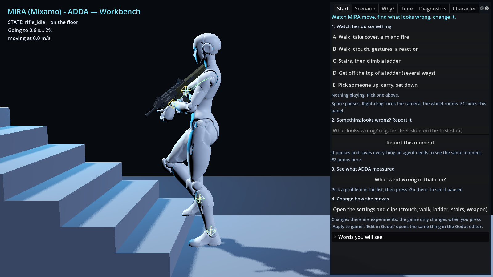

# Animation report: Stair entry: the first steps look like a glide into a bent-knee pose; the feet do not seem to hold their place on the treads

> Stair entry: the first steps look like a glide into a bent-knee pose; the feet do not seem to hold their place on the treads

| | |
|---|---|
| Character | mira_0, armed |
| Scenario | C  Contacts and traversal (`contacts`), step "stairs up (0.17 rise, 0.33 tread, 12 treads)" |
| Moment | scenario time 0.60 s, frame 36 at 0.0167 s a frame, paused |
| Revision | 8a749f3 on review/claude-adda (uncommitted changes) |
| On screen | state `rifle_idle`, on stairs, 0.00 m/s, stages Locomotion, CoverCrouch, Traversal, TraversalLegIK, TraversalFoot, WeaponPose, WeaponArmIK, HandGrip |
| Tuning | game values only |



## Reproduce

In the window: start the scenario, then the Scenario tab's progress bar or 'Back 1 s' reaches 0.60 s; or the Why? tab's 'Go there' on a nearby finding. Runs are deterministic at a fixed step.

```powershell
godot --path . res://tools/animation_workbench/pose_workbench.tscn -- --character=mira_0 --scenario=contacts
.\tools\adda.ps1 run -Scenario contacts -Character mira_0 -Detail full -Out adda-moment.json
.\tools\adda.ps1 isolate -Scenario contacts -Character mira_0 -At 0.60 -Bones "@left_foot,@right_foot,@left_knee,@right_knee,@left_hand,@right_hand"
```

## What ADDA measured near this moment (observations)

* **LOW Left Foot settles onto its foothold late** at 0.30 s: Left Foot was still 30.3 mm from its foothold when the stair planner took full hold of the leg, and closed to 0.0 mm over 0.32 s, at 0.30 s.
  * possible cause, NOT confirmed: The plan's weight reached full strength before the ankle arrived, so the foot is still travelling onto its foothold while the plan claims it planted. (test: Compare the weight ramp against the ankle's approach (Diagnostics tab, contact measurement) or at another frame rate)

Run summary: 1 finding: 0 high, 0 medium, 1 low. These are measurements; the causes are unknown unless a finding says otherwise. The whole analysis is in `adda_report.json`.

## Not established

* The note is a person's judgement of how the animation looks at this moment. It is not a measurement and it names no cause.
* ADDA's findings near the moment are measurements (a jump, a distance to a target). They do not say the animation is wrong or why; a clean list does not say it is right.
* A numerical improvement after a change is not proof the animation looks better: a person compares the result.

## For a coding agent

1. Read the note and look at the screenshot: that is the defect as a person sees it.
2. Reproduce with the headless run above and confirm the measurements near 0.60 s (`adda inspect`).
3. Separate what is measured from what you suspect (docs/claude/adda/10-agent-workflow.md); test one change at a time (`-Disable`, `-Set`, or code) and `adda compare` before and after.
4. Hand back to the person: what you changed, the compare, and a way to see the same moment (the window command and time above). Do not claim it looks better because the numbers improved.
