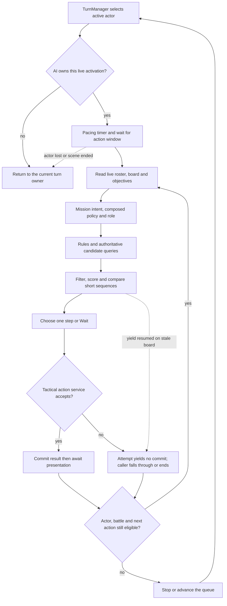
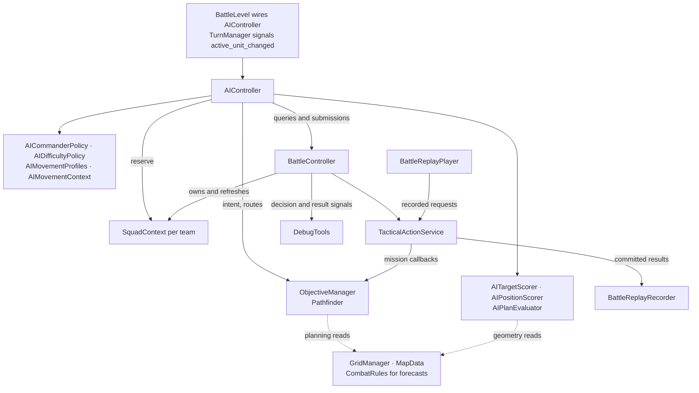
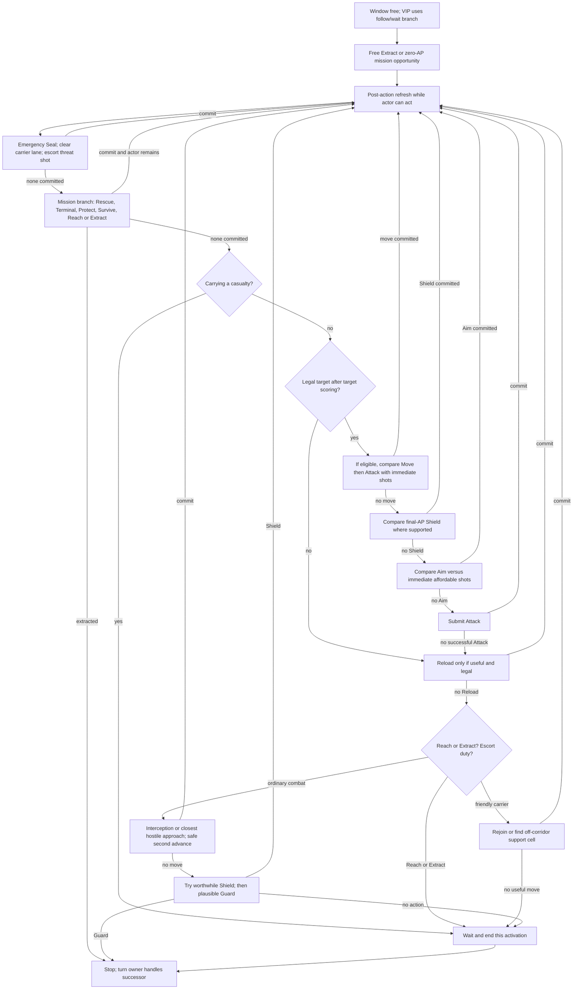
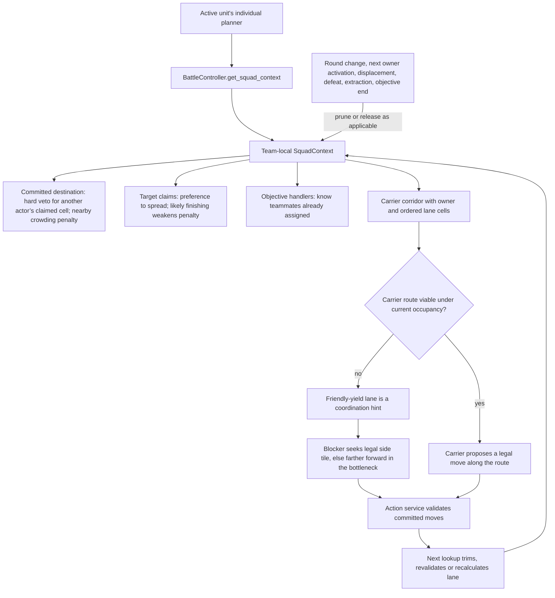
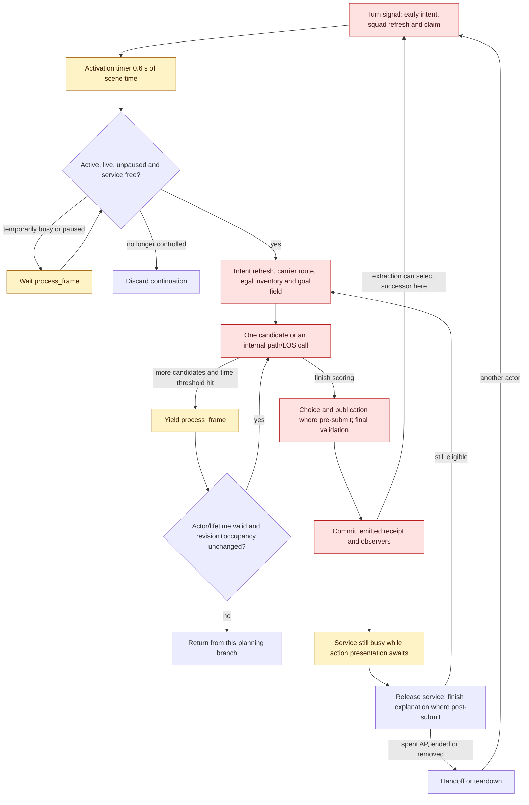
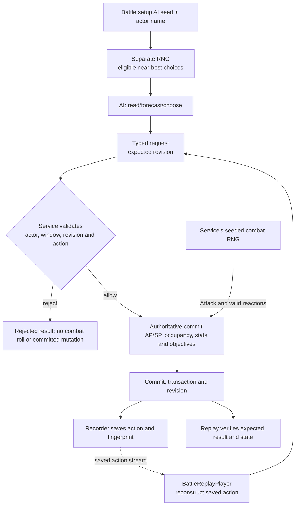
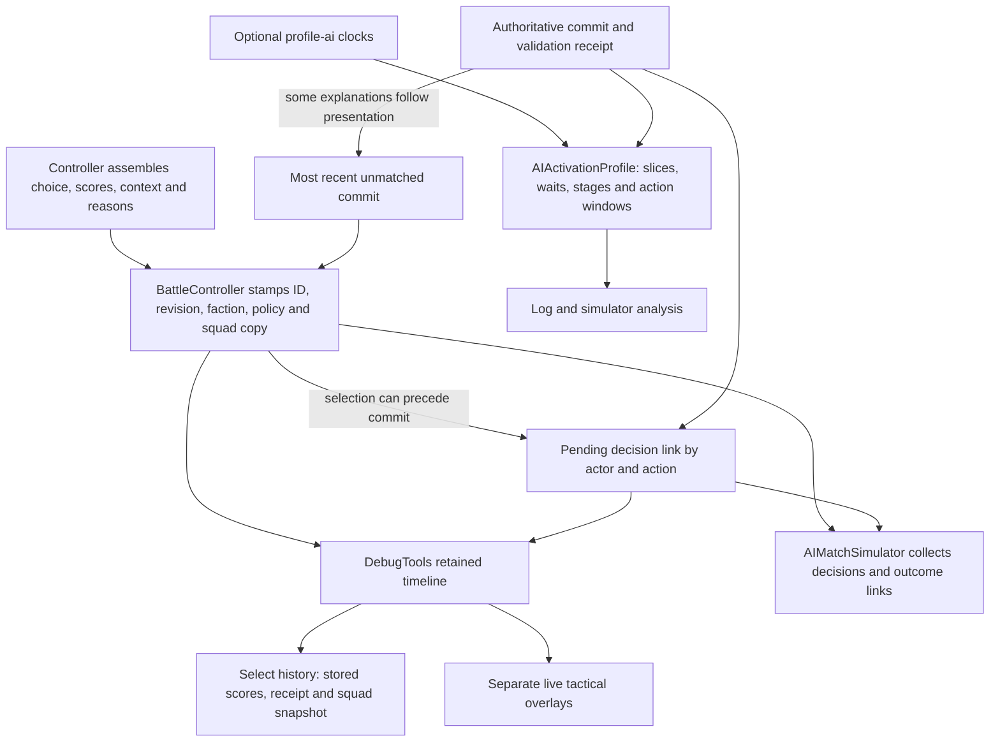

# Source-editable architecture diagrams

[Architecture index](README.md) · [Code inventory](implementation.md#source-inventory) · [Walkthroughs](walkthroughs.md) · [Performance](performance.md)

Solid arrows in diagram B are calls or deliveries, and dotted arrows are shared reads or results. Diagrams A and C compress control flow. Diagram E tracks execution time. Source links beside each diagram identify the functions represented.

## A · Complete decision lifecycle

Source: [AIController](../../units/ai_controller.gd) `_on_active_unit_changed`, `_await_action_window`, `_plan_activation`, `_execute_turn`; [TurnManager](../../systems/turn_manager.gd) `_set_active_unit`; [TacticalActionService](../../systems/actions/runtime/tactical_action_service.gd) `_validate_request`. Redirection after a stale search is caller-specific. It can abandon one branch and continue local fallbacks.

## B · Actual code architecture

Source: [BattleLevel](../../levels/prototype_map/battle_level.gd) controller setup; [BattleController](../../systems/battle_controller.gd) query/try adapters, `get_squad_context`, `_commit_mission_action`, `record_ai_decision`; [AIController](../../units/ai_controller.gd) `_ensure_policy`, `_find_attack_target`, `_move_along_goal_path`; [BattleReplayRecorder](../../systems/replay/battle_replay_recorder.gd) `begin`; [BattleReplayPlayer](../../systems/replay/battle_replay_player.gd) `_execute`. The [inventory](implementation.md#source-inventory) maps each module to its concrete path. The grouped mission callback targets ObjectiveManager through BattleController. The route read targets Pathfinder, which reads the grid. Scorers call CombatRules for forecasts and consult squad preferences. The recorder additionally receives turn and mission commands.

## C · Action selection and precedence

Source: [AIController](../../units/ai_controller.gd) `_plan_activation`, `_try_mission_step`, `_best_reposition_plan`, `_shield_instead_of_final_shot`, `_try_guard_if_useful`; [AIPlanEvaluator](../../systems/ai/ai_plan_evaluator.gd) `compare_aim`, `shots_with`, `best_attack_from` and `best_shield_plan`. A free action can finish directly. The ordering here is a sequence of rules, with local utilities inside target, move, Aim and Shield comparisons.

## D · Squad coordination

Source: [SquadContext](../../systems/ai/squad_context.gd) `begin_round`, `begin_unit`, `block_reason`, `target_adjustment`, `revalidate`, `_revalidate_corridor`; [AIController](../../units/ai_controller.gd) `_carrier_route`, `_clear_carrier_route`, `_move_to_escort_position`; [Pathfinder](../../systems/grid/pathfinder.gd) `calculate_friendly_yield_path`. An off-lane escort can attack threats and rejoin. An impossible lane can remain blocked.

## E · Frame timing and ownership

Red boxes are synchronous work on the main thread. They can extend a frame. Yellow boxes await another frame, a pacing timer, or presentation settlement.

Source: [AIController](../../units/ai_controller.gd) `_await_action_window`, `_move_along_goal_path`, `_best_reposition_plan`, `_wait_for_objective_update`; [AIPlanningSnapshot](../../systems/ai/ai_planning_snapshot.gd) `capture` and `is_stale`; [TacticalActionService](../../systems/actions/runtime/tactical_action_service.gd) `_set_busy`, `_publish_commit`, `submit_move`, `submit_mission`. Successful attacks can add a 0.25 s pacing timer after presentation. The 5 ms check runs between candidates in the two sliced loops. It cannot interrupt one synchronous path call.

## F · Authority, RNG and replay

Source: [AIController](../../units/ai_controller.gd) `_ready` and the two lapse call sites; [AIDifficultyPolicy](../../systems/ai/ai_difficulty_policy.gd) `choose_near_best_index`; [TacticalActionService](../../systems/actions/runtime/tactical_action_service.gd) `_validate_request`, `submit_attack`, `_resolve_overwatch_reactions`; [BattleReplayRecorder](../../systems/replay/battle_replay_recorder.gd) `_on_tactical_action_committed`; [BattleReplayPlayer](../../systems/replay/battle_replay_player.gd) `begin`, `_execute`, `_request_from_record`. A selection lapse may already have drawn AI randomness before a request rejects. Rejection itself does not draw combat randomness.

## G · Profiling and historical diagnostics

Source: [AIController](../../units/ai_controller.gd) `_record_ai_decision` and `_publish_movement_preview`; [BattleController](../../systems/battle_controller.gd) `record_ai_decision`, `_on_action_committed`, `_report_ai_rejection`; [DebugTools](../../ui/debug_tools.gd) `_on_ai_decision_recorded`, `_on_ai_action_outcome`, `_format_decision_detail`; [AIActivationProfile](../../systems/ai/ai_activation_profile.gd) `suspend`, `resume`, `begin_action`, `end_action` and `finish`. UI history retains up to 80 entries. Alternative labels can include branch context as text. A historical list is not an exhaustive action inventory, and terminal combat can outlive its decision explanation.
