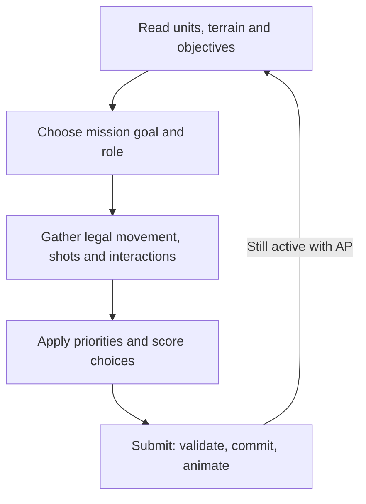

# AI today

The AI reads the live battlefield, pursues its mission, chooses among legal actions and submits through the same game rules as the player. It uses utility scoring inside an ordered policy. There is no fog/perception filter in this path, and no behavior-tree framework.

| Part | Current behavior |
| --- | --- |
| Mission | Rescue, eligible extraction, reach, terminal, protect, survive, then eliminate. Goals respect faction ownership. Intent refreshes during activation. |
| Combat | Shared queries establish legality. Target scores use HP-capped expected damage, actual on-hit finishing damage, wounds, VIP/threat/mission value and soft allied-focus penalties. Shield and edited weapon damage affect finishing priorities. |
| Shield | Shield only lowers damage taken, so it is valued as the expected damage it prevents (real chances and damage, the arc it would face, the capability's accuracy and damage modifiers). The facing that covers the most expected damage is chosen, and a stance worth at least 2.0 expected HP is taken when nothing productive remains. A capacity-limited shield (the Bulwark) is valued only for the attackers it can cover. With only the stance's AP left, a unit with a legal shot compares that shot with the stance and holds the stance only when it is worth at least 1.25 times the shot. Guard stays rule-based. See [step 6 results](claude/ai-step6-results-2026-11-18.md). |
| Move then Attack | A unit with a legal shot and AP to spare also weighs moving first: the best shot sequence from where it stands against the best after one move (at most 12 candidate cells, the destination must pass the exposure check, a clear margin is required, at most once per activation). Carriers, VIPs and rescue escorts do not; Easy keeps shooting from where it stands. Finishing value is the exact kill probability of the shots the unit can afford. See [step 6 results](claude/ai-step6-results-2026-11-18.md). |
| Aim | Compare direct shots with Aim followed by shots against the chosen target, over at most three AP. Use actual ammo/costs/chances, HP-capped expected damage and kill probability. Aim affects only the first shot. Choose direct attacks on ties. This is a short same-target comparison, not a complete planner for movement or future enemy responses. |
| Movement | Shared Move queries and physical route checks remain authoritative. Score progress, directional cover, exposure, firing opportunities and crowding. Hard-reserved candidates are rejected before selection. Recent positions, urgency and safer later advances help avoid idle loops. Situational **movement profiles** (editable presets in `systems/ai/profiles/`: objective route, carrier, escort, defensive, aggressive, flanking, support) multiply the position terms on top of the difficulty and commander weights; the rules that choose one and the reason are in each decision's `movement_profile` and F3. See [step 7 results](claude/ai-step7-results-2026-11-18.md). |
| Carrier / escort | Carriers seek extraction and avoid chasing enemies. Escorts can shoot threats, clear a corridor, move ahead through a bottleneck or rejoin/spread around the carrier. Carrier forward progress and legal least-bad detours remain available. VIP follow chooses the nearest eligible player, with stable-ID ties. |
| Squad claims | Player/allies share one context; enemies have another. Use tactical IDs, falling back to names only for unregistered fixtures. Replacement releases old destinations; activation/round cleanup and live-roster pruning release obsolete owners/targets. Claims expire no later than the next round; losing the passenger releases its carrier corridor. Changed objective claims release their previous handler. Handler counts still do not assign exclusive roles. |
| Difficulty / commander | Difficulty controls decision quality and bounded seeded lapses. Default/Cautious/Aggressive commander preferences remain separate. They do not change combat rules or available information. |
| Execution / replay | `TacticalActionService` revalidates and commits actions before presentation. Existing lifetime checks remain. These AI-policy changes do not change combat damage/accuracy formulas or replay execution rules. Playback re-executes recorded actions, rather than rerunning the planner. |

## Inspect and test

How one decision flows from the battle to a committed action, and what each stage owns, is in the [decision pipeline](claude/ai-decision-pipeline.md).

Hover a destination and press **F3**. Unit/Tactical show existing authoritative predictions; AI shows the latest explanation plus the latest authoritative outcome. Early movement heatmaps are labeled **selected**. Outcomes separately say **committed** or **rejected**, with transaction/revision data and a linked movement decision ID. Other post-action explanations are labeled explanations; an outcome with decision ID 0 has no preselected movement record. AI simulation records decision count separately from committed/rejected action counts.

Simulation terminal outcomes take precedence over limits reached in the same sampled frame. A genuinely ongoing deadline, stalled state or round limit remains distinct. The existing state-change stall clock is not a measure of useful tactical progress.

Run `.\tools\run_tests.ps1 subsystem -Subsystem ai`. Focused additions: `ai_carrier_reservation_test.gd`, `ai_attack_plan_test.gd`, `ai_simulation_classification_test.gd`; squad and F3 checks also cover replacement/cleanup and allied inspection. See [F3 guide](debug-inspection.md).

## Where to adjust it

- [Difficulty weights](../systems/ai/ai_difficulty_policy.gd): `expected_damage_weight`, finishing/wound/mission/focus/position weights and bounded lapses.
- [Commander preferences](../systems/ai/ai_commander_policy.gd): doctrine composition.
- [Controller](../units/ai_controller.gd): action priority, `MAX_ATTACK_PLAN_AP`, escort spacing and recovery limits.
- [Target/plan scoring](../systems/ai/ai_target_scorer.gd) and [position scoring](../systems/ai/ai_position_scorer.gd).
- [Shared combat tuning](../systems/combat_cover_tuning.tres): actual accuracy/damage. AI reads it; these fixes do not retune it.

`survival_cover_weight` remains an explicitly inactive compatibility field. Named movement profiles and a fuller typed decision pipeline remain milestone 05 work. Planning performance, current-site autonomous mission completion and explicit finer-grained commitment expiry still need the planned baseline/scenarios; passing isolated fixes does not close those investigations.

History: [initial audit and ranked evidence](quality/ai-audit-2026-11-17.md), [repair verification](quality/ai-repairs-2026-11-17.md), [ordered milestone plan](ai-2-plan.md).
