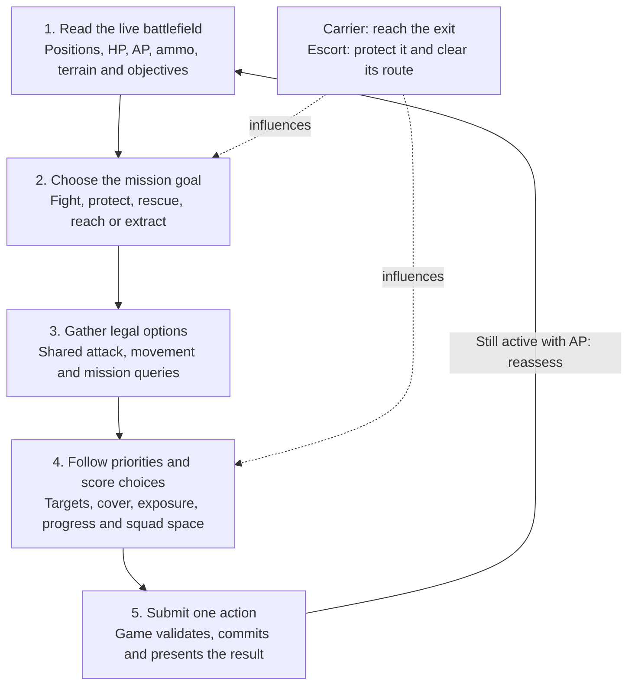

# AI today — milestone 05, step 1

Audit baseline: `e0c5208`, 2026-11-17. This describes existing behavior and ranks follow-ups. **No AI, combat, movement or tuning code changed during this audit.**

The foundation is worth keeping. Units already pursue missions, respect shared action rules, evaluate cover and threats, help rescue carriers and recover from some repeated waits. The main weakness is how those pieces choose between actions and maintain shared intentions, rather than a missing AI architecture.

## The simple picture

This is an explanation of the existing owners, not a proposal for five new systems. The AI currently uses an ordered set of branches with utility scoring inside them; it does **not** compare every complete action plan against every other plan.

## Short behavior sheet

| Part | What happens today |
| --- | --- |
| Information | AI reads live team rosters, exact positions/stats, tactical terrain and objectives. Hostility comes from `FactionRules`. There is no perception/memory/fog filter in this decision path: a wall can make a shot illegal without making the enemy's position unknown. Difficulty changes preferences/lapses, not these information sources. |
| Mission goal | `ObjectiveManager` prioritizes rescue, eligible extraction, reach, terminals, protection, survival, then elimination. Ownership determines which faction pursues an objective. `MissionIntent` is already typed. Intent is refreshed during activation. |
| Action order | Ordinary activation: Emergency Seal first; an escort already clear of the carrier route may shoot immediate threats; then mission interaction/movement; then Aim/Attack, useful Reload, approach/support movement, safe further advance, final-AP Shield, Guard or Wait. Exact branches depend on mission, carrying state and AP. This order itself is policy. |
| Shooting | Shared attack queries filter legal targets. Target utility rewards wounds/finishers, hostile VIPs, threats to teammates and mission urgency, while softly discouraging duplicated allied focus. Hit chance/expected damage appear in diagnostics but do not contribute directly to target total. If Aim is legal, enough AP remains for a shot and chance is below 100%, ordinary combat tries Aim first. |
| Moving | Shared Move queries supply reachable destinations. Pathfinder routes give direction; position scoring weighs progress, directional cover, legal incoming/outgoing lanes, close threats and crowding. Route corridors, a hold threshold, recent-position penalties and a bounded urgency increase influence selection. A later advance checks exposure. These preferences are currently constants/branches, not named movement-profile assets. |
| Committing | Controller adapters submit through `TacticalActionService`, which checks current legality/resources, action windows and request revision. Presentation follows committed results. AI checks scene lifetime/control after important waits; movement scoring yields between candidates around a 5 ms scheduling slice. It does not retain one immutable, revision-stamped observation across the whole scoring pass. |

### Allies, escorts and carriers

- **Enemies and allies use the same controller/scorers.** Players use it when F3 enables AI control. Player and allied units share team context/commander preferences; enemies have their own. TurnManager owns activation and prioritizes a carrier within automated ally/enemy rosters.
- **Protection/VIP following:** protectors try to return within an escort radius, then can fight. A following VIP currently approaches the first eligible player in roster order; the trace calls it the nearest escort, which is inaccurate when those differ. Hold-position VIPs wait. This small mismatch needs a controlled role scenario before changing its intended policy.
- **Rescue carrier:** once carrying, it cannot use the ordinary offensive chase branch. It seeks extraction along a cached route, values safety more heavily and may accept a locally poor but legal step to avoid deadlock. Forward progress is preferred when available. Dedicated carrier discovery currently applies to the rescue mission and uses its extraction convention; it is not a general transport-role framework.
- **Escorts:** can prioritize enemies threatening the carrier, clear a reserved corridor, advance ahead through a narrow bottleneck when there is no side tile, rejoin a distant carrier, and seek a spaced supporting position. They avoid extracting ahead of a carrier still transporting the required passenger. Existing rescue checks also cover departure after the passenger boards.
- **Shared intentions:** destinations/corridors are hard reservations; adjacent crowding and duplicated target focus are soft penalties. Objective-handler counts are recorded but do not themselves assign exclusive roles. State resets by round and partly by activation; it lacks explicit time-to-live and comprehensive interrupted-owner cleanup.

## Preserve these useful behaviors

Keep authoritative legality/execution, physical body/route checks, typed mission intent, separate commander preferences and difficulty, seeded bounded lapses, carrier-first safety/progress and escort corridor yielding. Retain recent-position/urgency recovery, free objective interactions at zero AP, reaction-casualty recovery, scene-lifetime cancellation and existing regression assertions. Keep the early movement heatmap; clarify its lifecycle rather than removing it.

## Ranked issues

Rank reflects fix/measurement order, not a claim that every battle encounters every problem. **Reproduced** means a fresh bounded diagnostic; **source-confirmed** means the code path is established but incidence/balance is not measured.

| Rank | Finding and classification | Smallest next step |
| --- | --- | --- |
| **1 — P1** | **Carrier candidate can cause a script error — reproduced.** A hard-reserved tile produces a score without `progress`; the carrier forward-filter reads it anyway. [#35](https://github.com/Melo9002/fusefire-proving-grounds/issues/35). | Reject hard constraints before carrier option selection; add a real carrier/reservation regression. Preserve least-bad legal detours. |
| **2 — P1** | **Replaced destination leaves an orphan claim — reproduced.** Reserving A then B for one actor leaves A after the next activation cleanup; other units still treat A as forbidden until round reset. [#36](https://github.com/Melo9002/fusefire-proving-grounds/issues/36). | Enforce one current destination per actor; test replacement/cleanup before extending expiry and interrupted-owner handling. |
| **3 — P2** | **Simulation status/reason can disagree — source-confirmed existing bug.** Terminal status overwrites an earlier deadline classification without clearing its reason. Round/AP changes also count as activity, so the current stall metric is not a tactical-progress metric. [#3](https://github.com/Melo9002/fusefire-proving-grounds/issues/3). | Fix terminal/deadline precedence with a controlled boundary check before treating baseline totals as reliable. Measure useful progress separately. |
| **4 — P2** | **Scores are not relative to the actual attack/plan — source-confirmed policy gap.** Fixed 25-HP finishers ignore edited damage/Shield; chance and expected damage do not directly rank targets. Automatic Aim does not compare Aim→Attack against two attacks. [#28](https://github.com/Melo9002/fusefire-proving-grounds/issues/28), plan step 6. | Use authoritative attack facts; compare a few short plans deliberately. This is a policy change, not an attack-legality fix. |
| **5 — P2** | **Shared intentions need a clearer lifecycle — source-confirmed design gap.** Node names identify owners; claims mostly expire by round/activation. Cached carrier routes and commitments are not comprehensively invalidated on changed intent/death/extraction. Actual action submission still validates legality. | Build on #36 with stable tactical IDs and explicit release/revalidation. Test a crowded exit and an interrupted carrier; do not replace squad coordination wholesale. |
| **6 — P2** | **Traces mix intentions and executed actions — source-confirmed.** Move can be published before submission and remain after rejection; decision records do not link an outcome/revision/transaction. Simulator decision count is therefore not committed-action count. [#38](https://github.com/Melo9002/fusefire-proving-grounds/issues/38). | Retain early previews, label selected/committed/rejected phases, correlate existing action-service evidence and distinguish metrics. |
| **7 — P2** | **F3 misses allied squad context — reproduced inspection regression.** Allied enum value 2 is used as a lookup key although player/allies share team key 0. Gameplay coordination exists; inspection can falsely say none. [#37](https://github.com/Melo9002/fusefire-proving-grounds/issues/37). | Use a read-only team-aware lookup without creating/resetting context. Add allied inspection coverage. |
| **8 — investigation** | **Planning cost and current-site mission completion remain incompletely measured.** Goal movement repeats path/shot work per candidate. Several escort/survival loops lack the general movement loop's between-candidate yielding. Explicit 0.6 s activation/0.25 s action delays are presentation, not planning. [#4](https://github.com/Melo9002/fusefire-proving-grounds/issues/4), [#5](https://github.com/Melo9002/fusefire-proving-grounds/issues/5). | Step 2: fixed-seed baselines with thinking/presentation separated, progress/waits and genuine completion. Do not add buffering or remove body checks without measurements. |

Two lower-priority source notes: VIP follow messaging above; `survival_cover_weight` is intentionally retained but inactive, so tuning it currently does nothing. Equal-score decisions often follow existing candidate order; one passing authored determinism check does not establish every map/role is deterministic.

## Evidence and limits

Audited controller activation, all mission branches, target/position scorers, difficulty/commander composition, squad bookkeeping, TurnManager, controller/service adapters, simulator and F3 lookup. Main sources: [AIController](../units/ai_controller.gd), [mission goals](../systems/objectives/objective_manager.gd#L146), [target scorer](../systems/ai/ai_target_scorer.gd), [position scorer](../systems/ai/ai_position_scorer.gd), [SquadContext](../systems/ai/squad_context.gd), [commander](../systems/ai/ai_commander_policy.gd), [execution authority](../systems/actions/runtime/tactical_action_service.gd#L859), [simulator](../systems/simulation/ai_match_simulator.gd), [inspection](../ui/debug_inspection_snapshot.gd).

Fresh AI subsystem run: **23 passed, 0 failed, 1 explicit-only batch skipped**, 326.29 seconds. Command: `.\tools\run_tests.ps1 subsystem -Subsystem ai`. Logs: `artifacts/test-results/20261117-210313-subsystem-ai/`. Includes mission intent, difficulty/commanders, target/position scoring, abilities, same-seed authored decisions, scene lifetime, defeat recovery, escort/rescue/carrier support, squad state and survival. No script/parser or resource-leak diagnostics were found in those suite logs. The separate intentional failure probe below is excluded from that passing total.

The suite's existing stalemate check completed Depot extraction seed 25005 and compatibility Refinery elimination seed 25100; these are specific existing cases, not proof of every current-site mission. Their wall times are regression-run observations, not isolated planning benchmarks. The environment still reports its root-certificate-store warning. No human/rendered playthrough, new difficulty tuning, planner benchmark, full current-site rescue matrix or saved-replay matrix was performed for this step. Existing fixtures remain useful but many use the authored mechanics scene or explicit compatibility maps. Step 1 is an audit; milestone 05 is not complete.

### Bounded defect reproduction

A disposable local script (`artifacts/ai-audit-probe.gd`, log with the same stem) loaded Tactical Test Range seed 1. It confirmed player/ally context sharing and the incorrect F3 key; reserving (1,0,16) then (1,0,17) for one actor and beginning its next activation left (1,0,16) reserved.

For the carrier case, a small AI subclass supplied one physically legal candidate (1,0,17), reserved by another ally, on the real route (1,0,16)→(1,0,18). A valid unit reference set the carrying predicate; this was a targeted path reproduction, not a completed rescue. The real `_move_along_goal_path` emitted `Invalid access to property or key 'progress'` at controller line 872 and returned false. **This diagnostic reproduced a failure despite exit 0.** Its script-error log is not a green test or a native engine crash. The eventual regression must assert error-free rejection and useful alternatives, rather than preserving the faulty result.
