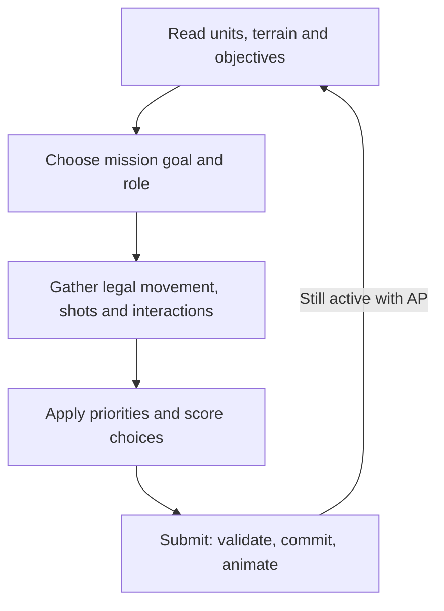

# AI today

The AI reads the live battlefield, pursues its mission, chooses among legal actions and submits through the same game rules as the player. It uses utility scoring inside an ordered policy. There is no fog/perception filter in this path, and no behavior-tree framework.



| Part | Current behavior |
| --- | --- |
| Mission | Rescue, eligible extraction, reach, terminal, protect, survive, then eliminate. Goals respect faction ownership. Intent refreshes during activation. |
| Combat | Shared queries establish legality. Target scores use HP-capped expected damage, actual on-hit finishing damage, wounds, VIP/threat/mission value and soft allied-focus penalties. Shield and edited weapon damage affect finishing priorities. |
| Shield | Shield only lowers damage taken, so it is valued as the expected damage it prevents (real chances and damage, the arc it would face, the capability's accuracy and damage modifiers). The facing that covers the most expected damage is chosen, and a stance worth at least 2.0 expected HP is taken when nothing productive remains. A capacity-limited shield (the Bulwark) is valued only for the attackers it can cover. With only the stance's AP left, a unit with a legal shot compares that shot with the stance and holds the stance only when it is worth at least 1.25 times the shot. Guard stays rule-based. See [step 6 results](claude/ai-step6-results-2026-11-18.md). |
| Move then Attack | A unit with a legal shot and AP to spare also weighs moving first: the best shot sequence from where it stands against the best after one move (at most 12 candidate cells, the destination must pass the exposure check, a clear margin is required, at most once per activation). Carriers, VIPs and rescue escorts do not; Easy keeps shooting from where it stands. Finishing value is the exact kill probability of the shots the unit can afford. See [step 6 results](claude/ai-step6-results-2026-11-18.md). |
| Aim | Compare direct shots with Aim followed by shots against the chosen target, over at most three AP. Use actual ammo/costs/chances, HP-capped expected damage and kill probability. Aim affects only the first shot. Choose direct attacks on ties. This is a short same-target comparison, not a complete planner for movement or future enemy responses. |
| Movement | Shared Move queries and physical route checks remain authoritative. Score progress, directional cover, exposure, firing opportunities and crowding. Hard-reserved candidates are rejected before selection. Recent positions, urgency and safer later advances help avoid idle loops. Situational **movement profiles** (editable presets in `systems/ai/profiles/`: objective route, carrier, escort, defensive, aggressive, flanking, support) multiply the position terms on top of the difficulty and commander weights; the rules that choose one and the reason are in each decision's `movement_profile` and F3. See [step 7 results](claude/ai-step7-results-2026-11-18.md). |
| Carrier / escort | Carriers seek extraction and avoid chasing enemies. A clear route takes precedence. When friendly occupancy closes every exit route, the squad can identify a corridor for escorts to yield, while the carrier waits for live passage. A blocking escort prefers a legal move off the lane and can advance along it if needed. Escorts clear of the lane can engage threats or rejoin the carrier. VIP follow chooses the nearest eligible player, with stable-ID ties. |
| Squad claims | Player/allies share one context; enemies have another. Use tactical IDs, falling back to names only for unregistered fixtures. Replacement releases old destinations; activation/round cleanup and live-roster pruning release obsolete owners/targets. Every claim lasts one round at most and ends sooner when its basis goes: a defeated owner or target is released at the moment of defeat, an owner that left its cell releases it, a carrier's lane is trimmed as the carrier passes cells and released when the carrier is no longer carrying, leaves the lane or its exit moves, and a completed or failed objective drops its handlers. A shot likely to finish a target is not discouraged by allied fire already on it (healthy targets still spread fire). A carrier replans its route when the map changes. Each release is recorded with its reason (`SquadContext.expiry_log`). Handler counts still do not assign exclusive roles. See [step 8 results](claude/ai-step8-results-2026-11-24.md). |
| Difficulty / commander | Easy skips Move → Attack comparison, Normal uses it, and Hard also discounts wound priority by the chance an affordable shot connects. Easy and Normal retain seeded near-best combat lapses, while objective-route moves avoid lapse rolls. Commander doctrine composes preferences separately from those capabilities. See [Step 10 results](quality/ai-step10-difficulty-pacing-2026-11-24.md). |
| Execution / replay | `TacticalActionService` revalidates and commits actions before presentation. Existing lifetime checks remain. These AI-policy changes do not change combat damage/accuracy formulas or replay execution rules. Playback re-executes recorded actions, rather than rerunning the planner. |

## Inspect and test

How one decision flows from the battle to a committed action, and what each stage owns, is in the [decision pipeline](claude/ai-decision-pipeline.md).

Hover a destination and press **F3**. Unit/Tactical show existing authoritative predictions. Open Timeline for the recorded decision, retained alternatives, and squad commitments at publication. A matching action receipt identifies the commitment or rejection. Some outcomes have no corresponding decision row, such as reactions. Guard explanations state the tactical condition the planner actually used. For profiling, the simulator's `profile-ai` flag separates synchronous planner work, frame waits, pacing, and action execution. [F3 guide](debug-inspection.md) · [Step 11 evidence](quality/ai-step11-profiling-f3-2026-11-24.md).

Simulation terminal outcomes take precedence over limits reached in the same sampled frame. A genuinely ongoing deadline, stalled state or round limit remains distinct. The existing state-change stall clock is not a measure of useful tactical progress.

Run `.\tools\run_tests.ps1 subsystem -Subsystem ai`. Focused additions: `ai_carrier_reservation_test.gd`, `ai_attack_plan_test.gd`, `ai_simulation_classification_test.gd`; squad and F3 checks also cover replacement/cleanup and allied inspection. See [F3 guide](debug-inspection.md).

## Step 9 evidence — mission roles and carrier recovery

Baseline `d389a3b111a3f0244724628e96658d7d6de39442` already revalidated squad commitments, released defeated handlers, reopened rescue when a carrier fell, and refreshed mission intent on activation and between actions. Handler claims are non-exclusive. A surviving eligible unit can choose a reopened objective without a separate promotion system.

### Reproduced failure and correction

An ally occupied the only extraction lane. The live pathfinder correctly refused a complete route through the body. The escort planner consequently saw an empty corridor, moved backward from `(12, 0, 10)` to `(11, 0, 10)`, and described its new position as keeping the route clear. The carrier waited. This occurred both with a legal side recess and when the recess was closed.

The controller now revalidates committed routes against current terrain and occupancy. When a clear route exists, it continues to use that route. When all live routes fail, a read-only path search can show the squad where friendly units could make room. This search keeps terrain and non-teammates in the way and never changes the grid or supplies the carrier's movement path. Escorts already on the lane try a legal side destination first and can move strictly forward through a bottleneck. The shared movement query and action service still determine legality and commit each move. Carrier wait explanations distinguish a lane blocked by teammates from the absence of a reachable lane.

### Controlled scenarios

| Scenario | Observed result |
| --- | --- |
| Occupied exit with a recess | The escort moved to `(12, 0, 11)`. The carrier spent two Move actions and extracted the casualty. |
| Same corridor, recess closed | The escort stayed at the exit on repeated activations. The carrier waited with the lane-blocked explanation. Neither actor submitted a rejected action. |
| Occupied exit plus open alternate | The escort made an ordinary support move. The carrier took the open route and extracted without a yield request. |
| Two occupied choke points | The first yield left the route blocked. The second escort took its own recess and the carrier subsequently extracted. |
| Defeated carrier | The actual defeat lifecycle dropped the passenger and reopened rescue. The other AI read the reopened objective and committed Rescue. This behavior already passed on Step 08. |

`ai_decision_scenarios_test.gd` contains the controlled activations. The corridor fixture exercises swept occupancy on a controlled floor and verifies the available recess with the authoritative Move query. The existing squad commitment scenarios cover a moved exit, changing terrain, and a carrier leaving a lane. Existing rescue/replay checks cover action outcomes and state reconstruction.

Against Step 08 production code, the single-blocker regression failed three assertions. It caught the missed yield, missed extraction, and useless backward move with the recess closed. On the review code, the expanded scenario script passed all 194 checks. The 25 selected AI, mission, rescue, traversal, and replay checks passed in 342.26 seconds. The focused selection included carrier support and loss, squad commitment scenarios and expiry, AI determinism and stall recovery, objective navigation, terminal and evacuation actions, rescue/departure replay, and loaded-carrier traversal. Catalog validation passed with 303 scripts and matching entries. Project import and all 27 smoke tests passed locally in 99.02 seconds. The remaining Ironclad tests and human playtesting were outside this verification.

### Mission families and expected roles

| Mission | Role checked | Victories out of six, before and after |
| --- | --- | ---: |
| Elimination | Approach and attack hostile combatants with legal movement and shots. | 5 |
| Protection | Protect the VIP while completing elimination. | 4 |
| Rescue | Secure the casualty, support the carrier, then deliver the casualty to extraction. | 4 |
| Reach | Advance to the current designated zone. | 6 |
| Survival | Preserve the squad until the timer unlocks extraction, then evacuate. | 4 |
| Extraction | Move eligible units into the exit and submit Extract, including free extraction after the last movement AP. | 4 |
| Enemy evacuation | Fleeing enemies try to extract while the player squad eliminates them before they escape. | 3 |
| Terminal | Approach an eligible interaction cell and activate the objective, even after spending the last movement AP. | 6 |

Both 48-match matrices ran on headless Godot 4.7.2 with Normal policy, Generic units, all three current sites, and seeds 16 and 17. The runs took about 578 and 579 seconds respectively. All 48 pairs had identical decision sequences, action outcomes, mission and round results, sampled objective/HP/alive progress, and final state signatures. Each run had 36 victories, 12 defeats, zero stalls or timeouts, 260 total rounds, 3,329 decisions, 3,305 committed actions, and zero rejected actions. There were 314 Wait decisions, two direct move returns, and 78 round intervals without sampled objective, HP, or alive-count changes in each run. Neither matrix exercised a yield, so the controlled scenarios are the evidence for the recovery itself.

All three seed-17 enemy evacuation runs ended in round 3 after an enemy used a legal Extract. In the Depot trace an enemy reached the exit after the player eliminated its two teammates. That is a resolved mission loss. The checked traces establish the escape and the lack of a technical stall. They leave the availability of a better intercept open for the difficulty and encounter review.

Reproduce the comparison from the two revisions.

```powershell
godot_console --headless --path . --script res://tests/ai_baseline_report.gd -- tag=step09-before
godot_console --headless --path . --script res://tests/ai_baseline_report.gd -- tag=step09-after
python tools/quality/ai_baseline_compare.py artifacts/ai-baseline/step09-before artifacts/ai-baseline/step09-after
```

Run the first simulation from the baseline revision and the second from the review revision, retaining both artifact directories for the comparator. The harness's direct A→B→A move counts and unchanged objective/HP/alive round samples are diagnostics. They can include legitimate repositioning and defensive rounds.

### Limits

The recovery path coordinates one rescue carrier and reserves its lane with the existing squad context. It does not search combinations of several actors' future moves. A human-controlled or inactive teammate may still hold a lane. Yielding currently identifies blockers by their lane cell, so a swept-body obstruction caused solely from an adjacent cell can still require separate handling. Mission balance and defensive tradeoffs remain Step 10 work.

## Where to adjust it

- [Difficulty weights](../systems/ai/ai_difficulty_policy.gd): `expected_damage_weight`, finishing/wound/mission/focus/position weights and bounded lapses.
- [Commander preferences](../systems/ai/ai_commander_policy.gd): doctrine composition.
- [Controller](../units/ai_controller.gd): action priority, `MAX_ATTACK_PLAN_AP`, escort spacing and recovery limits.
- [Target/plan scoring](../systems/ai/ai_target_scorer.gd) and [position scoring](../systems/ai/ai_position_scorer.gd).
- [Shared combat tuning](../systems/combat_cover_tuning.tres): actual accuracy/damage. AI reads it; these fixes do not retune it.

`survival_cover_weight` remains an explicitly inactive compatibility field. Later milestone 05 work covers difficulty, encounter pacing, planning cost, and broader validation.

History: [initial audit and ranked evidence](quality/ai-audit-2026-11-17.md), [repair verification](quality/ai-repairs-2026-11-17.md), [ordered milestone plan](ai-2-plan.md).
