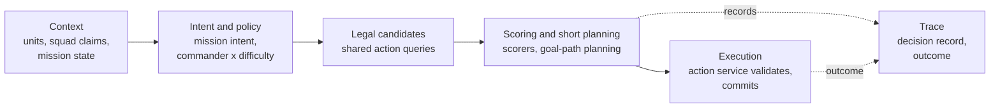

# AI decision pipeline

How one AI decision flows from the battle to a committed action, who owns each stage, and what crosses the boundaries. This describes the code as of milestone 05 step 4; it adds no new service. The stages are responsibilities inside existing owners, not five components.

| Stage | Owner today | What crosses the boundary |
| --- | --- | --- |
| Context | `AIController._on_active_unit_changed`; the team's `SquadContext` from `BattleController.get_squad_context`; hostile and friendly lists. No fog of war: the AI reads the live battlefield. | Live nodes and the squad context. |
| Intent and policy | `MissionIntent` from the objective manager; `AICommanderPolicy.compose(AIDifficultyPolicy)` built once by `AIController._ensure_policy`. | `MissionIntent`; the composed policy resource. |
| Legal candidates | `BattleController.query_attack`, `query_move`, `query_aim` and the other shared queries over `TacticalActionService`. The UI and replay use the same queries, so an attractive score cannot make an illegal action legal. | Query results with costs, chances, damage and rejection reasons. |
| Scoring and planning | `AITargetScorer`, `AIPositionScorer`, the Aim-versus-attack comparison (`AITargetScorer.shot_sequence_value`), and goal-path planning in `AIController._move_along_goal_path` (with `Pathfinder.planning_costs_to_goal`). | Score dictionaries from the scorers; typed `AIPositionCandidate` and `AITargetCandidate` records for every option considered. |
| Execution | `BattleController.try_*` submits through `TacticalActionService`, which revalidates against the current state revision and commits. | A request carrying the expected revision; a committed result or a rejection. |
| Trace | `AIDecisionRecord` (with `AIDecisionContext`) built by the controller; `BattleController.record_ai_decision` adds the decision id, state revision, difficulty and commander, then emits `ai_decision_recorded`. Authoritative outcomes use `ai_action_outcome_recorded`. | Plain dictionaries with the established keys, for F3, the simulator and tests. |

## Typed records

| Record | Purpose |
| --- | --- |
| `AIPositionCandidate` | One movement option: cell, score, summary, score components, rejection reason, chosen flag. |
| `AITargetCandidate` | One hostile considered: target, cell, score, chance, expected damage, components, rejection reason and validation code, chosen flag. |
| `AIDecisionContext` | What the AI knew when it decided: commander composition, attack plan, cell, AP, recent move origins, wait streak, hold score, thresholds, urgency, route corridor. |
| `AIDecisionRecord` | One explained decision: stage (`selected` for an early movement preview, otherwise `explanation`), action, subject, reason, alternatives, goal, squad notes, the candidates and the context. |
| `AIPlanningSnapshot` | The board a plan was made against: state revision and occupancy. |

Each decision record has a `to_dictionary()` that reproduces the established trace keys exactly, so F3, the simulator's JSON and existing tests read the same shape as before. Scorers still return dictionaries; typing them is possible later but was not needed for the boundaries above.

## Discarding stale work

Planning yields between frames, and the board can change while it waits. Three layers discard stale work:

1. **Planning snapshot.** `_move_along_goal_path` captures an `AIPlanningSnapshot` and abandons the plan if the state revision or any unit position changed after a yield (`AIPlanningSnapshot.is_stale`).
2. **Liveness.** After each awaited action the controller checks that the unit, turn manager and battle still exist (`_battle_is_live`). Recording a decision, publishing a movement preview and ending a turn do the same, so work resumed after the scene went away records and ends nothing.
3. **Authoritative commit.** The action service rejects a request whose expected revision is old, so a plan that slips past the first two still cannot commit against a changed state.

A unit that has just extracted is freed on purpose, so the post-extraction steps check the turn manager rather than the unit.

## Keep in mind

- Selecting a decision in F3 never recomputes it: the records are the decision as made.
- An Attack record still carries the movement candidates of the last movement plan in that activation (the controller does not clear them). F3 hides them for attacks so they do not read as a fresh choice; clearing them at the source would change the established trace.
- `AIController._run_activation` is still one long loop that mixes the stages for the whole activation. Splitting it was deliberately left out of step 4: it is the riskiest change and the typed boundaries above are what a later split would need.
