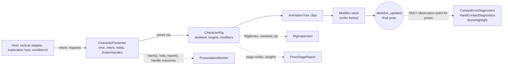
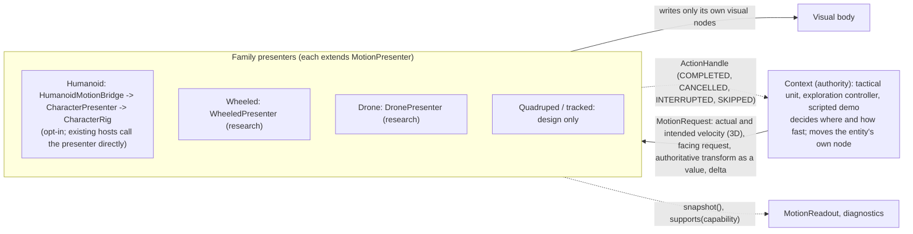
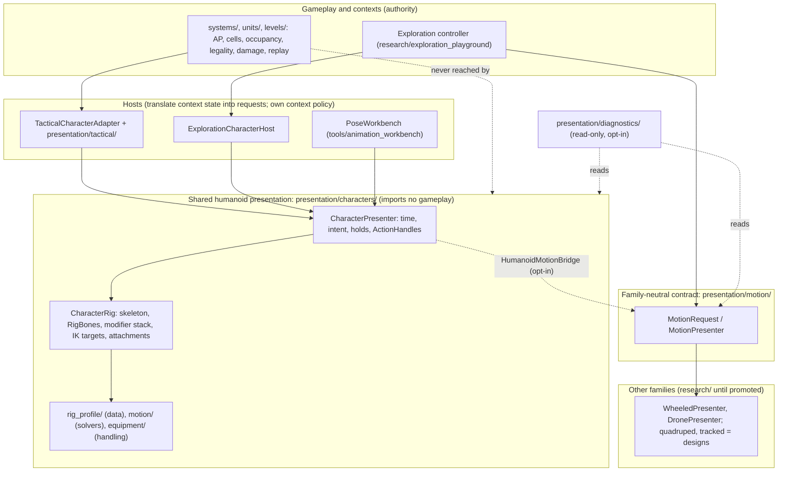

# Character animation: architecture and developer guide

The maintained guide to FuseFire's character presentation. It describes the code as it is at the end of the fourteen-task animation roadmap (Task 14): the humanoid stack built in Tasks 07 to 11, the diagnostics and workbench (Task 12), the non-humanoid motion contract (Task 13) and the validation and quality gates (Task 14). Start with [The architecture at completion](#the-architecture-at-completion-task-14) for the one-page summary, the gates and the extension procedures. The dated reports in [`docs/claude/`](claude/README.md) (audits, the Task 02 to 06 designs, the Package 1 to 10 migration reports) are history; read this page for the current shape.

Sign-off corrections (2026-11-23): [lifecycle, successful traversal and verification contracts](quality/task14-signoff-corrections-2026-11-23.md). Teardown is terminal; create a fresh presenter for a new character lifetime.

## The picture

Gameplay decides what happens and owns authority (AP, cells, occupancy, legality, movement completion, damage, objectives, replay). A **context host** turns the game's (or a tool's) state into presentation requests. One shared **presenter** per character owns presentation time and intent. A **rig** applies poses to the skeleton. Presentation may change transforms, poses, effects and timing; it never changes HP, AP, occupancy, line of sight, legality or replay outcomes.

```
 gameplay (TacticalUnit, systems/)            authoritative, knows nothing of poses
        |  reads / calls present_*()
 context host   TacticalCharacterAdapter  (tactical)      reads tactical state, chooses requests, cover policy
                ExplorationCharacterHost  (exploration)    a controller's wishes: move, face, crouch, inspect
                PoseWorkbench             (tools)         controls and benches
        |  requests (context-neutral)         drives once per frame: presenter.tick, advance_actions, rig.update_weapon_pose
 CharacterPresenter (RefCounted, in the rig)  time, facing, postures, aim/attack/hit/defeat lifecycles, rescue clock, ActionHandles
        |  typed inputs
 CharacterRig (Node3D)                        skeleton, resolved rig roles (RigBones), modifiers, IK targets, attachments, poses
```

A host is a plain `Node3D` with a `Rig` child. It does not inherit the rig, builds nothing on the skeleton, and the rig has no frame callback of its own: the host advances the character exactly once per frame. Ratchets in `tests/animation_module_boundaries_test.gd` enforce this.

## Who owns what

| Responsibility | Owner |
| --- | --- |
| AP, cells, occupancy, legality, movement completion, damage, objectives, replay | gameplay (`units/`, `systems/`); unchanged by presentation |
| Reading tactical state, choosing which presentation to request, tactical cover policy (`CoverEdgePolicy`, `CoverEdgeSelector`), route expansion (`TacticalRouteBuilder`), camera anchors, team ring and class marker | `TacticalCharacterAdapter` and `presentation/tactical/` |
| Presentation time, facing, posture arbitration (`PostureArbiter`), aim hold, attack sequence, hit and defeat lifecycle, the rescue clock, pending pickup, `ActionHandle`s | `CharacterPresenter` |
| Skeleton configuration, bone roles, the modifier stack and its order, IK targets, weapon and passenger attachments, equipment presentation, unarmed arms | `CharacterRig` |
| What the body is (bones, roles, joints, sockets, measurements, capabilities) | the rig profile, `presentation/characters/rig_profile/` and `art/characters/<name>/<name>_rig_profile.tres` |
| How it moves (gait tables, profiles, pure solvers for ladders, stairs, paths) | `presentation/characters/motion/` |
| What it carries (handling profile, equipment requirements) | `presentation/characters/equipment/`, optional per character |

The reusable cover **body-motion** numbers (yaw offsets, crouch depths, clearances, speeds) are `CoverPostureProfile` (`motion/`, exported on the rig). The tactical **edge-selection** numbers are `CoverEdgePolicy` (`presentation/tactical/`, owned by the host).

### Cover facing and release

The rig node's yaw is the facing selected by its host. `CoverPostureProfile.yaw_offset()` supplies a relative body turn. The presenter resolves the posture request and `CharacterRig` drives the offset on `character_root`. `CharacterAnimationController` deliberately leaves that axis alone when changing clips, so repeated clip changes and cover posing can coexist.

ADDA previously drove body yaw only while its cover demo existed. **Leave** released the request, but later frames applied only depth and kneel, so the rig kept the last cover offset (45° on both MIRA rigs in the traversal repro). The direct cover-to-traversal shortcut forced the heading and local offset to zero, masking the problem on that path. The Workbench now continues applying the resolved yaw after release, like the tactical and exploration hosts. Preview turns use the rig-facing channel. On exit the Workbench restores the heading from before the temporary wall/target facing, preserves the visible heading at the handoff, and lets the shared posture ramp settle it. Idle, walk, aim, stairs, and ladder all use that same release.

Regression coverage starts with a real cover offset, samples its first frame of release, and checks the settled facing after each action on MIRA and Small MIRA. Run `.\tools\run_tests.ps1 select -Test workbench_cover_release_test,cover_edge_selection_test,exploration_actions_test`. The tactical and exploration tests sample the running gameplay hosts. The Workbench fixture also supports rendered screenshots:

```powershell
godot_console --path . --resolution 1280x720 --rendering-method gl_compatibility --script res://tests/workbench_cover_release_test.gd -- capture=res://artifacts/cover-release/rendered
```

The original 44-assertion reproduction had 18 failures on `707a1e2`. The final fixture passed 52 assertions headless and 66 with 14 screenshots. For each rig the stair and ladder transitions measured 45.0° at release, 39.7° one 60 Hz step later, and 0.0° settled. Idle and its subsequent aim preserved a 31° heading. A 70° walking turn from 19° settled at 89°. Project import and ten targeted Ironclad tests passed across the focused run and reruns, including in-engine cover release in a tactical battle and both rigs in the exploration playground. The screenshots document the sampled poses. They are not a traversal animation quality review.

## Where things live

```
presentation/characters/        shared: no tactical, exploration or base types, no gameplay imports
  presenter/                    CharacterPresenter, PresentationTypes/Intent, ActionHandle, AttackHandle/AttackSequence/AttackHost,
                                AimHold, PostureArbiter, WeaponReadiness, RescueInteraction
  rig/                          CharacterRig, RigBones, RigAxes, animation controller, fallback clip builder, ChestAnchor,
                                RescuePassenger, PassivePassengerPose, typed pose state (LadderClimb/Pose, StairWalk/Pose, WeaponPoseBinding, ...)
    modifiers/                  Locomotion, CoverCrouch, Traversal, WeaponPose, HandGrip modifiers; PoseOwnership
  rig_profile/                  RigProfile, RigAnatomy, RigResolver, roles, joint specs, sockets, diagnostics (pure data)
  motion/                       LocomotionProfile/Gait, Traversal and Stair profiles and solvers, PathRefiner, CoverPostureProfile
  equipment/                    WeaponHandlingProfile, EquipmentPresentation
presentation/exploration/       the non-tactical host: ExplorationCharacterHost (reads no tactical type; ratcheted)
presentation/tactical/          the tactical host and its policy: TacticalCharacterAdapter, TacticalActionPresenter, CoverEdgeSelector,
                                CoverEdgePolicy, TacticalPoseContext, TacticalRouteBuilder
presentation/diagnostics/       hand-contact diagnostics (read the rig, never write it)
tools/animation_workbench/      ADDA — Workbench (the animation workbench): pose_workbench.tscn, its panel tabs (ui/), scenarios, locomotion test panel
tools/quality/                  pose_trace, route_trace, animation_perf_baseline and probes
art/characters/mira_0/          model, rig profile (mira_0_rig_profile.tres), runtime/mira_0_unit_visual.tscn (the production character)
tests/                          flat; tagged in tests/catalog.json
research/                       evidence only: update-order probe, exploration playground (the Task 03 host probe was retired into exploration_host_test)
```

Modifier order (declared in `PoseOwnership`, checked by `pose_ownership_test`): Locomotion, CoverCrouch, Traversal, TraversalLegIK, TraversalFoot, WeaponPose, WeaponArmIK, HandGrip. IK results are valid only at `skeleton_updated`, not between updates.

## How a context host uses CharacterPresenter

1. Add a scene with a host `Node3D` and a `Rig` child (a `CharacterRig` with `character_scene`, `rig_profile`, optional `weapon_scene`). See `art/characters/mira_0/runtime/mira_0_unit_visual.tscn` for the production shape.
2. In the host, resolve the rig (`rig`, `presenter = rig.presenter`) and, before it builds, set `rig.loaded_query` (when the context says the character is a loaded carrier) and `rig.aim_blend_follows_clips` (false if the host drives readiness itself). The tactical adapter does this in `_enter_tree`.
3. Each frame, in this order: feed motion (`presenter.set_movement_authority`, `report_velocity` or `set_scripted_motion`), `presenter.tick(delta)`, any host policy (posture requests via `presenter.postures`, `presenter.apply_posture`), `presenter.advance_actions(delta)`, then `rig.update_weapon_pose()`. The presenter advances exactly once per frame; `presentation_frame_driver_test` checks it.
4. Ask for actions through the presenter and rig (`begin_pickup`, `begin_release`, attack, hit, defeat) and await the returned `ActionHandle` (COMPLETED, SKIPPED, INTERRUPTED, CANCELLED). A handle describes the visual operation only; gameplay outcomes never depend on it.
5. Read `presenter.intent()` for the character's persistent state (posture, facing, equipment, readiness) when something else needs it.

`TacticalCharacterAdapter` is the tactical example; `ExplorationCharacterHost` is the minimal context-neutral one; `tools/animation_workbench/pose_workbench.gd` is the third. Nothing in the shared module may import gameplay.

### The non-tactical host (Task 08)

`ExplorationCharacterHost` (`presentation/exploration/`, scene `art/characters/mira_0/runtime/mira_0_exploration_visual.tscn`) hosts the same rig scene as the tactical unit (`mira_0_rig.tscn`) with no unit, turns, AP, cover or combat state. A controller asks for: `report_velocity(world_velocity, delta)` (the presenter turns the body toward it and derives the gait), `face_point` / `face_yaw`, `set_crouched(on)` (a CONTEXT-priority posture request) and `inspect(world_point, seconds)`, which turns to the object, bends toward it and returns an `ActionHandle` (COMPLETED when the hold ends, INTERRUPTED when the controller walks away or the host is removed, CANCELLED if one is already running). The host selects the clip state (`move` or `rifle_idle`) and drives the frame: presenter tick, posture, action stage, `rig.update_weapon_pose()`. Equipment is the scene's choice: set `rig.weapon_scene = null` before the host enters the tree for an unarmed MIRA. `ExplorationSpawnGuard` (same folder) is the mode's fall safety net: a body that falls out of the world is let fall for a moment, then returned to the nearest spawn point (any `Node3D` in group `exploration_spawn`) with its velocity cleared; the controller then calls `host.reset_motion(yaw)`. A controller should move its body per rendered frame (speed times that frame's delta), not on 60 Hz physics ticks: stepping only on ticks while the camera and animation run per frame shows as a tremor at higher frame rates. The host also offers `set_aiming` and `fire` (the shared attack sequence through a small `AttackHost`), `react_hit` and `defeat`, `enter_cover`/`leave_cover` (the shared cover posture), `begin_climb`/`set_climb_height`, `begin_stairs`/`set_stairs_progress`, and `pick_up(world_point, passenger)`/`put_down` (the shared rescue lift and release; `passenger` is an optional `PassengerDefinition`, and a loaded climb is asked for with `begin_climb`, see the section on carrying someone up a ladder). The example controller is `research/exploration_playground/` (WASD, Shift run, RMB aim, LMB fire, Space cover or a placeholder jump, E climb, lift or inspect, C crouch, Q holster, middle mouse recenters). It is a proof of concept, not an exploration architecture: each action is its own small component (`playground_combat`, `playground_cover`, `playground_traversal`, `playground_carry`, `playground_player_health`, plus mannequins and props). Test: `exploration_actions_test`; render: `tests/exploration_actions_capture.gd`.

## How to add or configure a humanoid rig

A rig is configured entirely by its profile; no skeleton bone name appears in production code (ratcheted).

1. Import the model (a glb with a `Skeleton3D`). Keep its path stable once referenced.
2. Create the rig profile (`RigProfile`): a Godot `BoneMap` of the humanoid roles to this skeleton's bone names, the anatomy (head-top bone, standing height measurements) and sockets. `art/characters/mira_0/mira_0_rig_profile.tres` is the reference; `tests/fixtures/rigs/` holds a synthetic skeleton with entirely different names.
3. `RigBones.from_profile` turns it into the typed roles every stage reads (`hips`, `torso`, arms, legs, fingers, toes, `head_top`). Roles the skeleton lacks are listed in `bones.absent`; a stage that cannot build records why in `bones.degraded` and declines instead of crashing. Check `rig_bones_test` and `rig_profile_test`.
4. Build the character scene as above. The feet are at the visual's origin (the foot-point convention): do not offset the scene; the host composes it (`TacticalUnit` places it `standing_height` below its origin; `presenter.foot_point_problems()` checks the basis).
5. Tune with the workbench (below) and the pose trace.

### A second humanoid (Task 09): what a new character takes

The small medabot-style robot (`art/characters/small_mira_0/`) runs on the same `CharacterRig`, `CharacterPresenter`, modifiers and hosts as MIRA. Its whole difference is data: a model with fixed skinning (`models/small_mira_0.glb`), a rig profile (`small_mira_0_rig_profile.tres`: the same Mixamo role map, `character_scale = 1.2`, so the mesh stands 1.20 m), a weapon handling profile (`small_mira_0_weapon_handling.tres`), and three scenes in `runtime/` (`small_mira_0_rig.tscn`, `_exploration_visual.tscn`, `_unit_visual.tscn`), copied from MIRA's with the character-local numbers in the rig scene scaled by the leg ratio (0.70: arm IK elbow guides, hand-target markers, shoulder contact offset; the handling profile's lowered grip, ready clearance, sling offset and weapon scale). Three different heights are in play, so they are named: the **mesh height** is the top of the model including the robot's ears (the design figure: 1.20 m); the **skeletal stature** is the height of the head-top joint that the rig profile measures (`standing_height`: 1.06 m for the robot, 1.62 m for MIRA; the resolver's plausibility check and the camera framing use it); the **leg length** is hip joint to ankle along the bones, thigh plus shin (0.54 m and 0.77 m; the stair planner, the stride and `body_ratio` use it). Its anatomy against MIRA: stature 1.06 m vs 1.62 m, leg 0.54 m vs 0.77 m (thigh 0.26/shin 0.28 vs 0.39/0.38), torso 18% shorter against its leg, feet 36% longer against its leg, shoulder width 12% wider against hip width, upper arm 10% shorter against its forearm.

What is shared, what is per character:
- **Shared behaviour** (code): the presenter and its arbitration, the locomotion clips (angle tables), the leg and arm IK, the crouch and kneel solvers, the foot stage, the stair planner, the weapon pose, the action handles.
- **Per-character configuration** (data): bone names and roles (profile), anatomy and sockets (profile), weapon handling (grips, lowered grip, ready clearance, sling, scale), arm IK guide positions and hand-target markers (rig scene), camera anchors (unit scene). The measured anatomy (leg, ankle, hip joints, foot size) is never configured: the rig measures it from the skeleton at build.
- **Presentation style**: the locomotion profile (speed thresholds are context policy and stay in m/s; the stride is authored on the reference body).
- **Reference-body lengths**: a few shared lengths in metres were authored for MIRA (stride, pelvis bob and sway, the exploration crouch depth, the wary cover bend, the stair stance roll, heel lift, swing lift, margins and step rise, the crouch balance and kneel constants). They stay in metres for the reference body (`RigBones.REFERENCE_HIP_TO_ANKLE`) and a body scales them by `RigBones.body_ratio` / `CharacterRig.body_ratio()` (its hip-joint-to-ankle height over the reference's; 1 for MIRA, 0.70 for the robot). Depths derived from the world (low cover) are not scaled. The crouch also corrects only a body's DIFFERENCE from the reference rest lean of the legs, so MIRA's tuned poses are unchanged.

Required roles: the hips, the spine to the head, both arms (upper, lower, hand) and both legs (upper, lower, foot). Optional: toes (the foot stage then uses a default foot length), fingers (the hand grip declines and reports it), upper chest, head top. A missing required bone is a resolver error naming the role; a missing optional one is listed in `bones.absent` and the stage that needs it in `bones.degraded`. Equipment compatibility is configuration: the robot draws the same rifle model at 0.57 scale through its own handling profile; an item that cannot be made to fit gets no handling profile instead of a forced pose. The workbench takes `--character=small_mira_0` (or the `character` export): the same host, panel and diagnostics, cameras scaled by the body ratio. Tests: `humanoid_portability_test` (body-relative, with negative controls for the stride scaling and the crouch rest-lean correction, a renamed-bone fixture through the full rig, missing optional anatomy, a required-bone diagnostic) and `posture_body_scale_test`; renders: `tests/humanoid_portability_capture.gd`.

## Equipment and unarmed characters

Equipment is chosen by the scene, never by the rig. `weapon_scene` is null by default: a rig with none initialises, moves, crouches, climbs, carries and is defeated on the same stack, with relaxed arms (`apply_relaxed_hand_targets`: hands hang by the thighs with a neutral wrist, cleared of the thigh by `HAND_THIGH_CLEARANCE`). `rig.has_weapon()` and `rig.equipment_state()` (NONE, HELD, SLUNG) are the truth; readiness is STOWED and an attack request settles SKIPPED without a shot clip. To equip, assign `weapon_scene` (a model with `SupportHandTarget` and `MuzzleSocket` nodes) and a `WeaponHandlingProfile`. No placeholder weapon exists. Tests: `unarmed_humanoid_test`, `unarmed_hand_clearance_test` (mesh penetration, not joint distance).

## Stairs: foot placement and the stance motion

Both contexts use the same stair planner (`motion/stair_foot_planner.gd`, tuned by `StairProfile`): the feet are planned on the treads (one hold per tread at walking pace, every second at speed), alternate left and right, and the pelvis is placed from the feet. With `stance_motion_enabled` (the default) a planted foot is not nailed to one point: through its stance it rolls (the ankle drifts forward by `stance_roll` and the heel comes up by `heel_lift` toward toe-off), where it lands varies a little per tread (`placement_variation`, deterministic: the same every time for the same tread), and the pelvis shifts sideways toward the supporting foot (`pelvis_sway`). It is a pure function of where the body is along the stair, so replay and frame rate are unaffected. Switching it off reproduces the earlier locked-foot behaviour exactly (the tactical pose trace is identical with it off). ### Stairs: terrain contact, foot orientation and balance

The planner knows the rig's real anatomy: `CharacterRig._measure_stair_anatomy` fills the `StairProfile` copy it owns (leg length hip joint to ankle, ankle height above the sole, hip joint offset, foot front/back/half-width) from the skeleton's rest pose through the profile's roles, so no bone names or proportions live in the planner. Reach and knee-fold are measured from the hip JOINTS, not the pelvis origin (`StairFootPlanner.hip_joint`); a window narrower than `REACH_TOLERANCE` (1.5 cm, inside the legs' real 2.3 cm slack) is met in the middle. Feet follow the body across the stair (`lateral_follow_enabled`) and stay wholly on their tread and inside its width (`tread_clamp_enabled`: heel and toe margins, orientation-aware). As the body slows, the gait's feet blend into a terrain stance (`StairFootPlanner.stance_foot`, `contact_foot`, `settle_enabled`): each foot stands on the tread under it, so a stop, a turn across the stair or a body on a riser line settles onto valid treads instead of freezing the stride. The leg IK only places the ankle; `TraversalFootModifier` (stage `TraversalFoot`, right after `TraversalLegIK`, owns foot rotation only) turns each planted foot flat to the tread, heel up by the planner's lift, and a swing foot part way (before it, the shin leaned the foot toes-down and the ball sat 4-5 cm in the tread). Nothing is written when no stair pose is active. Tests: `stair_contact_test` (pure planner plus a rig stopped half way up at the centre and the edge, with negative controls for the lateral follow, the tread clamp, the settle and the foot stage); render: `tests/stair_contact_capture.gd`. Known limits: steep (0.5 m) risers pull the swing foot in up to 12 cm; running is walked on stairs; the foot stage levels the foot but does not plan toe clearance beyond the planner's lift.

A crouch is suspended on stairs and ladders and a run is walked on stairs in the exploration host, because the stair pose owns the legs and the pelvis there. Tactical stairs are ridden kinematically along the route and have no collision; the sandbox staircase has solid treads that are ignored while she is on them.

## Cosmetic effects outside the action lifecycle

These are deliberate and stay outside `CharacterPresenter`'s lifecycles because nothing waits on them and they cannot affect gameplay: the team ring and class marker (`TacticalCharacterAdapter`), the muzzle flash and shot-feedback timer (`CharacterRig`), the passenger's presence fade while boarding (`present_boarding`), the stow blend and carry sway, and, for a standalone rig only, the sights tween (`aim_blend_follows_clips`). Move one into the presenter only if its ownership causes a real timing or lifecycle problem.

## Held Aim pose

A committed Aim keeps the sights up for as long as it lasts: until its attack, an action that cancels it (a Move), a Reload, or the next activation. `TacticalCharacterAdapter` follows the committed `tactical_state.is_aiming` flag (translated into `presenter.aim_committed`) and the presenter's `AimHold` keeps a short release grace so the rifle does not dip while the attack camera moves in. A carrying unit never raises a rifle; a shot, hit, defeat, move or traversal is never interrupted. Test: `aim_hold_presentation_test`.

## The pipeline decision (Task 10): the hybrid stays

Per frame, in order: the host feeds the presenter, the presenter advances time and one-shots, the **AnimationTree** evaluates clips and speed blends (the walk, jog and run are phase-synchronised blend spaces), then the **modifier stack** (`PoseOwnership.STAGE_ORDER`) adds posture, contact and IK, and the weapon and attachments follow the final pose. This was compared with an AnimationTree-centric design (clips and blends only) and a procedural-centric one (everything in modifiers) against FuseFire's needs, and the hybrid is kept:

| Need | Verdict |
| --- | --- |
| Different humanoid proportions | Clips are authored as directions in the body's frame and the modifiers use measured anatomy (`body_ratio`, rig profile): the second humanoid needed no clip or graph change (Task 09). A tree-only design would need per-body clips; procedural-only would lose cheap authored or baked clips. |
| Contacts and equipment (hands on a weapon, feet on stairs, a carried body) | Only possible after the clip, as IK and attachments; the tree cannot express them. |
| Interruption and determinism | The presenter owns time and every one-shot's lifetime (`ActionHandle`); the tree only crossfades (0.12 s) between states and never decides when anything ends. One owner of time, one of completion. |
| Shared tactical, exploration, workbench | The tree and the modifiers are context-free; hosts only choose states and requests. |
| Cost and debugging | One tree, a small fixed modifier order, a table of who writes what (`PoseOwnership`, tested). No second pipeline. |

Known property worth remembering: between skeleton updates the skeleton reports the clip pose; the modifiers' result (the arms, IK, crouch) exists only at `skeleton_updated`. Read final poses there (see `gesture_capability_test`, `exploration_host_test`), and do not expect a clip track on an arm bone to survive the arm stage: arms are placed from IK targets (a held weapon's, or the unarmed hands' from `apply_relaxed_hand_targets`).

## Adding an animation capability (Task 10)

Two kinds exist and keep their separation. **Persistent** state (movement, facing, posture, aim, equipment) is an idempotent request, arbitrated (`PostureArbiter`, readiness, facing) and read back through `presenter.intent()`. A **one-shot** (hit, attack, inspection, rescue lift, defeat, a gesture) has a start, an end and an `ActionHandle` (COMPLETED, CANCELLED, INTERRUPTED, SKIPPED; settles once). Do not add another completion mechanism or a second clock.

**The worked example: `&"acknowledge"`, a nod with a raised, waving hand.** Ask for it with `ExplorationCharacterHost.gesture(&"acknowledge")` (the workbench's `F` key calls the same `presenter.begin_gesture`). It works on MIRA and the small robot, armed (head and torso only, the weapon keeps the hands) and unarmed (the right hand rises), and composes with crouch and aim.

1. **Where it belongs.** The clip's name in `CharacterAnimationController.GESTURES` and its recipe in `CharacterFallbackAnimationBuilder.make_gesture` (a saved clip of the same name overrides the recipe). Recipes use the body's own directions (`_about(bone, axis, degrees)` with the measured up, forward and hinge), never per-bone euler angles, so they fit every humanoid. A procedural part that needs the arms goes through the rig's hand targets (`CharacterPresenter.gesture_hand()` read by `CharacterRig._raised_by_gesture`), because the arm stage runs after the clip. A gesture that wants the hand also goes in `CharacterAnimationController.HAND_GESTURES`; any other gesture (such as the head-only `nod`) leaves the arms alone.
2. **How a host requests it.** `presenter.begin_gesture(clip, restore, seconds)` returns an `ActionHandle`. The host supplies `restore`: a callable that puts the persistent state back (the exploration host clears its selected state so the next frame re-picks walk, aim or idle). That is all a host writes (`gesture()` is a few lines).
3. **Lifetime.** The presenter owns it as a timed hold (`begin_hold`): it counts down in `tick()` on presentation time, is cancelled by `cancel_hold`, and is settled INTERRUPTED by `teardown()`. `restore` runs on normal completion and when the caller cancels the handle (CANCELLED: nobody else took over, so the body goes back to the persistent state); it does not run on INTERRUPTED, where whoever interrupted owns what follows. A refused gesture (SKIPPED) never touches the animation state: the hold is acquired before the clip plays.
4. **Priority and interruption.** Holds have ranks, `PresentationTypes.HOLD_GESTURE < HOLD_INTERACTION < HOLD_REACTION`. A request below the running rank is refused (handle already settled SKIPPED, the running hold untouched); equal or higher supersedes (the older settles INTERRUPTED). A request that names no rank is REACTION, so everything that existed before ranks behaves as before. A gesture is also SKIPPED during a rescue lift, a ladder or stairs, a carried body or an attack, and CANCELLED after defeat (terminal). Movement reported to the exploration host ends any one-shot (INTERRUPTED) and the walk is what follows. Persistent requests (crouch, aim) are untouched by a gesture. The reverse holds too: an action that takes the body (a shot, a lift, a ladder, a staircase) calls `presenter.cancel_gesture()` first, so a gesture never runs under it; a hit or an interaction supersedes it through the rank. Hold observers may start holds of their own while one is being settled: the newest request still wins by rank, and none is orphaned or left behind by `teardown()`.
5. **Clips and blending.** A gesture is a state of the graph; every state crossfades to every other (0.12 s). The clip ends at rest so the fade back is short. Nothing else advances time: the tree plays the clip, the presenter decides it is over.
6. **Procedural parts.** No stage changes: `PoseOwnership` is untouched. Spine and head are ADD-composed on top of posture, so a gesture while crouched nods without disturbing the crouch.
7. **Per-character configuration.** None needed: the recipe is directional and the hand target is a fraction of the measured arm length. A character that needs a different look supplies a saved clip under the gesture's name, or per-rig numbers in its profile.
8. **Observing it.** `await handle.wait()` or `handle.when_done(cb)`; both work on an already-settled (refused) handle.
9. **Testing and visual check.** `tests/gesture_capability_test.gd` (lifecycle, ranks, refusals, restore, both rigs, armed and unarmed, once per frame, negative controls) and the rendered `tests/gesture_capture.gd` (`docs/claude/images/task10/gesture-sheet.png`). Sample poses at `skeleton_updated`, not between updates, and look at a render.

**What the next simple gesture costs.** A gesture that needs no hand touches two production files: the name in `GESTURES` and a recipe in the builder. Task 10's `acknowledge` also needed the presenter (`begin_gesture`, hold ranks, `gesture_hand`), `presentation_types.gd` (ranks), the rig (the hand target) and one host method, because the architecture had no named one-shot entry, no hold priority and no way to ask the arm stage for a hand. Those extension points now exist.

Not wired on purpose: the tactical adapter (the rule is the presenter's, so a tactical use is one call with its `_return_from_hold`), and any combat or AP rule.

## Contacts: who plans, who owns, who applies (Task 11)

Full audit and matrix: `docs/claude/contact-audit-2026-11-22.md`. The rule in one line: **a family plans its own contacts in its own frame; the rig applies a contact to a limb through one typed claim; the modifier order decides who is last.** The stair planner, the ladder solver, the weapon pose and the rescue interaction stay specialised; nothing is shared between feet and hands except the pipeline order (`PoseOwnership.STAGE_ORDER`).

For the **hands** (the one body part with several producers) there is one typed value and one writer:

* `HandContact` (`presentation/characters/rig/hand_contact.gd`): hand (the grip modifier's convention, 0 left, 1 right: the only one), world point, world finger direction, world palm normal, orientation weight, optional closure.
* `CharacterRig.claim_hand_contact(contact)`: moves the wrist target and fills the grip modifier's slot, converting to skeleton space. Nothing else writes `contact_weight`, `contact_forward`, `contact_normal` or a contact's `curl`.
* `CharacterRig.release_hand_contacts()`: runs at the start of every pass that places the hands and when a ladder or carry ends. A hand nobody claims in a pass is the weapon's or the animation's again, so a contact weight can never outlive its producer. (Before this, the last ladder weight stayed on the grip after the hands let go and replaced the rifle's orientation.) The last claim of a pass wins; the producers (ladder, carry, relaxed hang) are mutually exclusive and placed in the existing pass order.

### How to add a new contact-based interaction

1. **Geometry** comes from the environment or the other body (a model, a profile, a contact frame), never from the rig's tactical state. Legality is the tactical layer's; the rig only presents what it is given.
2. **Planning** is a pure function in the family (like `StairFootPlanner` or `TraversalSolver.ladder_pose`): inputs in, positions, weights and phases out, in one stated frame. Convert to a typed pose (`LadderPose`, `StairPose`) once, in the rig, never index a dictionary downstream.
3. **Presentation ownership**: decide which stage owns the limb and add its writes to `PoseOwnership.WRITES` (and an `OVERLAPS` entry if it overlaps another stage). Prefer an existing stage; a new stage needs a reason.
4. **IK application**: for a hand, build a `HandContact` in world space and `claim_hand_contact` it from the pass that places the hands (the placer's methods). For a foot or the pelvis, extend `TraversalPoseInput` and the traversal modifiers. Never write the grip modifier's contact slots directly.
5. **Interruption**: the contact lives only while its producer claims it each pass. End the interaction by stopping the claim (and call `release_hand_contacts()` if the producer's end must be immediate); the next pass restores the weapon or the hang. Cover cleanup in a test: interrupt mid-contact, enter and leave repeatedly, check the final pose at `skeleton_updated`, and run it on both MIRA and Small MIRA.
6. **Unreachable contacts** are the planner's to handle (clamp or report); the arm only stretches toward a target. Measure how often it happens on the smaller body before shipping (the Small MIRA ladder was the example; `TraversalSolver` now reports `hand_reachable` / `foot_reachable` and `ladder_climb_test` measures the final pose on both bodies).

## Diagnostics and the workbench (Task 12)

> **ADDA (AniLab Diagnostic & Debugging Assistant)** is the name of this diagnostic suite today: the Workbench below, the measurement contract, the temporal recorder, findings, reports, comparison, the command line `tools/adda.ps1` and the Why? tab. Start at [`docs/claude/adda/README.md`](claude/adda/README.md) for how to investigate an animation problem (as a person or as a coding agent), what ADDA measures and what it does not, the diagnostic challenges and the measured cost. The paragraphs below describe the original Task 12 layer.

The workbench (`tools/animation_workbench/`, see its README for the panel and scenarios) is a host that inspects the shared stack. Its diagnostics live in `presentation/diagnostics/`, are **read-only, rig-only and opt-in** (nothing in the game creates them), and are usable from any host: `RigInspection` (identity, roles, measurements, capabilities, a compatibility check that does not build a rig), `PoseStageReport` (the stages in real order with declared writes and live weights), `PresentationMonitor` (a live snapshot and a bounded event history from the presenter's public accessors), `ContactErrorDiagnostics` (target against final wrist or ankle, reach margin), `MotionTrail`, `BoneHighlight`, and the older `HandContactDiagnostics`.



Solid arrows are production data flow; dotted ones are the diagnostics' observation points. **Poses are measured only in `skeleton_updated`**: before it, `get_bone_global_pose` is the animation pose without the modifiers. Diagnostics never write, keep no clock (the presenter's `time` is the timestamp), and leave no node or signal connection behind when switched off (`tests/workbench_diagnostics_test.gd`).

### Modifier order and bone ownership

The skeleton's modifier children are the schedule; `PoseOwnership` declares what each may write (`PoseStageReport` shows both, and checks that the order agrees). *Declared* is not *measured*: `tests/pose_ownership_test.gd` is what measures real bone changes.

| # | Stage | Declared writes (role: op) | Engaged when |
|---|---|---|---|
| 1 | Locomotion | hips, spine, thighs, shins: add (twist, bank, pitch, step lift) | any twist, bank, pitch or step lift |
| 2 | CoverCrouch | hips position, thighs, shins, feet: override; spine flexion: replace component; support clavicle: override | crouch depth or kneel above zero |
| 3 | Traversal | hips position: override; thigh and shin: IK targets | traversal weight above zero (ladder, stairs) |
| 4 | TraversalLegIK | thighs, shins: override (solves stage 3's targets) | with Traversal |
| 5 | TraversalFoot | feet: override | stair weight above zero |
| 6 | WeaponPose | upper and forearm: IK targets; support clavicle: override (adds to the posture's base only) | armed and enabled |
| 7 | WeaponArmIK | upper arm, forearm: override (solves stage 6's targets, and the ladder, carry and hang targets) | `ik_enabled` |
| 8 | HandGrip | wrist, fingers: override (a claimed contact replaces the weapon grip's orientation) | weapon grip or a claimed contact above zero |

Intended overlaps (`PoseOwnership.OVERLAPS`): hips position (CoverCrouch then Traversal), thighs and shins (Locomotion adds, CoverCrouch replaces, TraversalLegIK takes by influence), feet (CoverCrouch then TraversalFoot), support clavicle (CoverCrouch sets the base, WeaponPose only adds). The "engaged" column is read from the stage's own weight or request; it is an interpretation, shown as such.

### Adding a diagnostic

Operate on a `CharacterRig` or `CharacterPresenter` only; read through public accessors (add a small read-only accessor to the owner, as `hold_report()` was, rather than reaching into a private field); take any pose reading in `skeleton_updated`; create nodes and connections only when switched on and remove them when off (`is_clean()`); give it a negative control (the thing it must notice). Scenario or tactical policy belongs in the workbench, not in `presentation/diagnostics/`.

### Toward a standalone animation framework (assessment, not a plan)

Usable outside tactical gameplay today: everything in `presentation/characters/` (the stack imports no gameplay code; the only tactical names are in comments), the rig profile and resolver, and all of `presentation/diagnostics/`. Meaningful FuseFire-specific dependencies: `CharacterRig`'s default `character_scene` is MIRA's model; `PresentationTypes`, the cover and hold vocabularies carry FuseFire's actions (cover, rescue, ladder, stairs); `CoverPostureProfile`, `StairFootPlanner` and the rescue pose are game-shaped specialisations; the workbench's character list and the tactical selectors (`CoverEdgeSelector`) live in the game. Helpful before any extraction: a rig-scene or profile-only way to name a character (no default model), the capability list as the declared interface of a stage, and the diagnostics' read-only accessors kept as the public observation surface. Deliberately FuseFire-specific: the tactical adapter, route building, cover edge policy, the rescue carry. No extraction is planned or started.

## Movement families and the presentation boundary (Task 13)

`CharacterPresenter` is a humanoid presenter: it binds a `CharacterRig`, flattens velocity to the ground plane (`report_velocity` keeps only x and z), turns the body toward that velocity about the vertical, owns humanoid postures, weapon readiness and rescue holds, and feeds a gait. That is right for the humanoid family and wrong to stretch over a drone. Task 13 keeps it as it is and adds a small **motion contract** beside it that a different family can implement without a rig, a skeleton or a leg.



### What is shared, what is specialised, what is the context's

| Concept | Where it lives today | Family-neutral? | Decision |
|---|---|---|---|
| Presentation clock advanced once per frame | `CharacterPresenter.tick`, `time` | yes | `MotionPresenter.present`: `time += delta`, duplicate frame numbers counted |
| `ActionHandle` and its four outcomes | `presenter/action_handle.gd`, `PresentationTypes.Outcome` | yes (no rig, no tactical import) | reused as is |
| Facing vocabulary (FOLLOW_VELOCITY, FACE_POINT, FACE_YAW, HOLD) | `PresentationTypes.FacingMode` | yes | reused in `MotionRequest` |
| Velocity input | `report_velocity(Vector3, delta, turn_speed)` flattens y | no: discards vertical motion | `MotionRequest.velocity` keeps all three axes; a family chooses what to use |
| Actual vs intended velocity | not carried (hosts pass the actual one) | needed by any family | `MotionRequest.intended_velocity` + `has_intent` |
| Authoritative transform | the host node; the presenter writes the rig's yaw | the boundary | passed as a **value**; a presenter holds no reference through which it could move the entity |
| One-shot actions | `begin_hold`, `begin_gesture`, attack, rescue | only the hit reaction is shared | `MotionPresenter.request_action(&"reaction")`; unsupported returns SKIPPED and records why |
| Posture (crouch, kneel), weapon readiness, aim, rescue, traversal contacts | presenter, rig, modifiers | humanoid (legged-body concepts) | stay humanoid; only named in the capability list |
| `PresentationIntent` snapshot | posture, readiness, equipment are humanoid fields | partly | left alone (changing it would touch every humanoid test); non-humanoid state goes through `MotionPresenter.snapshot()` |
| Skeleton profile, IK, gait clips, contact claims, weapon handling | rig, modifiers | humanoid | unchanged |
| Movement legality, AP, paths, collision, replay | tactical and exploration contexts | context | never presentation |

Families: **humanoid** keeps everything above (skeleton, clips, IK, contacts, weapons, traversal, rescue). **Quadruped** (design): a family anatomy profile (leg chains per limb), a gait with phase offsets between four feet, per-foot ground contacts, body pitch and balance from the contacts, terrain adaptation, all driven by the same `MotionRequest`; it would reuse the humanoid's ideas (profile, contact claims) but not its code. **Wheeled and tracked** (wheeled implemented as an example): wheel spin and track scroll from the observed forward speed, steering from the observed turn rate, equipment mounts static or articulated; no stride, no foot planting. **Drone** (implemented as an example): 3D motion, yaw, pitch and bank, rotors from vertical and horizontal speed, hover; equipment orientation would follow the body's shown attitude.

### The contract

`presentation/motion/motion_request.gd` (`MotionRequest`) and `motion_presenter.gd` (`MotionPresenter`). **Frames:** world space is Godot's (+Y up); yaw is about +Y with +Z forward at zero; in an entity's own frame forward is +Z, up +Y, left +X; pitch is positive nose up, bank positive right side down; velocities are world m/s with the vertical component kept. A request carries `delta`, an optional `frame_id`, the actual `velocity`, an optional `intended_velocity`, the authoritative `transform` (read-only), and a facing request (`facing_mode`, `facing_yaw`, `facing_point`; a request that says nothing holds the facing, and every current humanoid host means FOLLOW_VELOCITY). A presenter's `present(request)` is called exactly once per frame. `supports(capability)` answers one of six names (motion, facing, reaction, posture, aiming, traversal); `request_action(&"reaction", seconds)` returns an `ActionHandle`; a request the family cannot honour is refused with a recorded reason, never faked; `snapshot()` is the read-only state for diagnostics; `teardown()` ends everything the presenter shows. **Authority:** the presentation draws; it never moves the entity, decides whether it may move, or reads gameplay state. One honest caveat: the humanoid presenter counts a hold down only on a later engine frame than the one it was armed in, so a humanoid reaction needs real frames to pass, which a stepped test must provide.

### Choosing the design

| | A: separate presenters, small common contract | B: shared coordinator with family drivers | C: extend `CharacterPresenter` |
|---|---|---|---|
| Dependency direction | families depend on a tiny contract | families depend on a coordinator that owns time, intent and actions | everything depends on the humanoid presenter and its rig |
| Humanoid impact | none (opt-in bridge) | every humanoid call goes through the coordinator | optional fields everywhere, risk to 2 humanoids and 3 hosts |
| Determinism and cost | one clock per presenter, about 2 to 9 us per call (measured) | extra indirection per frame | unchanged for humanoids, unclear for others |
| New family | extend `MotionPresenter` | write a driver and register it | grow the humanoid class |
| Detachability | contract plus shared types can move together | the coordinator drags humanoid-shaped intent along | not detachable |

**Chosen: A.** B's coordinator would own exactly what the examples show differs (what intent means, which actions exist), and C turns every humanoid field optional while a drone still needs a rig-free time and action model. A shares only what has the same meaning: the clock, the facing vocabulary, `ActionHandle` and its outcomes, the capability question and the snapshot.

### Adding a locomotion family

1. Extend `MotionPresenter` in your own folder; override `family()`, `_capabilities()` (only what you implement) and `_present(request)`; write only to your own visual nodes.
2. If you have a one-shot, override `_begin_action` and `_end_action` and use the base handle; do not add actions you cannot show.
3. Expose your state through `_snapshot_extra()` (scalar values show up in `MotionReadout` with no other work).
4. The context builds a `MotionRequest` per frame (velocity, transform, facing request), calls `present`, and keeps its own movement authority.
5. Add the folder to the boundary test's family rule, and a contract test: motion reaches you, unsupported things are refused, nothing moves the entity, teardown leaves nothing running.

### What the examples prove, and what they do not

**Proven (tests and renders):** a wheeled platform and a drone, built from primitives with no skeleton, are driven by the same request type; the drone's vertical velocity reaches the presentation and drives its rotors (and a variant that flattens it is detected); facing is independent of travel (a drone faces +X while flying along +Z and banks sideways); the entity's authoritative transform is untouched; unsupported actions are refused with a reason; a humanoid, through the opt-in bridge, behaves like the direct presenter calls (same facing, speed and time), ticks once per request, and shows a hit reaction through its own hold. Boundary tests keep `presentation/motion` and `research/motion_families` free of the rig, skeleton, humanoid solvers and tactical types, and keep the humanoid hot path free of the contract. Run `research/motion_families_demo/motion_families_demo.tscn` (renders: `tests/motion_families_capture.gd`).

**Not proven or not built:** a quadruped, a tracked platform, suspension, vehicle or flight mechanics, equipment orientation on a drone, a workbench that hosts several families (the workbench is a humanoid host; a family adapter that supplies a `MotionPresenter` to the Diagnostics tab's live view is the small first step, the skeletal tabs stay humanoid), a generalised `MotionTrail` (it takes a rig today; it needs only a node), and moving `ActionHandle` and `PresentationTypes` out of `characters/presenter` (they are family-neutral but live under characters, and `PresentationTypes` also holds humanoid enums).

**AniLab:** the contract, `ActionHandle`, the facing vocabulary and the read-only diagnostics are the portable core and now have a second and third consumer that prove they do not need a skeleton. They do not make AniLab four families: only the humanoid is a real system, wheeled and drone are demonstrations, quadruped and tracked are descriptions. Extraction obstacles recorded: the shared types' location, `PresentationTypes` mixing neutral and humanoid enums, `MotionTrail` and the workbench tabs coupled to a rig.

## The architecture at completion (Task 14)

The fourteen-task roadmap ends here. This section is the one-page summary and the decision record; the sections above and below are the detail. Evidence for every claim, with what was and was not executed, is in [`docs/claude/task14-architecture-validation-2026-11-22.md`](claude/task14-architecture-validation-2026-11-22.md).

### Layers and dependency direction



Arrows are the only allowed direction of knowledge: authority knows nothing of presentation's internals; hosts know the presenter and rig through public members; the shared stack knows no host and no gameplay; the contract knows no family and no skeleton; families know only the contract; diagnostics read and never drive. Each arrow that matters is enforced (table below).

### One humanoid frame, in order

1. The host decides (from its own context) and feeds the presenter: motion (`report_velocity` / `set_scripted_motion`), facing, posture and action requests. It never writes a pose or a yaw.
2. `presenter.tick(delta)` advances presentation time once, counts holds down (a hold is not counted down in the engine frame that armed it), settles finished actions (each `ActionHandle` exactly once) and decides facing and the persistent intent.
3. `presenter.advance_actions(delta)` advances the attack sequence and the rescue clock; `rig.update_weapon_pose()` places the weapon targets.
4. The engine evaluates the AnimationTree (clips and speed blends), then the skeleton's modifier children in `PoseOwnership.STAGE_ORDER`, then emits `skeleton_updated`. **Only after that signal is a pose final.** Equipment and attachments follow the final pose. Diagnostics sample here.
5. Nothing in 1 to 4 can change gameplay: the host's inputs are values, and every result the game depends on (AP, cells, occupancy, replay records) is produced before or beside this chain (`presentation_authority_test`).

Owners: **time** is the presenter's (`time`, advanced in `tick`); no host, rig or modifier keeps a second clock (ratcheted). **Completion** is the presenter's `ActionHandle`s. **Posture** is arbitrated by `PostureArbiter` (deterministic: highest priority wins, ties go to the most recently changed request by a call-order counter, an identical repeat does not refresh it) and applied by the rig. **Order of bone writes** is `PoseOwnership`. **Facing** is decided by the presenter and applied by the rig only.

### Timing, pause and teardown rules

* One advance per frame per character: the host calls `tick` and `advance_actions` once (`presentation_frame_driver_test`). A second caller is a bug, not a feature.
* Presentation time is engine time scaled by the host; gameplay never reads it. A paused presentation (workbench: the tree in manual mode and the presenter not ticked) leaves holds and handles pending, never settled; unpausing resumes them.
* A handle settles once (COMPLETED, SKIPPED, INTERRUPTED, CANCELLED). A newer request supersedes the running one by rank and the older settles INTERRUPTED, including when an observer starts a request while it is being told (`AttackSequence.begin` handles this since Task 14).
* `teardown()` settles every pending handle INTERRUPTED and releases requests, holds, contacts and diagnostics' nodes (`animation_cleanup_test`, `action_handle_test`).
* **Duplicate frames:** `MotionPresenter` counts a repeated `frame_id` and still advances. This is a diagnostic by design: the frame number is chosen by the host (a physics tick number is repeated by two rendered frames), so rejecting a repeat would silently drop legitimate motion, and it would not protect the humanoid path, which does not use the contract. Nothing reads the counter except diagnostics. Revisit only if a host starts using `present` for several requests per frame on purpose.

### Test classification and gates

Ironclad's classes (see [`quality/project-ironclad.md`](quality/project-ironclad.md)) applied to the animation architecture. A script may protect several.

| Class | What it protects | Where |
|---|---|---|
| **Invariant** | presentation holds no gameplay authority (`presentation_authority_test`; boundary gates A, B); shared modules keep their dependency direction (boundary test rules 1 to 3 and the family gate); one owner advances a presentation lifecycle (`presentation_frame_driver_test`); handles settle exactly once and cleanup leaves nothing (`action_handle_test`, `animation_cleanup_test`, `combat_presentation_lifecycle_test`); a non-humanoid family needs no skeleton (`motion_contract_test`, family gate); diagnostics observe only (gate C); hosts use public members (gate D) | smoke and FAST |
| **Contract** | stage order and declared overlaps (`pose_ownership_test`); posture arbitration (`posture_ownership_test`, `posture_arbiter_test`); hold ranks and gestures (`gesture_capability_test`); the per-frame host order; rig capability and degraded reporting (`rig_bones_test`, `rig_profile_test`, `humanoid_portability_test`, `unarmed_humanoid_test`); the contact claim rules (`hand_contact_test`) | FAST or subsystem |
| **Experimental** | the look of the research drone and wheeled platform, provisional non-humanoid movement numbers, art-dependent pose tuning, rendered captures (`*_capture`, explicit only), the look of the ladder pose (the numbers are gated, see "Ladders") | explicit or not gated |

The gates in `tests/animation_module_boundaries_test.gd` (all text-based, each with a control proving its pattern can fail): the shared stack imports no gameplay; the rig-profile layer imports no runtime nodes; pure solvers stay pure; single owners (posture, locomotion feed, facing, route, rescue, combat lifecycle); no bone name in production code; hosts compose rather than inherit; the motion contract and the families never name the humanoid stack or tactical types; **A** production never depends on `research/`; **B** the contract, diagnostics, families, demo and workbench never reach `systems/`, `units/`, `levels/` or tactical authority types; **C** diagnostics call no driving, posing or writing method; **D** hosts, diagnostics, tools and research use no underscore member of the rig or presenter. The catalog (`tests/catalog.json`, checked by `run_tests.ps1 check`, also on every push) must classify every test, map every source file to an area (a changed file in an unmapped area would not select the suite that guards it), and keep SMOKE headless. The smoke tier includes the cheap architecture invariants (boundaries, motion contract, frame driver, action handles, cleanup, rig bones) so ordinary pushes protect them.

### Procedures

**Add a humanoid rig.** See "How to add or configure a humanoid rig" and "A second humanoid". Then add the character to `humanoid_portability_test` and run `rig_bones_test`, `rig_profile_test`, the workbench with `--character=<name>`, and the pose trace.

**Add a pose stage or modifier.** (1) Put the pure maths in `presentation/characters/motion/` if it is a solver; (2) write the `SkeletonModifier3D` in `rig/modifiers/` taking typed inputs only (no lookups into other objects, `_process_modification_with_delta`; ratcheted); (3) create and add it in `CharacterRig` at its place in the skeleton's children; (4) add the name to `PoseOwnership.STAGE_ORDER`, its writes to `WRITES` and any intended overlap to `OVERLAPS`; (5) run `pose_ownership_test` (it measures real bone changes, so an undeclared write fails), `modifier_boundary_test`, `animation_module_boundaries_test`, then the pose trace and compare with the approved one; (6) look at a render.

**Add a contact-based interaction.** Follow "How to add a new contact-based interaction" (Task 11).

**Add a presentation action.** Humanoid: "Adding an animation capability" (Task 10), one-shot with an `ActionHandle`, a hold rank and a `restore`. Non-humanoid: override `_begin_action` and `_end_action` on your `MotionPresenter`; an action you cannot show is refused, never faked.

**Add a locomotion family.** "Adding a locomotion family" (Task 13). A new folder under `research/` is already mapped to the animation tests; extend the family gate's folder list when it graduates out of `research/`.

**Add a diagnostic.** "Adding a diagnostic" (Task 12); the observation gate (C) and the private-reach gate (D) cover it automatically.

**Write the right Ironclad test.** A rule that must survive redesign (authority, ownership, dependency direction, settle-once): an invariant, text-based when it is about code shape (add to the boundary test with a control) or runtime when it is about behaviour (real rig, real frames). An intentional current agreement (order, ranks, conventions): a contract test with a documented reason for each number. A look: a rendered capture, explicit only, inspected by a person. Always add a negative control (break the code under test or the oracle, see the test fail), put the script in `tests/catalog.json` (the `check` tier fails otherwise), and give it `smoke` only if it is headless, cheap (a few seconds) and an architecture invariant.

### Architecture decision record

| Decision | Choice | Rejected alternative and why |
|---|---|---|
| Pipeline | Hybrid: AnimationTree clips, then ordered modifiers for posture, contacts and IK (Task 10) | Tree-only (cannot express contacts, needs per-body clips); procedural-only (loses cheap authored clips) |
| Time and completion | One owner: `CharacterPresenter` time and `ActionHandle`s | A clock per host or per rig (double advancement, divergent completion) |
| Hosts | Composition: a host has a `CharacterRig`, the presenter is the single entry | A rig that inherits or runs itself (two drivers, host policy leaking into the rig) |
| Rig variation | Data: profile (`BoneMap`, anatomy, sockets), measured anatomy, `body_ratio` | Per-character code or per-bone constants |
| Contacts | The family plans, the rig applies one typed claim, stage order decides who is last (Task 11) | A universal contact solver (feet and hands share only the pipeline order) |
| Non-humanoid | Separate presenters behind a small contract (Task 13, option A) | A shared coordinator (owns exactly what differs) or extending `CharacterPresenter` (humanoid fields everywhere) |
| Duplicate frames | Record, do not reject | Reject (drops legitimate motion for host-defined frame ids; no consumer needs it) |
| Diagnostics | Read-only and opt-in, sampled at `skeleton_updated` | Always-on instrumentation or writes from tools |
| Gates | Extend the existing boundary test, catalog and runner | A second harness |
| AniLab | Not extracted; the extraction obstacles are documented | A separate repository or plugin now |
| Folders | Unchanged: no relocation found that improves ownership or boundaries enough to justify moving `.uid` and resource paths | Moving `ActionHandle` and `PresentationTypes` into a neutral folder (would help detachability; deferred as a named obstacle) |

### Known limitations after Task 14

* Ladders (issue #55, see "Ladders"): a raised knee on MIRA still grazes a rung by up to about 3.4 cm in the approximate limb volumes at some phases (it was 10 cm), because a 0.25 m pitch and a body that must reach the rungs leave no way to keep a raised knee entirely behind the plane; at the top-out the hands let go of the rungs about 0.9 m below the deck (the body hangs far enough back that the deck is out of reach) and the climber stands out of a deep squat with the arms down, which reads as abrupt (a pelvis that moves in toward the deck during the dismount would fix it); the knee search costs about 0.5 ms (MIRA) or 0.25 ms (Small MIRA) per frame while a character is on a ladder.
* The tactical host reports the route speed, not the slower stair or ladder presentation speed, to the locomotion feed (observed 3.5 m/s reported against 1.0 m/s travelled on stairs); the stair pose owns the legs there, and the effect was not shown to be wrong, so it is recorded, not changed (see the validation report).
* The exploration host decides "still moving" from wall-clock time, not presentation time (it ignores pause and time scale). It affects only the exploration controller's gait decay.
* The tactical action presenter's watchdogs are wall-clock deadlines; a long pause can make one expire on resume (the presented effect is only an early end of a visual wait; gameplay does not depend on it).
* `MotionTrail` and the workbench tabs need a `CharacterRig`; a workbench for other families does not exist. `ActionHandle` and `PresentationTypes` live under `characters/presenter` although most of them are neutral.
* Quadruped and tracked families are designs. The wheeled and drone examples are demonstrations in `research/`.
* No screenshot comparison and no automated performance budget (see the report for the measurements and why).

## Ladders (issue #55)

A ladder has **one geometry**, and a body is **measured, not assumed**. Report with measurements and renders: [`docs/claude/ladder-stabilization-2026-11-22.md`](claude/ladder-stabilization-2026-11-22.md).

| What | Owner | Where |
|---|---|---|
| Where the rungs, rails and plane are (pitch 0.25 m, first rung 0.25 m, rails at 0.35 m, plane 5 cm behind the cell centre) | `LadderGeometry` | `presentation/characters/motion/ladder_geometry.gd` |
| The authored ladders | `maintenance_ladder_4m.tscn` and `maintenance_ladder_3m.tscn`, which ARE that geometry (`ladder_geometry_test` compares every rung and rail, and fails any parcel that stretches a ladder mesh) | `art/environments/authored/components/` |
| The body's limb lengths and joint offsets | `LadderBody`, measured once from the skeleton at rest (`CharacterRig.ladder_body()`) | `motion/ladder_body.gd` |
| Where a body hangs, how far each limb steps, which rungs it holds | `TraversalSolver.plan_ladder` / `ladder_pose` (pure: profile + geometry + body + height) | `motion/traversal_solver.gd` |
| Where the knee goes | `LadderKneePlanner` (pure: from the actual hip and ankle, the leg's own length and the rungs) | `motion/ladder_knee_planner.gd` |
| Drawing a ladder in a tool or sandbox | `LadderGeometry.build_visual` (the workbench, the sandbox and the captures all use it) | |

Rules:

* **The profile does not restate the ladder.** `TraversalProfile` holds only how a body climbs (spread, lean, swing, sway, mount lengths). A taller ladder has more rungs at the same pitch; it is never a stretched mesh (a stretch would change the pitch the climbers were planned for). The only ladder fact a host supplies is the rise.
* **Windows come from the body.** The pelvis hangs behind the torso's clearance and, if a raised knee needs it, farther back, as far as the arms still hold the whole hand span (`plan_ladder`). Each limb steps one rung (both feet, and the hands of a short body) or two (the hands of a body whose arm span covers most of two pitches); the limbs of a pair are a quarter window apart. Skipping rungs is never needed.
* **The wrist holds a rung from below and behind it** (`GRIP_BELOW`, `GRIP_BEHIND`, scaled by the body), so the forearm does not run through the bar it grips.
* **Unreachable contacts are reported.** `ladder_pose` returns `hand_reachable` and `foot_reachable` (typed in `LadderPose`); a target beyond the limb is never presented as a success.
* **Knees are planned, not offset.** The leg IK bends toward a pole; the modifier puts the pole where `LadderKneePlanner` finds a knee whose knee, thigh and shin volumes clear every rung and rail (a frog-leg turn of the thigh, kept near its previous turn and changed at a limited rate so a knee glides). If nothing clears, the least overlap is used and reported (`knee_overlap`).
* **Everything here is presentation.** AP, legality, routes, occupancy, replay and presentation speeds are untouched (route trace: 853 routes, no difference).
* **A landing is described by the host, not assumed** (`LadderLanding`: deck lip, usable deck size, genuine handholds: posts or the ladder's own rails run on). `begin_traversal(..., landing)` accepts it only when the body can use it (`unsupported_reason`); a deck with nothing to hold, a lip out of reach or a deck too small keeps the height-only climb-out and says why (`ladder.landing_status`). The knee planner treats the deck as an obstacle, a hand holds a grip only while it is within 93% of the arm, and the stance follows pose travel (not just time) so it behaves the same at any frame rate. The workbench reproduces all of it: `--scenario=landing`, the Ladder landing buttons and the Diagnostics tab section. Report: [`docs/claude/ladder-landing-generalization-2026-11-23.md`](claude/ladder-landing-generalization-2026-11-23.md). Tactical ladders do not have landing metadata yet and keep the previous exit.

Tests: `ladder_geometry_test` (the definition and the authored scenes; smoke), `traversal_solver_test` (the pure plan on both bodies, reachability reporting with negative controls), `ladder_climb_test` (the real rigs, armed and unarmed, up and down, measured from the final skeleton pose: planted feet within 3 cm, wrists within 3 cm, at least 95% of hand contacts within reach, knee/thigh/shin/torso/arm volumes clear of the bars, knees not popping), `hand_contact_test` (the contact ownership contract, unchanged). Measurement helper: `presentation/diagnostics/ladder_clearance.gd`; the render check is `tests/ladder_review_capture.gd` (explicit only). **Add a ladder-using consumer** by passing the rise to `begin_traversal` and drawing with `LadderGeometry.build_visual`; never restate rung heights.

## Running and testing

Run from the repository root (`godot_console` is the console build of Godot 4.7):

```powershell
.\tools\run_tests.ps1 fast -Subsystem animation      # the animation FAST tier (about 90 s)
.\tools\run_tests.ps1 changed -Since HEAD            # tests selected by what changed
.\tools\run_tests.ps1 select -Test pose_ownership_test
.\tools\run_tests.ps1 check                          # catalog consistency
```

Equivalence evidence for any structural change (compare before and after with the scratch comparison scripts or by diffing the JSON): the deterministic pose trace (39 scenarios) and route trace (853 routes), and the performance baseline.

```powershell
godot_console --headless --fixed-fps 60 --path . --script res://tools/quality/pose_trace.gd -- pose.json
godot_console --headless --path . --script res://tools/quality/route_trace.gd -- route.json
godot_console --headless --path . --script res://tools/quality/animation_perf_baseline.gd
godot_console --headless --path . --script res://tools/quality/script_warning_audit.gd
```

The workbench: open `tools/animation_workbench/pose_workbench.tscn` and press F6 (four tabs: Character, Scenario, Diagnostics, Evidence; scenario presets; the cover, ladder and stair benches; contact, state and stage diagnostics; hand diagnostics on `H`, pose presets on `Z`; see its README). Rendered evidence scripts need a display: `tests/unarmed_capture.gd`, `tests/pose_review_capture.gd`, `tests/weapon_readiness_capture.gd` (see each script's header). Headless success does not establish visual correctness: inspect a render after pose changes.

Contracts to know before editing: `animation_module_boundaries_test` (module, composition and authority gates), `presentation_authority_test` (visual timing never changes the simulation), `pose_ownership_test`, `animation_cleanup_test` and `action_handle_test` (teardown and handle settling), `combat_presentation_lifecycle_test`, `presentation_frame_driver_test` (once per frame), `motion_contract_test`, `modifier_boundary_test`, `traversal_*` tests, `rescue_*` tests. The architecture invariants are in the smoke tier (`.	ools
un_tests.ps1 smoke`) so every push runs them.

## Known limits and future work

Not done and not required by the current architecture: an arm swing for unarmed walking; general body self-collision (the unarmed hands only clear the thigh); the carry clip's upper-arm track (removed because it never applied; restoring it is an animation decision); a second humanoid's own art polish and gait style (the robot reuses MIRA's angle tables, only stride and pelvis motion scale; its baked Tripo clips are unused); an inspection that reaches with a hand (the exploration inspect is a turn-and-bend, no hand IK); an armed character's gesture is only a head and torso nod (the weapon owns the hands); the tactical adapter does not call `begin_gesture` yet; the Small MIRA ladder (51 of 88 sampled hand contacts are beyond the arm's reach: the rung windows are authored for MIRA's arms; measured in Task 11, tracked as #55 for the stabilization milestone); the unreachable ladder contacts are now visible in the workbench (`ContactErrorDiagnostics`, Task 12) but still not solved (#55).

## Carrying someone of another size, and up a ladder (animation assignment, 2026-11-27)

A carried body used to be built from the carrier's own scene, scale and rig profile, so a MIRA could only carry a MIRA, and a loaded ladder was a fallback with no rung contacts. Three small pieces change that and nothing else:

* **`PassengerDefinition`** (`presentation/characters/rig/`) describes the passenger apart from the carrier: its character, model scene, scale and rig profile. It reuses the project's own identity unit, the runtime rig scene (`art/characters/<id>/runtime/<id>_rig.tscn`), which is also what the Workbench and the Playground choose between; there is no second registry, and no code names a character (`humanoid_portability_test` still enforces that). `CharacterRig.passenger_definition` (null = the carrier's own kind, the default for every caller that names none) is what the next carried body is built from; `begin_pickup(point, lying_basis, definition)` and the host's `pick_up(point, passenger)` take one. The definition travels on the body (`carry_passenger.definition`), so a body that is put down and lifted again is the same casualty. The passenger resolves its own bone roles from its own profile.
* **`PassengerFit`** fits a body of another size to its carrier, once per pairing, from both bodies' measurements (cached; the carry of a body of the carrier's own kind is left exactly as authored). The ordinary carry: legs drawn up so the body clears the floor, the body moved on the shoulders and the hands moved along the held limbs until both contacts are inside the carrier's arm reach. The climbing carry has its own fit (see below).
* **`LoadedLadderCarry`** with its data, **`LoadedClimbProfile`**, is the loaded-ladder presentation. It is **opt-in**: `begin_traversal(kind, length, direction, landing, loaded_presentation)` (and the exploration host's `begin_climb`, which asks when the character is carrying) starts it; every other caller keeps the old loaded fallback unchanged. A clock-driven blend (the presentation's own delta; 0.9 s by default) moves the passenger from lying across the shoulders to a **back carry**: upright on the carrier's back, its back against the carrier's, narrow enough to pass between the rails, its limbs hanging along the real down in its own frame. The carrier's **supporting hand keeps its hold on the passenger's thigh**, the **free hand** lets go of the wrist and takes the rungs (only a rung the arm can reach is taken), both legs climb exactly as unloaded, and the passenger's legs are drawn up while the carrier crosses the deck lip. The climb is held until the transfer has finished (`loaded_ladder_ready()`), at the foot and at the head of the ladder; the ordinary carry returns once the carrier is across the lip (going up) or near the floor (going down).

**Contact ownership while loaded and on a ladder** (`apply_carry_targets`, the one place the carried hands are placed): the supporting hand is the carry's contact throughout; the free hand is the carry's contact blended toward the ladder's by the transfer's blend and by whether the arm can reach the rung; hips and legs come from the ordinary ladder pose (`TraversalPoseModifier`); the trunk's lean, the slung weapon and the passenger belong to the carry. Nothing switches IK off.

Hosts ask `supports_loaded_ladder()`, opt into the shared traversal, and hold visual translation until `loaded_ladder_ready()`. The Exploration Playground, Workbench and tactical adapter all use this clock. Tactical Move also waits for ordinary carry restoration before resuming the remaining route or releasing the action barrier. The committed route still defines Guard checkpoints. An unsupported rig uses the existing fallback. See the [animation engineering report](claude/carry-ladder-report-2026-11-27.md) and [tactical integration evidence](quality/movement-06-step06b-tactical-carry.md).
