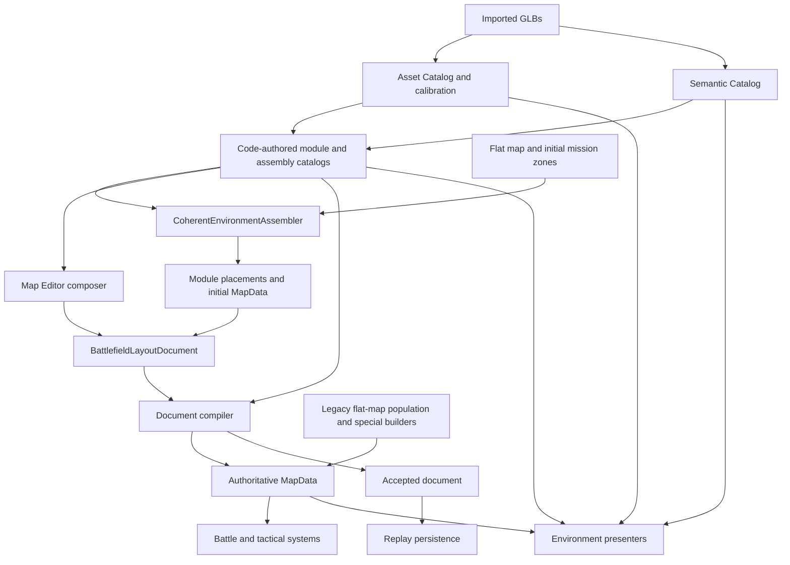
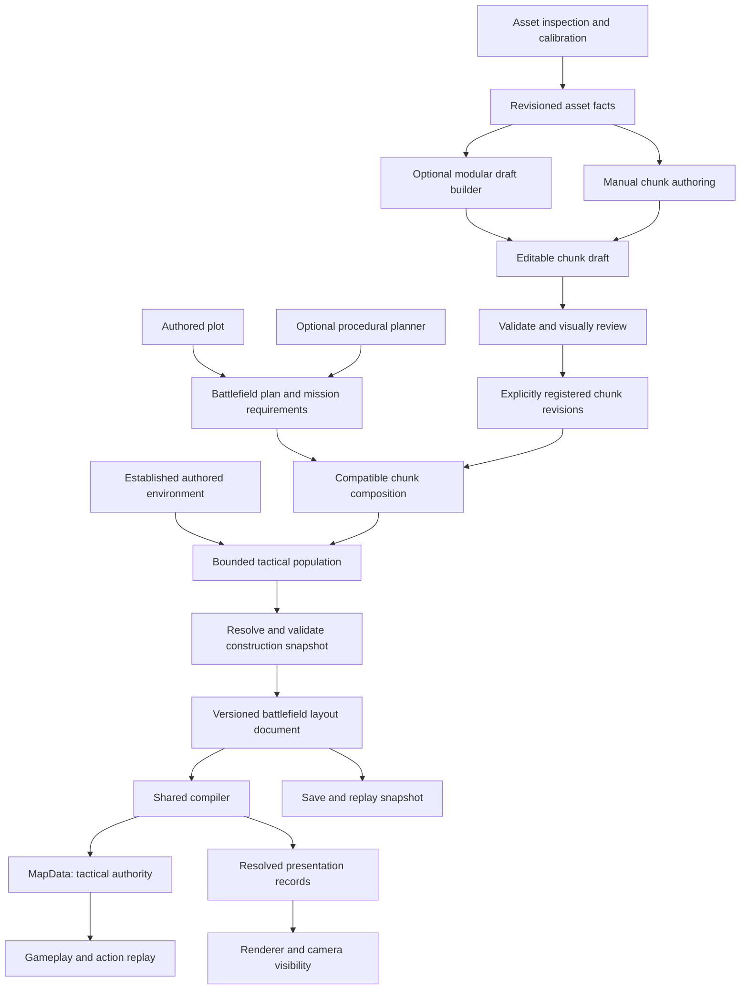

# FuseFire environment generation: feasibility, target architecture and foundation plan

**Status:** independent first draft for owner review; not an implementation authorization.
**Date:** 2026-10-25. **Repository examined:** `fb373e6` (`certify generation 2 content baseline`).
**Scope:** tactical population, reusable authored chunks, modular assembly, editing, compilation and runtime integration. No production code, roadmap, commits or assets were changed by this consultation.

## Executive assessment

**Build an environment-authoring and composition system, with procedural generation as one of its clients.** The proposed three approaches are appropriate, provided they share a trustworthy publication/compilation boundary rather than becoming three independent environment engines.

My recommended product direction is:

1. Hand-author a coherent environment and vary its tactical population.
2. Compose battlefields from authored plots and approved reusable chunks, then populate designated regions.
3. Use modular procedural assembly to create editable drafts and, eventually, carefully bounded runtime variations. It must not be a prerequisite for the first two workflows.

Preserve the tactical simulation, canonical transforms, asset inspection/calibration, useful module content, geometric socket math, relationship checks, deterministic search ideas and replay verification. Substantially redesign composition identity, authoring/publication state, dependency resolution and tactical compilation. Replace the current assembler's position as the central architecture with a limited producer behind the common boundary; move successful code-authored compositions into editable content over time.

This is a larger recommendation than the previous follow-up's hardening plan because the requested product is now larger. The previous conclusion remains valid for the narrow existing industrial preset. It does not establish that the current document, editor and assembler are suitable as the foundation of a general chunk-authoring workflow.

Being early makes restructuring appropriate. It does not make deferred consolidation free: obsolete paths need retirement criteria in each milestone, not only a cleanup phase after three new systems have grown around them. Conversely, preserve working legacy behavior until its replacement is demonstrated; do not conduct a simultaneous generation, combat and renderer rewrite.

**Necessary changes:** stable instance identity; saveable drafts distinct from approved content; authored chunk contracts; independent planning/composition phases; explicit tactical merge semantics; elevation-aware placement; one resolved dependency context; one runtime compiler/presentation contract.

**Optional or deferred:** fully procedural road graphs, arbitrary polygon packing, unrestricted chunk stacking, automatic building synthesis, a general spatial grammar language, WFC, unlimited nested prefabs and a second editor application.

## A. Existing architecture assessment

### A1. What the implementation actually does

The current flow is not a single linear pipeline. It has two main runtime branches plus authoring/inspection paths:



The coherent runtime path starts with a flat tactical map and default mission zones, assembles roads/parcels/modules, captures a layout document, then compiles that document into a fresh map. The presenter reconstructs catalog definitions and resolves visual choices again. This works within tested limits but makes the supposedly accepted result dependent on repeated live interpretation.

### A2. Responsibility and authority inventory

| Area | Current owner / evidence | Assessment and disposition |
| --- | --- | --- |
| Imported geometry | GLBs under `art/environments/kenney`; `EnvironmentAssetPlacement` measures hierarchies and instantiates calibrated assets | Preserve. Geometry is evidence for visual bounds and sockets, not tactical authority. |
| Scale, source yaw, anchor | `tools/asset_lab/asset_catalog.gd`, `asset_calibrations.json` | Preserve authoring data and resolution precedence. Resolve once per content revision/operation instead of repeatedly during validation and rendering. |
| Meaning and eligibility | `semantic_asset_catalog.gd`, `asset_semantics.json` | Preserve classification, working faces and confidence/review distinctions. Semantic eligibility cannot establish fit or complete architecture. |
| Tactical components | `environment_module_definition.gd:59`, `industrial_module_catalog.gd:11` | Useful vocabulary: effects, surfaces, traversal, visuals, connections. Currently code-authored and industrial-specific. Adapt into explicit leaf content contracts and a catalog that accepts published content. |
| Building dimensions and frontage | `industrial_building_placement_profiles.gd:11`, building catalog/contracts | Existing reviewed information is valuable, but overlaps calibration, envelopes, semantic working faces and assembly declarations. Resolve derived facts from one approved revision; keep deliberate authored clearances separate. |
| Attachment geometry | `environment_geometric_socket.gd` and equipment catalog | Preserve measured socket frames and alignment math. This is an attachment primitive, not a complete building solver. |
| Roads and parcels | `coherent_environment_assembler.gd:118`, `:687`, `road_streetscape_profile.gd` | Code owns topology, parcel dimensions, templates and furniture rules. Extract planning from content placement; retain proven street profiles and recipes as initial content. |
| Spatial validity | `environment_module_layout.gd:15`, reservation ledger, parcel relationship validator | Separate concerns are legitimate, but duplicated transforms/reservations should use one spatial query layer. Existing reservation dimensionality is insufficient for general stacked content. |
| Construction persistence | `battlefield_layout_document.gd`, `map_editor_layout_store.gd` | Preserve the shared-document principle, provenance, transactional loading and schema migration. Redesign the content/source versus resolved-runtime boundary. Current schema is not a reusable chunk format. |
| Editing | `tools/map_editor.gd` | Reuse the application, camera, picking, preview and diagnostics. Separate editor session/commands from document compilation and UI. Current authoring is one working composition, not a library workflow. |
| Tactical translation | `environment_module_map_writer.gd:4` | Preserve tactical effects and traversal conversion intent. Replace insertion-order mutation with declared surface/occupancy/effect composition. |
| Simulation | `systems/grid/map_data.gd`, graph builder, pathfinder, LOS, missions | Preserve as runtime authority. No new scene-graph combat model. |
| Presentation | `modular_environment_presenter.gd:15`, terrain/warehouse presenters | Reuse instantiation and camera integration. Consume resolved records rather than choosing assets again from live catalogs. Migrate specialized presenters only as equivalent content is demonstrated. |
| Runtime and replay | `generation_2_battlefield_builder.gd`, `battle_level.gd:201`, `battle_replay_recording.gd:34` | Preserve fail-before-activation and document-bearing replay. Remove industrial-specific restrictions only after new content passes the same boundary. |

### A3. Confirmed limitations and defects

**1. Tactical composition depends on insertion order — reproduced.**

`EnvironmentModuleLayout` permits a ground component and an occupant in the same cell. `EnvironmentModuleMapWriter.apply()` subsequently assigns cell properties for each placement, including defaults for unspecified properties. A minimal legal composition produced:

```text
ground then obstacle: walkable=false, blocks_los=true
obstacle then ground: walkable=true, blocks_los=false
```

This means an editor reorder or ground addition can change tactical meaning without changing the apparent arrangement. It is not evidence that the existing generator always produces the wrong order; its usual construction sequence masks the issue. It is a confirmed shared-API defect and a blocker for trustworthy general composition. Fixing only the editor's order would preserve the underlying ambiguity.

**2. Placement reservations ignore elevation — reproduced.**

`EnvironmentModuleLayout.world_cells()` returns `Vector2i`; layer reservation keys omit placement elevation. Two occupants at the same X/Z at elevations 0 and 3 are rejected as overlapping. Meanwhile, `MapData` and vertical module links already support 3D coordinates. The limitation is in composition, not proof that the tactical engine lacks verticality. The mission reservation ledger also projects zone cells onto X/Z, which may intentionally protect a whole column but currently cannot express a floor-specific reservation distinctly.

**3. Identity is reconstructed from mutable placement properties — source-confirmed.**

`EnvironmentModulePlacement` has no persistent instance ID. `BattlefieldLayoutDocument.apply_edited_layout()` matches IDs using component/origin/elevation/rotation/variation. Moving an object produces a new ID while old ownership and access references remain. This must change before selection, undo, nested chunks, duplication and relationship editing become dependable. Interactive reproduction was not repeated in this study; the source path is explicit.

**4. Certification and live resolution remain too permissive — source-confirmed.**

The prior independent follow-up documents dynamically generated certification baselines, a resolver trusting `CERTIFIED`, and signatures that omit assembly transforms and other behavior. Also, the presenter selects semantic candidates and calibration again rather than rendering a fully resolved visual record. These are distinct from the useful existing checks that reject stale documents. The new pipeline needs an approved immutable revision and a frozen resolution result, not another approval flag.

**5. Draft authoring is coupled to complete battlefield validity — source-confirmed.**

`map_editor.gd:976` requires successful battlefield compilation before saving. The store also validates the document. A partially built warehouse or disconnected chunk is a legitimate draft but not a playable battlefield. Reusing this policy unchanged would make chunk authoring unnecessarily restrictive. Draft save/load must validate file structure without requiring complete tactical or publishing validity.

**6. Templates are still program logic, not reusable authored content — source-confirmed.**

`coherent_environment_assembler.gd:687` constructs arrays for yards, loading bays, strips, alleys and forecourts. Adding a new arrangement means changing code and often parallel relationship tables. The editor cannot directly author a reusable replacement, register it and have the existing generator select it. Named chunks solve this real bottleneck if their contracts are derived/edited through the same tool.

**7. There is no general population pass over arbitrary established environments.**

`FlatMapGenerator.generate_with_cover()` always creates its base map and branches into special builders. It provides useful cover formations, seeded candidate selection and route protections, but is not the proposed independent strategy A. Extract those policies; do not transplant its entire orchestration into a second generator.

**8. Runtime mission planning is coarse.**

The Generation 2 builder populates default zones on a flat graph before assembly. This is substantially safer than placing structures over mission space, but is not a planner for the selected mission's actual spatial needs. Reserving all defaults can constrain unrelated missions. Chunk mission anchors and active-mission requirements should participate in planning, followed by concrete binding after tactical compilation.

**9. Visual evidence remains bounded.**

The supplied overhead road capture shows organized connected blocks. The supplied playable frontage capture shows an identifiable shell entrance and surrounding pavement, but also large undifferentiated paved space and furniture whose relationship to the façade is not convincingly composed. This is a visual judgement about those captures, not a quantified whole-generator result. Original orientation fixes must not be confused with solved environmental composition.

### A4. Suspected architectural weaknesses

- Many policies are distributed across catalog code, profile code, semantics, relationship tables, document reconstruction and presentation. The repeated need to restate intent increases drift risk. This is an architectural inference supported by the ownership inventory, not a claim that every duplicated value currently disagrees.
- Repeated hashing, JSON parsing and catalog construction likely contribute to latency. Prior reports measured multi-second validation and roughly 20 seconds for one initial build path. A profile is still needed before assigning cost shares.
- Hardcoded fit-valid recipes offer limited control over foreground/background, coherent yards, utility access and visual storytelling. More tags alone will not create an authoring workflow or better compositions.
- Current broad tactical scores are useful diagnostics, not proofs of mission fairness or believable streets. For example, local route branching is not equivalent to two strategically independent approaches.

### A5. Foundation roadmap reconciliation

The roadmap at `docs/generation/battlefield-generation-2-roadmap.md` describes an older baseline and is not fully synchronized with the October 21–25 work. Treat its headings as capability areas rather than unquestioned completion certificates.

| Existing area | Current evidence | Redesign treatment |
| --- | --- | --- |
| 2.0 integration | Warehouse, tactical grid, camera and replay groundwork | Retain as regression anchors. |
| 2.1 calibration | Asset Lab, saved calibration, semantic review | Retain; add revision resolution and reuse its gallery capabilities. |
| 2.2 modular components | Effects, surfaces, links and geometry contracts work in bounded cases | Retain vocabulary; redesign placement identity, elevation reservations and compilation. |
| 2.3 coherent assembly | Road/parcel recipes, bounded search, relationships demonstrated | Reclassify as an existing producer and content source, not the mandatory master architecture. |
| 2.4 verticality | Tactical warehouse and traversal demonstrated; general multi-building membership incomplete | Preserve simulation. Add explicit chunk floor/support/cutaway membership and one reusable vertical proof. |
| 2.5 missions | Roadmap says reservations are future; new builder already reserves default zones | Record this progress, but distinguish it from active-mission planning and per-chunk anchors. |
| 2.6 quality | Connectivity/cover metrics plus new access contracts | Retain checks, add composition-specific and playthrough evidence; do not collapse all quality into one score. |
| 2.7 tools | Composer, save/load/edit-copy, overlays and battle launch | Substantial starting point; needs drafts, identities, history, library management and publishing. |
| 2.8 release | Roadmap says not started; bounded industrial gameplay/replay now exists | Recognize narrow integration. Three-strategy release acceptance is new work, not already complete. |

The roadmap's immediate recommendation to grow the existing grammar should be superseded by proving authoring and chunk reuse. Destruction, arbitrary interiors, general vertical construction and broad biome expansion need not join this redesign's first milestone.

## B. Feasibility

| Capability | Feasibility | Main obstacle / minimum change |
| --- | --- | --- |
| Handcrafted chunk authoring | High | Local composition source, stable IDs, boundaries, ports and saveable drafts. Existing editor controls are reusable. |
| Authored plot + chunk selection | High | Published chunk index, compatible slot/port matching, deterministic bounded selection and explicit failure behavior. |
| Variable rectangular sizes | High | Remove the assumption that all content is a fixed macro tile. Existing rotated bounds/math can be adapted. Let available assets inform size families. |
| Arbitrary masks or interlocking footprints | Moderate | Boundary extraction, reservation ownership, authoring UX and search complexity. Do not require it for the first release. |
| Manual and generated content in one editor | High | Common editable composition records; independent creation strategies. A generator must emit a draft rather than a second special scene format. |
| Tactical population on a fixed environment | High for supported source content | Immutable base plus allowed population regions, protected routes and transactional tactical validation. An arbitrary imported scene first needs authored tactical annotation. |
| Reusing the editor application | High, with internal restructuring | Its coupled UI/rebuild/compile workflow needs separation. No evidence justifies a standalone replacement app. |
| Shared tactical compilation | High, with necessary redesign | Order-independent semantics, surface creation before effects, elevation-aware conflicts, resolved references. |
| Modular assembly independent of chunk generation | High | Keep recipes/socket solver as authoring producers. Convert their results explicitly; avoid a requirement that every chunk be procedurally reconstructible. |
| Nested assemblies | Moderate | Cycle rejection, revision pinning, ID namespaces and transform composition. Restrict nesting depth initially and flatten before runtime. |
| General multistorey chunk stacking | Moderate/high effort | Support/headroom, floor-specific occupancy, interface elevation, cutaway membership. The warehouse proves underlying gameplay, not unrestricted stacking. |

The largest uncertainty is content economics: how quickly can this team create multiple attractive, tactically distinct approved chunks? The pilot must measure authoring and repair time. A sophisticated selector with three interchangeable parking lots will still look repetitive.

## C. Architectural alternatives and research

### C1. What to borrow from XCOM 2

Brian Hess's original Firaxis presentation describes a master plot with separately authored parcels. Initial small/medium/large parcel buckets and random facing needed revision: parcel size, subdivision, orientation, driveways and zoning all caused problems. Road networks gained variant cover-parcel sets, and a quick-launch tool allowed content manipulation after loading. Mission-location changes demonstrated the value of separating layout from art; the system nevertheless required a substantial authored library and had limits in artistic control and storytelling. These are the relevant lessons, not evidence that random chunk tiling automatically produces coherent maps. See slides 11–24, 26 and 29–36 in [Firaxis's GDC slide deck](https://media.gdcvault.com/gdc2018/presentations/Hess_Brian_PlotAndParcel.pdf).

**My inference for FuseFire:** preserve authored spatial intent at more than one scale. The master plot controls routes and mission structure; chunks control recognizable places; small variations control dressing. Require frontage and access relationships across boundaries. Do not copy XCOM's dimensions, mission compatibility policy, library size or engine streaming implementation.

I extracted all 38 slides and inspected the parcel-facing and zoning slides visually. I did not inspect a local XCOM SDK in this consultation; the repository roadmap's claim of an earlier SDK review is historical project evidence only.

### C2. Alternatives comparison

Costs below are relative engineering/content burdens, not schedule estimates. All deterministic alternatives still require stable ordering, versioning and bounded failure behavior.

| Option | Likely result | Engineering / authoring / maintenance | Verdict |
| --- | --- | --- | --- |
| Handcrafted whole maps + population | Strong intentional composition; limited layout variation | Low/moderate engineering, high per-map authoring, simplest maintenance | Essential baseline and a legitimate shippable fallback if chunk economics disappoint. |
| Authored plots + authored chunks + bounded population | Good control at macro and local scales; reuse and meaningful permutations | Moderate engineering, substantial but reusable authoring, manageable contracts | **Recommended initial architecture.** |
| Procedural route graph + chunk placement | More topology variety, greater fit/search and seam risk | Higher engineering/debugging, still needs the same library | Later planner using the same plot contract, after authored plots succeed. |
| Existing code recipe expansion | Quick additional examples, continued dependence on programmers | Low immediate change; rising code/content maintenance | Retain as draft producer/fixture, stop treating it as the only creative workflow. |
| General hierarchical shape grammar | Potentially broad building families | High rule/kit authoring, difficult exceptions and debugging | Use a small explicit recipe hierarchy first; add a grammar only for a demonstrated content family. |
| WFC / general constraint solver | Local adjacency variation; globally satisfactory missions need extra constraints | Moderate/high solver integration and diagnostic burden | Not the default battlefield planner. Could serve bounded paving/dressing later. |
| Semantic scene graph with AI assembly | Expressive proposals and relationships | Ambiguous geometry, difficult reproducibility/validation, large authoring burden hidden in semantics | Use AI offline for proposals; explicit geometry and approved content remain the acceptance boundary. |

The original [WaveFunctionCollapse implementation](https://github.com/mxgmn/WaveFunctionCollapse) describes local pattern/adjacency constraints and possible contradictions. My assessment is that this alone does not establish FuseFire's mission reachability, usable frontage or tactical composition; an additional global planner would remain necessary.

[CGA shape research](https://www.peterwonka.net/Publications/pdfs/2006.SG.Mueller.ProceduralModelingOfBuildings.final.pdf) demonstrates hierarchical/context-sensitive rules for architectural models. It supports considering grammars for buildings, not assuming their geometry is automatically tactically playable. [PlotMap](https://arxiv.org/abs/2309.15242) studies facility-layout constraints separately from underlying map generation. That separation is relevant; its optimization/learning methods are not a recommended dependency for FuseFire.

### C3. Challenges to the proposed direction

- Three workflows should not become three independent authorities for placement, saved state or tactical effects.
- A chunk can preserve a bad composition just as reliably as a good one. Human review and useful boundary contracts matter more than the name.
- Variable size should mean supported size families and actual footprints initially, not unrestricted packing of arbitrary shapes.
- More modularity can make seams, repetition and authoring harder. Use larger authored arrangements where their internal relationships matter.
- Sims-inspired interaction is appropriate; a Sims-scale construction simulation is unnecessary. Place/edit reusable content before adding procedural wall drawing, roof synthesis or structural engineering.
- Existing sealed shells are exterior obstacles. A visible door is not an interior port. Playable interiors must have authored surfaces, access and camera behavior.
- Tactical cover placement cannot compensate indefinitely for an unsuitable street or building layout. Population may reject an environment; it must not silently destroy its spatial intent to satisfy a density target.

## D. Proposed target architecture

### D1. Boundaries and data flow



This is a conceptual flow, not a request for one class per box. Start with a small number of cohesive modules and explicit records. The authoring editor and runtime use the same resolution/validation services. Generators produce data; they do not instantiate scene nodes or directly mutate active combat state.

### D2. Representations: share contracts, not every document

Use distinct source documents for distinct authoring responsibilities, sharing placement/transform/reference records. Avoid turning `BattlefieldLayoutDocument` into a universal object with dozens of optional unrelated modes.

| Representation | Owns | Does not own |
| --- | --- | --- |
| Resolved asset record | Stable asset ID, geometry/calibration revision, normalized source transform, measured bounds, working-face/socket facts, source/provenance | Battlefield position, mission rules, inferred walkability |
| Chunk source | Local instances, authored tactical contributions, local bounds, ports, clearances, floor/cutaway groups, optional population regions, dependency references | World position, faction deployment binding, district road topology |
| Plot source / battlefield plan | Map boundary, fixed content, route network or fixed street placements, slots, frontage obligations, reservations, mission capacity constraints, population policy | Internal arrangement of each chunk or mesh-level socket solving |
| Battlefield layout document | Accepted exact instances/choices, world transforms, resolved leaf content, bound mission data, dependencies, source provenance and diagnostics reference | Mutable editor selection/history or a live procedural recipe that must rerun on load |
| Compiled output | `MapData` plus derived presentation records and source-to-runtime mapping | An independent persisted tactical authority competing with the document |

Use explicit schema versions and migrations. JSON is a practical initial source format because persistence already uses it; this is a provisional storage choice, not a reason to duplicate the same data in both JSON and Godot Resources. Typed in-memory objects can wrap parsed records. A `PackedScene` is a useful visual payload, not a sufficient tactical chunk format.

The resolved section of the battlefield document is the accepted runtime construction snapshot. The compiler should not rediscover variants from current semantics. A derived render manifest can live in the compilation result; it need not become another independently editable saved format. `MapData` remains authoritative once the battle starts, including runtime occupancy and action-driven state.

### D3. Chunk contract

A first chunk definition needs:

- Stable content ID and immutable published revision; a human name, context tags and thumbnail for discovery.
- A local integer-cell origin, rectangular allocation bounds, supported quarter-turn rotations and explicit vertical extent. Tactical occupancy and visual envelopes are separate from the allocation rectangle.
- Stable local instance IDs referencing a reviewed component, a visual asset with an explicit tactical role, or a nested approved assembly/chunk revision.
- Tactical surfaces/effects, traversal links, no-placement/access regions, and optional mission candidate anchors.
- Boundary ports with ID, role, local span or cells, outward normal, elevation, minimum usable width, compatibility profile and whether connection is mandatory, optional or explicitly terminated.
- Internal access relations: e.g. public entrance reaches courtyard; loading gate reaches loading area. These are validated against compiled local geometry and then rechecked in world context.
- Visual bounds, intended support/contact, floor/cutaway membership and allowed overhangs where necessary.
- Authored variation/population zones and budgets. Fixed content is immutable to a population pass unless explicitly designated replaceable.
- Exact dependencies and review state tied to the content revision, plus validation evidence version.

Do not store derived cell arrays twice as independent editable facts. Generate them from authored contributions and cache them under a content fingerprint. Where geometry and tactical approximation deliberately differ, keep that decision explicit and reviewable.

An illustrative warehouse-frontage chunk might contain a fixed exterior shell, apron and entrance-clear region, with a separately declared loading-access span and a bounded cargo population zone. A road chunk includes its cross-section and sidewalk interfaces. A completely handcrafted alley can be approved without any socket assembly recipe.

**Variable sizes:** initially support arbitrary positive integer rectangular dimensions, with the library curating a few useful size families. The existing 10-cell road pitch is a supported road profile, not a universal chunk unit. Do not rescale chunks to fit slots. Filter compatible rotations and bounds; explicitly compose smaller chunks into a larger slot only when an authored subdivision rule exists. Unused space must have a declared purpose such as forecourt, access apron or landscaped buffer.

**Nesting:** permit bounded acyclic references to approved revisions; flatten them at resolution while preserving instance paths for diagnostics. Start with shallow nesting, such as a yard containing a machinery assembly. Depth limit and override policy are provisional. Avoid inherited arbitrary property overrides initially: edit the source revision, duplicate it as a variant, or explicitly unpack a copy. Publishing a parent freezes its child revisions.

### D4. Orientation, ports and spatial relationships

Retain FuseFire's X/Z grid, Y elevation and current quarter-turn convention. Centralize the proven cell/point/direction/AABB operations; do not introduce a second yaw convention for chunks. Existing cell-center and continuous-coordinate behavior must survive migration, including rectangular rotations. Chunk world transforms compose with local instances before leaf placement; avoid applying asset calibration twice.

Structural/tactical instances use grid translation, integer elevation and supported 90-degree rotations initially. Visual-only dressing may use finer local transforms inside approved envelopes. Arbitrary scaling or mirroring of a published chunk is unsupported unless authored as a separately validated variant.

Keep three concepts distinct:

1. **Working face:** descriptive facing information, e.g. a lamp head or façade direction.
2. **Geometric socket:** measured local attachment frame and compatible seam, used inside an assembly.
3. **Chunk port:** a boundary/access contract, often a span rather than a point, used to connect places.

These use common transform math but do not require one universal connector class. A sign face cannot certify a road connection, and aligned pipe sockets cannot certify pedestrian access.

Road ports must match direction, elevation and cross-section profile, including carriageway/sidewalk/curb treatment. Pedestrian and loading access use widths, connectivity and approach clearances. A loading-access declaration initially means geometric clearance, not a simulated vehicle turning guarantee. Only promise turning radii when a vehicle-envelope test exists.

Ownership must be unambiguous: the street chunk normally owns carriageway and public sidewalk; the parcel owns its apron beyond the interface. Boundary contact is allowed; unexplained overlap is not. Where an imported road mesh bundles sidewalk geometry, its footprint owns that surface. A separate sidewalk system must not draw the same space again.

Use elevation-aware occupancy/support intervals or discrete occupied volumes, plus floor-specific clearance masks. A whole-column reservation remains an explicit supported policy. A 2D parcel allocation can conservatively exclude other chunks while its internal content uses 3D reservations. This avoids immediately requiring arbitrary interlocking multistorey chunk packing.

### D5. Planning and generation stages

**Separate planning from content placement, with a bounded compatibility feedback loop.** A planner should not commit impossible slots without checking that the library can fill them, but failed placement should not trigger unbounded random replanning.

1. Resolve the requested environment, active mission, deployment counts, supported content revisions and generation version.
2. Select an authored plot initially. Later, an optional planner may generate the same plan representation from a road/zone graph.
3. Establish fixed routes, street profiles, district constraints, slot boundaries, mandatory connections and coarse mission reservations. Query library feasibility before committing unusual slot dimensions.
4. Fill the most constrained slots first: required mission facility, fixed access, large chunk, then optional content. Use deterministic candidate ranking, rotation filtering and bounded backtracking. Reuse current candidate-search principles, not hardcoded template names.
5. Validate seams and relationships incrementally. A valid local chunk may still be invalid beside its neighbor. On failure, report the slot, port, candidate and violated requirement.
6. Compile a preliminary tactical map to verify global routes and bind mission candidate anchors into concrete zones. Validate required deployments and mission reachability at actual elevations.
7. Populate declared regions with compatible obstacles/cover/props. Protect bound mission cells, support, doors, loading routes and required approaches. Use thematic placement rules such as cargo in staging regions, not a uniform scatter over every free cell.
8. Compile and validate the final result transactionally, resolve all visual variants and record exact choices. Reject or return an explicit diagnostic draft if mandatory conditions fail.

For strategy A, begin at an established source environment and the relevant reservation/population steps. A whole handcrafted map can initially behave as one fixed composition with population regions. Loading a GLB is not sufficient: its tactical surfaces, obstacles and access must be annotated or provided by a trusted adapter.

For strategy C, create a local draft through a recipe/socket solver. Inspect/edit it and publish a chunk revision. Runtime assembly is an optional later producer using the same resolved output, justified only for an actual content family that benefits from it.

### D6. Tactical compilation

Refactor the existing writer into explicit passes rather than add a competing tactical translator:

1. Resolve and validate source identities, dependencies and transforms once.
2. Create base/elevated surfaces with explicit ownership and support; reject incompatible surface claims.
3. Apply occupancy and tactical effects according to declared composition rules. An omitted field means no contribution, not reset-to-default. Ground appearance must not clear an obstacle's blocking state.
4. Add traversal links only after both endpoints exist and have appropriate access/support.
5. Bind mission zones, rebuild LOS/graph indexes and run local/global validation.
6. Produce presentation records from the same resolved instances, retaining IDs for selection and diagnostics.

Define merge semantics per contribution type, not an arbitrary last-writer-wins dictionary merge. Surface properties, blocking volumes, cover and explicit authored overrides need different rules. Two incompatible claims should reject; a later ground tile must not implicitly win. Sorting is useful for determinism but cannot by itself fix undefined semantics.

A surface referenced by an upper-floor obstacle must exist; silently skipping a missing cell, as the current writer can do, is not acceptable for a published chunk. Physics collision used by picking/camera occlusion remains separate from authoritative movement/LOS. Mesh-derived probes can detect visual/tactical disagreement, but must not silently rewrite simulation data.

Internal chunk validation should expose reachable groups of ports and anchors as a derived summary. Global compilation still checks the actual map, because neighbors, population and missions can invalidate local guarantees.

### D7. Determinism, publication and dependencies

Determinism is a function of seed, configuration, algorithm/compiler version and exact content revisions. Use stable sorted candidate sets and independent random streams keyed by stage and stable instance/slot identity. Adding decorative candidates must not perturb unrelated deployment choices. Record rejected candidates and accepted choices without depending on dictionary iteration order or wall-clock budgets.

Publication states should distinguish draft, technically validated, visually reviewed and registered for generation. Registration references an exact source/dependency fingerprint; any behavior-affecting edit invalidates it. Automatic generation can produce a draft and automated validation evidence, never human visual approval. A fixed constituent of an approved hand-authored chunk need not be independently eligible for random asset selection; approval is contextual. All dependencies must still be available and revision-checked.

Use a small project-local index of registered chunk revisions, not a remote asset service. Retain old revisions only as required by supported saves/replays. Replays store the resolved battlefield snapshot and compiler/content compatibility information; they must not rerun plot selection or population. Explicitly reject unsupported versions. Indefinite replay compatibility across arbitrary engine/gameplay changes is not promised; a later policy can retain compiler versions or baked tactical snapshots if needed.

Resolve unique assets, calibration, components and chunks once per operation or trusted content revision. Share the resolution context with validation, compiler and presenter. Invalidation keys must include behavior-changing definitions and transforms, not merely GLB hashes. Distinguish schema validity, dependency freshness, geometric validity, tactical validity and visual approval in diagnostics and UI.

### D8. Map Editor evolution

Keep one Godot development tool with three explicit workspaces: **chunk authoring**, **plot/battlefield composition**, and **generated-result inspection**. Share viewport, picking, selection and gizmos. Keep Asset Lab as the specialist calibration tool; reuse its searchable inventory/preview services rather than duplicate calibration ownership inside the editor.

Separate the editor session from the content model. The session owns selection, dirty state, undo/redo and the currently edited file. Commands operate on stable IDs: add, transform, duplicate, delete, assign port, change boundary, edit reservation. Duplication creates new IDs and remaps internal references; transformation preserves IDs. Selection cannot be array-index identity. Preview builds are derived and may be canceled/replaced without modifying source state.

Prioritize:

- Named files/library entries, thumbnails, search and filters for assets/components/chunks.
- Placement with grid/elevation snapping, move/rotate, duplicate/delete, and undo/redo.
- Local chunk bounds, ports, working-face/socket overlays and clearance visualization.
- Actionable errors linked to instances and locations: e.g. “loading port L needs four clear cells; container C blocks cell …”.
- Draft save/load and recovery even when incomplete. A preview can display invalid drafts with diagnostics; registration and play require stronger validation.
- Explicit validate/review/register actions, with stale approval visible after edits.
- Plot slots and population-region editing, followed by a playtest launcher with supported mission options.

The current preview-only transform nudges must remain visibly distinct from persisted authoring commands or be routed into them. Avoid a tool that appears to save a visual correction while leaving the content model unchanged.

The lifecycle is **author/generate → save draft at any time → inspect/edit → validate → visually review → explicitly register an exact revision**. Editing registered content produces a new draft. Updating instances to a new revision is an explicit operation with a diff/revalidation, not an automatic library side effect.

Do not block every edit that temporarily disconnects a structure; display invalidity and prevent publication. Strict placement mode can remain optional for efficient assembly. This is a necessary change from the present reject-invalid-edit/save behavior, not a reduction in runtime validation.

## E. Migration and foundation plan

### E1. Retain, adapt, replace and retire

| Existing work | Action | Retirement / completion condition |
| --- | --- | --- |
| Asset files, calibration, reviewed semantics | Retain | No re-review without changed evidence; consolidate derived values through a resolver. |
| Canonical transforms and independent geometry tests | Retain, extract shared use where necessary | Old duplicate transform logic removed after equivalent new paths pass the same oracles. |
| Socket math and equipment examples | Retain as authoring capability | No requirement to generalize to all structures. |
| Module contracts and catalogs | Adapt leaf vocabulary; migrate selected definitions to data | Remove duplicated code declarations only after published content replaces them and fixtures migrate. |
| Coherent assembler | Freeze broad feature growth; use as reference/draft producer | Retire production use after replacement industrial plot/chunks meet gameplay, visual and replay gates. Preserve a small archived regression fixture if useful. |
| Document/compiler/store | Evolve with versioned migration | One current compiler, explicit legacy import path; no parallel “chunk tactical writer.” |
| Map Editor | Restructure in place | Remove index-based identity and special-case template authoring paths when new commands/workspaces replace them. |
| Legacy cover population | Extract proven policies | Remove duplicate orchestration after strategy A parity; retain compatibility mode for its stated support window. |
| Warehouse/refinery special builders | Retain test fixtures initially; migrate useful authored content | Specialized production presentation can retire after equivalent data-driven content/camera behavior is demonstrated. |
| Runtime `MapData`, combat, AI, pathfinding, replay verifier | Preserve | Only integration adapters change unless a separate defect is established. |

### E2. Independently verifiable milestones

Relative size is an engineering judgement, not a time commitment. Content effort must be measured alongside code effort.

| Milestone | Scope / dependencies | Acceptance and Map Editor demonstration |
| --- | --- | --- |
| **M0 — Agree contracts and proof content** (small) | Approve decisions in G; select two plots, initial chunks, mission pair and visual references; capture baseline metrics | One reviewed ownership/schema sketch and concrete content list. No general framework implementation before agreement. |
| **M1 — Correct composition boundary** (medium/high) | Stable IDs, canonical transforms reused, elevation-aware reservations, deterministic tactical merge, dependency resolution/publication enforcement; follows M0 | Permuting legal placements produces identical tactical output; ground cannot erase blocking; independent floors coexist while real volume collisions fail; edits preserve refs; changed approved dependencies reject. Demonstrate move/rotate/undo and stacked obstacles in the editor. |
| **M2 — Author and publish chunks** (high, UI + content) | Chunk source, draft persistence, local validation, named library, thumbnails, ports, boundaries and basic history; relies on M1 contracts | Manually construct, save incomplete, reload, complete, validate and register a chunk without modifying code. Unpublished or stale revisions cannot be selected. Place the same chunk twice with independent identities. |
| **M3 — Fixed environment plus population** (medium) | Extract bounded population policies; immutable base and declared regions; shares compiler | Handcrafted base remains unchanged across seeds; only allowed tactical content varies. Required access and active mission remain valid. Save/load/play/replay the populated result. Compare authoring and repair time with baseline. |
| **M4 — Authored plot and chunk composition** (high) | Plot source, slots/ports, compatible candidate selection, bounded backtracking, mission binding; follows M2 | Two distinct plots use the same approved library. Variable rectangular chunks rotate correctly; incompatible street profiles reject; required frontage is connected; unsupported slot reports the actual missing contract. Preview seed matrix, then edit/save/play a generated result. |
| **M5 — Reusable vertical content** (medium/high) | One warehouse or raised facility, floor-specific occupancy/support, traversals, cutaway groups; uses M1/M2/M4 | Translate/rotate/reuse it without hardcoded world coordinates. Reach roof/platform and return, preserve cover/LOS, inspect floor selection/cutaways, and replay authoritative actions. This does not authorize unrestricted building stacking. |
| **M6 — Modular draft production** (medium for one family) | Adapt measured socket/recipe builder to emit normal chunk source; follows M2 | Generate two drafts, edit one manually, publish it, and use it in M4 without invoking the original generator. Invalid/incomplete drafts save but cannot publish. No hidden auto-certification. |
| **M7 — Broader procedural planning, if justified** (high, optional) | Evaluate need after M4 evidence; road graph planner emits same plan | Generates several meaningful topologies using supported road profiles; bounded failures; no disconnected mandatory ports; matches authored baseline quality. Stop/defer if novelty does not justify repair/content burden. |
| **M8 — Consolidation and release gate** (medium) | Complete deprecation criteria, migrate supported fixtures/saves, narrow compatibility policy, performance budget | One accepted compiler/presenter boundary; retired duplicate code has no production callers; selected legacy saves have explicit behavior; representative mission/replay and visual matrix pass. Update roadmap to actual capability/evidence. |

M1–M2 are the critical foundation. M3 provides value even if M4 proves too expensive. M4 is the central proof of the redesign. M5 deliberately tests the hardest existing gameplay requirement before claiming a generalized architecture. M6 should not delay M2–M4. M7 is an option, not a prerequisite or a promised project.

**Parallel opportunities after interfaces are agreed:** editor commands/gallery and pure compiler/resolver work can proceed separately; a content author can prepare plot/chunk candidates against the frozen M0/M1 schema; population policies and plot selection can proceed independently after the shared boundary exists. Integration tests and the content model remain shared dependencies. These are planning opportunities, not a delegation of this consultation.

### E3. Compatibility and rollout

- Introduce a new explicit document schema; keep old files untouched and provide deterministic import with a diagnostic report. Preserve source identity/provenance. Do not synthesize missing human approval.
- Imported v1 battlefield documents can become flattened drafts with original placements and mission data. Referenced code definitions require a known revision adapter or explicit failure. Import does not prove chunk boundaries/ports that old documents never contained.
- Keep the current industrial runtime preset available during comparison. Add the redesigned path as opt-in through the same runtime preparation boundary, not a second combat scene.
- A published chunk upgrade must be explicit. Saved accepted maps/replays retain exact resolved choices; they do not float to “latest.”
- Retire old factories and presenter branches by migrated capability, with caller checks and focused regression coverage. Update tests for intentional contract changes while preserving valid invariants; fixed catalog counts are not the new architecture's acceptance metric.
- Track file/class reduction where useful, but judge simplification primarily by fewer authorities, fewer authoring steps and fewer special cases. A smaller line count alone is not success.

### E4. Performance and diagnostics

Measure cold resolution, warm editor edits, chunk validation, map composition, tactical compilation, presentation and replay initialization separately on a named development machine. Cache unique dependency work by revision. Preview cheap geometric feedback immediately and run expensive global validation asynchronously or on demand without accepting stale results.

Provisional UX goals for discussion: placement feedback within one interaction frame where possible; warm local revalidation below roughly 100 ms for the pilot chunk; full 60×50 build within a few seconds on the reference machine. These are proposed targets, not current measurements or guarantees. Profile first and revise them explicitly.

Diagnostics should carry code, stage, severity, instance/slot/port IDs, affected cells and the violated requirement. Preserve rejected candidates in the inspection view. A missing required chunk is an error; an intentionally optional buffer is a named outcome. No silent fallback from a mandatory warehouse to an empty lot.

## F. Prototype and validation strategy

### F1. Representative content

Start with the existing industrial assets and a small purposeful library, not all 315 assets and every biome:

1. An exterior warehouse/frontage chunk using a reviewed sealed shell, apron and protected access.
2. A handcrafted loading yard and a distinct machinery/service yard, with cargo population regions.
3. An alley/courtyard connection with two meaningful pedestrian access points.
4. A street family using reviewed straight/T/cross pieces with their actual sidewalks. Add an end cap only if suitable geometry can be authored/reviewed; otherwise use explicit map-boundary exits.
5. One warehouse interior/platform/roof example adapted from the existing vertical slice, kept distinct from sealed-shell content.
6. One equipment assembly generated through measured sockets and saved as a chunk.

Use at least three useful rectangular size classes, including an elongated lot and one content-driven dimension not imposed by the road's 10-cell pitch. Determine exact dimensions from actual asset envelopes, clearances and access. Do not require stretching imported assets to satisfy a chosen numeric grid family.

Author two plots with different tactical structure: a through-street industrial block and a yard/service-access arrangement. Add a whole handcrafted base to test population independently. Initially use Eliminate and Terminal because bounded integration already exists; include extraction/escort-style reservations before claiming broad mission coverage.

### F2. Automated acceptance matrix

| Property | Meaningful checks |
| --- | --- |
| Orientation | All supported rotations of asymmetric rectangular chunks; source working face versus expected world direction; independent expected coordinates and rendered transforms; nested transforms applied once. |
| Spatial composition | Distinct elevations, support/headroom, boundary/overhang rules, real overlap failures, exact port spans and seam profiles. Negative cases include correct tags with wrong geometry. |
| Tactical merge | Placement-order permutations; base preservation under population; surface/obstacle conflicts; missing support rejection; blocked cells do not reopen after ground/dressing changes. |
| Connectivity | Mandatory port matching, local port-to-port reachability, final mission paths, protected widths, invalid loading approach, inaccessible elevated anchor. |
| Identity and persistence | Move/rotate preserves ID; duplicate remaps child refs; delete reports dependency loss; invalid draft round-trip; stale publication rejection; transactional failed load. |
| Dependencies | Geometry, calibration, socket, transform, clearance and tactical effect changes invalidate approval/resolution as appropriate. Test new generation as well as old-document loading. |
| Determinism | Same seed/config/revisions yields identical accepted snapshot and tactical signature; stable serialization; decorative stream changes do not perturb reserved mission bindings. |
| Gameplay/replay | Real authoritative movement to objectives, cover/LOS interactions, vertical actions, mission completion, saved-document reconstruction and action-by-action replay. Fixture teleports remain useful unit/integration tests but do not substitute for these playthroughs. |
| Failure behavior | Missing compatible chunk, exhausted budget, dangling port, incompatible profile and unsupported schema produce bounded actionable failures without partial battle activation. |

Do not claim meaningful global diversity from a changing seed alone. Measure route/plot changes, chunk identity repetition, functional-region coverage and mission approach variation separately from decorative differences.

### F3. Visual and gameplay review

Use a fixed review set plus an unseen holdout set. A provisional pilot matrix is two plots × five seeds, then five additional holdout seeds; record failures rather than silently replacing inconvenient seeds. Test explicit edge cases separately. This is an iteration sample, not statistical proof of all seeds.

For each reviewed map, retain clean overhead, oblique gameplay-height, frontage/access, seam and relevant interior/cutaway captures. Pair them with a separate diagnostic overlay showing boundaries, ports, reservations and tactical cells. Include a unit-scale reference. Use actual imported assets, not a greybox screenshot to approve finished visual composition.

Review against explicit questions:

- Can a reviewer identify street, frontage, entrance, yard and service function without reading debug labels?
- Do doors, lamps, signs and machinery face their functional targets? Are sidewalks continuous and free of unexplained duplicates or curbs across entrances?
- Are loading spaces plausible, required routes clear, structures intentionally complete/open, and props supported rather than floating or intersecting?
- Does the place have deliberate open space and recognizable composition, rather than every leftover region being filled or paved identically?
- Are useful combat routes, cover, vertical opportunities and objective approaches visible and playable? Does the camera keep them legible?
- Do variations change useful play or setting, rather than only swapping nearly identical decorations?

Record defects by severity, source chunk/plot/seed and corrective owner. Missing required access, severe geometry overlap and misleading tactical visuals block approval. Composition/readability scores can guide comparisons but should not be converted into a universal aesthetic pass number. Human visual approval applies to the reviewed revision and supported contexts.

Run natural Terminal and Eliminate playthroughs on both plots, plus a vertical traversal encounter. Compare authoring hours, manual repair frequency, invalid-map rate, generation time and review defects against a fixed handcrafted baseline and the current industrial generator. The strongest proof is that the owner can author and reuse a coherent place without asking Sol to add a special-case code recipe.

### F4. Investigation performed and limits

This study builds on the immediately preceding independent follow-up and the supplied reports. Six focused tests there passed, including geometry/envelopes, socket assembly, document lifecycle, tactical integration and 35/35-action replay. They were not needlessly rerun here.

Additional runs in this consultation:

| Run | Result | Whole-run elapsed |
| --- | --- | ---: |
| `modular_environment_components_test.gd` | Passed, exit 0 | 16.32 s |
| `map_editor_layout_store_test.gd` | Passed, exit 0 | 73.15 s |
| `industrial_warehouse_vertical_slice_smoke.gd` | Passed, exit 0 | 2.43 s |
| Temporary composition-boundary diagnostic | Reproduced order dependence and elevation-blind conflict | Diagnostic, not a passing acceptance test |

Logs and the temporary diagnostic are in `artifacts/architecture-redesign-research/`. Godot emitted the local root-certificate-store error; the selected assertions completed successfully. No selected suite was skipped or failed. The diagnostic intentionally reports existing problematic behavior; its exit 0 means it executed, not that the behavior is acceptable.

Inspected existing generated captures, not a fresh full rendering matrix. No interactive editor usability session, exhaustive asset audit, production-asset mutation test, performance profile or prototype of the proposed architecture was performed. Therefore feasibility is supported by source analysis and bounded diagnostics; authoring productivity, aesthetic improvement and full vertical generality remain prototype questions.

## G. Decisions requiring owner discussion before implementation

| Decision | Recommendation | Tradeoff / remaining uncertainty |
| --- | --- | --- |
| Primary generation model | Authored plots + approved chunks + bounded population | Stronger control and tooling; requires real content-authoring investment. |
| Modular assembly's role | Independent draft producer first | Slower pursuit of fully automatic buildings; much earlier usable chunk workflow. |
| Tactical authority | Preserve `MapData`; redesign how contributions compile into it | Necessary compiler work, avoids a second simulation model. |
| Chunk geometry scope | Rectangular variable bounds, 90-degree rotation, explicit ports; internal 3D support | Defer arbitrary packing/stacking rather than falsely promise it. |
| First content scope | Industrial outdoor content plus one reusable vertical warehouse proof | Concentrates evidence; commercial/mixed themes remain later content work. |
| Asset policy | Imported assets by default; explicit reviewed exceptions only | A missing canopy/end cap may block a recipe instead of generating placeholder boxes. Decide whether any derived final geometry is acceptable. |
| Authoring and approval | Save incomplete drafts; registration requires technical validation and human visual approval of an exact revision | More honest lifecycle; owner must allocate review time. |
| Editor | Restructure the current Godot tool; no new application | Retains useful work; substantial internal/UI changes still required. |
| Road planning | Authored plot routes first; graph planner optional after proof | Less immediate topology novelty, lower seam/content risk. |
| Replay policy | Exact accepted snapshot plus explicit supported compiler/content versions | No silent upgrade; indefinite historical compatibility remains a separate cost decision. |
| Legacy retirement | Per-capability gates, then remove duplicate production paths | Temporary compatibility cost, with a defined end rather than permanent parallel systems. |
| Investment gate | Review M0–M4 results before committing to M7/general grammar work | Allows an ambitious foundation without precommitting to speculative machinery. |

The immediate implementation handoff, if approved, should authorize M0/M1 and the bounded M2–M4 proof—not “build the entire final generator.” The architecture should be revised using the pilot's actual authoring, visual and gameplay evidence before broader commitments.

## Repository evidence index

Paths below identify the inspected implementation; line numbers are reference points at `fb373e6`.

- [Previous independent follow-up](C:/Users/Blue/Documents/Codex/git/fusefire-proving-grounds/docs/architecture/reviews/2026-10-25-independent-generation-2-follow-up.md): certification, identity, performance and test-scope findings.
- [Generation roadmap](C:/Users/Blue/Documents/Codex/git/fusefire-proving-grounds/docs/generation/battlefield-generation-2-roadmap.md:15) and [composer workflow](C:/Users/Blue/Documents/Codex/git/fusefire-proving-grounds/docs/generation/map-editor-composer.md): stated intent and incomplete work.
- [Module definition](C:/Users/Blue/Documents/Codex/git/fusefire-proving-grounds/systems/generation/environment_module_definition.gd:59), [placement](C:/Users/Blue/Documents/Codex/git/fusefire-proving-grounds/systems/generation/environment_module_placement.gd:4), [layout validation](C:/Users/Blue/Documents/Codex/git/fusefire-proving-grounds/systems/generation/environment_module_layout.gd:15), [tactical writer](C:/Users/Blue/Documents/Codex/git/fusefire-proving-grounds/systems/generation/environment_module_map_writer.gd:4): composition boundary.
- [Document edit handling](C:/Users/Blue/Documents/Codex/git/fusefire-proving-grounds/systems/generation/battlefield_layout_document.gd:125), [dependency resolution](C:/Users/Blue/Documents/Codex/git/fusefire-proving-grounds/systems/generation/battlefield_layout_document.gd:839), [compiler](C:/Users/Blue/Documents/Codex/git/fusefire-proving-grounds/systems/generation/battlefield_layout_document_compiler.gd:10): source/runtime coupling.
- [Editor placement/edit commands](C:/Users/Blue/Documents/Codex/git/fusefire-proving-grounds/tools/map_editor.gd:671), [save/play](C:/Users/Blue/Documents/Codex/git/fusefire-proving-grounds/tools/map_editor.gd:976), [store](C:/Users/Blue/Documents/Codex/git/fusefire-proving-grounds/tools/map_editor_layout_store.gd:20): authoring capabilities and limitations.
- [Legacy population](C:/Users/Blue/Documents/Codex/git/fusefire-proving-grounds/systems/generation/flat_map_generator.gd:54), [coherent recipes](C:/Users/Blue/Documents/Codex/git/fusefire-proving-grounds/systems/generation/coherent_environment_assembler.gd:687), [runtime preparation](C:/Users/Blue/Documents/Codex/git/fusefire-proving-grounds/systems/generation/generation_2_battlefield_builder.gd:7): generation paths.
- [MapData](C:/Users/Blue/Documents/Codex/git/fusefire-proving-grounds/systems/grid/map_data.gd:4), [quality evaluator](C:/Users/Blue/Documents/Codex/git/fusefire-proving-grounds/systems/generation/map_quality_evaluator.gd:12), [warehouse](C:/Users/Blue/Documents/Codex/git/fusefire-proving-grounds/systems/generation/industrial_warehouse_layout_builder.gd:50): tactical capabilities.
- [Presenter](C:/Users/Blue/Documents/Codex/git/fusefire-proving-grounds/systems/generation/modular_environment_presenter.gd:15), [asset instantiation](C:/Users/Blue/Documents/Codex/git/fusefire-proving-grounds/presentation/environment_asset_placement.gd:9), [replay validation](C:/Users/Blue/Documents/Codex/git/fusefire-proving-grounds/systems/replay/battle_replay_recording.gd:34): resolved-output integration.
- [Temporary diagnostic](C:/Users/Blue/Documents/Codex/git/fusefire-proving-grounds/artifacts/architecture-redesign-research/boundary_probe.gd) and [observed output](C:/Users/Blue/Documents/Codex/git/fusefire-proving-grounds/artifacts/architecture-redesign-research/boundary-probe.log).
