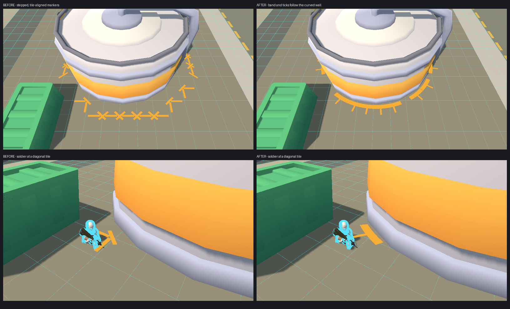

# Asset edges, standing positions and hybrid animation

Current prototype, 2026-11-16. **Supported standing points are enabled by default in all newly compiled current maps and Parcel Editor previews/tests.** Keep most assets grid-aligned for readability, with flexibility for tile-edge walls and irregular objects. The grid identifies the tactical choice; real geometry decides where the body fits. If no tested fit exists, the cell stays blocked. Restart an already running battle to use the new compilation.

## The requested behavior

In the container example, the usable space and cover contact should follow the container's actual side. A tile partly overlapped by an object may still contain a safe standing point. The actor should stand there, close to the surface, rather than stand at the tile center or be visually pushed while gameplay stays behind.

There is no rule that “half a tile is always usable.” A body of the chosen width must fit in real space, including neighboring space and other units, and have a traversable route to that point. Animation cannot make an undersized gap physically valid.

The grid can still identify the occupied tile and keep existing turn/AP structure. The physical standing point becomes the shared position for movement, targeting, cover, range and LOS. First aim for **one canonical point per cell**; multiple poses/positions per tile are a later decision, not a requirement for this first experiment.

## What exists now

| Foundation | Status |
| --- | --- |
| `systems/grid/surface_placement.gd` | Pure, bounded body-fit search against supplied world-space boxes; returns a proposed point and a clear failure reason. Separately returns surface contact, outward direction and desired body clearance. No map, actor or occupancy mutation. |
| Existing `tactical_pose_context.gd` | Authored-pose selection now reads actual nearby part bounds and exposes contact hints. An empty label alone no longer supplies a pose. |
| `systems/grid/surface_navigation.gd` | Resolves supported cell points, checks swept body clearance, neighboring bodies and actual nearby cover contacts. One shared prototype body profile; deterministic box geometry. |
| Existing `TacticalCharacterAdapter` | Reads the committed standing point/contact, chooses the existing low/high-cover clips and retains weapon-grip IK. It does not invent a separate cosmetic root offset. |
| Surface Fit Lab | Isolated slider demo with a MIRA placeholder, body-fit/contact markers and a diagnostic LOS ray from the resolved point. |
| Surface Fit Range | Small editable container/truck/building example for focused checks; the same system now runs on the other current maps. |
| All current maps / editor | Standing-point rules are automatic in new compilation. No per-map or per-asset opt-in is required. Historical compilers retain recorded behavior. |

The body proxy starts at radius 0.28, height 1.8 and horizontal clearance 0.04 world units for a one-unit tile. These are prototype parameters, not measurements guaranteed to fit every character or weapon. A search is limited to 32 local parts and 256 tested points; exceeding those limits reports failure. The candidate set is conservative: failure means no tested fit, not proof that no continuous solution exists.

Bounds still come from the existing automatic per-mesh boxes. This does not recover holes inside a single concave mesh or produce exact polygon collision. No per-asset hull fitting, tactical-role assignment or boundary export is added.

## Why LOS must be part of it

`MapCellData.world_position` is the canonical support/standing point. `support_center` retains logical cell identity. Movement paths, previews, grid-to-world conversion, range, five-sample LOS, Guard and spawning share that point. Cover and pose contacts search real nearby parts, including the actor's own cell and diagonal parts. Mission adjacency additionally checks physical distance and obstruction.

Parts are independently indexed for shots, so occupying their cell does not make them disappear from source/target LOS. Cover indicators sit beside the actual surface, rather than at a guessed tile edge. Grid tiles and AP costs still identify discrete tactical steps.

The lab therefore indexes the object independently of navigation, using the existing shot-only index. Its ray tests do not ignore a solid merely because it overlaps the starting tile. At the default setting, the old-center ray is blocked while the resolved-point ray clears the edge. **This is one diagnostic geometry ray, not a complete legal attack, path, Guard or replay validation.** The lab deliberately leaves its navigation cell blocked.

## Integration and deliberate limits

| Order | Current behavior |
| --- | --- |
| 1 | Existing part boxes automatically produce a supported point. Invalid/no-fit cells remain blocked; assets are never moved to suit the grid. |
| 2 | Swept body/floor clearance validates graph edges, entrances, diagonal corners and neighboring bodies. Existing authored ladders, ramps and stairs supply checked rise-outside/step-on routes, also followed by presentation. |
| 3 | Shared canonical positions feed movement, previews, combat, Guard, spawning, mission adjacency, contacts and surface-aligned cover markers. |
| 4 | Compiler **6** (historical), simulation **height-range-8**, Move payload **10**. Points round to **1/10000 tile**. Manifests store a reconstruction signature; moves record XYZ per checkpoint; fingerprints include geometry/profile and within-cell positions. Older simulation recordings reject clearly. Compilers 1–5 preserve historical geometry, including the former compiler-5 opt-in pilot. |
| 5 | All three examples complete real moves and saved replay. Existing authored cover clips, contact direction and weapon IK follow the committed point. Wall-hand/foot IK and new peek firing origins remain future animation work. |

Rectangular solids use the same conservative enclosing body box for both standing-point fitting and sweeps. Curved solids use the established radius and vertical clearance. Unsupported rises still reject. Existing authored ladders and ElevationPath ramps/stairs provide checked transitions: rise outside the upper floor, then step onto it; reverse downhill. This preserves authored traversal without inferring arbitrary slopes or climbs from a render mesh. Compiler 7 uses exact curved footprints for tagged upright solids. See [Curved tactical geometry](#curved-tactical-geometry).

A route may bend within an edge to enter a valid gap, but both legs require floor and body clearance. Existing low-cover vaults use checked raised transit points that cannot be selected as standing destinations. Thin low barriers can also supply a checked rise/cross/land route; a ceiling or a tall obstacle prevents that route. Presentation follows these same waypoints, while AP and Guard checkpoints remain tied to logical cells.

The common body profile does not yet cover differently sized creatures, carried-body silhouettes or every authored animation extremity. Contact hints and authored clips are placeholders, not completed procedural cover animation. No second generator or manual hull-fitting workflow is introduced.

## Authored plus procedural animation

Use authored clips for readable motion and timing: low-cover idle, rise-over-low-cover/fire/return, left-corner lean/fire/return, and right-corner lean/fire/return. Existing high-cover left/right shooting and cover clips are placeholders to reuse; a distinct rise-over-low-cover sequence is still future work.

Procedural fitting can then adjust contact height/direction, upper-body lean, feet on the supported surface and hand/weapon placement within bounded limits. Reuse the rig's existing IK instead of adding another rig. Wall-hand and foot contact solving are **not implemented** here. The gold marker is a target for future fitting, not a hand already attached to the wall.

Any actual peek firing origin must first be validated by the shared tactical query and used identically by UI, AI, execution, Guard and replay. A visual lean cannot invent a legal shot through a wall. Animation follows committed results; root motion must not silently change tactical position.

## What JA3's public code confirms

THQ Nordic publishes significant Lua source for modding. Its [cover code](https://github.com/THQNordic/JaggedAlliance3Modding/blob/main/Lua/Tactical/Cover.lua) contains explicit alignment checks, cardinal cover offsets and stance-dependent cover queries. Its [unit code](https://github.com/THQNordic/JaggedAlliance3Modding/blob/main/Lua/Tactical/Unit.lua) uses aim/look IK and passes positions and stance into cover queries. Its [combat paths](https://github.com/THQNordic/JaggedAlliance3Modding/blob/main/Lua/Tactical/CombatPath.lua) track positions, occupancy restrictions and destination stances. These support separating tactical placement from pose fitting; they **do not establish arbitrary mesh-edge standing or reveal the complete native collision/pathfinding implementation**. FuseFire's proposal is our design, not a claim to reproduce JA3 internally. Sources inspected read-only on 2026-11-16; no JA3 code/assets copied.

## How to test

1. Start a **new match** on Service Depot, Freight Yard or Fleet Station. The ordinary crate and container now participate. Alternatively open **Parcel Editor → Surface Fit Range — container, truck, building edges** for the small editable example.
2. For the editable Range option, press **Preview**, then **Test battle**. With the editor's default two soldiers, test the container and truck; the automated three-soldier test covers the building too. Walk near the building in additional moves if desired.
3. Move toward the left side of each object. Useful destinations in parcel coordinates are **(5, 0, 12)**, **(13, 0, 12)** and **(21, 0, 12)**. Expect the soldier to stand slightly away from the tile center, beside the real surface. The object stays put. Use Move to see cover markers at its actual face.
4. Try crossing the object or placing a second soldier too close in a neighboring tile. Unsafe destinations/routes must reject or use a safe detour. A clear destination never authorizes travel through an object.
5. Move around an end before attempting a shot. A nearby obstacle still blocks its own cell's firing ray; fitting beside it does not grant the ability to shoot through it. Corner lean clips do not grant a new tactical peek origin yet.

Automated saved replay, with optional review captures:

```powershell
godot_console --headless --path . --script res://tests/surface_battle_replay_test.gd
godot_console --path . --script res://tests/surface_battle_replay_test.gd -- capture artifacts/surface-battle-review
```

The test archives the exact parcel, moves three soldiers, saves/reopens JSON and verifies replay reconstructs all three positions. It also rejects changed standing-point evidence. This is a three-Move replay, **not a completed combat match**. Review captures show the placeholder poses, not proof that every frame/weapon clears every mesh.

To try a new ordinary asset, use the existing Objects tool in any parcel. Its automatic mesh boxes participate without another asset flag or boundary draft. A single concave mesh still produces a conservative box. Compiler 5’s old `surface_placement_enabled` metadata is compatibility data, not an authoring requirement.

## Original slider lab

Open `art/characters/mira_0/demo/surface_fit_demo.tscn` in Godot and press **F6** (run current scene), or run:

```powershell
godot_console --path . res://art/characters/mira_0/demo/surface_fit_demo.tscn
```

| Test | Expected result |
| --- | --- |
| Default slider **0.65** | Body fits. Standing X is **-0.17**, leaving a **0.04 body gap** before the face at X=0.15. Cyan marks the fit, red the old center and gold the contact. The authored cover placeholder faces the object. |
| Default LOS text/ray | **Old center blocked → resolved point clear**. The green ray starts at the resolved point's shot height. |
| Slider fully left, **0.00** | **NO FIT**; the character/contact markers hide instead of pretending animation can solve the collision. |
| Slider fully right, **1.20** | Body approaches the moved object: standing X **0.38**, still with a 0.04 body gap. Both rays may now be clear. |
| Intermediate positions | The finite search may choose a valid corner rather than fail. Some position jumps are expected in this geometric lab; smooth movement is not implemented here. |
| Current maps | Restart the match: supported partly occupied cells participate in all new current-map compilations. |

Verification: [original pilot](quality/surface-placement-2026-11-16.md) and [global rollout](quality/surface-rollout-2026-11-16.md).

## Round assets: historical presentation-only rollout

Through compiler 6, round assets used: whole reserved tiles, the same cover, shots, standing points and replay evidence (hashed on 18 compiled maps before and after: identical). Only what the player sees changed. Cover markers and pose contacts used to be built from the nearest point of the tile-sized stand-in boxes, so they were axis-aligned, floated up to about a tile from the wall and zigzagged. They now follow the real wall.



- **Data:** the compiler records the real shape of each round asset for presentation only (`MapData.presentation_cylinders`, `presentation_boxes`, `presentation_stand_ins`). Nothing in tactics reads it. Authoring hints on a round volume: `presentation_shape` (`cylinder` by default, or `box` for a lying drum, which is a rectangle from above), `presentation_radius` and `presentation_center` (local units). The large tank in `tank_storage.tscn` has the measured body radius 3.771 and axis offset 0.35, because its tactical box is bigger than the tank (the side pipe).
- **Cover markers** (`CoverVisualizer`): a band hugging the curved wall, long enough that neighboring tiles join into one line, with an outward tick per tile (the same "line with ticks" read as flat walls), lifted slightly off the wall so it separates from the base shadow. Drum markers follow its real faces.
- **Pose contacts** (`TacticalPoseContext.cover_at`): the contact direction is the exact radial direction to the wall (0.03 degrees worst error on the Depot tank, where axis-aligned box faces were up to 45).
- **Reach:** a free tile beside a reserved diagonal corner can be about 1.7 tiles from the real wall while the stand-in still grants cover, so presentation contacts reach `SurfaceNavigation.ROUND_REACH_UNITS = 1.75` tiles.
- Test: `tests/cover_round_presentation_test.gd` (13 checks, on the real Service Depot). Capture with `-- capture <directory>` on a machine with a display.

This historical version retained the unreachable gap beside round walls. Its crouch started at the tile, which could sit about a tile away along diagonals.

## Historical cylinder prototype

Through compiler 6 a `round_volume` asset (the two tanks in `tank_storage.tscn`) is replaced by whole-tile boxes in a stepped, circle-ish pattern, because every geometry layer assumes axis-aligned boxes. By the compiler's own rule that reserves about 1.2 to 1.3 times the tiles of the real circle, leaves reserved corners up to about a tile outside the wall, and puts cover markers and contacts on tile edges instead of the wall.

The original prototype, `systems/grid/cylinder_part.gd`, provides pure geometry for a vertical cylinder that answers the questions the box code asks of an AABB, exactly for a curve:

| Question | Function | Matches the box rule |
| --- | --- | --- |
| Where does a shot enter? | `ray_entry` | Same return value; an open probe that only grazes misses, a closed probe counts the graze, a ray that starts inside enters at 0. |
| Can a body travel along a segment? | `segment_clear` | Same vertical overlap rule; touching allowed; optional absolute rounding tolerance as the box sweep uses. |
| Where can a body stand in this cell? | `resolve` | Same inputs, outputs and budgets as `SurfacePlacement.resolve`; the closest legal point lies on a margin circle, a cell edge or corner, so those are exactly the candidates tried. |
| Which way is the wall, and where should the body stand? | `contact` | Same keys as `SurfacePlacement.contact`, with the exact radial normal. |

It never reads or mutates a map, actor or occupancy, and a fit is still not permission to navigate. Tests: `tests/surface_cylinder_test.gd` (67 checks, included in the movement subsystem), including a direct comparison with the box fit.

Measured with the real functions on a ring of cells around a tank (diagram: [cylinder-census-2026-11-18.png](quality/images/cylinder-census-2026-11-18.png)): the box fit leaves 48 of 64 cells around a radius-2 tank usable, the curve 52. It never loses a cell the box keeps, and it recovers the four diagonal corner cells that the box leaves with no legal point inside the tile. Standing points follow the arc instead of sliding out along a box face. The same four tiles are recovered around a radius-3.5 tank.

## Curved tactical geometry

Compiler 7 accepts `tactical_curve = &"cylinder"` on an upright solid. Reuse
`presentation_radius` and `presentation_center` to match the radius and axis of
an off-center asset. Set `tactical_curve = &"rounded_box"` and
`tactical_corner_radius` for an upright rounded rectangle. Dimensions and
metadata are asset-local. Scene yaw, uniform horizontal scale and independent
positive vertical scale are supported. Unsupported transforms and metadata
use the solid's full enclosing box. Tag each reusable asset once so placed
instances inherit its shape.

A compound uses ordinary sibling solids. The Depot tank combines a cylinder
for the shell and a separate box for the outside pipe. The horizontal drum
keeps its established representation. The compiler uses explicit solid
volumes and does not infer doors, hollows or arbitrary hulls from render meshes.

Curves participate in the same single-point-per-cell fit, support, sweep,
occupancy, LOS, cover and pose-contact system. Manifests record compiler 7 and
hash the resulting canonical positions and shapes. A saved manifest for
compiler 6 reconstructs the historical stepped geometry, including its old
stopping points and line-of-fire behavior.

See the [integration report](quality/curved-tactical-geometry.md) and the
[rounded equipment fixture](../tests/fixtures/rounded_equipment.tscn).
