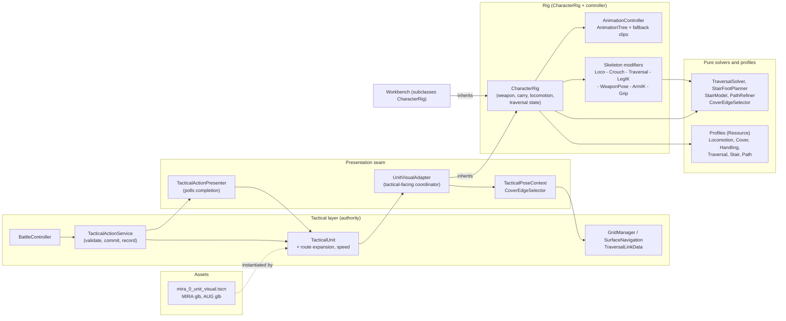
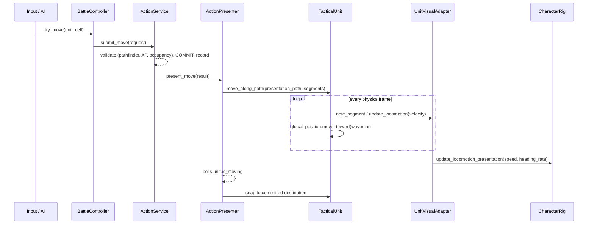
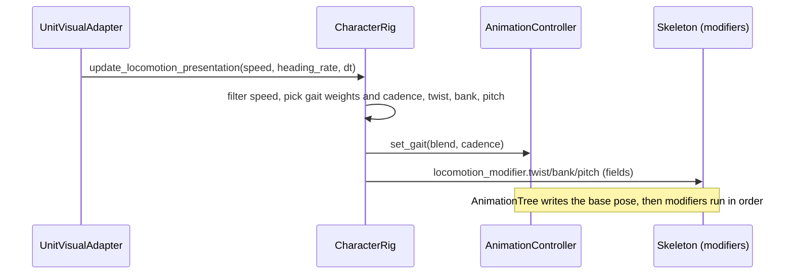
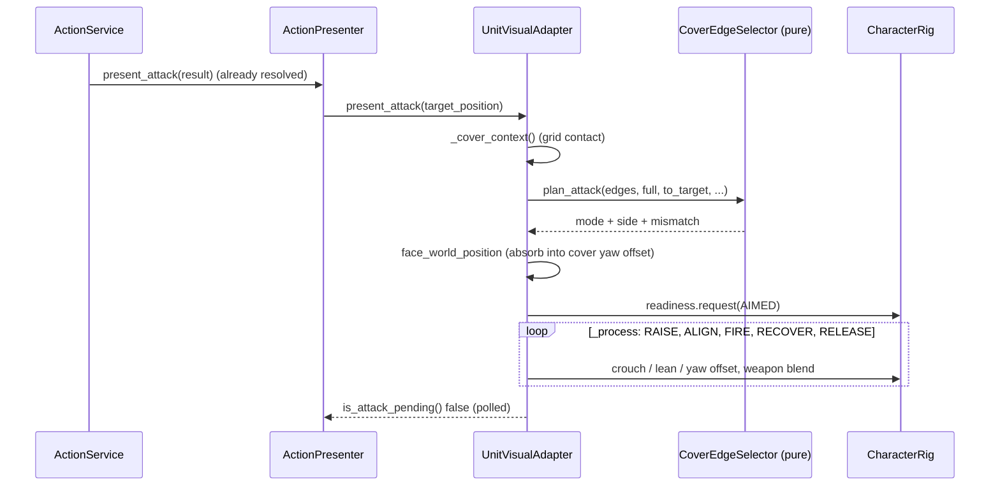
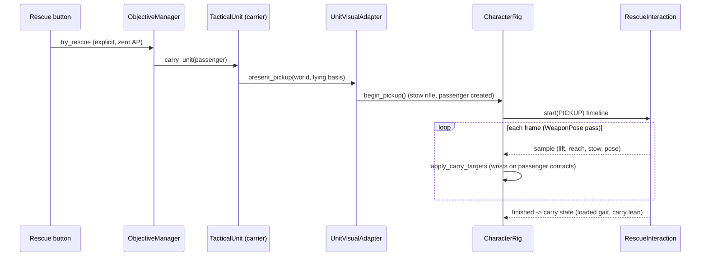
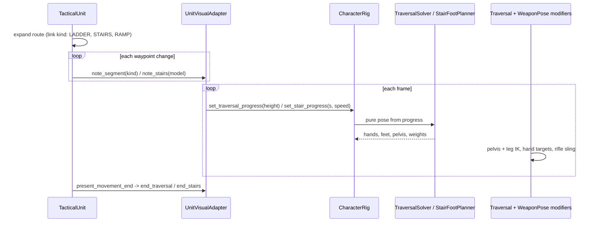
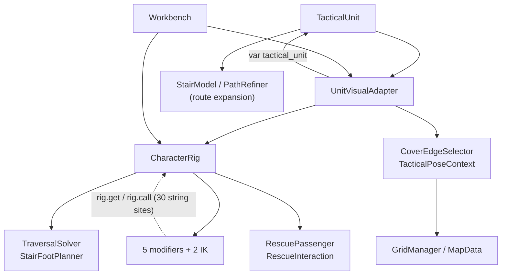

# Animation architecture audit (Task 02)

Audit of the animation and character-presentation code as it exists on **2026-11-20**: `main` at `396c8cb` (ladder traversal, committed) plus **uncommitted** Movement Foundations 01-03 work (stairs, ramps, path refinement, explicit link kinds, timing contract; 15 modified and about 36 new files). Nothing was changed for this audit: it is read-only analysis, scripted inventory, and probes run from the scratchpad (outside the repository). Evidence is marked **[code]** (read in the source), **[measured]** (run during this audit), **[tests]** (existing test), or **[inference]**. The companion developer guide is [animation-developer-guide-2026-11-20.md](animation-developer-guide-2026-11-20.md).

## A. Executive summary

**What exists.** FuseFire's humanoid animation is a *procedural layer over a generated placeholder animation*. There are no authored animation clips in use: `clip_library` is `null` in the only character scene, so every clip (idle, walk/jog/run, aim, shoot, cover, hit, climb, carry...) is built in code by `CharacterFallbackAnimationBuilder` and played by an `AnimationTree` in `CharacterAnimationController`. On top of those base clips a stack of seven skeleton modifiers (three bodies of procedural posing, two IK passes, a grip pass) adjusts the pelvis, spine, legs, arms, hands and the rifle every frame. A thin set of pure, deterministic solvers (ladder contacts, stair footholds, cover-edge choice, path smoothing, cover/posture profiles) feeds those modifiers. Gameplay talks to all of it through one class, `UnitVisualAdapter`, which sits on top of the rig (`CharacterRig`) and is the only place that reads tactical state.

**How coherent is it?** Better than its growth history suggests, with one clear structural pattern and two structural weaknesses:

* *Coherent core:* tactical authority is separate from presentation (verified: a replay of the same moves with every presentation feature off and on gives byte-identical action records and state fingerprints [tests]); the pure solvers are genuinely reusable and tested; behaviour is profile-driven (`Resource` profiles); the per-frame pose is mostly a function of tactical position, not accumulated history.
* *Weakness 1: rig identity is scattered.* Bone names, proportions and rig-space offsets are spread across 6 files with two naming conventions handled by 29 inline ternaries; there is no rig/character profile. A second humanoid would be a code edit in several places, not a data change.
* *Weakness 2: two large classes carry most of the logic.* `CharacterRig` (1,125 lines, 53 functions, 77 fields) and `UnitVisualAdapter` (859 lines, 76 functions) each mix 5-7 sub-systems (weapon, carry, traversal, cover, attack sequencing, camera anchors...). The workbench subclasses the rig and re-implements part of the adapter's frame driver, so production and workbench can drift.

**What works especially well.** Pure solvers with tests; the shared hand-contact path (carry contacts reused for ladder rungs); `ChestAnchor`; measuring bone axes from the rest pose instead of assuming them; profile resources; the position-driven traversal poses (replay-safe); the workbench; the regression suite (55 animation-related test files).

**Biggest risks.** (1) A confirmed composition defect: `CoverCrouchModifier` writes the spine as an absolute pose and **erases the Locomotion modifier's compensating spine twist** whenever any lean is active, so a turn-in-place with the weapon up, or while carrying, swings the chest with the hips (measured below, F-04). (2) Hard MIRA assumptions block any second humanoid (F-01). (3) Cross-context reuse (exploration, base) is blocked by a polling seam into `TacticalUnit` (F-03). (4) 14 tests poke private adapter state (F-09), which will resist a refactor.

**How reusable is it?** The *solvers and profiles* are reusable as they are. The *rig* is reusable for another humanoid only after its bone map and proportions become data. The *adapter* is tactical-combat specific. Non-humanoids can share the intent/event/timing layer but nothing skeletal.

**Is a major refactor justified?** Not a rewrite. The evidence supports a **targeted re-architecture of three seams**: a data-driven rig profile, a smaller adapter-to-rig interface (an intent layer that is not `TacticalUnit`), and an explicit modifier-composition contract. The pure solvers, profiles, contact infrastructure, tests and workbench should be preserved. No finding is Critical; four are High.

## B. Component inventory

Sizes are lines of GDScript. "State" is what the component owns. "Tests" lists the main files that protect it. `RT` = `presentation/characters/runtime/`.

| Component (file) | Responsibility | Entry points | Depends on | State owned | Tests |
| --- | --- | --- | --- | --- | --- |
| **`UnitVisualAdapter`** (`RT/unit_visual_adapter.gd`, 859) | Tactical-facing coordinator: turns gameplay requests into rig calls; cover side/yaw, attack sequencing, aim hold, readiness, traversal/stair/ladder segment hooks, rescue pickup/incapacitated, camera anchors, team marker | `present_move/idle/aim/attack/hit/defeat/pickup/boarding`, `note_segment`, `note_stairs`, `face_world_position`, `update_locomotion` | CharacterRig (inheritance), `TacticalUnit`, `GridManager`, `CoverEdgeSelector`, `TacticalPoseContext`, `WeaponReadiness`, `TraversalProfile`, `StairModel` | cover yaw/side, attack timeline/phase, aim-held flag, locomotion speed feed, ladder segment, pending pickup | `unit_visual_adapter_test`, `aim_hold_presentation_test`, `cover_*`, `unit_visual_weapon_readiness_test`, rescue tests |
| **`CharacterRig`** (`RT/character_rig.gd`, 1,125; no `class_name`) | The rig: instantiates model and weapon, builds IK and modifiers, weapon/arm/torso pose inputs, elbow guidance, locomotion presentation, carry/pickup/release timeline, weapon stow, traversal and stair state | `update_locomotion_presentation`, `apply_weapon_targets`, `begin_carry/pickup/release`, `stow_weapon`, `begin_traversal`, `begin_stairs`, `set_*_progress` | controller, 5 modifiers, profiles, `RescuePassenger`, `ChestAnchor`, solvers | locomotion filters, torso frame, elbow swivel latch, carry/stow blend, traversal/stair pose, IK nodes | `weapon_pose_modifier_test`, `unit_visual_elbow_guidance_test`, `unit_visual_torso_weapon_frame_test`, `rescue_*`, `traversal_rig_test` |
| `CharacterAnimationController` (`RT/character_animation_controller.gd`, 281) | `AnimationPlayer` + `AnimationTree` (state machine, phase-synchronised gait blend spaces); state change, cross-fade, visual-root lean tween | `setup`, `play(state)`, `set_gait` | `CharacterFallbackAnimationBuilder`, `LocomotionProfile` | current state, sequence generation, tween | `locomotion_*` tests |
| `CharacterFallbackAnimationBuilder` (388) | Generates every clip procedurally from the rest pose; measures anatomical axes | `make_gait`, `make_forward_clip`, `make_lean_shot`, `measure_axes` | skeleton bone names | none (pure builder) | `locomotion_gait_test` |
| `LocomotionPoseModifier` (73) | turn twist, bank, accel pitch, turn steps | fields set by rig | measured axes | none | `locomotion_gait_test`, `locomotion_speed_test` |
| `CoverCrouchModifier` (299) | pelvis drop, leg solve, kneel, spine lean, support clavicle | `depth`, `kneel`, `aim_lean_degrees` fields | measured axes, limb lengths | none | `cover_crouch_test`, cover tests |
| `TraversalPoseModifier` (92, new) | ladder pelvis/legs; stair feet and pelvis | `rig.traversal_pose`, `rig.stair_pose` | rig (string `get`), IK nodes | last weight | `traversal_rig_test`, stair tests |
| `WeaponPoseModifier` (179) | places hand targets (weapon, carry contacts, ladder contacts), torso frame, elbow guidance call | `_process_modification` | rig (19 string-based `get/call`) | pass counters | `weapon_pose_modifier_test` |
| `HandGripModifier` (127) | finger curl, wrist orientation, contact orientation | `curl`, `contact_*` fields | none | none | `unit_visual_hand_contact_diagnostics_test` |
| `TwoBoneIK3D` x2 (`WeaponArmIK`, `TraversalLegIK`) | Godot built-in IK | targets/poles (Marker3D) | rig | none | via rig tests |
| `WeaponReadiness` (64) | request/release arbitration for weapon-up state | `request/release/requested` | none | requests by source | `unit_visual_weapon_readiness_test` |
| `RescueInteraction` (199) | pickup/release timeline resource | `start/sample/scrub` | none | timeline state | `rescue_interaction_test` |
| `RescuePassenger` (286; no `class_name`) | the carried body: placement, lift path, secondary motion | `build/attach/update_presentation` | `ChestAnchor`, `PassivePassengerPose` | lag filters | `rescue_passenger_visual_test` |
| `ChestAnchor`, `PassivePassengerPose` | shared chest-relative anchor; passenger spine/limb pose | static | skeleton | none | rescue tests |
| `TacticalPoseContext` (`tactical_pose_context.gd`, 68; no `class_name`) | reads the grid for the cover contact and the route's `climb/descend/vault` labels | `cover_at`, `path_poses` | `SurfaceFit`, `GridManager` | none | `tactical_pose_test` |
| `CoverEdgeSelector`, `CoverPostureProfile` | pure cover side/firing plan; posture numbers | static | none | none | `cover_edge_selection_test`, `cover_target_aware_test` |
| `LocomotionProfile`, `LocomotionGait` | gait tables, thresholds | resources | none | none | `locomotion_*` |
| `WeaponHandlingProfile` (78) | stock/grip/stow numbers for one weapon | resource | none | none | weapon tests |
| `TraversalProfile`, `TraversalSolver` (79+152) | ladder rungs, contacts, mount weights, speeds | static | none | none | `traversal_solver_test`, `traversal_rig_test` |
| `StairModel`, `StairProfile`, `StairFootPlanner` (124+66+161, uncommitted) | stair surface, foot holds, pelvis | static | none | none | `traversal_stair_*` |
| `PathRefiner`, `PathPresentationProfile` (129+14, uncommitted) | clearance-safe corner smoothing | static | none | none | `path_refiner_test`, `traversal_path_gameplay_test` |
| `TacticalActionPresenter` (323) | awaits visual completion of resolved actions (movement polling, shot waiting, reactions) | `present_*` | `TacticalUnit`, adapter | none | `tactical_action_presenter_test` |
| `TacticalUnit` (`units/tactical_unit.gd`, 473) | tactical node; **also** expands routes into stairs/ramps/ladders, smooths paths, and feeds the adapter each frame (uncommitted growth) | `move_along_path`, `present_*` forwards | adapter, StairModel, PathRefiner, SurfaceNavigation | route, waypoint, leg kinds | many |
| Hand-contact diagnostics (`presentation/diagnostics/*`, 723) | sampler, overlay, diagnostics for wrist/palm contact | `HandContactSampler.sample` | rig | history | `unit_visual_hand_contact_diagnostics_test` |
| Workbench (`art/characters/mira_0/demo/*`, 1,308) | scene + `mira_0_pose_workbench.gd` (subclass of the rig, 857) + `locomotion_test_panel.gd` | interactive | production rig | demo state (cover/ladder/stair/path) | capture scripts, some tests |
| Scenes/assets | `art/characters/mira_0/runtime/mira_0_unit_visual.tscn` (the only visual), `models/mira_0_prototype.glb`, `art/weapons/aug/...glb` | | | | |
| Tools | `tools/quality/{bone_axis,crouch,grip,aim_pose}_probe.gd`, `movement_audit.gd`, `script_warning_audit.gd` | | | | |

**Orphaned / unused.** `CylinderPart` (round-obstacle geometry) is built, tested and unreferenced by navigation (its own header says so); `surface_fit_demo` is a demo scene; the per-state `AnimationLibrary` import path (`clip_library`) is wired but never exercised (always `null`). `movement_ghost.gd` hard-preloads the MIRA scene. No dead class was found in the animation runtime directory; `CharacterRig`, `RescuePassenger`, `CharacterAnimationController` and `TacticalPoseContext` are used through `preload`/path `extends` rather than `class_name`.

**Verified modifier order (current build, uncommitted)** [measured]: `Locomotion, CoverCrouch, Traversal, TraversalLegIK, WeaponPose, WeaponArmIK, HandGrip`; five tests assert this exact list.

## C. Current architecture

In words: gameplay decisions are made and recorded by the action service; the presenter and `TacticalUnit` then show them. `TacticalUnit` calls `UnitVisualAdapter`, which inherits the rig. The rig owns the animation controller and the modifier stack; modifiers and the rig call pure solvers; behaviour numbers come from profile resources.

## D. Runtime sequences

### D1. Ordinary movement and turning (high level, then detail)

The action is **committed first** and drawn afterwards: the tactical grid already holds the destination while the body is still walking. `TacticalUnit` walks the waypoints at one speed (the route expansion into stairs/ramps/ladders is currently inside `move_along_path`). The adapter turns the body toward the heading (`global_rotation.y`, 360 deg/s) and feeds speed to the rig, which smooths it into a gait blend and modifier values.

### D2. Aiming and firing from cover (target-aware)

The visual layer receives only the already-authorized target *position*. It chooses a posture from wall geometry (which edge, over/around), holds that plan until the attack ends, and returns to the passive cover side. Completion is observed by the presenter **polling** `is_attack_pending()`; the adapter's `shot_fired`/`attack_sequence_ended` signals are connected only by tests.

### D3. Rescue pickup and carry

The carrier's pose is a timeline (`RescueInteraction`) sampled each frame; the hands are placed by the WeaponPose pass on contact points computed from a chest anchor; the passenger follows the carrier's chest bone in `skeleton_updated`.

### D4. Ladder and stair traversal

The pose is a **pure function of the unit's tactical height (ladder) or progress along the stair**, so frame rate, replay speed and pause cannot change it. The presenter's wait is the same polling as ordinary movement.

## E. Skeletal ownership matrix

`W` = writes, `R` = reads/derives, `o` = ordered override, `b` = blend. Order of application: AnimationTree base -> Locomotion -> CoverCrouch -> Traversal (+ leg IK) -> WeaponPose -> arm IK -> HandGrip -> (chest-anchor consumers read in `skeleton_updated`).

| Target | AnimTree clip | Locomotion | CoverCrouch | Traversal | Leg IK | WeaponPose | Arm IK | HandGrip | Other writers |
| --- | --- | --- | --- | --- | --- | --- | --- | --- | --- |
| Visual root yaw (`character_root.rotation.y`) | | | | | | | | | `UnitVisualAdapter` (cover yaw offset); controller tween resets lean axes only |
| Tactical node yaw / rig node yaw | | | | | | | | | `UnitVisualAdapter` (`global_rotation.y`, `rotation.y`) |
| Rig node position (carry step) | | | | | | | | | `CharacterRig` (pickup/release step) |
| Hips (position) | W base | | **W absolute** (crouch) | **b** lerp (ladder, stairs) | | | | | |
| Hips (rotation) | W base | W relative (twist, bank) | | | | | | | |
| Spine / chest | W base | W relative (twist share, pitch) | **W absolute** (lean) | | | | | | rig sets lean request |
| Neck / head | W base | | | (pitch computed, not applied) | | | | | |
| Support clavicle | W base | | W absolute (reach) | | | W (extra reach) | | | |
| Thighs / knees / ankles | W base | W relative (step lift) | **W absolute** (crouch solve) | | **IK b** | | | | |
| Feet position | W base | | solved by crouch | feet targets | IK | | | | |
| Upper arms / elbows | W base | | | | | | **IK** | | elbow pole markers (rig) |
| Wrists / hands (position) | W base | | | | | targets o | IK | | contact targets (carry, ladder) |
| Hand orientation, fingers | W base | | | | | | | **W** | |
| Rifle transform | | | | | | W (target) | | | rig: hand socket, stow anchor (`_follow_stowed_weapon`), recoil tween |
| Passenger body | | | | | | | | | `RescuePassenger` (`skeleton_updated`), `ChestAnchor` |

**Overlap classification.**

| Overlap | Classification | Evidence / risk |
| --- | --- | --- |
| Locomotion twist -> CoverCrouch lean on the spine | **Conflicting responsibility (confirmed defect)** | CoverCrouch `_apply_lean` writes `rest * lean` (absolute) and discards the Locomotion share. See F-04, measured. |
| CoverCrouch hips (absolute) -> Traversal hips (lerp) | Legitimate ordered override (weight 0 = crouch value stays) | Traversal weight is 0 outside a ladder/stair; ladder crouch is not used together. Undocumented. |
| AnimationTree base -> modifiers | Intentional ordered composition | Modifiers read poses inside `skeleton_updated` (documented lesson). |
| WeaponPose hand targets -> ladder/carry contact targets | **Legitimate temporary override with explicit priority** | `apply_traversal_hand_targets` blends over the weapon targets by hand weight; rifle is slung so no hand holds both [tests: `traversal_rig_test`]. |
| Rig elbow poles -> arm IK | Intentional ordered composition | `apply_elbow_guidance` sets poles in the WeaponPose pass; swivel preserved (`swivel-preserving-elbow-guidance` doc). |
| Adapter cover yaw vs controller visual-root tween | Was a conflicting responsibility (fixed at `3b8b6c9`); now intentional split | Controller resets lean axes + position only. Regression: `cover_edge_selection_test`. |
| Rig `aim_lean_degrees` per-frame write vs ladder lean | Blend between compatible influences | `_update_weapon_pose_inputs` lerps by traversal weight. |
| Loaded carry pelvis yaw | Known limitation (kept 0) | 5.8 mm contact drift at 2 degrees, cause not isolated (documented). |
| Stow weapon: parent change + anchor follow | Legitimate temporary override | `_stow_blend` interpolates hand/sling; dependent on `skeleton_updated` ordering. |

## F. Dependency analysis

Direct source dependencies (class references and preloads, counted by script over 38 files) and runtime dependencies (scene references, string reflection):

**Cycles.** Two-cycles exist between `TacticalUnit` and `UnitVisualAdapter` (the adapter holds a typed `tactical_unit`; the unit holds a typed `visual_adapter`) and between `TacticalUnit` and `UnitWorldBar`. The first is the animation seam itself.

**Hidden / fragile coupling.**

* The modifiers reach back into the rig with strings (`rig.get("arm_ik")`, `rig.call("apply_carry_targets", ...)`): 19 sites in `WeaponPoseModifier`, 11 in `TraversalPoseModifier` [code]. Renaming a rig member breaks them silently at runtime, not at parse time.
* `CharacterRig` hardcodes scene node paths (`$Character/IKTargets/RightHandTarget`...) and the animation controller by name (`VerticalSliceController`).
* Initialization order is positional: modifiers are inserted *before* `arm_ik` by index, built in a fixed order inside `_build_animation_controller`.
* The adapter reads tactical state directly: `tactical_unit.is_moving`, `.grid_position`, `.tactical_state.is_aiming`, `.is_carrying_unit()`, `.archetype_id`, `.faction`, `presentation_grid` (56 references to tactical types in one file; zero in the rig, modifiers and solvers [measured]).
* `TacticalUnit` has gained presentation duties (route expansion into stairs/ramps/ladders, path smoothing, presented speed, leg kinds, ~220 lines) [code, uncommitted].

**Cohesion of the two large classes.** `CharacterRig` is a legitimate coordinator for *one humanoid body*: everything it does concerns posing that body, and it has **no tactical dependency**. But it holds five sub-systems whose state does not interact: model/weapon/IK construction (12 functions), weapon/arm/torso/elbow pose (15), locomotion presentation (3), rescue/carry/stow (13), traversal/stairs (7). The 77 fields confirm it. `UnitVisualAdapter` is a coordinator plus seven mini-systems: attack/aim/readiness (24 functions), cover (8), rescue/incapacitated (10), traversal segments (8), locomotion/facing (5), camera/team marker (7), state (9). It is cohesive *as the tactical seam*; its size comes from hosting policy (cover choice, attack timeline) that is not tied to the seam.

## G. Reusability

### G1. Context independence (tactical vs exploration vs base)

| Capability | Component | Tactical combat | Exploration (continuous, no turns) | Base management | Blocker |
| --- | --- | --- | --- | --- | --- |
| Gait from speed and heading | rig `update_locomotion_presentation` | yes | **yes as is** (it only takes speed, heading rate, dt) | yes | none |
| Turning, banking, stops | rig + `LocomotionPoseModifier` | yes | yes | yes | none |
| Facing control | adapter + unit yaw | yes | needs own controller | needs own controller | adapter owns yaw via `tactical_unit` |
| Cover posture | adapter + `CoverEdgeSelector` + `CoverCrouchModifier` | yes | partially (crouch modifier reusable; cover selection reads the tactical grid) | no | `GridManager`/`MapData` |
| Weapon pose, arm IK, grips | rig + 3 modifiers | yes | yes (carried rifle) | needs "no weapon" | rig asserts a weapon exists |
| Attack sequencing | adapter | yes | needs adapter-free version | no | `TacticalUnit`, readiness, grid |
| Rescue / carry | rig + `RescueInteraction` | yes | yes (timeline is pure) | maybe | trigger is `ObjectiveManager`; timeline/contacts are independent |
| Ladder | `TraversalSolver` + rig | yes (via link kind) | **solver and rig yes; trigger no** | no | route/kind comes from `TacticalUnit` expansion |
| Stairs | `StairFootPlanner` + rig | yes | solver and rig yes; model must come from the world | yes (walk home stairs) | `StairModel` is built from tactical links today |
| Vault | `TraversalSolver.vault_pose` | prototype only | prototype | no | not wired |
| Sitting, working, furniture | none | no | no | **no capability exists** | no interaction/contact infrastructure beyond carry/ladder hands |
| Damage / hit reaction | adapter `present_hit` (one clip) | yes | needs intent | needs intent | single clip |
| Update timing | rig is driven by its subclass `_process` | adapter | workbench has its own | none | the per-frame driver is not a component |

### G2. Multiple humanoid rigs

Evidence of MIRA-specific assumptions [code, measured]:

| Assumption | Where | Class | If a different humanoid appears |
| --- | --- | --- | --- |
| Bone names, two conventions (`mixamorig_*`, `J_Bip_*`) via 29 ternaries; the controller carries 12 `J_Bip` constants | builder 11, rig 14, locomotion modifier 4, controller 12 | **Unnecessary hardcoded dependency** | any other naming silently disables modifiers (`setup()` returns false, modifier is not added) or breaks clips; no error |
| Measured bone axes from the rest pose | modifiers, builder | **Shared humanoid behaviour (good)** | works for any rest orientation |
| Limb lengths measured from the skeleton (crouch) vs fixed numbers in planners (`leg_length` 0.84, `ankle_height` 0.09, stair standing height 0.86, ladder windows) | `CoverCrouchModifier` vs `StairProfile`, `TraversalProfile` | **Unresolved design question** (two sources of truth) | planner numbers must be retuned by hand |
| Model scale 1.6 and rig-space metre constants (`RELAXED_HANDS`, `RELAXED_POLES`, `GRIP_OFFSET`, `SIGHT_OFFSET`, `left_elbow_ready`...) | rig | **Unnecessary hardcoded dependency** (not derived from proportions) | wrong hand placement for any other height |
| One weapon (AUG glb) and one `WeaponHandlingProfile`; the rig asserts a weapon | rig | Legitimately character-specific **but unconfigurable** | unarmed or other weapons need rig edits |
| One character scene; `TacticalUnit.tscn` instantiates it for every unit | `units/tactical_unit.tscn` | Design question | all factions render as MIRA; class marker/palette is the only differentiator |
| Movement speeds (stair 1.4, ladder 0.85/0.75 m/s) and gait thresholds (`walk_until` 1.6 etc.) | profiles | Legitimately configurable | fine (data) |
| Joint limits (45 degree knee, 130 degree max flexion) | `StairProfile`, `CoverCrouchModifier` consts | Shared humanoid behaviour partly hardcoded | acceptable defaults |

Godot facilities relevant to portability (documented): `BoneMap` + `SkeletonProfileHumanoid` map any humanoid skeleton onto standard bone names and are the import-time retargeting path ([Godot retargeting tutorial](https://docs.godotengine.org/en/4.6/tutorials/assets_pipeline/retargeting_3d_skeletons.html), [BoneMap](https://docs.godotengine.org/en/4.3/classes/class_bonemap.html)); the profile expects a T-pose facing +Z and uses the hips height as motion scale. A runtime retarget modifier is not verified here. The project's *procedural* approach is largely retarget-independent *if* the bone lookups went through such a map; today they do not. Different **joints** (a humanoid lacking a clavicle or a chest bone) are not handled: `setup()` fails on the first missing bone.

### G3. Non-humanoid boundaries

Shareable concepts (no skeletal assumptions): presentation intent requests (move, face, attack, hit, defeat, interact), movement intent (speed, heading, kind of route leg), update timing and completion contract (polling or events), damage presentation request, equipment/interaction *state flags*, debug/diagnostic conventions, the tactical-first timing contract, deterministic position-driven evaluation. **Humanoid-only:** the modifier stack, gait tables, cover crouch, stair/ladder contacts, hand contact infrastructure, rescue carry, bone-axis measurement. A wheeled or tracked unit shares only heading/speed/orientation and the intent layer; a flying drone shares those plus equipment state.

## H. Ranked findings

Confidence: H = high, M = medium, L = low. Type: **C** confirmed defect, **L** demonstrated limitation, **R** reasonable risk, **Q** hypothesis, **O** opportunity.

| ID | Sev | Type | Finding |
| --- | --- | --- | --- |
| F-01 | High | L | Rig identity (bone map, proportions, rig-space offsets) is scattered and hardcoded; no rig profile |
| F-02 | High | L | `CharacterRig` and `UnitVisualAdapter` are large multi-subsystem classes; the workbench subclasses the rig and duplicates part of the adapter driver |
| F-03 | High | L | The tactical seam is polling-based and concentrated in the adapter; presentation logic has leaked into `TacticalUnit`; no intent interface for other controllers |
| F-04 | High | **C** | `CoverCrouchModifier` absolute spine lean erases `LocomotionPoseModifier`'s spine twist share when both are active |
| F-05 | Medium | R | Modifier-to-rig coupling by string reflection and shared mutable fields |
| F-06 | Medium | L | Parent-state duplication and manual cleanup contracts (facing, cover side, carry, stow) |
| F-07 | Medium | R | Measured hot spots in the new planners (pelvis 0.5 ms, refine 0.4 ms per call) and unmeasured modifier cost |
| F-08 | Medium | L | Documentation: no animation architecture page; the editing guide is stale |
| F-09 | Medium | R | 14 tests poke private adapter state |
| F-10 | Medium | L | One weapon, no unarmed path; placeholder-only animation (no authored clip path exercised) |
| F-11 | Low | O | Naming/`class_name` inconsistency and MIRA assets in generic paths |
| F-12 | Low | R | Replay has no seek; visual reconstruction relies on polling derived state (not exercised) |
| F-13 | Medium | C (process) | Uncommitted ramp change contradicts an existing test (`surface_vertical_traversal_test`); needs a contract decision |

### F-01 Rig identity is scattered and hardcoded (High, demonstrated limitation, confidence H)

* **Files:** `RT/character_fallback_animation_builder.gd`, `character_rig.gd`, `locomotion_pose_modifier.gd`, `character_animation_controller.gd`, `art/characters/mira_0/runtime/mira_0_unit_visual.tscn`, `stair_profile.gd`, `traversal_profile.gd`.
* **Evidence:** 29 `if mixamo else` ternaries (11/14/4); 12 `J_Bip_*` constants in the controller beside `mixamorig_*` literals everywhere else; the rig's exported arm bones default to VRM names and the scene overrides them with Mixamo names; rig-space metre constants (`RELAXED_HANDS = (-0.22, 0.92, 0.30)`, `GRIP_OFFSET`, `SIGHT_OFFSET`, `left_elbow_ready`) and planner numbers (`leg_length 0.84`, `ankle_height 0.09`) are independent of the measured proportions the crouch modifier uses [code].
* **Cause:** features were added one at a time against one model; each looked up bones inline.
* **Consequence:** a second humanoid needs edits in 6 files and a retune of ~40 numbers; a missing bone silently disables a modifier.
* **Tests:** `locomotion_*`/`rig` tests use only MIRA. No test builds a second skeleton, so portability is untested.
* **Remediation directions:** a rig/skeleton profile resource (bone map + measured proportions + capability flags) read once; move rig-space metres to profile fractions of height; keep axis measurement.

### F-02 Two large multi-subsystem classes and a duplicated driver (High, limitation, confidence H)

* **Evidence:** `CharacterRig` 1,125 lines/53 functions/77 fields (5 groups); `UnitVisualAdapter` 859/76 (7 groups) [measured by script]. The rig has **no `_process`**: its per-frame update is run by whichever subclass owns it: the adapter's `_process` (7 ordered calls) or the workbench's own `_process` (a different, partial sequence: no aim-hold, readiness, attack, cover sync; its own `_apply_cover_demo`, ladder and stair demos) [code].
* **Consequence:** a change to the frame order must be made in two places; the bench can show behaviour production does not have (or the reverse). Workbench/runtime parity is not tested.
* **Remediation directions:** an explicit frame-driver component; sub-systems (carry, traversal, weapon pose) as separate components the rig composes.

### F-03 Polling seam, leaked presentation logic, no intent interface (High, limitation, confidence H)

* **Evidence:** the presenter waits by polling `unit.is_moving` and `is_attack_pending()`; the adapter's three signals are connected only by tests; the adapter reads 8 distinct tactical members plus the grid; `TacticalUnit.move_along_path` (~150 lines) expands stairs/ramps/ladders, runs the path refiner, assigns leg kinds and presented speeds, and feeds the adapter each frame [code].
* **Consequence:** an exploration or base controller must instantiate a `TacticalUnit` (or fake its members) to use cover, traversal segments or attack sequencing. Completion semantics live in the presenter's loops.
* **Tests:** `traversal_timing_contract_test` pins the barrier; no test uses the adapter without a `TacticalUnit` except rig-level tests.
* **Remediation directions:** a small intent API (move segment with kind, face, aim, interact) independent of tactical types; completion events consumed by the presenter; route-to-presentation expansion moved out of `TacticalUnit`.

### F-04 Spine lean erases locomotion twist (High, confirmed defect, confidence H) [measured]

* **Files:** `RT/cover_crouch_modifier.gd` (`_apply_lean`, `_set_flexion`: `rest * Quaternion(axis, lean)`), `locomotion_pose_modifier.gd` (`_turn`: multiplies the current pose).
* **Probe** (scratchpad script on the production workbench scene, rig driver stopped, both modifiers set by hand): twist 20 degrees alone gives spine y = 6.7 degrees (the compensating share); twist 20 + aim lean 6 gives the same spine as lean alone (0, 0, -3): the share is gone while the hips stay twisted (-110 vs -90 degrees). Verdict printed: *"spine with twist+lean equals spine with lean only (twist erased): true"*.
* **Consequence:** whenever any lean is active (weapon raised, carrying, ladder), a turn-in-place twists the chest with the hips instead of keeping the chest net yaw at zero. In cover the facing change is absorbed into the cover yaw instead of a twist, so cover is not affected; non-cover aimed turns and carrier turns are.
* **Tests:** `locomotion_gait_test` checks "chest net zero" only without lean; no test combines them. Missing coverage.
* **Remediation directions:** make one convention (relative multiply) for all modifiers, or have the lean read-modify-write; add a composition test.

### F-05 String reflection and shared mutable fields (Medium, risk, confidence M)

30 string-based `rig.get/call/set` sites (19 + 11) between modifiers and rig; modifiers are configured by fields the rig overwrites each frame (`aim_lean_degrees`, `twist_degrees`, `depth`...). Consequence: renames fail at runtime; two writers to one field are possible (the ladder lean needed a special case in `_update_weapon_pose_inputs`). Remediation: typed references/interfaces; one writer per field.

### F-06 Duplicated state and manual cleanup (Medium, limitation, confidence M)

Examples: facing exists as the tactical node yaw, the adapter `rotation.y`, `_cover_yaw`, and `character_root.rotation.y`; cover side is `cover_side` (passive) plus `attack_plan.side`; aim is `_aim_held` mirroring `tactical_state.is_aiming`; carry is `tactical_unit.carried_unit`, `preview_carrying`, `rig.carry_passenger`; stow is `_stow_anchor` + `_stow_blend` + the weapon's parent. Cleanup is manual: `end_traversal`, `end_stairs`, `_end_ladder`, `end_carry`, `finish_interaction_now`, `_cancel_attack_sequence` are called from `present_move`, `present_movement_end`, `present_defeat`, `present_hit` and others. Protected by `rescue_carrier_loss_test` (loss at every phase), `traversal_ladder_gameplay_test`/`traversal_stair_gameplay_test` (defeat mid-climb); **not** covered: a hit mid-stair, a move order interrupting a climb, carrier death on a ladder.

### F-07 Performance (Medium, risk) [measured / suspected]

| Item | Value | Basis |
| --- | --- | --- |
| `UnitVisualAdapter._process` per unit per frame | about 16 us (idle, aim, run, ladder, carry all within 1 us) | measured (headless, manual `_process`) |
| `TraversalSolver.ladder_pose` | 14 us per call | measured |
| `StairFootPlanner.foot_at` | 5 us per call | measured |
| `StairFootPlanner.pelvis_smoothed` | **505 us per call** (9 samples x 2 feet + 18 floor references) | measured; one call per frame per unit on stairs |
| `PathRefiner.refine` (4 points, 2 parts) | 410 us | measured; once per move |
| Modifier stack and IK cost | **not measurable headless** (`Skeleton3D.advance` ran in 0 us: modifiers do not execute off the render path) | suspected, unmeasured |
| Reflection `rig.get/call` per frame | 30 sites | suspected (small) |

A tactical squad of 8 on stairs costs about 4 ms/frame in `pelvis_smoothed` alone: acceptable but the first hot spot to cache or flatten. A base with many walking characters would need the stair/ladder planners to be event-driven. No premature optimisation is recommended; a render-path profile (modifiers + IK) is needed for a real answer.

### F-08 Documentation (Medium, limitation)

`docs/architecture.md` (57 lines) is the tactical code map and does not mention animation. `docs/animation-editing-guide.md` (29 lines) is partly stale (says cover and traversal pose selection live in `tactical_pose_context.gd`, which only labels route legs; says the aim pose is still a placeholder). The real documentation is 20 per-milestone reports under `docs/claude/`, indexed by `docs/claude/README.md`.

### F-09 Tests coupled to private state (Medium, risk, confidence H) [measured]

`_aim_held`, `_aim_release_left`, `_retarget_aim_blend` and `_presentation_clock` are set directly by 14 test and capture files (`weapon_pose_modifier_test`, `unit_visual_elbow_guidance_test`, `unit_visual_torso_weapon_frame_test`, `cover_crouch_test`, five captures...). Also `_cover_yaw`, `_held_cover_kind`, `_ladder`, `_leg_kinds`, `_plan_attack_posture`. Consequence: renaming or restructuring the adapter's aim-hold logic breaks tests without a behaviour change. Remediation: a public test seam (hold aim for N seconds) used by all.

### F-10 One weapon; placeholder-only animation (Medium, limitation)

`weapon_scene` defaults to the AUG glb and the rig asserts it is non-null; there is one `WeaponHandlingProfile`. `clip_library` is `null`; the imported-clip path (`AnimationLibrary`, "saved clips take precedence") is unexercised, and clips named `vault/climb/descend/land` remain static poses for generic links. Authored-clip integration with the procedural layers is therefore an unproven composition.

### F-13 Pending ramp change vs existing test (Medium, confirmed, confidence H) [measured]

See section M: the uncommitted ramp presentation (continuous slope, 4 waypoints) fails `tests/surface_vertical_traversal_test.gd:52` which expects 7 waypoints (rise/step checkpoints). Not a regression of behaviour that matters (ramp deviation from the slope fell from up to 1 m to under 0.02 m) but a contract the owner must either keep or retire; the audit did not modify the test.

### F-11, F-12

F-11 (Low): `CharacterRig`, `UnitVisualAdapter` extend by path (no `class_name` on the rig), several runtime classes lack `class_name`; `movement_ghost.gd` and tools preload the MIRA scene by path. F-12 (Low, risk): `BattleReplayPlayer` has no seek (play, pause, speed only); replay re-executes actions with live presentation, and `presentation_suppressed` (simulation/fast paths) skips presentation entirely (the move snaps); visual state after a suppressed action is rebuilt only by polling derived values (cover, aim). Not exercised by a test with a pose comparison.

## I. Strengths worth preserving

1. **Pure, testable solvers.** `CoverEdgeSelector`, `TraversalSolver`, `StairFootPlanner`, `StairModel`, `PathRefiner` have no scene dependency and carry 66+48+22+20+17 checks [tests]. They are the most portable code in the system.
2. **Position-driven poses.** Ladder and stair poses are pure functions of the tactical height/progress; the replay test shows identical records and fingerprints with presentation on/off and the shown duration scaling 3.9x for a 4x playback change.
3. **Tactical-first timing contract**, now explicit and tested (`traversal_timing_contract_test`): commit before draw, one barrier, a deadline that follows the walk.
4. **Shared hand-contact infrastructure.** The carry-contact path (WeaponPose pass + `HandGripModifier` contact arrays) was reused unchanged for ladder rungs; the rifle sling reuses `ChestAnchor` and stow.
5. **Measured bone axes** (`measure_axes`, `_measure_axis`) replace assumptions and are the right portability primitive.
6. **Profile resources** for every tunable group, exposed on the rig.
7. **Workbench** driving the *production* rig with scenario panels, overlays and capture scripts; it found real defects (reversed lean clips, 0.5 m stair limits).
8. **Regression culture.** 55 animation-related tests, registered by filename pattern in the runner, a GDScript warning audit tool, modifier-order assertions, and explicit-only visual captures.
9. **Separation proven by test**: replay determinism with every presentation feature toggled.

## J. Tests and performance

**Inventory (55 files relevant to animation, by script classification):** integration / production gameplay 28; rig-level (scene, no battle) 13; pure unit 13 (several non-animation); explicit-only visual captures 8. Largest: `rescue_passenger_visual_test` (63 check sites), `unit_visual_weapon_readiness_test` (58), `rescue_lifecycle_test` (51), `rescue_interaction_test` (47). Pure solver tests: `traversal_solver_test` (20), `traversal_stair_feet_test` (26), `traversal_stair_gait_test` (14), `path_refiner_test` (18).

**Untested architectural contracts:** modifier composition (F-04); workbench/runtime parity; a second skeleton/bone naming; a rig without a weapon; imported clips combined with the procedural layers; hit mid-traversal; replay pose reconstruction after suppressed actions; interruption of a climb by a move order; adapter without a `TacticalUnit`.

**Tests executed during this audit** (current working tree): see section M. Historical results (204 passed / 0 failed / 24 skipped on the Foundations 02 state; 197 on the cover checkpoint) are **not** repeated here.

**Performance:** see F-07; headless benchmarks only, no render-path profile.

## K. Architecture-design questions for Task 03

1. Is the target a **rig profile resource** (bone map, proportions, capabilities) read by every modifier and the builder, and what is its relation to Godot's `BoneMap`/`SkeletonProfileHumanoid`?
2. Should the adapter's tactical-facing role shrink to an **intent interface** (move leg with kind, face, aim, interact, hit) that exploration/base controllers can also drive?
3. Who is the **single frame driver** of a rig (an explicit component), and does the workbench use it?
4. What is the **modifier composition contract** (relative vs absolute writes, one writer per bone/field, weights)?
5. Where does **route expansion** (stairs, ramps, ladders, smoothing) belong: a presentation-side route builder instead of `TacticalUnit`?
6. How do **authored clips** and the procedural stack compose (clip_library, AnimationTree, retargeting)?
7. Weapon: multiple weapons, unarmed, dual profiles; where does equipment state live?
8. Is a **context adapter** per context (tactical, exploration, base) the intended shape, and what do exploration and base need from interaction/contact infrastructure (sitting, working)?
9. Event or polling completion contract; replay and seeking requirements for visual reconstruction.
10. Provisional decisions still open from earlier milestones: presentation speeds, carriers on ladders, round-object navigation.

## L. Recommended migration priorities (preliminary, not implemented)

1. Fix or contain **F-04** with a composition test (small, high certainty).
2. **Rig profile** (F-01): no behaviour change, enables everything else.
3. **Intent seam and route builder** (F-03): move expansion out of `TacticalUnit`, define completion events.
4. **Frame driver and component split** of the rig/adapter (F-02), keeping the pure solvers and profiles.
5. Test seams (F-09) and the missing composition/parity tests.
6. Documentation (F-08) written against the new structure, not before.
7. Performance pass with a render-path profile, then cache the pelvis/stair planners (F-07).
8. Only then multi-rig, unarmed, and non-tactical contexts.

## M. Quality-gate execution during the audit

Executed on 2026-11-20 against the **working tree** (committed `396c8cb` plus the uncommitted Movement Foundations 01-03 changes), with `tools/run_tests.ps1`:

| Suite | Passed | Failed | Skipped (explicit-only) |
| --- | --- | --- | --- |
| `subsystem assets` (rig, cover, locomotion, unit visual, weapon pose, mesh boundary) | 21 | **0** | 5 |
| `subsystem movement` (traversal, stairs, path, elevation, vertical traversal) | 38 | **1** | 2 |

The one failure is **`surface_vertical_traversal_test`**, assertion "Ramp presentation follows every validated rise/step checkpoint" (`actor.current_path.size() == 7`). It encodes the *old* ramp presentation (a vertical rise then a level step per link). The uncommitted Foundations 03 change walks a declared ramp along its slope (4 waypoints), so the assertion is obsolete by intent: **an intentional contract change that has not yet been reconciled with that test** (the Foundations 03 full tier was stopped before it reached this file, so it was not caught earlier). The same test's ladder assertions still pass. Classification: intentional design change, test needs an owner decision (update the assertion to the new contract) before the work is checkpointed; recorded as **F-13 (Medium)**. No other suite was run (ui, combat, replay, missions and the full tier were not executed in this audit; the last complete full-tier result, 204/0/24, predates Foundations 03).

## N. Method notes

* Inventory: a scripted scan of all 479 GDScript files (`class_name`, `extends`, size, class references, `preload` paths) restricted to 38 animation-related files for the dependency counts; outside callers counted separately (`UnitVisualAdapter`: 32 outside files reference it; `TacticalUnit`: 162).
* Probes (scratchpad, outside the repo): `bench_perf2.gd` (per-unit script cost and pure solver cost), `probe_compose.gd` (F-04). No production file, test or runner configuration was modified.
* Limits: no render-path profiling; no second skeleton exists in the repository to test portability empirically; modifier cost is unmeasured.

## Follow-up (2026-11-20)

This audit is kept as written. Resolved afterwards, see [foundation-closure-2026-11-20.md](foundation-closure-2026-11-20.md): F-04 (the CoverCrouch absolute spine write erasing the Locomotion twist) was reproduced and fixed with regression coverage, and the ramp contract (F-13) was settled and verified. Two further facts found during that work: the stair model was a tread too low (corrected), and `cover_edge_selection_test` / `cover_target_aware_test` failed their muzzle-rate check on a clean `HEAD` too; that was a wall-clock measurement artefact in the tests, fixed (closure doc section 8).
