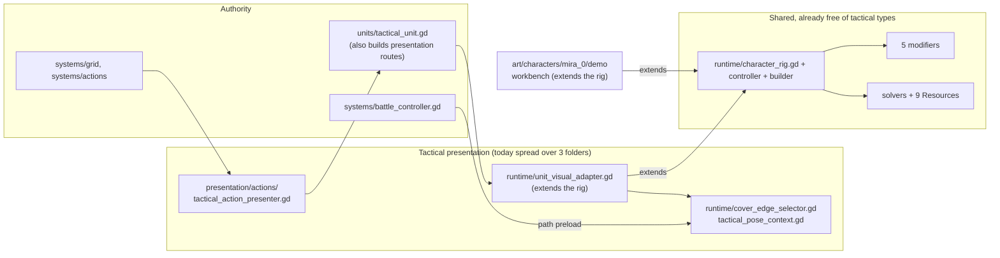
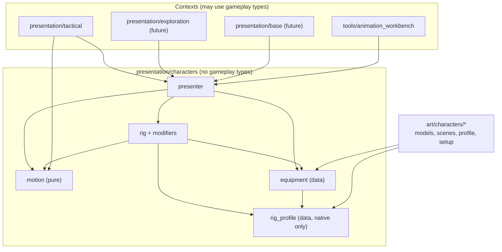

# Animation module and file organization (Task 06)

Where the reusable animation architecture should live in the repository, how modules depend on each other, and how Task 07 can get there in small, safe steps. This is a **design document**: no production file was moved or changed, and nothing in the proposed tree exists yet unless it is marked as existing. Nothing is committed.

> **Revisions after review (2026-11-20).** (1) The former S8 combined moving files with extracting presentation-route behaviour from `TacticalUnit`; it is now **S8 (moves only), S9 (extraction), S10 (cover profile data split)**, and the later steps are renumbered S11 to S15 (section 18.1 and the mapping). (2) The changed-file selector's inability to select tests for changes under `tests/fixtures/` and `tests/support/` is recorded as a **hard S0 prerequisite** that must be implemented and validated before production migration (sections 17 and 18.1). (3) Documentation decision recorded: canonical docs under `docs/`, history under `docs/claude/`, a short README beside the shared code, the full set written with the implementation (section 16).

**Labels.** `[REPO]` read in the source. `[MEASURED]` computed by a scan of the repository during this task. `[PROPOSED]` this design. `[OPEN]` undecided or unverified. Paths marked **(new)** do not exist; every other path in the inventory tables was checked to exist (55 of 55).

Companion: [animation-where-to-go-2026-11-20.md](animation-where-to-go-2026-11-20.md), the short "where do I change X?" guide.

## 1. Executive summary

* **Recommendation: a small hybrid.** Keep the existing top-level home `presentation/characters/` for everything that is *shared character presentation*, but replace its flat 37-file `runtime/` folder with **five responsibility folders** (`presenter/`, `rig/` with `modifiers/`, `rig_profile/`, `motion/`, `equipment/`). Put each **gameplay context's adapter with its context** (`presentation/tactical/` now; `exploration/` and `base/` only when real code exists). Keep **character assets with the character** (`art/characters/mira_0/`), move the **workbench to `tools/`**, keep tests flat in `tests/` (the runner requires it) with fixtures under `tests/fixtures/rigs/`.
* **The boundary already exists in the code.** `[MEASURED]` A scan with comments and strings removed shows that of the 37 files in `presentation/characters/runtime/`, **exactly three** use tactical types in code (`unit_visual_adapter.gd`, `cover_edge_selector.gd`, `tactical_pose_context.gd`); the other 34 are already free of them, and no proposed shared module imports anything gameplay-specific. So the reorganisation is mostly *regrouping and renaming*; real splitting is needed in only three places: `CharacterRig`, `UnitVisualAdapter`, and the presentation duties inside `TacticalUnit`.
* **One real cycle to remove.** The measured module graph has one reverse edge: `CharacterRig` uses `WeaponReadiness` and `RescueInteraction`, which the design places in the presenter. Moving the arbitration and timeline sampling into the presenter (Task 04 M3 and M9) removes it; until then it is recorded as a temporary exception.
* **Few folders, justified.** Five new folders under `presentation/characters/` (plus the `modifiers/` leaf), one new context folder, one tool folder, one fixtures folder. No folder for contacts (a cross-cutting record, not a module), none for interfaces, none per class. Contract types are grouped into five files instead of a dozen.
* **Moves and behaviour changes never share a step.** The reconciled Task 07 sequence (section 18) alternates *move-only* steps (leaf modules first, high-reference files last) with *behaviour* steps, each with a verification command.
* **Reference hazards are real and small.** `[MEASURED]` 1,005 `res://` references and 41 `uid://` references scanned; 0 genuine broken references today. Moving the production character scene would touch about 41 files (so it stays put); moving the runtime scripts touches 6 production files, 4 tests and 2 scenes. One hazard concerns the test runner itself: its import-freshness check looks at file *modification times*, and a moved file keeps an old timestamp, so every move step must force `-Import` (section 17).
* **Prerequisites before any production change:** the checkpoint commits, and a selector that can select tests for fixture changes (S0).
* **Checkpoint first.** Tasks 03 to 06 left research, a prototype, a playground and design reports uncommitted. Section 18 proposes four focused commits, with patch staging for the shared `catalog.json` and `README.md`.

## 2. Current directory and file inventory `[REPO]`

| Location | Files | What it holds today |
| --- | ---: | --- |
| `presentation/characters/runtime/` | 37 `.gd` (+ `.uid`) | **everything**: rig (1,124 lines), adapter (858), controller (280), clip builder (387), five modifiers, nine profile/profile-like Resources, pure solvers, passenger, readiness, tactical pose context, cover selector |
| `presentation/actions/` | 1 | `tactical_action_presenter.gd` (tactical sequencing; awaits visuals with deadlines) |
| `presentation/diagnostics/` | 3 | hand-contact diagnostics, overlay, sampler |
| `presentation/camera/`, `overlays/`, `objectives/` | 2, 20, 1 | camera, tactical overlays, terminal presenter (not character animation) |
| `art/characters/mira_0/` | `models/` (glb), `runtime/` (production scene), `demo/` (workbench, test panel, surface-fit demo) | the only character: assets, its visual scene, and development tools mixed with it |
| `units/tactical_unit.gd` (+ `.tscn`) | 491 lines | tactical node; also route expansion, path smoothing, presented speeds, leg kinds (about 220 lines of presentation duty) |
| `systems/grid/`, `systems/actions/` | | authority: traversal link data, surface navigation, action service (stays) |
| `tools/quality/` | 16 | probes (`crouch_probe`, `grip_probe`, `bone_axis_probe`, `aim_pose_report`, ...), audits, test inventory |
| `research/` | 4 folders | Task 03 host probe, Task 04 update-order probe, the exploration playground, Task 05 rig-profile prototype (all uncommitted) |
| `tests/` | 236 scripts (43 tagged `animation`) | flat; `support/`, `fixtures/`; the runner discovers top-level `tests/*.gd` only |
| `docs/`, `docs/claude/` | | Codex-written docs; Claude-written reports (index `docs/claude/README.md`) |

Responsibilities per file are in the mapping (section 12), which covers all 37 runtime files.

## 3. Existing ownership and coupling observations



Measured facts:

* **Tactical coupling is concentrated.** Tactical identifiers in code (not comments): `UnitVisualAdapter` (`GridManager`, `MapCellData`, `TacticalArchetypeCatalog`, `TacticalUnit`, `TraversalLinkData`), `CoverEdgeSelector` (`GridManager`, `MapCellData`), `TacticalPoseContext` (`GridManager`, `MapCellData`, `SurfaceFit`, `SurfaceNavigation`). Files such as `stair_profile.gd`, `traversal_profile.gd`, `path_refiner.gd` and `rescue_passenger.gd` only *mention* tactical types in doc comments.
* **Inbound references.** `UnitVisualAdapter`: 13 production files and 28 tests; `TacticalUnit`: 58 and 111. The character scene `mira_0_unit_visual.tscn` is instantiated by `units/tactical_unit.tscn` by path, and loaded by `presentation/overlays/movement_ghost.gd`, `tools/asset_lab/asset_lab.gd`, four `tools/quality` probes and 25 tests.
* **The workbench and the adapter both extend the rig by path** (`extends "res://presentation/characters/runtime/character_rig.gd"`), because `CharacterRig` has no `class_name`.
* **Gameplay code imports a presentation helper:** `systems/battle_controller.gd` preloads `tactical_pose_context.gd` by path.
* **Existing conventions worth preserving:** snake_case files, PascalCase `class_name`, `*_profile.gd` for tuning Resources, `*_modifier.gd`, pure `RefCounted` solvers, `.uid` sidecars committed, flat `tests/` with `*_test.gd`, `*_smoke.gd` and explicit-only `*_capture.gd`, per-character asset folders, Claude's reports in `docs/claude/`.

## 4. Organisation strategy comparison

| Criterion | A. Feature-oriented only | B. Technical layers only | **C. Small hybrid** |
| --- | --- | --- | --- |
| Discoverability | good for one feature, poor for "where is all the rig code" | good by kind, poor for "everything about stairs" | one home per *responsibility*, data next to its code |
| Dependency clarity | hidden: features import each other | clear but coarse (a global `modifiers/`, `resources/`) | folder = module = dependency unit |
| Character authoring | scattered | scattered across `resources/` | profile, setup and model together in the character's folder |
| Adding a capability | clear | needs edits in several global folders | the capability's module plus its profile; small |
| Reuse across contexts | poor (features embed context) | fine | contexts separate from shared modules by construction |
| Godot references | many moves | many moves | most moves stay inside `presentation/characters/` |
| Testing | co-located tests impossible (runner) | same | tests flat, tagged by subsystem; fixtures by topic |
| Incremental migration | difficult | difficult | leaf folders first, high-reference files last |
| Cognitive load | medium | medium | low: five names to learn |

**Chosen: C.** The repository's own shape points to it: `presentation/` is already organised by feature (`actions`, `camera`, `characters`, `diagnostics`, `objectives`, `overlays`), and `characters/runtime/` is the one place that stopped being organised. A global technical-layer split (`modifiers/`, `solvers/`, `profiles/` for the whole game) would separate a stair planner from the stair profile it consumes and from the stair tests, which is the opposite of what the developer questions need.

## 5. Recommended annotated directory tree `[PROPOSED]`

```text
presentation/
  characters/                         SHARED character presentation: no tactical, exploration or base types
    README.md                           (new) module map and the dependency rules, 1 page
    presenter/                          what contexts call
      character_presenter.gd            (new) CharacterPresenter: intent, lanes, facing, driver, handles
      presentation_types.gd             (new) enums + Intent + Contact (Posture, FacingMode, Readiness, EquipmentState, Outcome,
                                              Fidelity, Policy, PosturePriority, Limb)
      presentation_actions.gd           (new) PresentationActions: base + Attack, Hit, Pickup, Release, Interact, Defeat, Equip
      action_handle.gd                  (new) ActionHandle: is_done, outcome, wait(), when_done()
      posture_arbiter.gd                (new) source-keyed posture requests
      weapon_readiness.gd               (existing, moved) source-keyed readiness
      rescue_interaction.gd             (existing, moved) pickup/release timeline resource
    rig/                                the humanoid body
      character_rig.gd                  (existing, split) skeleton, pose application, builds the modifier stack
      rig_input.gd                      (new) typed pose input (replaces the 30 string reflection sites)
      character_animation_controller.gd (existing, moved) AnimationTree and clip state
      character_fallback_animation_builder.gd (existing, moved) generated clips
      chest_anchor.gd, rescue_passenger.gd, passive_passenger_pose.gd (existing, moved) attachments on the body
      modifiers/                        the pose stages, in declared order
        locomotion_pose_modifier.gd, cover_crouch_modifier.gd (later posture_pose_modifier.gd),
        traversal_pose_modifier.gd, weapon_pose_modifier.gd, hand_grip_modifier.gd   (existing, moved)
        pose_ownership.gd               (new) declared writes and overlaps; the data behind the ownership test and report
    rig_profile/                        anatomy: what the body IS (pure; imports only Godot native types)
      rig_profile.gd, rig_anatomy.gd, rig_joint_spec.gd, rig_socket.gd   (promoted from the Task 05 prototype)
      rig_roles.gd, rig_diagnostics.gd, rig_resolver.gd, resolved_rig.gd, rig_capabilities.gd   (promoted, resolver split)
    motion/                             how it moves: style data and PURE solvers
      locomotion_profile.gd, locomotion_gait.gd, posture_profile.gd (split from cover_posture_profile.gd)
      traversal_profile.gd, traversal_solver.gd, stair_model.gd, stair_profile.gd, stair_foot_planner.gd
      path_refiner.gd, path_presentation_profile.gd              (existing, moved)
    equipment/                          what it carries: presentation data (imports rig_profile for sockets)
      weapon_handling_profile.gd        (existing, moved)
      equipment_presentation.gd         (promoted)
  tactical/                           TACTICAL context adapter: may import tactical types
    tactical_character_adapter.gd       (the tactical half of UnitVisualAdapter, renamed after the split)
    tactical_action_presenter.gd        (existing, moved from presentation/actions/; later TacticalActionSequencer)
    tactical_route_builder.gd           (new) stairs/ramps/ladders/smoothing expansion, extracted from TacticalUnit
    cover_edge_selector.gd, tactical_pose_context.gd, cover_selection_profile.gd (existing/split)
  exploration/                        (future, Task 08) created only when real adapter code exists
  base/                               (future) likewise
  camera/  overlays/  objectives/  diagnostics/   unchanged (diagnostics keeps the hand-contact tools)

art/characters/mira_0/
  models/mira_0_prototype.glb         unchanged
  runtime/mira_0_unit_visual.tscn     unchanged PATH (about 41 referrers); contents restructured
  mira_0_rig_profile.tres             (new) promoted from the prototype
  mira_0_character_setup.tres         (future) rig profile + gait style + equipment + archetype link
art/weapons/aug/aug_equipment_presentation.tres   (new)

tools/animation_workbench/            (new) pose_workbench.gd/.tscn, locomotion_test_panel.gd (moved from art/characters/mira_0/demo/)
tools/quality/                        unchanged probes (+ a reference audit when added)

tests/                                flat (runner rule); tagged in tests/catalog.json
  fixtures/rigs/                      (new) rig_fixtures.gd (synthetic humanoid builder), alternate_rig_profile.tres
  animation_module_boundaries_test.gd, animation_update_order_test.gd, resource_references_test.gd   (new)

research/                             evidence only: animation_host_probe, animation_update_order_probe, exploration_playground
docs/                                 canonical animation docs (section 16); docs/claude/ keeps the dated evidence
```

**Why a few folders and not more.** `contacts/` does not exist: a `Contact` is a record in `presenter/`, planners are in `motion/`, application is in `rig/`, debugging is in `diagnostics/`, so a contacts folder would only be a second place to look. There is no `interfaces/`: the public surface is `presenter/`. `motion/` is flat (10 files) rather than split into locomotion and traversal because the two share profiles and tests. `rig/clips/` is added only when authored clips arrive. `exploration/` and `base/` are not created now.

## 6. Module ownership table

| Module | Purpose and owned responsibilities | Public surface | May depend on | Must not depend on | Inputs | Extension points | Tests | Docs |
| --- | --- | --- | --- | --- | --- | --- | --- | --- |
| `presenter/` | intent snapshot, lanes, facing, transitions, handles, posture and readiness arbitration, the single frame driver | `CharacterPresenter`, `PresentationTypes`, `PresentationActions`, `ActionHandle` | `rig`, `rig_profile`, `motion`, `equipment` | any context (`tactical`, `exploration`, `base`, workbench), tactical or gameplay types | intent setters, action requests | a new action class; a new lane rule | presenter contract tests (new), posture arbitration test | animation API (canonical) |
| `rig/` | skeleton, pose application, the modifier stack and its order, AnimationTree, attachments | `CharacterRig`, `RigInput`, modifiers | `rig_profile`, `motion` (profiles, solvers), `equipment` (data) | `presenter` (target state), any context | `RigInput`, `Contact`s, a resolved profile | a new modifier (declare writes), a new clip source | composition, rig, modifier, traversal tests | rig authoring guide |
| `rig_profile/` | anatomy: roles, proportions, joints, sockets; resolution, validation, capabilities | `RigProfile`, `RigResolver`, `ResolvedRig`, `RigDiagnostics` | Godot native types only | everything else in `presentation/`, gameplay roles, AP, factions | a `Skeleton3D` and a profile | a new role, rule or capability | rig-profile test, fixtures | rig authoring guide |
| `motion/` | gait style, traversal style and PURE solvers (stairs, ladders, vault, path) | `*Solver`, `*Planner`, `StairModel`, profiles | none (plain data in, plain data out) | any Node, the scene tree, `rig`, `presenter`, tactical types | numbers and models | a new solver with its profile | pure solver tests (`traversal_solver_test`, `traversal_stair_*`, `path_refiner_test`) | animation API |
| `equipment/` | what an item needs and how it is held, stowed, aimed | `EquipmentPresentation`, `WeaponHandlingProfile` | `rig_profile` (socket names) | `rig` runtime, gameplay inventory or legality | item data | a new item resource | weapon pose tests | equipment authoring guide |
| `presentation/tactical/` | tactical policy: cover choice, attack sequencing requests, route expansion, waiting with deadlines | `TacticalCharacterAdapter`, `TacticalActionPresenter`, `TacticalRouteBuilder` | `presenter` contracts, `motion` (run models), `rig_profile` (setup), tactical types | `rig` internals | `TacticalUnit` state, grid, action results | new tactical presentation policy | tactical integration tests (`cover_*`, `unit_visual_adapter_test`, `traversal_*gameplay*`) | tactical guide |
| `tools/animation_workbench/` | development host: scripted intents, overlays, parity | scenes | `presenter`, `rig`, `rig_profile`, diagnostics | its own animation logic | the shared presenter | a new scenario | parity test (new) | animation quick reference |
| `art/characters/<name>/` | the character's model, scene, profile, setup | assets and `.tres` | `rig_profile`, `presenter`, `rig`, `equipment` types | other characters | | a new character folder | rig-profile test, a per-character validation test | rig authoring guide |

## 7. Public interfaces and allowed dependencies

The public surface of the shared module is **`presentation/characters/presenter/` plus the data types of `rig_profile/` and `equipment/`**. A context imports `CharacterPresenter`, the action classes, `ActionHandle`, `PresentationTypes` and, when composing a character, `RigProfile`, `EquipmentPresentation` and the run models from `motion/` (`StairModel`). It never imports `rig/` internals, modifiers or `RigInput`. Everything else is internal.

## 8. Dependency graph



**Measured against today's code** `[MEASURED]` (with the proposed grouping applied to the existing files): `motion` and `equipment` have **no** dependency on any other module; `rig -> motion` and `rig -> equipment` exist (12 and 1 file edges) and are allowed; `tactical -> presenter, motion, rig` exist (the last disappears when the adapter stops extending the rig); **one edge goes against the design: `rig -> presenter`** (`character_rig` uses `WeaponReadiness` and `RescueInteraction`). It is the only reverse edge, with a named removal (Task 04 M3, M9; the rig keeps only the blend value and a contact set).

## 9. Rules that prevent circular dependencies

1. **Direction:** context to presenter to rig to data. Nothing in the shared module may import a context.
2. **The rig never calls the presenter.** It reads typed input (`RigInput`, contacts) that the presenter writes earlier in the frame; it reports through Godot's own signals (`skeleton_updated`). This breaks the presenter and rig cycle by construction.
3. **Pure modules take numbers.** `motion/` solvers take their own profile types and plain data; the presenter converts a `ResolvedRig` into a `StairProfile`. Solvers never import `rig_profile` and never return a presenter type (they return plain records; the presenter makes `Contact`s).
4. **Equipment imports rig_profile, not the reverse** (an item names sockets; a body does not know items). The resolver's equipment-fit function therefore moves to `equipment/`.
5. **Profiles do not import runtime nodes.** `rig_profile/` knows `Skeleton3D` and native resources only.
6. **Cycles inside one context are tolerated but bounded:** `TacticalUnit` and its adapter know each other today. The unit may hold the adapter; the adapter should receive a small snapshot each frame instead of reading unit internals (Task 07 decision at S7), and no shared module sees either.
7. **Tools reuse, never reimplement:** the workbench, probes and diagnostics call the presenter and rig; none may contain animation logic.
8. **If two modules need each other's mutable state, ownership is wrong:** fix the ownership (as with readiness and the rig) rather than adding a pass-through layer.

### 9.1 Enforceable rules and how to check them cheaply

| Rule | Check | Status |
| --- | --- | --- |
| No tactical identifier in code in `presentation/characters/**` | a text scan (comments and strings removed) in a headless test, `animation_module_boundaries_test` (new) | **validated now** with the proposed grouping: 0 violations in the 34 shared files, 3 in the files destined for `tactical/` |
| `rig_profile/` has no gameplay words and imports only native types | same scan plus the existing property-name scan from the Task 05 test | validated for the prototype |
| `motion/` files extend `RefCounted` or `Resource` and never `Node`/`get_tree` | same scan | **validated now**: all 10 files comply |
| Allowed module edges (the graph above) | same scan matching class names and preload paths against an allow-list | validated now: 1 known exception |
| No broken `res://` or `uid://` references | `resource_references_test` (new) or a script | **baseline now**: 1,005 references, 0 genuine breaks (4 false positives: runtime-created temp paths and one regex line in a tool) |
| Modifier order and pose-write overlaps | existing order assertions plus the ownership test (Task 04) | existing and planned |
| Every test classified | `.\tools\run_tests.ps1 check` (also CI) | existing |

No dependency-linting framework is proposed: one small test that reads files is enough, in the style the project already uses.

## 10. Naming conventions

| Thing | Convention | Examples |
| --- | --- | --- |
| Scripts, scenes, Resources | snake_case file, PascalCase `class_name` | `character_presenter.gd`, `CharacterPresenter` |
| Tuning or anatomy Resource | `*_profile.gd` | `rig_profile.gd`, `locomotion_profile.gd`, `stair_profile.gd` |
| Skeletal pose stage | `*_modifier.gd` extending `SkeletonModifier3D` | `locomotion_pose_modifier.gd` |
| Pure geometry | `*_solver.gd`, `*_planner.gd`, `*_model.gd`, `*_refiner.gd`: `RefCounted`, static where stateless | `stair_foot_planner.gd` |
| Presenter action | `PresentationActions.<Verb>Action` inner class | `PresentationActions.AttackAction` |
| Context adapter | `<context>_character_adapter.gd` | `tactical_character_adapter.gd`, `exploration_character_adapter.gd` |
| Typed data record | `RefCounted` for transient records; `Resource` only when authored or saved | `Intent`, `Contact` (RefCounted); profiles (Resource) |
| Workbench | `tools/animation_workbench/` scenes | `pose_workbench.tscn` |
| Diagnostics | `*_diagnostics.gd`, `*_report.gd` | `rig_diagnostics.gd` |
| Tests | `*_test.gd` (checks), `*_smoke.gd` (flows), `*_capture.gd` (explicit graphics); module prefix for new ones | `rig_profile_*_test`, `presenter_*_test`, `pose_composition_*_test`, `animation_*_test` |

**`class_name` policy.** Register globally only types that **cross a module boundary** or appear as an exported Resource/Node type: `CharacterPresenter`, `CharacterRig`, `PresentationTypes`, `PresentationActions`, `ActionHandle`, `PostureArbiter`, `RigProfile`, `RigAnatomy`, `RigJointSpec`, `RigSocket`, `RigResolver`, `ResolvedRig`, `RigCapabilities`, `RigDiagnostics`, `EquipmentPresentation`, the existing profiles, solvers and modifiers, and the context adapters. **Do not** register helpers used by one file (role tables, diagnostic entries, fixture builders): use a `preload` constant or an inner class. `CharacterRig` and `RescuePassenger` currently have no `class_name` and are reached by path; giving them one is the first Task 07 step because it removes a path hazard.

**Avoid the generic words.** `Manager`, `System`, `Data` are not used; `Controller` only with a qualified responsibility. Two existing names need care: **`TacticalActionPresenter`** collides with `CharacterPresenter` (rename to `TacticalActionSequencer`, it sequences waits and cameras), and **`CharacterAnimationController`** is acceptable but vague (a candidate rename later, not worth a step of its own). `UnitVisualAdapter` becomes `TacticalCharacterAdapter` when it has been split. `CoverCrouchModifier` becomes `PosturePoseModifier` (it is the posture stage). Signals use past-tense verbs or `*_changed`; enums are PascalCase types with UPPER_SNAKE members; stable identifiers (socket names, role names, posture sources) are `StringName` with a `context/purpose` namespace (`&"tactical/cover"`).

## 11. Godot scene and Resource reference considerations `[MEASURED][REPO]`

| Kind of reference | How the repo uses it | Move hazard |
| --- | --- | --- |
| `class_name` use | most cross-file references to profiles, solvers, modifiers | **safe** across moves; the global class cache (`.godot/global_script_class_cache.cfg`) is rebuilt by `--import` |
| `preload("res://...")` / `load` by path | 6 production files (rig, controller, passenger, adapter, `battle_controller`), 4 tests for `presentation/characters/`; 25 tests, 4 probes, `asset_lab`, `movement_ghost` and `tactical_unit.tscn` for the MIRA scene | each must be rewritten; a script can do it, an audit confirms |
| `extends "res://.../character_rig.gd"` | the adapter and the workbench | **path hazard**: add `class_name CharacterRig` first |
| scene `ext_resource` with `path` and `uid` | `mira_0_unit_visual.tscn`, the workbench scene, `tactical_unit.tscn` | uid survives a move that carries the `.uid`; the `path` string goes stale. Whether runtime loading falls back to the uid with a stale path (and warns) was **not verified**: Task 07 must test one move before relying on it, and rewrite the paths anyway |
| `.uid` sidecars | committed beside every script | move script and `.uid` together (`git mv` both); a missing sidecar regenerates a new uid and breaks uid references |
| glb import | the model's uid is in its `.import` file | do not move the model |
| `.tres` referencing script paths | prototype profiles; `team_presentation_palette.tres` | rewrite script paths; the prototype `.tres` files reference `research/rig_profile_prototype/*.gd` and will be regenerated after promotion |
| docs | many `docs/claude/*.md` cite paths | links break silently; a link check belongs to each doc-touching step |
| runner and catalog | `tests/catalog.json` `areas` (path prefixes), freshness stamp | section 17 |

**Straightforward moves:** `motion/`, `equipment/`, the modifiers, `chest_anchor`, `weapon_readiness`, `rescue_interaction` (class_name users only). **Need care:** `character_rig.gd` (path-extended), `character_animation_controller.gd` and the workbench (scene references), `tactical_pose_context.gd` (path preload in gameplay code). **Do not move:** the MIRA character scene and the glb.

**Task 07 verification after every move step:** `godot_console --headless --path . --import` (clean class cache), the reference audit (every `res://`/`uid://` resolves), the warning audit (it loads every script, so a bad preload is a parse error), `run_tests.ps1 fast -Subsystem animation`, and the changed-file selection for the touched paths with `-Import`.

## 12. Current-to-target file mapping

All 37 files of `presentation/characters/runtime/`, plus the other animation-related files and the prototype (55 rows; every existing path verified). Step numbers refer to section 18.

| Existing file | Current responsibility | Proposed destination | Change type | Reason | Step | Risk |
| --- | --- | --- | --- | --- | --- | --- |
| `presentation/characters/runtime/character_rig.gd` | the humanoid body: model, weapon and IK construction; weapon/arm/torso/elbow pose; locomotion presentation; carry/pickup/release; traversal and stair state (1,124 lines, 44 exports, no class_name) | presentation/characters/rig/character_rig.gd (body, pose application, builds) + presenter-owned state moves to presentation/characters/presenter/ | Split responsibilities | five sub-systems with independent state; only the body half is skeletal | S1 (class_name), S3 (move), S5, S6, S11, S13 | High |
| `presentation/characters/runtime/unit_visual_adapter.gd` | tactical coordinator (extends the rig): cover, attack/aim sequencing, rescue hooks, route segment hooks, readiness, camera anchors, team and class marker (858 lines) | presentation/tactical/tactical_character_adapter.gd (policy and hooks); attack/aim/readiness sequencing into presentation/characters/presenter/ lanes | Split (S6 and S7), move (S8), then rename (S15) | the only file that reads tactical state; its mechanics are not tactical | S6 and S7 (delegate), S8 (move), S15 (rename) | High |
| `presentation/characters/runtime/character_animation_controller.gd` | AnimationPlayer and AnimationTree, state machine, gait blend spaces, cross-fades (12 J_Bip constants) | presentation/characters/rig/character_animation_controller.gd | Move without behavioural change (role lookups later) | body-level clip playback; referenced by 2 scenes by path and uid | S3 (move), S5 (roles) | Medium |
| `presentation/characters/runtime/character_fallback_animation_builder.gd` | generates every clip procedurally; measure_axes | presentation/characters/rig/character_fallback_animation_builder.gd | Move; later edit to role lookups and derived axes | clip generation is a rig concern; a rig/clips/ folder only when authored clips arrive | S3, S5 | Medium |
| `presentation/characters/runtime/locomotion_pose_modifier.gd` | turn twist, bank, pitch, step lift (ADD) | presentation/characters/rig/modifiers/locomotion_pose_modifier.gd | Move without behavioural change | a skeletal modifier | S3 | Low |
| `presentation/characters/runtime/cover_crouch_modifier.gd` | pelvis drop, leg solve, kneel, spine flexion, support clavicle (posture stage) | presentation/characters/rig/modifiers/cover_crouch_modifier.gd; renamed posture_pose_modifier.gd late | Move; rename only at S15 | it is the posture stage, not a cover stage (Task 04); the class name is used by 6 files and 3 tests | S3, S15 | Low |
| `presentation/characters/runtime/traversal_pose_modifier.gd` | ladder/stair hips and leg IK | presentation/characters/rig/modifiers/traversal_pose_modifier.gd | Move; typed input later | a skeletal modifier | S3, S4 | Low |
| `presentation/characters/runtime/weapon_pose_modifier.gd` | hand and pole targets, torso frame, clavicle reach (19 rig string calls) | presentation/characters/rig/modifiers/weapon_pose_modifier.gd | Move; typed RigInput later | a skeletal modifier | S3, S4 | Medium |
| `presentation/characters/runtime/hand_grip_modifier.gd` | finger curl, wrist orientation (requires all fingers) | presentation/characters/rig/modifiers/hand_grip_modifier.gd | Move; add the no-finger fallback | a skeletal modifier | S3, S11 | Low |
| `presentation/characters/runtime/chest_anchor.gd` | chest-relative anchor shared by sling, passenger, markers | presentation/characters/rig/chest_anchor.gd | Move without behavioural change | attachment helper on the rig skeleton | S3 | Low |
| `presentation/characters/runtime/rescue_passenger.gd` | the carried body: placement, lift path, secondary motion | presentation/characters/rig/rescue_passenger.gd | Move; add class_name | a skeleton-attached node, no tactical type in code | S3 | Low |
| `presentation/characters/runtime/passive_passenger_pose.gd` | passenger spine and limb pose (hard-coded mixamorig_ prefix) | presentation/characters/rig/passive_passenger_pose.gd | Move; roles later | passenger body pose | S3, S5 | Low |
| `presentation/characters/runtime/weapon_readiness.gd` | source-keyed readiness requests, highest wins | presentation/characters/presenter/weapon_readiness.gd | Move; generalise to the posture arbiter pattern | persistent-state arbitration belongs to the presenter (the rig keeps only the blend value) | S6 | Low |
| `presentation/characters/runtime/rescue_interaction.gd` | pickup and release timeline resource | presentation/characters/presenter/rescue_interaction.gd | Move without behavioural change | the action timeline sampled by the presenter lane; the rig currently samples it (a temporary reverse edge) | S3, S6 | Low |
| `presentation/characters/runtime/locomotion_profile.gd` | gait thresholds, speed filters, turn/bank/lean (style) | presentation/characters/motion/locomotion_profile.gd | Move without behavioural change | style data referenced by character setup | S3 | Low |
| `presentation/characters/runtime/locomotion_gait.gd` | joint-angle tables per gait (style) | presentation/characters/motion/locomotion_gait.gd | Move without behavioural change | style data | S3 | Low |
| `presentation/characters/runtime/traversal_profile.gd` | ladder geometry, body windows, speeds | presentation/characters/motion/traversal_profile.gd | Move; split world, body-relative and style values later | data for the ladder/vault solvers | S3, S13 | Medium |
| `presentation/characters/runtime/traversal_solver.gd` | pure ladder and vault contacts | presentation/characters/motion/traversal_solver.gd | Move without behavioural change | pure solver, no tactical identifier in code | S3 | Low |
| `presentation/characters/runtime/stair_model.gd` | pure stair surface model | presentation/characters/motion/stair_model.gd | Move without behavioural change | pure geometry | S3 | Low |
| `presentation/characters/runtime/stair_profile.gd` | stair foot policy, leg and ankle numbers, speeds | presentation/characters/motion/stair_profile.gd | Move; feed anatomy fields from the resolved rig later | solver data | S3, S13 | Medium |
| `presentation/characters/runtime/stair_foot_planner.gd` | pure stair foot placement and pelvis solve | presentation/characters/motion/stair_foot_planner.gd | Move without behavioural change | pure solver | S3 | Low |
| `presentation/characters/runtime/path_refiner.gd` | pure clearance-safe path smoothing | presentation/characters/motion/path_refiner.gd | Move without behavioural change | pure geometry (SurfaceNavigation appears only in a comment) | S3 | Low |
| `presentation/characters/runtime/path_presentation_profile.gd` | path smoothing settings | presentation/characters/motion/path_presentation_profile.gd | Move without behavioural change | solver data | S3 | Low |
| `presentation/characters/runtime/cover_posture_profile.gd` | cover side-choice tuning (tactical policy) and crouch/yaw/clearance numbers (posture style) | presentation/characters/motion/posture_profile.gd (posture numbers) + presentation/tactical/cover_selection_profile.gd (edge choice) | Split responsibilities | half is tactical policy, half is posture style | S10 | Medium |
| `presentation/characters/runtime/cover_edge_selector.gd` | cover edge choice and firing plan (takes GridManager and MapCellData) | presentation/tactical/cover_edge_selector.gd | Move without behavioural change | it reads tactical grid types in code, so it belongs to the tactical context | S8 | Low |
| `presentation/characters/runtime/tactical_pose_context.gd` | grid lookup for the cover contact and route labels; imported by systems/battle_controller.gd | presentation/tactical/tactical_pose_context.gd | Move; update one path in systems/battle_controller.gd | tactical grid types in code | S8 | Low |
| `presentation/characters/runtime/weapon_handling_profile.gd` | rifle stock, grips, sight, stow, raise/lower | presentation/characters/equipment/weapon_handling_profile.gd | Move without behavioural change | equipment presentation data | S3 | Low |
| `presentation/actions/tactical_action_presenter.gd` | tactical sequencing: awaits resolved actions, cameras, deadlines, snap to the committed cell | presentation/tactical/tactical_action_presenter.gd; renamed TacticalActionSequencer late | Move; rename at S15 | tactical context; the name collides with CharacterPresenter | S8 (move), S15 (rename) | Low-Medium |
| `presentation/diagnostics/hand_contact_diagnostics.gd` | wrist and palm contact diagnostics (rig-only) | presentation/diagnostics/hand_contact_diagnostics.gd | Keep in place | already a separate tool folder; no reason to move | - | None |
| `presentation/diagnostics/hand_contact_overlay.gd` | contact overlay | presentation/diagnostics/hand_contact_overlay.gd | Keep in place | as above | - | None |
| `presentation/diagnostics/hand_contact_sampler.gd` | contact sampler | presentation/diagnostics/hand_contact_sampler.gd | Keep in place | as above | - | None |
| `units/tactical_unit.gd` | tactical node; also expands routes into stairs/ramps/ladders, runs the path refiner, assigns leg kinds and presented speeds (about 220 lines of presentation) | stays; route expansion moves to presentation/tactical/tactical_route_builder.gd (new) | Extract reusable code | the unit should execute movement, not build presentation routes | S9 | Medium-High |
| `systems/battle_controller.gd` | battle coordination; preloads tactical_pose_context.gd by path | stays; one path reference updated | Keep in place (reference rewrite) | gameplay authority is not relocated | S8 | Low |
| `art/characters/mira_0/runtime/mira_0_unit_visual.tscn` | the production character scene (adapter root script, controller, model) | same path; its contents are restructured to presenter and rig children | Keep in place (contents change) | referenced by tactical_unit.tscn, movement_ghost.gd, asset_lab, 4 probes and 25 tests: moving it touches about 41 files | S13 | High |
| `art/characters/mira_0/models/mira_0_prototype.glb` | imported model (its uid lives in the .import file) | same path | Keep in place | large imported asset; asset locality | - | None |
| `art/characters/mira_0/demo/mira_0_pose_workbench.gd` | workbench: subclasses the rig, own _process, cover/ladder/stair/path demos (856 lines) | tools/animation_workbench/pose_workbench.gd | Move, then rebuild on the shared driver | a development tool, not a character asset; it must use the shared presenter driver | S6, S12 | Medium |
| `art/characters/mira_0/demo/mira_0_pose_workbench.tscn` | workbench scene | tools/animation_workbench/pose_workbench.tscn | Move (scene path and uid references) | as above | S12 | Medium |
| `art/characters/mira_0/demo/locomotion_test_panel.gd` | workbench panel (class LocomotionTestPanel) | tools/animation_workbench/locomotion_test_panel.gd | Move without behavioural change | workbench UI | S12 | Low |
| `art/characters/mira_0/demo/surface_fit_demo.gd` | asset edge-placement demo lab (not animation architecture) | art/characters/mira_0/demo/surface_fit_demo.gd | Keep in place | documented in docs/asset-edge-placement.md with its path; unrelated to this reorganisation | - | None |
| `research/rig_profile_prototype/rig_profile.gd` | Task 05 prototype: root profile Resource | presentation/characters/rig_profile/rig_profile.gd | Promote (copy, then adjust) | validated by 43 checks; the first piece of the final data model | S4 | Low |
| `research/rig_profile_prototype/rig_anatomy.gd` | prototype: anatomy Resource | presentation/characters/rig_profile/rig_anatomy.gd | Promote | as above | S4 | Low |
| `research/rig_profile_prototype/rig_joint_spec.gd` | prototype: joint Resource | presentation/characters/rig_profile/rig_joint_spec.gd | Promote | as above | S4 | Low |
| `research/rig_profile_prototype/rig_socket.gd` | prototype: socket Resource | presentation/characters/rig_profile/rig_socket.gd | Promote | as above | S4 | Low |
| `research/rig_profile_prototype/rig_roles.gd` | prototype: FuseFire role requirements | presentation/characters/rig_profile/rig_roles.gd | Promote | as above | S4 | Low |
| `research/rig_profile_prototype/rig_diagnostics.gd` | prototype: structured diagnostics | presentation/characters/rig_profile/rig_diagnostics.gd | Promote | as above | S4 | Low |
| `research/rig_profile_prototype/rig_resolver.gd` | prototype: resolver, measurements, validation, capabilities, equipment fit (one file with inner classes) | presentation/characters/rig_profile/rig_resolver.gd + resolved_rig.gd + rig_capabilities.gd; equipment fit moves to equipment/ | Promote and split | inner classes become files; the rig_profile module must not import equipment (equipment imports rig_profile) | S4 | Low-Medium |
| `research/rig_profile_prototype/equipment_presentation.gd` | prototype: equipment requirements Resource | presentation/characters/equipment/equipment_presentation.gd | Promote | equipment data | S11 | Low |
| `research/rig_profile_prototype/fixtures.gd` | prototype: MIRA profile builder and the synthetic alternate skeleton | tests/fixtures/rigs/rig_fixtures.gd | Keep as test fixture | it is a fixture, not production code | S4 | Low |
| `research/rig_profile_prototype/generate_profiles.gd` | prototype: one-off .tres generator | retired after the profiles are generated once | Retire after migration | disposable tooling | S4 | None |
| `research/rig_profile_prototype/profiles/mira_rig_profile.tres` | prototype: MIRA profile data | art/characters/mira_0/mira_0_rig_profile.tres | Promote (character asset locality) | character data belongs with the character | S4 | Low |
| `research/rig_profile_prototype/profiles/alternate_rig_profile.tres` | prototype: alternate profile data | tests/fixtures/rigs/alternate_rig_profile.tres | Keep as test fixture | synthetic body, not a character | S4 | Low |
| `research/animation_host_probe/host_probe.gd` | Task 03: scripted non-tactical host, 12 checks | research/ (kept) until Task 08 converts it to a test | Keep as experimental tooling | evidence; superseded by the Task 08 non-tactical test | Task 08 | None |
| `research/animation_update_order_probe/update_order_probe.gd` | Task 04: measured Godot callback order | its assertion becomes tests/animation_update_order_test.gd; the probe stays as evidence | Extract reusable code (as a test) | the order is a contract the presenter depends on | S0 | Low |
| `research/exploration_playground/exploration_playground.gd` | playable sandbox controller (throwaway glue) | research/ until Task 08; not promoted | Keep as experimental tooling | its glue is the argument for the intent interface, not code to keep | Task 08 | None |
| `tests/rig_profile_prototype_test.gd` | Task 05 evidence test | tests/rig_profile_test.gd (renamed) with fixtures from tests/fixtures/rigs/ | Rename only | tests the promoted module | S4 | Low |

## 13. Experimental code disposition

| Item | Disposition |
| --- | --- |
| Rig-profile prototype (resources, resolver, diagnostics, roles) | **Promote** to `rig_profile/` (and `equipment_presentation.gd` to `equipment/`), after adjusting the resolver split and removing its equipment import |
| Prototype fixtures (synthetic skeleton, profile builders) and the alternate `.tres` | **Test fixtures** under `tests/fixtures/rigs/` (not production) |
| `generate_profiles.gd` | **Disposable**; retire once the promoted `.tres` exist |
| MIRA `.tres` | **Promote** to `art/characters/mira_0/` |
| Update-order probe | **Evidence**; its assertion (presenter before rig; modifiers after all `_process`) becomes a test |
| Host probe (12 checks) | **Evidence**; folded into the Task 08 non-tactical test |
| Exploration playground and its Match Setup button | **Experimental, kept in `research/`**; not promoted. Its controller is disposable glue; the button is an experimental entry point |
| Handle and posture-arbiter sketches (Task 04) | not in the repo; become `action_handle.gd` and `posture_arbiter.gd` with tests |

## 14. Character asset locality

**Character assets belong to the character; shared behaviour belongs to shared modules** holds in this repository. `art/characters/mira_0/` keeps the glb (its `.import` carries the uid), the production scene (`runtime/`) at its current path, and gains `mira_0_rig_profile.tres` and later `mira_0_character_setup.tres`. Weapons stay in `art/weapons/aug/` with a new `aug_equipment_presentation.tres`. **No shared logic is copied into a character folder.** The one exception to relocate is the *workbench and panel* in `art/characters/mira_0/demo/`: they are development tools (shared infrastructure that happens to default to MIRA), so they move to `tools/animation_workbench/`. `surface_fit_demo` stays (asset edge placement, documented with its path). A second character gets its own `art/characters/<name>/` with the same three pieces and shares everything else.

## 15. Eight developer workflows

Each is "start here, change this, validate here". Paths are **target** paths (they exist after Task 07); the current equivalents are in the companion guide.

| Scenario | Start here | Change this | Validate here |
| --- | --- | --- | --- |
| **A. Add another humanoid** | `art/characters/<name>/` (new folder with the imported model) | create `<name>_rig_profile.tres` (assign a `BoneMap` with `SkeletonProfileHumanoid`, set `character_scale`, head top or declared height, joint specs, sockets); a `<name>_character_setup.tres` choosing a gait profile and equipment | run the profile validator (`rig_profile_test` pattern with a per-character check); read the diagnostics and the capability report; open it in `tools/animation_workbench/`; no GDScript edit |
| **B. Add a weapon** | `art/weapons/<weapon>/` | an `EquipmentPresentation` `.tres` (required sockets, two-handed) and a `WeaponHandlingProfile` (grips, stock, sight, stow) | `equipment` fit diagnostics against the rig profile; weapon pose tests; workbench |
| **C. Add a posture** | `presenter/presentation_types.gd` (the `Posture` enum) | the posture's numbers in `motion/posture_profile.gd`; the stage that realises it in `rig/modifiers/` (declare the writes); a request from a context via `set_posture(source, posture, priority)` | `pose_composition_*_test` (new pair test), the ownership test, `fast -Subsystem animation` |
| **D. Change stair foot placement** | `motion/stair_foot_planner.gd` (pure) and `motion/stair_profile.gd` | the planner or the profile fields (anatomy comes from the resolved rig, style stays in the profile) | `traversal_stair_feet_test`, `traversal_stair_gait_test`, then `traversal_stair_gameplay_test` |
| **E. Add an exploration interaction** | the exploration adapter `presentation/exploration/` (future) for the policy | an `InteractionPoint` resource (approach yaw, contacts); the adapter's trigger; the shared action is `PresentationActions.InteractAction` | a presenter contract test and the non-tactical integration test (Task 08) |
| **F. Debug a composition defect** | `rig/modifiers/pose_ownership.gd` and the ownership report | the declaration or the offending stage (relative or replace-component) | the ownership test; `locomotion_cover_composition_test`; reproduce in `tools/animation_workbench/` |
| **G. Add an authored clip** | the character's model import settings (retargeting, bone map) | `rig/character_animation_controller.gd` state mapping; the clip source in `rig/` (a `rig/clips/` folder at that point) | composition tests (authored clip passes the same stages); workbench |
| **H. Add an animation test** | `tests/` (flat), name by module prefix | register it in `tests/catalog.json` (`sub`, `scope`, `fast` if cheap) | `.\tools\run_tests.ps1 check`, then `select -Test <name>`; see the testing guide |

## 16. Canonical documentation structure

| Document | Purpose | Proposed home |
| --- | --- | --- |
| Animation architecture overview and module map | the one page to read first (about 150 lines) | `presentation/characters/README.md` (beside the code) and a pointer in `docs/architecture.md` |
| Animation API and contracts | intent, actions, handles, composition rules, update lifecycle | `docs/animation.md` (distilled from the Task 04 document) |
| Rig authoring guide | add a humanoid; roles, proportions, sockets, validation | `docs/animation-rig-authoring.md` (from Task 05) |
| Equipment authoring guide | add an item or weapon | a section of the rig authoring guide until it needs its own page |
| Quick reference ("where do I change X?") | tables of change to module to test | `docs/animation-quick-reference.md` (promoted from the companion guide) |
| Testing guide | which tests to run | existing `docs/claude/testing-developer-guide-2026-11-20.md` and `docs/quality/project-ironclad.md` |
| Workbench and diagnostics | run, read overlays, ownership report | `tools/animation_workbench/README.md` |
| Audits, research, design history | evidence | stays in `docs/claude/` (Task 02 to 06 reports, dated) |

**Decision (2026-11-20, project owner).** Canonical, maintained animation documentation lives under **`docs/`**. Historical research, audits and dated design reports stay under **`docs/claude/`**. A short README may live beside the shared animation infrastructure (`presentation/characters/README.md`). The full canonical set is **not created now**: each document is written alongside the implementation it describes (step S15, and earlier where a step introduces a new capability). The stale `docs/animation-editing-guide.md` (29 lines) is replaced by the quick reference at that point.

## 17. Test and CI migration considerations

* **`tests/catalog.json` `areas` already map `presentation/characters/` to `animation` by prefix, so every move *inside* that prefix keeps selecting the right tests.** Moves that leave the prefix need new rules: `presentation/tactical/` to `animation` and `actions`; `tools/animation_workbench/` to `animation` and `tooling` (the generic `tools/` rule would otherwise silently map a workbench change to tooling only; longest-prefix lets a more specific entry win, so adding it is enough); `art/characters/` already maps to `animation` and `assets`; `research/` is unmapped (it broadens to the critical tests, harmless).
* **S0 prerequisite: the changed-file selector must select tests for fixture and support changes.** Today a changed `tests/*.gd` path selects "the test itself" and stops, so a changed fixture (`tests/fixtures/**`) or support file (`tests/support/**`) selects **nothing**, even though dozens of tests depend on them (`tests/support/ai_scenario_fixture.gd` alone has 23 users). The fix is **implemented and validated in S0, before any production migration**, and is **not** implemented by this checkpoint. Recommended design: for a changed path under `tests/fixtures/` or `tests/support/`, select every test whose source references that file (a deterministic scan of `res://tests/...` strings and class names), with the `areas` table as a fallback (`tests/fixtures/rigs/` to `animation`, `tests/fixtures/legacy_generation/` to `generation`). **Validation criteria:** (1) `changed -Changed tests/fixtures/rigs/rig_fixtures.gd -List` selects the rig-profile test and every other test that preloads it; (2) `changed -Changed tests/support/ai_scenario_fixture.gd -List` selects its 23 dependent tests; (3) an unreferenced file under `tests/fixtures/` selects the fallback subsystem and says so; (4) the existing selections for non-fixture paths are unchanged (compare `-List` output before and after); (5) `check` stays clean.
* **Hazard in import freshness:** `run_tests.ps1` skips the project scan for `fast`, `select` and `changed` when no source file is newer than the last scan stamp. A `git mv` keeps the file's old modification time, so after a move the class cache can be stale and the scan skipped. Every migration step must pass `-Import` (or the runner should also compare the file list). The runner was not changed by this task.
* **Test discovery** stays `tests/*.gd` top level; no test moves. New tests use module prefixes and catalog tags. Tests that hard-code `res://presentation/characters/runtime/` paths (4: `cover_round_presentation_test`, `surface_navigation_test`, `surface_placement_test`, `tactical_pose_test`) need edits when `tactical_pose_context.gd` moves.
* **CI** runs `check` and `smoke` only; the catalog check keeps new tests classified. A reference audit and the boundary test are cheap enough to join the smoke or fast tiers when they exist.
* **Verification commands per step:** `godot_console --headless --path . --import`; the reference audit; `.\tools\run_tests.ps1 check`; `fast -Subsystem animation -Import`; `changed -Since HEAD -Import -List` to review the selection; the warning audit; the full tier at S0 and at the end (needs the owner's authorisation).

## 18. Task 07 migration and checkpoint strategy

### 18.1 Reconciled sequence

Tasks 04 (M0 to M9) and 05 (seven steps) are merged here. **Rule: a step either moves files (move plus reference rewrite, no behaviour change) or changes behaviour, never both.**

| Step | Kind | What | Verify |
| --- | --- | --- | --- |
| S0 | safety nets (**prerequisites**) | checkpoint commits (below); **fix and validate the changed-file selector for fixture and support changes (section 17: a hard prerequisite, finished before any production migration)**; add the boundary test, reference audit, update-order test, the missing cleanup-matrix and per-pair composition tests (Task 04 M0), catalog areas; **one full-tier run** | the selector validation of section 17; full tier once; `check` |
| S1 | tiny, behaviour-free | `class_name CharacterRig` (and `RescuePassenger`); replace the two path-extends | warning audit; rig and animation tests |
| S2 | profile baseline | run `RigResolver` on MIRA beside the old path, diagnostics only (still `research/`) | rig-profile test |
| S3 | **moves only** | leaf modules inside `presentation/characters/`: `motion/`, `equipment/`, `rig/modifiers/`, `chest_anchor`, readiness, rescue interaction; then `rig/` files; rewrite the 6 + 4 path references | `-Import`, reference audit, `fast -Subsystem animation -Import`, traversal tests |
| S4 | behaviour (additive) | promote `rig_profile/` (adds code, MIRA `.tres`, fixtures to `tests/fixtures/rigs/`) | `rig_profile` test; check |
| S5 | behaviour | role lookups in the clip builder and controller (clips unchanged); typed `RigInput`, `_process_modification_with_delta` (Task 04 M1); declared pose ownership | existing composition and rig tests |
| S6 | behaviour | the single driver (M2), `CharacterPresenter` wrapping the rig with posture and readiness arbitration (M3); the rig stops using `WeaponReadiness` and `RescueInteraction`; workbench uses the driver | workbench-using tests; a parity test |
| S7 | behaviour | typed contracts in `presenter/`; attack and aim lanes (M4), handles (M6); the tactical adapter delegates to the presenter | `aim_hold_presentation_test`, `cover_*`, `traversal_timing_contract_test` |
| S8 | **moves only** | create `presentation/tactical/` and move into it, **unchanged**, `tactical_action_presenter.gd`, `cover_edge_selector.gd`, `tactical_pose_context.gd` and `unit_visual_adapter.gd` (its renaming waits for S15); rewrite the path references (`systems/battle_controller.gd` and the 4 tests that hard-code paths) | `-Import`, reference audit, `fast -Subsystem animation -Import`, `cover_*`, `tactical_pose_test`, `traversal_*` |
| S9 | behaviour (extraction) | extract the route-to-presentation expansion (stairs, ramps, ladders, path smoothing, leg kinds, presented speeds, about 220 lines) from `units/tactical_unit.gd` into `presentation/tactical/tactical_route_builder.gd`, byte-for-byte the same behaviour; `TacticalUnit` keeps executing the movement | the `traversal_*` family including `traversal_timing_contract_test` and `traversal_replay_determinism_test`; `changed -Changed units/tactical_unit.gd` (a central area); **full tier** |
| S10 | behaviour (data split) | split `cover_posture_profile.gd` into `motion/posture_profile.gd` and `presentation/tactical/cover_selection_profile.gd` | `cover_crouch_test`, `cover_edge_selection_test`, `cover_target_aware_test` |
| S11 | behaviour | equipment state, unarmed, grip fallback (M7); `equipment_presentation.gd` promoted | weapon and rescue tests; a new unarmed test |
| S12 | **moves only** | workbench to `tools/animation_workbench/` | workbench scene loads; `-Import`; reference audit |
| S13 | behaviour | foot-point convention (M8) and the character scene's contents; profile-driven stair and traversal values (MIRA keeps explicit equal numbers) | every test that instantiates the visual; the playground test |
| S14 | behaviour | remove the shims; convert the 47 private-state tests (M9) | `check` |
| S15 | **rename only** | `TacticalCharacterAdapter`, `TacticalActionSequencer`, `PosturePoseModifier`; canonical docs written alongside (decision in section 16) and the stale guide retired | reference audit; link check |

The earlier draft combined the `presentation/tactical/` relocation with the `TacticalUnit` extraction; they are now S8 (move) and S9 (extraction) so that each can be verified, and reverted, on its own.

**First thing Task 07 should implement: S0** (and S1 straight after). Nothing else should start before the checkpoint, the selector fix and the safety nets exist.

### 18.2 Checkpoint before Task 07

Current Git state `[REPO]`: branch `main`, HEAD `f838fa2`; modified `docs/claude/README.md`, `tests/catalog.json`, `ui/match_setup.gd`; untracked: four Task 03 to 05 reports and the playground report, `research/` (four folders), two tests with their `.uid`; plus the unrelated Kenney `.import` changes (not part of any group). Proposed commits, in this order (review before authorising anything):

| # | Commit | Files | Staging notes |
| --- | --- | --- | --- |
| 1 | `research(animation): host and update-order probes` | `research/animation_host_probe/**`, `research/animation_update_order_probe/**` (all `.uid` included) | plain `git add` of the folders |
| 2 | `research(animation): rig-profile prototype and its test` | `research/rig_profile_prototype/**`, `tests/rig_profile_prototype_test.gd` (+ `.uid`), the `rig_profile_prototype_test` line of `tests/catalog.json` | `git add -p tests/catalog.json` and accept only the hunk containing `rig_profile_prototype_test` |
| 3 | `feat(exploration): experimental playground and Match Setup button` | `research/exploration_playground/**`, `tests/exploration_playground_test.gd` (+ `.uid`), `ui/match_setup.gd`, the `exploration_playground_test` line of `tests/catalog.json` | `git add -p tests/catalog.json` for the other hunk; `ui/match_setup.gd` is a CRLF file: stage it whole |
| 4 | `docs(animation): Task 03 to 06 reports and guides` | `docs/claude/animation-requirements-research-2026-11-20.md`, `animation-ownership-contracts-2026-11-20.md`, `animation-rig-profiles-2026-11-20.md`, `animation-module-organization-2026-11-20.md`, `animation-where-to-go-2026-11-20.md`, `exploration-playground-2026-11-20.md`, `docs/claude/README.md` | plain `git add` (the README rows reference only files in this commit or earlier ones) |

Exclude: the six Kenney `colormap.png.import` files, `AGENTS.md`, `.agents`, `.codex`, and the `.svg.import` files Godot regenerates in `docs/claude/images/` (untracked noise: delete before staging). Commit as the user, with no co-author trailer, per the standing preference. **Nothing was committed by this task.**

## 19. Tradeoffs, uncertainties and decisions

* **Keep the `presentation/characters/` name** instead of introducing `animation/`: no churn, and the repository already uses `presentation/<feature>/`.
* **Contract types grouped into five files** (types, actions, handle, arbiter, presenter) rather than one file per class: fewer files, but inner classes cannot be registered globally; acceptable because they are used through their file's `class_name`.
* **Tests stay flat.** Folders per module would be nicer to browse but would require a runner change; the catalog tags give the grouping without it.
* **The tactical adapter lives under `presentation/`, not `units/`**: it is presentation policy even though it knows tactical types; `TacticalUnit` stays the authority node.
* **Uncertain:** whether Godot loads a scene whose script `path` is stale but whose `uid` is valid (it must be tested in S3); how large `CharacterRig`'s split will be in lines (the responsibilities are known, the sizes are not); whether `motion/posture_profile.gd` and `cover_selection_profile.gd` is the best split of `CoverPostureProfile`.
* **Decisions that can be deferred to migration:** the exact class and file names beyond those in the tree; whether `rig/clips/` exists; the form of the snapshot passed from `TacticalUnit` to the adapter.
* **For the owner (process, not architecture):** authorising the full regression runs (S0, after S9, and at the end). The documentation location is decided (section 16). No gameplay or long-term architecture question is open from this task.

## 20. Validation and inspection evidence

| What | Result |
| --- | --- |
| Directory and file inventory | every path in the mapping exists: 55 of 55; the mapping covers all 37 runtime files (script check) |
| Boundary claim | a scan with comments and strings removed over the proposed grouping: 34 of 37 shared files free of tactical identifiers, 3 expected violators (all destined for `tactical/`); all 10 `motion/` files are `RefCounted`/`Resource` |
| Dependency direction | module graph computed from `class_name` and preload references: one reverse edge (`rig -> presenter`), named and removable |
| Reference baseline | 1,005 `res://` and 41 `uid://` references scanned: 0 genuine broken references (4 false positives, and unresolvable uids only in the third-party `addons/` folder and the glb's `.import` uid) |
| Reference counts | `presentation/characters/` paths: 6 production files, 4 tests, 2 scenes; MIRA scene path: 3 production, 25 tests, 5 tool scripts (four probes and `asset_lab`), 4 scenes, 4 research files |
| Test metadata | `tests/catalog.json` `areas` inspected; the selector hazards in section 17 read from `tools/run_tests.ps1` |
| `.\tools\run_tests.ps1 check` | catalog complete (236 scripts) |
| Production code | **not changed**; the scans are read-only scripts run from the scratchpad; the proposed tree is **not implemented** |
| Not run | the full regression tier; any file move |

**Limitations.** The scans use name matching, not a Godot parse: a type used only through a variable of an untyped base would be missed. Link validity of the new documents was checked by script (see the companion guide). The runner's behaviour after a move was reasoned from its code, not exercised.
