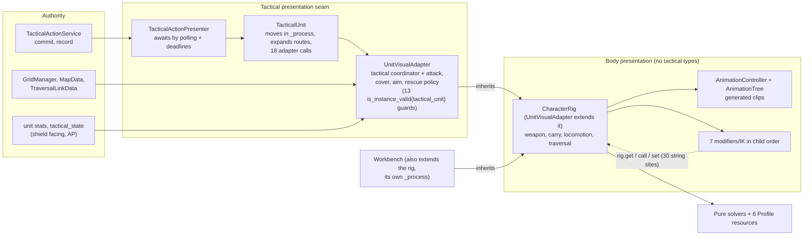
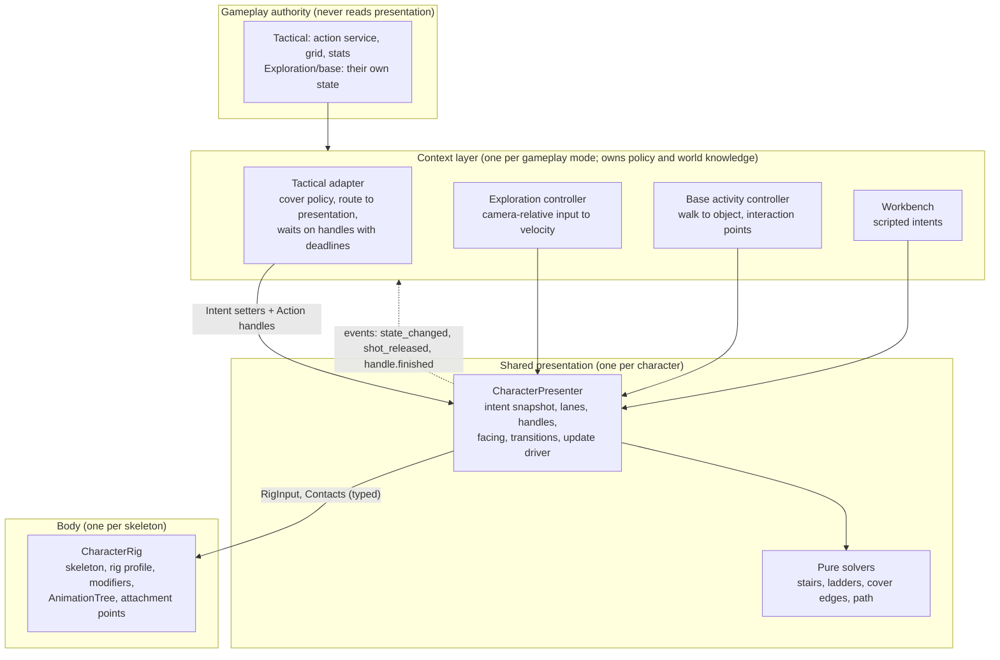

# Animation ownership and public contracts (Task 04)

Design of who owns what in FuseFire's character-animation architecture, and the small public interfaces through which tactical, exploration, base and workbench contexts will drive one shared character presentation. This is a design document: **no production code was changed**, no interface in it exists in the game, and nothing was committed. Tasks 05 to 09 implement it; the design is meant to stay revisable when they find real constraints.

> **Refinement 2026-11-20 (Task 05 addendum).** Four contract corrections and three approved gameplay decisions were folded into this document; it is still one design. Corrections: **(1)** action handles can be observed safely even when they settle before anyone subscribes (sections 6.3 and 7); **(2)** the pose-ownership rule distinguishes exclusive, additive, component-replacing and *declared ordered* overlaps, and validation rejects only *undeclared* conflicts (sections 8.2 to 8.5, 9); **(3)** presentation never scales delta by `Engine.time_scale` a second time, and the Godot 4.7 modifier API notes are recorded (sections 8.5, 12, 13); **(4)** posture arbitration is explicit, with priority independent of the enum, deterministic ties, release, interruption, context-switch and teardown rules and a whole-body override layer (sections 6.4 and 7). Decisions: facing stays presentation-owned except where authority supplies it (6.2, 19); genuinely unarmed humanoids are a normal configuration (6.2, 8, 18, 19); base occupancy and reservations belong to the base simulation (15 scenario C, 19). Nothing else was reopened.

**Evidence labels.** `[REPO]` read in the source today. `[MEASURED]` observed by running something in this task. `[DOC]` documented by Godot (URL given). `[TESTED]` covered by an executed existing test. `[PROPOSED]` this design. `[REC]` a recommendation. `[OPEN]` needs a decision or an experiment.

## 1. Executive summary

* **One sentence.** Gameplay contexts (tactical, exploration, base, workbench) each translate their own world into a *small, typed presentation intent*; one shared **`CharacterPresenter`** per character owns presentation state, facing, transitions, interruption and the per-frame update; the **`CharacterRig`** owns the body (skeleton, profile, modifiers, attachment points); pure **solvers** keep planning contacts. Gameplay authority stays outside all of it.
* **Persistent state and one-shot actions are different things, so they get different shapes.** Continuous desires (velocity, facing, posture, readiness, equipment state) are *idempotent setters* on one inspectable snapshot, using the source-keyed "request / release, highest wins" pattern the code already uses for weapon readiness. One-shot actions (attack, hit, pickup, interact, defeat) are *typed action objects* that return a **handle** with a guaranteed outcome (completed, cancelled, interrupted or skipped). No event bus, no scheduler, no generic framework.
* **The five limitations the playground and probe exposed are all still present** (section 3), and each maps to a specific part of the design: crouch becomes a posture request instead of a cover side effect; unarmed becomes an equipment state; interaction becomes an action with contact specs; the scene's 1 m offset moves from the visual scene to the context that knows the unit's height; clip states stop being the caller's job; facing becomes a mode the presenter owns.
* **Verified engine order** `[MEASURED]` (Godot 4.7.2, a new probe): physics callbacks, then the `process_frame` signal, then every `_process` in tree order (parent first, the `AnimationTree` mixer at *its* tree position), then all skeleton modifiers in child order, then `skeleton_updated`. This fixes the update lifecycle (section 12) and the one real constraint it imposes: the presenter must precede the rig in the tree.
* **Recommended ownership model: a hybrid (section 17)**: thin context adapters plus one shared presenter (option B) whose input is a persistent intent snapshot (option C) plus scoped action handles. The minimal-change option (A) keeps the tactical coupling; the pure declarative model (C alone) cannot express one-shot actions or guarantee completion.
* **Migration is nine small steps**, each behaviour-preserving and each keeping an existing test meaningful (section 18). Tactical timing (commit first, then draw, one barrier with deadlines) and replay determinism are explicit compatibility requirements, not design variables.
* **The three gameplay questions raised by this design are now decided** (section 19): authoritative facing only where a mechanic requires it, genuinely unarmed humanoids as a normal configuration, and base occupancy owned by the base simulation. Open items are engineering experiments, not owner decisions.

## 2. Verified current ownership

Re-checked against the repository at `f838fa2` plus the uncommitted playground work (the playground changes only `ui/match_setup.gd`, adds `research/exploration_playground/`, a test and one catalog line; **no animation production code differs from the Task 03 report**).



| Fact | Evidence |
| --- | --- |
| Tactical movement happens in `TacticalUnit._process`: it advances the node along the route, feeds `update_locomotion(velocity, delta)` each frame and calls `note_segment` / `note_stairs` / `present_path_segment` on segment changes (18 adapter call sites) | `units/tactical_unit.gd:208-240` `[REPO]` |
| The presenter waits for visuals by **polling with deadlines** (`unit.is_attack_pending()` with a 3 s deadline, `_wait_for_movement`, `_wait_for_rescue_interaction`), then **snaps the unit to the committed destination** | `tactical_action_presenter.gd:248-295` `[REPO]` |
| Presentation can be suppressed per result (`presentation_suppressed`, 10 checks in the presenter); a suppressed move snaps | `[REPO]` |
| The adapter's own `_process` runs seven ordered calls (`_tick_locomotion`, aim hold, readiness, cover crouch, attack, traversal, weapon pose); the workbench has a different `_process` | `unit_visual_adapter.gd:798`, `mira_0_pose_workbench.gd:227` `[REPO]` |
| Modifier order is the order of children of the skeleton: `Locomotion, CoverCrouch, Traversal, TraversalLegIK, WeaponPose, WeaponArmIK, HandGrip`; the rig builds them in a fixed sequence and inserts before the arm IK by index | `character_rig.gd:320-335, 369-390`; measured child order below `[REPO][MEASURED]` |
| All five modifiers implement the **deprecated** `_process_modification()` (Godot 4.7 documents `_process_modification_with_delta(delta)` as its replacement and says modifiers must not apply `influence` themselves) | `[REPO]` + [SkeletonModifier3D](https://docs.godotengine.org/en/stable/classes/class_skeletonmodifier3d.html) `[DOC]` |
| **Authoritative facing exists in one place:** the Shield stance computes a `facing` vector from *cells* (`CombatRules.shield_direction`) and stores it in `tactical_state.establish_shield(facing)`; it is recorded in the replay fingerprint. The visual yaw is never read back by the rules | `tactical_action_service.gd:324-376`, `shield_action_result.gd:38` `[REPO]` |
| **No inventory or equipment legality exists.** The only weapon-related authoritative datum is the archetype's `weapon_damage_multiplier`; the visual weapon is always the AUG | `tactical_archetype.gd:24`, `character_rig.gd:13,260` `[REPO]` |
| `TacticalUnit.standing_height` (default 1.0) is the unit-origin-above-floor convention; the visual scene's 1 m offset is a **separate, duplicated** assumption of the same number | `tactical_unit.gd:14`, `mira_0_unit_visual.tscn` root transform `[REPO]` |
| Weapon readiness already uses source-keyed `request` / `release` with "highest request wins" | `weapon_readiness.gd` `[REPO]` |

### 2.1 Measured update order (Godot 4.7.2)

A disposable probe, `research/animation_update_order_probe/update_order_probe.gd`, instantiates the production visual under a parent probe node, adds a child probe node and a sibling, and records one steady-state frame. Result (headless, single-threaded; repeated twice, identical):

```
SceneTree.physics_frame, physics callbacks (parent, child, sibling)      <- when a physics tick is due
SceneTree.process_frame
process: parent of the visual          (e.g. TacticalUnit)
AnimationTree.mixer_applied            (the mixer, at its own tree position)
process: child of the visual / sibling after the parent
modifier_done: Locomotion, CoverCrouch, Traversal, WeaponPose, WeaponArmIK, HandGrip   (child order)
Skeleton3D.skeleton_updated            (last)
```

`TraversalLegIK` emitted no `modification_processed` in that frame (it was inactive). `[DOC]` agrees: within one priority nodes process in tree order, `_process` runs after physics ticks, the two rates are not synchronised ([Idle and physics processing](https://docs.godotengine.org/en/stable/tutorials/scripting/idle_and_physics_processing.html), [Node](https://docs.godotengine.org/en/stable/classes/class_node.html)); modifiers run after the mixer ([SkeletonModifier3D](https://docs.godotengine.org/en/stable/classes/class_skeletonmodifier3d.html)); `skeleton_updated` fires when the final pose is applied ([Skeleton3D](https://docs.godotengine.org/en/stable/classes/class_skeleton3d.html)). What the docs do not state and the probe does: **all modifiers run after every `_process`**, so anything any node sets during `_process` reaches the modifiers in the same frame regardless of tree order, while *reading* pose results from `_process` sees the previous frame.

## 3. Important existing limitations (rechecked)

The Task 03 probe and the playground listed six. All remain `[REPO]`/`[MEASURED]`:

| # | Limitation | Still true? | Where the design answers it |
| --- | --- | --- | --- |
| 1 | A direct crouch request is overwritten every frame by the adapter's cover sync (`_sync_cover_crouch` writes `crouch_modifier.depth`) | Yes (`unit_visual_adapter.gd:568-573`) | Posture is a source-keyed request on the presenter; cover is just one *source* (section 6.1) |
| 2 | No generic interaction request | Yes | `InteractAction` with an `InteractionPoint` and contact specs (6.2, scenario C) |
| 3 | Unarmed is not an equipment state (the rig asserts a weapon) | Yes (`character_rig.gd:260`) | `EquipmentState.NONE / HELD / SLUNG` (6.1, scenario E) |
| 4 | The visual scene assumes the tactical-origin offset | Yes | Transform conventions (section 10): the presenter's node origin is the **foot point**; the offset moves to the tactical composition |
| 5 | Callers coordinate clip states manually (`present_move`, `present_idle`) | Yes (probe and playground both do it) | The presenter derives clip state from the intent (velocity, posture, readiness, equipment) |
| 6 | Facing is entangled with locomotion (`update_locomotion` rotates the whole body toward the velocity at 360 deg/s) | Yes | `FacingMode` owned by the presenter (6.1) |

Other limitations the design also addresses: string reflection between modifiers and rig (30 sites), two frame drivers, scattered rig identity (Task 05), deprecated modifier virtual, manual cleanup calls (`end_traversal`, `end_stairs`, `finish_interaction_now`, ...), duplicated facing state (`rotation.y`, `_cover_yaw`, `character_root.rotation.y`), and private-state test coupling (47 scripts).

## 4. Target responsibility model



**Rules of the model.**

1. **Information flows down as intent and up as events**; nothing in the presentation reads or writes gameplay authority.
2. **A context owns policy**: whether an action is allowed, which cover edge, when to walk where, what a chair means. **The presenter owns appearance**: how the body gets there, how long it takes visually, how it recovers.
3. **The rig owns the body and is unaware of intent**: it takes a typed pose input and contact set and produces a pose.
4. **Solvers own geometry-to-contact maths** and stay pure and scene-free.
5. **The same presenter and rig run in every context**; contexts differ only in the adapter above them.

## 5. Ownership matrix

Each responsibility has exactly one owner. "Data" provides numbers, "Behaviour" executes, "State" holds mutable state; where more than one cooperates the owner is the one that decides.

| # | Responsibility | Owner | Dependencies | Inputs | Outputs | Lifecycle | Current implementation | Required change | Rationale |
| --- | --- | --- | --- | --- | --- | --- | --- | --- | --- |
| 1 | Authoritative world position, collision, occupancy | **Context's gameplay authority** (tactical: grid and unit; exploration: character body) | physics or grid | actions, input | position | the game | `TacticalUnit`, `GridManager`; playground `CharacterBody3D` | none | Presentation must never move authority |
| 2 | Movement legality, AP, costs, combat, missions, replay record | **Tactical authority** (action service, rules) | grid, stats | requests | results, fingerprint | the battle | action service | none | Task 04 does not touch it |
| 3 | Equipment legality and inventory state | **Context authority** (does not exist yet) | n/a | n/a | an `EquipmentState` and item *presentation id* offered to the presenter | n/a | absent (only `weapon_damage_multiplier`) | the design only *consumes* an equipment state; it does not invent an inventory | Avoids new gameplay scope |
| 4 | Translating a mode's events into presentation input | **Context adapter** | authority, grid, camera | gameplay events | intent setters, actions | with the context | `UnitVisualAdapter` (mixed in), `TacticalUnit` (route expansion), `TacticalActionPresenter` | split out of the adapter and the unit | One place per mode; reusable presenter below |
| 5 | Context policy (cover side, allowed actions, timing barriers) | **Context adapter** | grid, rules | | which posture / action to request; when to wait | with the context | adapter (cover), presenter (waiting) | keep policy on this side of the seam | Keeps tactical rules out of reusable code |
| 6 | Route to surface-run models (stairs, ramps, ladders) | **Context adapter** (builds `SurfaceRun` data from its world) | map / world geometry | links or colliders | run models + progress | per move | `TacticalUnit.move_along_path` (~220 lines) | move to a tactical route builder | The unit should not expand presentation routes |
| 7 | Receiving intent, current presentation state, clip state selection | **`CharacterPresenter`** | rig, profiles | intent snapshot, actions | clip request, `RigInput` | per character | `UnitVisualAdapter` + `CharacterRig` mixed | new component | One state owner removes duplicated facing, aim, carry and stow state |
| 8 | Facing and turning presentation | **Presenter** (visual root yaw is its output) | locomotion profile | `FacingMode`, target, velocity | root yaw, hips twist request | per frame | adapter `rotation.y`, `_cover_yaw`, rig `_twist` | single owner | `update_locomotion` entanglement removed |
| 9 | Locomotion parameters (gait blend, cadence, bank, pitch) | **Presenter** | `LocomotionProfile` | velocity | animation parameters, `RigInput` | per frame | `CharacterRig.update_locomotion_presentation` | move behind the presenter | Already context-free |
| 10 | Action presentation (attack, hit, pickup, release, interact, defeat) | **Presenter** (action lanes) | rig, equipment | `Action` objects | handles, `shot_released` | per action | adapter timelines; `RescueInteraction` | actions as typed objects | Guaranteed outcomes |
| 11 | Interruption, recovery, cleanup | **Presenter** | all lanes | cancel, supersede, teardown | settled handles, released contacts | per transition | ~6 manual `end_*` calls | lane `exit()` hooks | Prevents stale state |
| 12 | Presentation completion signals | **Presenter** (handles, `state_changed`, `shot_released`) | | | signals | per action | polling `is_attack_pending()`; adapter signals used by tests only | handles replace polling (polling `is_done()` stays valid) | Compatible with tactical waiting |
| 13 | Visual time and update order | **Presenter** (the single driver) | Godot tree order | delta | one tick | per frame | adapter `_process`, workbench `_process` | one driver | Parity of production and workbench |
| 14 | Skeleton access, rig configuration, transform conventions | **`CharacterRig`** with the rig profile (Task 05) | model scene | | skeleton, bone roles, proportions | per skeleton | scattered literals | profile data | Second humanoid |
| 15 | Pose application and modifiers | **Rig** | typed `RigInput`, contacts | | final pose | per frame | five modifiers, string reflection | typed input; declared ownership | Composition rules (section 8) |
| 16 | Contact **planning** (feet, hands) | **Pure solvers** invoked by the presenter | run models, rig proportions | progress, speed, profile | contact targets in character space | per frame | `TraversalSolver`, `StairFootPlanner` | read proportions from the rig profile | Keep working solvers |
| 17 | IK targets and solving | **Rig** (target markers, `TwoBoneIK3D`) | contacts | | pose | per frame | rig markers | convert character space to skeleton space inside the rig | One conversion point |
| 18 | Grip resolution | **Rig** (`HandGripModifier`) fed by equipment and contact data | equipment profile | | wrist, fingers | per frame | grip modifier | none | Stays |
| 19 | Equipment presentation (held, slung, none; weapon pose config) | **Presenter** (state) + **equipment presentation resource** (data) + **rig** (attachment) | item profiles | `EquipmentState` | attachment, hand targets | per equip | one built-in rifle | equipment as data | Unarmed becomes normal |
| 20 | Attachment following (slung weapon, passenger, class marker) | **Rig**, in `skeleton_updated` | final pose | | transforms | per frame | adapter and rig | stays, documented as post-pose stage | Reads final pose |
| 21 | Rig-specific capabilities and proportions | **Rig profile** (Task 05) | | | | per rig | constants | profile | |
| 22 | Diagnostics (who wrote a bone) | **Rig** (ownership report) | | | report | on demand | absent | add | Section 8.4 |

## 6. Proposed public presentation contracts

### 6.1 Shape: a small hybrid

| Kind | Shape | Why |
| --- | --- | --- |
| Persistent desired state (velocity, facing, posture, readiness, equipment) | **Idempotent typed setters** that write one **`Intent` snapshot**; source-keyed where several systems may ask (posture, readiness), highest priority wins, release withdraws | Idempotent, inspectable, trivially testable, replay-reconstructable; the code already does this for readiness (`WeaponReadiness`) |
| One-shot actions (attack, hit, pickup, release, interact, defeat, equip change) | **Typed `Action` objects** (`RefCounted`) returning a **`Handle`** | Carry only their data; have a lifecycle; give completion a single mechanism |
| Events out | **A few signals** on the presenter plus `Handle.finished` | `shot_released` and `state_changed` already exist and are wanted; no bus |
| Data (profiles, interaction points, contact specs, equipment presentation) | **`Resource`s** | Inspectable and editable in Godot; the project's convention |
| Rig input | **A typed `RefCounted` (`RigInput`)** | Replaces 30 string `get/call/set` sites and shared mutable fields |
| Diagnostics, reports | `Dictionary` is acceptable (not a contract) | |

**Why not commands only (method soup)?** Persistent desires would need defensive de-duplication in every caller. **Why not declarative only?** A pickup is an event with a beginning and an end; it cannot be derived from a state diff, and completion would again need polling. **Why not a message bus?** Nothing here has multiple unknown subscribers; direct typed calls and handles are easier to follow and debug.

**Stable across contexts:** the vocabulary (`Posture`, `FacingMode`, `Readiness`, `EquipmentState`, `Outcome`, `Fidelity`), the intent fields, the action classes, handles, contacts. **Context-specific:** how a context decides what to ask (cover edge selection, camera-relative input, a chair's interaction point), the world data it feeds (surface-run models), and the timing barrier it imposes.

### 6.2 What each interface means

* **Velocity** is a *report of how the character is moving* (world-space metres per second), not a movement command. The context moves authority; the presenter derives gait, cadence, lean and bank from it. Speed zero is standing. (Today's `update_locomotion` already means this: the tactical layer owns speed and heading; the adapter only reports them.)
* **Facing** has four modes: `FOLLOW_VELOCITY` (default while moving), `FACE_POINT` (turn toward a world point and hold), `FACE_YAW` (a world yaw; used when authority supplies a facing such as the Shield stance's), `HOLD` (do not turn; cover absorbs facing into the posture yaw offset). The presenter owns turn rate, hips twist and the visual root's yaw.
  **Authority of facing (approved).** General character facing is **presentation-owned**. Where a gameplay mechanic explicitly needs an authoritative direction, **gameplay authority determines it and supplies it** (the Shield stance already does, from cells, and is replay-recorded); the presentation receives it as `FACE_YAW` or a posture yaw offset and never feeds it back. **No authoritative tactical result may ever be derived from visual rotation.** Future mechanics such as overwatch cones, directional armor or facing-dependent flanking will each have to introduce their own authoritative facing in the rules layer; none is designed or implemented here.
* **Posture** is source-keyed with an explicit integer priority (section 6.4). `set_posture(&"tactical/cover", CROUCH, PosturePriority.CONTEXT, yaw_offset)` and `set_posture(&"exploration/walk", STAND, PosturePriority.BASE)` coexist; the highest priority wins, equal priorities resolve to the most recent change, and `release_posture` withdraws. **Cover is a context policy that supplies a posture request; it is no longer a special case inside the body.**
* **Readiness** keeps its present semantics (`LOWERED / READY / AIMED`, source-keyed, highest wins); `STOWED` becomes part of equipment state because it is a statement about the weapon's whereabouts, not its readiness.
* **Equipment** is `NONE / HELD / SLUNG`; the item's *presentation* (scene, grips, stow place) comes from an equipment presentation resource. The authoritative loadout, when it exists, lives in the context. **A genuinely unarmed humanoid is a normal configuration (approved):** civilians, support personnel, rescued characters and androids without firearms all use `NONE`. **A rig must never require a weapon to exist** (today's `assert(weapon_scene != null)` is a limitation to remove). `EquipmentState` describes only *what the body is physically holding*; it grants or denies nothing: whether an unarmed character may attack, reload, or take any action is decided by gameplay systems, never inferred from the presentation state. No inventory and no new tactical action is introduced by this design.
* **Contacts** are typed (`Contact`), registered **by source** and cleared by source, so cleanup is one call.

### 6.3 Completion, interruption, cancellation

Every action returns a `Handle` whose outcome is settled **exactly once**: `COMPLETED`, `CANCELLED` (the requester withdrew, or the request was rejected as busy), `INTERRUPTED` (a higher-priority action superseded it, or the character was defeated or removed), or `SKIPPED` (presentation fidelity was reduced; the *end state* was applied instead).

**Completion must be observable whether the handle is still pending or already settled.** A rejected, skipped or suppressed request can settle *before `request()` returns*, so a caller that connects to a signal afterwards would miss it and hang. The handle therefore exposes: `is_done()` and `outcome` (inspectable at any time); `wait()` (a coroutine that **returns the outcome immediately if already settled**, otherwise waits for the single settlement); and `when_done(callback)` (runs the callback **at once if already settled**, otherwise once on settlement). Direct `finished.connect(...)` remains available but is for observers that are connected *before* the request; new code should use `wait()` or `when_done()`. Settlement is idempotent (a second `settle` is ignored and the first outcome stays). The pattern was executed in a scratch test (section 20) covering settled-before-subscribe, pending, repeated settlement and several subscribers. Contexts that need a deadline (the tactical presenter) keep polling `is_done()` against their deadline; contexts without one (exploration, workbench) can simply `await handle.wait()`.

### 6.4 Posture arbitration

A small, predictable table of requests, resolved by the presenter, **not** by the rig:

* **A request** is `(source, posture, priority, yaw_offset)` plus a presenter-assigned `sequence` counter. `source` is a namespaced `StringName` (`&"tactical/cover"`, `&"exploration/walk"`) so that an owner can find and release its own requests.
* **Priority is an explicit integer, independent of the `Posture` enum values.** It is chosen by the requester from four named tiers with gaps for later insertion: `BASE = 0` (a context's ordinary posture), `CONTEXT = 100` (a context policy such as cover), `ACTION = 200` (a posture an action needs for its duration), `FORCED = 300` (a scripted or debug override). A `KNEEL` at `BASE` never beats a `CROUCH` at `CONTEXT`; a `STAND` at `FORCED` beats both.
* **Winner:** the highest priority. **Ties** resolve to the request with the highest `sequence`, i.e. the **most recently changed** one. `sequence` is a call-order counter, not wall-clock time, so the result is deterministic whenever the call order is (as in replays). Two sources with equal priority are a design smell: the diagnostics report flags every tie.
* **Updating:** the same source calling `set_posture` replaces its own request. An **identical** request (same posture, priority and yaw offset) is a no-op and does **not** refresh `sequence`, so per-frame idempotent calls cannot reorder anything; a real change refreshes it.
* **Releasing:** `release_posture(source)` removes one request (releasing an absent source is a no-op); `release_posture_prefix("tactical/")` removes every request of a context. With no requests the posture is `STAND`.
* **Interruption:** posture is **persistent state, not an action**: cancelling or superseding actions never touches the request table. A request that must not outlive its owner is the owner's responsibility to release; contexts do so in their exit path.
* **Context switching:** the leaving adapter calls `release_posture_prefix(<its prefix>)` (and the matching release for readiness and contacts); the entering adapter sets its own requests. Anything not released carries over, deliberately.
* **Teardown:** `teardown()` and defeat clear the whole table, so no request can outlive the character.
* **Whole-body overrides** (traversal, defeat) do **not** write into the table. They set an *override layer* that the presenter consults: while active the body is in the override's hands and the winner is ignored (the persistent requests are stored untouched); when the override ends the presenter resumes from the table, ramping by weight rather than snapping. Persistent state is therefore never corrupted by a temporary whole-body action.
* **Debugging:** `intent()` shows the resolved posture; a diagnostics report lists every request (source, posture, priority, sequence), marks the winner and any tie, and says whether an override is active.

The arbitration logic above was written as a scratch sketch and executed (12 checks, all passing; section 20). It is design validation only: no production file contains it.

## 7. Representative typed GDScript interfaces

The following sketch was **syntax-checked only** (`godot_console --headless --check-only` accepted it; a deliberately broken copy was rejected, so the check is meaningful). It was never executed and exists in no production file. It uses inner classes only to fit in one file; the real homes are Task 06's business.

```gdscript
extends RefCounted
## SKETCH ONLY (Task 04): proposed public presentation contracts. Not used by production. Syntax-checked, never executed.

# ---------------------------------------------------------------- vocabulary shared by every context
enum Posture { STAND, CROUCH, KNEEL }
enum FacingMode { FOLLOW_VELOCITY, FACE_POINT, FACE_YAW, HOLD }
enum Readiness { LOWERED, READY, AIMED }   # same meaning as WeaponReadiness.Level (STOWED is an equipment state)
enum EquipmentState { NONE, HELD, SLUNG }
enum Outcome { COMPLETED, CANCELLED, INTERRUPTED, SKIPPED }
enum Fidelity { FULL, FAST_FORWARD, SUPPRESSED }
enum Policy { SUPERSEDE, REJECT_IF_BUSY }
enum Limb { HAND_LEFT, HAND_RIGHT, FOOT_LEFT, FOOT_RIGHT }
enum PosturePriority { BASE = 0, CONTEXT = 100, ACTION = 200, FORCED = 300 }   # explicit integers: independent of the Posture enum values

## What a context asks for, continuously. Idempotent: setting the same value twice changes nothing.
class Intent extends RefCounted:
	var velocity := Vector3.ZERO                 # world space, metres per second; zero means standing
	var facing_mode := FacingMode.FOLLOW_VELOCITY
	var facing_point := Vector3.ZERO             # FACE_POINT: a world point
	var facing_yaw := 0.0                        # FACE_YAW: radians, world
	var posture := Posture.STAND
	var posture_yaw_offset := 0.0                # a body offset the context wants held (cover peek side), radians
	var equipment := EquipmentState.HELD
	var readiness := Readiness.LOWERED           # already resolved from the per-source requests by the presenter

## A one-shot request with a lifecycle. Settles exactly once; observable before OR after settlement.
class Handle extends RefCounted:
	signal finished(outcome: Outcome)
	var outcome: Outcome = Outcome.COMPLETED
	var _done := false
	func is_done() -> bool:
		return _done
	## Returns at once if already settled (a rejected, skipped or suppressed request settles before request() returns); otherwise waits for the single settlement.
	func wait() -> Outcome:
		if _done:
			return outcome
		return await finished
	## Runs `callback(outcome)` exactly once: immediately if already settled, otherwise on settlement. Cannot miss the settlement.
	func when_done(callback: Callable) -> void:
		if _done:
			callback.call(outcome)
		else:
			finished.connect(callback, CONNECT_ONE_SHOT)
	func settle(result: Outcome) -> void:   # called only by the presenter
		if _done:
			return
		_done = true
		outcome = result
		finished.emit(result)

class Action extends RefCounted:
	var policy: Policy = Policy.SUPERSEDE
	var handle := Handle.new()

class AttackAction extends Action:
	var target_point := Vector3.ZERO

class HitAction extends Action:
	var from_direction := Vector3.BACK
	var severity := 1.0

class InteractAction extends Action:
	var point: InteractionPoint

class InteractionPoint extends Resource:
	@export var approach_facing_yaw := 0.0
	@export var contacts: Array[ContactSpec] = []

class ContactSpec extends Resource:
	@export var limb: Limb = Limb.HAND_RIGHT
	@export var offset_local := Vector3.ZERO     # in the interaction object's own frame
	@export var curl := 0.0

## A moving world frame the contact is expressed in, so the presenter re-expresses it in character space every frame.
class Contact extends RefCounted:
	var limb: Limb = Limb.HAND_RIGHT
	var source: StringName = &""
	var priority := 0
	var world_transform := Transform3D.IDENTITY
	var weight := 0.0
	var curl := 0.0

# ---------------------------------------------------------------- shared presentation (what contexts call)
class Presenter extends Node3D:
	signal state_changed(state: StringName)
	signal shot_released()                          # the moment a visible shot happens (the tactical presenter times target reactions from it)
	var fidelity: Fidelity = Fidelity.FULL

	func intent() -> Intent: return Intent.new()   # a copy, for tests, diagnostics and replay reconstruction
	func apply_intent(_snapshot: Intent) -> void: pass   # idempotent state application (seek, skipped actions)

	func set_velocity(_world_velocity: Vector3) -> void: pass
	func face_point(_world_point: Vector3) -> void: pass
	func face_yaw(_radians: float) -> void: pass
	func set_posture(_source: StringName, _posture: Posture, _priority: int, _yaw_offset := 0.0) -> void: pass   # source-keyed; highest priority wins; ties: most recent change
	func release_posture(_source: StringName) -> void: pass
	func release_posture_prefix(_prefix: String) -> void: pass                 # a context leaving: remove all of its requests
	func request_readiness(_source: StringName, _level: Readiness) -> void: pass
	func release_readiness(_source: StringName) -> void: pass
	func set_equipment(_state: EquipmentState) -> void: pass

	func request(_action: Action) -> Handle: return Handle.new()
	func cancel_all(_outcome := Outcome.CANCELLED) -> void: pass
	func set_contact(_contact: Contact) -> void: pass
	func clear_contacts(_source: StringName) -> void: pass
	func teardown() -> void: pass                   # every open handle settles, every contact is released

# ---------------------------------------------------------------- the rig (what the presenter calls)
class RigInput extends RefCounted:
	var hips_twist_degrees := 0.0
	var bank_degrees := 0.0
	var pitch_degrees := 0.0
	var crouch_depth := 0.0
	var kneel := 0.0
	var lean_degrees := 0.0
	var weapon_weight := 0.0
	var traversal_weight := 0.0

class Rig extends Node3D:
	func apply_pose_input(_input: RigInput) -> void: pass                # typed, replaces string get/call
	func apply_contacts(_contacts: Array[Contact]) -> void: pass         # character-space conversion happens here
	func pose_ownership_report() -> Array[Dictionary]: return []          # diagnostics only

# ---------------------------------------------------------------- call-site examples (compile checks)
static func tactical_example(presenter: Presenter, target_world: Vector3) -> void:
	presenter.set_velocity(Vector3(0.0, 0.0, 4.0))
	presenter.set_posture(&"tactical/cover", Posture.CROUCH, PosturePriority.CONTEXT, 0.35)
	presenter.request_readiness(&"tactical/attack", Readiness.AIMED)
	var attack := AttackAction.new()
	attack.target_point = target_world
	var handle := presenter.request(attack)
	# Safe even if the request was rejected or skipped and settled before this line: the callback then runs at once.
	handle.when_done(func(outcome: Outcome) -> void: presenter.release_readiness(&"tactical/attack"))

## A context without a deadline can simply await. This cannot hang on an already-settled handle.
static func exploration_example(presenter: Presenter, input_direction: Vector3, speed: float, door: InteractionPoint) -> void:
	presenter.set_velocity(input_direction * speed)
	presenter.set_posture(&"exploration/walk", Posture.STAND, PosturePriority.BASE)
	presenter.face_point(Vector3.ZERO)
	var interact := InteractAction.new()
	interact.point = door
	var outcome: Outcome = await presenter.request(interact).wait()
	if outcome != Outcome.COMPLETED:
		presenter.clear_contacts(&"exploration/interact")
```

**Notes on the sketch.**

* The sketch deliberately does not name concrete classes for the rig profile (Task 05) or the surface-run models (stairs, ladders; they exist today as `StairModel` and `TraversalProfile` data and would be passed through a typed `set_surface_run(run, progress)` whose shape Task 07 should settle with the existing solvers).
* `Intent` fields are a *snapshot*, not the working state: the presenter keeps the source-keyed requests and exposes the resolved snapshot.
* `Action` subclasses that exist today as timelines map one to one: `RescueInteraction` (pickup/release) stays the timeline resource a `PickupAction` carries; the attack phases (`RAISE, ALIGN, FIRE, RECOVER, RELEASE`) become the internal states of `AttackAction`'s lane.
* A tactical call-site mapping for the 18 existing adapter calls:

| Today (`UnitVisualAdapter`) | Becomes |
| --- | --- |
| `present_move()`, `present_idle()`, `update_locomotion(velocity, delta)` | `set_velocity(...)` every frame; clip state derived |
| `face_world_position(p)` | `face_point(p)` (or `HOLD` plus a posture yaw offset in cover) |
| `present_aim()` | `request_readiness(&"aim", AIMED)` |
| `present_attack(target)` | `request(AttackAction)` + handle (replaces `is_attack_pending()` polling) |
| `present_hit()`, `present_defeat()` | `request(HitAction)`, `request(DefeatAction)` |
| `present_pickup`, `present_carry_released`, `present_incapacitated`, `present_boarding` | `PickupAction`, `ReleaseAction`, `set_incapacitated` state or action, `BoardAction` |
| `note_segment`, `note_stairs`, `present_path_segment`, `present_movement_end` | `set_surface_run(...)` and `set_velocity(...)`; the context builds the run |
| cover side and yaw (internal) | the tactical adapter chooses posture and yaw offset; `set_posture(&"tactical/cover", ..., PosturePriority.CONTEXT, ...)` |

## 8. Skeletal pose composition policy

### 8.1 The existing stack is the baseline `[REPO]`

Order (child order of the skeleton, verified): AnimationTree base clip, then `Locomotion`, `CoverCrouch`, `Traversal`, `TraversalLegIK`, `WeaponPose`, `WeaponArmIK`, `HandGrip`, then `skeleton_updated` consumers. The defect F-04 arose because one stage **multiplied** the current pose (`Locomotion`) and a later one **replaced** it wholesale (`CoverCrouch`'s absolute spine write). The fix (replace only the flexion component, keep the rest) is the model for the policy.

### 8.2 Operations, and the four kinds of overlap

The earlier draft said "one owner per (bone, component)". That is too strong: legitimate poses overlap. The rule is now **declared overlap, never accidental overlap**.

| Operation | Meaning | Typical use |
| --- | --- | --- |
| **ADD** (relative) | left-multiply an offset in the parent frame onto the *current* pose | locomotion twist, bank, pitch, step lift; future look-at |
| **REPLACE_COMPONENT** | set one rotational component (flexion about the bone's measured forward axis, for example) and keep every other component (swing-twist split, the F-04 code) | crouch and lean flexion |
| **OVERRIDE_BONE(weight)** | blend the whole bone (or its position) toward a target by a weight | hips position under traversal, wrists under grip contacts |
| **TARGET** | set an IK or contact target; a solver writes the bones | arms, legs |
| **POST** | read the final pose and move non-bone nodes; never writes bones | weapon alignment, sling, passenger, class marker |

| Overlap kind | What it is | Rule |
| --- | --- | --- |
| **Exclusive** | one stage replaces or overrides a (bone, component) and no other stage writes that component non-additively | the default for REPLACE_COMPONENT and OVERRIDE_BONE; needs no declaration |
| **Additive** | any number of ADD stages on the same bone | always allowed; ADD composes with whatever came before and never needs to know earlier stages |
| **Component replacement** | two stages touch the **same bone but different components** (locomotion's twist ADD and posture's flexion REPLACE_COMPONENT on the spine) | allowed; the replacing stage **must preserve every other component** (this is F-04) |
| **Declared ordered override** | two or more stages deliberately write the **same** (bone, component) non-additively, with an explicit precedence | allowed **only if declared** in an overlap table (below); precedence is the declared modifier order (the later stage wins) unless the declaration states a limit or weight rule |

**The legitimate overlaps that exist today `[REPO]`, to be declared:**

| Bone and component | Stages (in order) | Precedence and limit |
| --- | --- | --- |
| Hips position | Posture (CoverCrouch writes the absolute drop) then Traversal (lerp by the traversal weight) | Traversal wins **by weight**; weight 0 leaves the posture's hips exactly; ladder or stairs are not combined with crouch today, and the declaration records that this is an assumption |
| Support clavicle | Posture (`support_reach_degrees`, the base protraction) then Weapon pose (adds `extra` through the same `set_support_reach(base + extra)`; when nothing is added it restores the base) | Weapon pose is the later stage and may only **add to** the posture's base reach; the result never falls below `base` |
| Wrists | Arm IK then HandGrip (orientation override by contact weight) | Grip wins by weight; weight 0 leaves the IK result |
| Hand targets | Weapon pose then contact sources (carry, ladder) | the per-limb contact priority (section 8.3), blended by weight |

### 8.2a Validation: reject undeclared conflicts, not all overlaps

A pure test (no scene) collects each stage's declared writes `(bone role, component, operation, stage index)` and **fails when**: (a) two stages write the same (bone, component) with any operation other than ADD and no matching overlap declaration exists; (b) a declaration names stages whose actual order differs from the modifier order, or lists a precedence the order contradicts; (c) a REPLACE_COMPONENT stage is not accompanied by the component-preserving helper (it is the only sanctioned way to replace); (d) a declared overlap no longer corresponds to any pair of writers (stale declaration; reported, not failed). Overlaps that are exclusive, additive, or on different components pass without declaration. The existing composition test keeps the F-04 behaviour pinned, and the five existing order assertions keep the order pinned.

### 8.3 The composition table `[PROPOSED]` (stage order is today's order, plus one reserved slot)

| Stage | Inputs | Transform ownership | Allowed effects | Dependencies | Conflict policy | Validation |
| --- | --- | --- | --- | --- | --- | --- |
| 0 Base clips (AnimationTree) | gait, locomotion direction, clip state | every bone, absolute (the base) | any pose; in-place only (no root motion) | clip library or generator | none: it is the base | clips exist for every `STATES` entry; root bone does not travel |
| 1 Locomotion | twist, bank, pitch, step lift | hips (rotation), spine (twist share), upper legs | ADD | stage 0 | none needed (ADD composes) | composition test (turn without lean, F-04 cases) |
| 2 Posture (CoverCrouch) | crouch depth, kneel, lean, support reach | hips position (absolute drop), legs (solved), spine flexion (REPLACE_COMPONENT), support clavicle | REPLACE_COMPONENT, hips position | stage 1 | exclusive per component; hips position and support clavicle are **declared ordered overlaps** (section 8.2) | composition test; return-to-neutral residue < 0.2 degrees |
| 2b Attention (reserved) | look-at target | neck, head | ADD | stage 2 | ADD only, so it can never fight another stage | future |
| 3 Traversal | traversal pose, weight | hips (OVERRIDE_BONE by weight), leg IK targets | OVERRIDE (hips), TARGET (feet) | stage 2 | declared ordered override on hips position (wins by weight; weight 0 means untouched); ladder and stair mutually exclusive | `traversal_rig_test`, stair tests |
| 4 Weapon / object pose | equipment state, readiness, contacts | clavicle (protraction), arm IK targets (hand contacts) | TARGET, small REPLACE on clavicle | stage 3 | contact priority per limb (below) | `weapon_pose_modifier_test` |
| 5 Arm IK | targets, poles | arms | TARGET solve | stage 4 | single writer (the solver) | via rig tests |
| 6 Grip | grip curl, contact orientation | fingers (REPLACE curl), wrists (OVERRIDE by weight) | | stage 5 | weights | `unit_visual_hand_contact_diagnostics_test` |
| 7 Post (`skeleton_updated`) | final pose | attachments, markers | POST | stage 6 | read-only on bones | existing rifle/passenger/stow tests |

**Contact priority per limb:** carry > interaction > traversal > weapon (the same precedence the code already implements by weight: a ladder hand target blends over the weapon target; a carrier's hands belong to the passenger). Equal priority: the later `set_contact` wins and the earlier one is reported by the ownership report. A contact never silently disappears: its source must clear it.

### 8.4 Rules that prevent the next F-04

1. **Every modifier declares what it writes** as a typed constant list of (bone role, component, operation); the rig exposes the union as `pose_ownership_report()`.
2. **Overlaps must be declared** (section 8.2): exclusive, additive and different-component writes need no declaration; a deliberate same-component, non-additive overlap needs an entry in the overlap table with its precedence. The pure test of section 8.2a fails *undeclared* conflicts only.
3. **A modifier is a stateless function** of (current pose, typed input, weight). When its weight is 0 it writes nothing. Temporary effects therefore enter and leave by ramping a weight in the **presenter**, never inside a modifier, and leaving restores exactly the previous pose (the existing return-to-neutral test). Modifiers must also be correct when called with a delta of 0.0 (section 8.5).
4. **Use Godot's `influence` for a modifier's overall weight** and implement `_process_modification_with_delta`; the engine applies influence, so modifiers must not apply it themselves `[DOC]`. This retires the deprecated virtual every modifier uses today (Task 07 migrates; Task 05 does not).
5. **Order is one declared array** in the rig, checked by a test (five tests already assert the list); adding a stage means adding it to the array and to the table above with its rationale (what it must run after).
6. **A shared pure helper** (the swing-twist split already written for F-04) is the only way to REPLACE a component; a new modifier does not hand-write quaternion surgery.
7. **Conflicting requests** are resolved before the rig, in the presenter (by source priority and lane rules, section 14); the rig never arbitrates.

### 8.5 Presentation time and the Godot 4.7 modifier API

* **Do not scale twice.** The `delta` a `_process` callback receives already reflects `Engine.time_scale` `[DOC]`. Presentation code uses `delta` as given and **never multiplies by `Engine.time_scale`** (and never reads it for timing). Production code does not use `Engine.time_scale` today (only tests and AI simulations set it `[REPO]`), and the replay player scales *authority-side* values instead (`BattleReplayPlayer.playback_speed` multiplies `actor.movement_speed` and pacing delays `[REPO]`), so presentation follows through the reported velocity without any multiplier of its own.
* **Two different things.** *Engine delta* is the frame time, already scaled by the engine. A *presentation or replay-speed multiplier* is an explicit, named value owned by the context (replay speed): it scales what the context reports (speeds, pacing), not the presenter's delta. If a presenter ever needs its own rate (for example a clip playback rate), it is a named `presentation_rate` with default 1.0 applied to clip playback only, never folded into `delta`.
* **Modifier API considerations for Godot 4.7** `[DOC]` ([SkeletonModifier3D](https://docs.godotengine.org/en/stable/classes/class_skeletonmodifier3d.html)): `_process_modification_with_delta(delta)` replaces the deprecated `_process_modification()`; the engine applies `influence` automatically, so a modifier writes its full result; and the callback may run outside the normal process callbacks with a **delta of 0.0** right after the skeleton initialises, so a modifier must be safe at zero delta (no division by delta, no state that advances with it). All current modifiers are pose-pure, so they are naturally safe; any future smoothing inside a modifier is not allowed (smoothing belongs to the presenter).
* **Not done in Task 05.** No production modifier is migrated by Task 05; it is Task 07 step M1.

## 9. Modifier and bone ownership table `[REPO]` baseline

| Modifier / stage | Bones written (Mixamo names for reference) | Operation today | Proposed declaration |
| --- | --- | --- | --- |
| `LocomotionPoseModifier` | Hips (rotation twist, bank), Spine, Spine1, Spine2 (twist share), Spine[0] (pitch), UpLeg and Leg (step lift) | ADD (`_turn`: left-multiply in the parent frame) | hips: ADD; spine: ADD; upper legs: ADD |
| `CoverCrouchModifier` | Hips (position, absolute), UpLeg/Leg/Foot (solved), Spine chain (flexion), support clavicle | hips: absolute; legs: absolute-by-solve; spine: REPLACE_COMPONENT (F-04); clavicle: absolute | hips position: OVERRIDE, **declared ordered overlap with Traversal**; legs: REPLACE (solved, exclusive); spine flexion: REPLACE_COMPONENT (different component from locomotion's twist); support clavicle: REPLACE base reach, **declared ordered overlap with WeaponPose** |
| `TraversalPoseModifier` | Hips (position, lerp by weight) + leg IK targets | OVERRIDE by weight | as is |
| `WeaponPoseModifier` | support clavicle (adds reach through `set_support_reach(base + extra)`); hand/pole target markers | TARGET; ordered override on the support clavicle that never goes below the posture's base reach | as is; clavicle overlap declared (section 8.2) |
| `TwoBoneIK3D` x2 | arms (right, left), legs (traversal) | solver | as is (TARGET) |
| `HandGripModifier` | finger curls, wrist orientation | REPLACE curl; OVERRIDE wrist by weight | as is |
| Rig (`skeleton_updated`) | rifle transform, stowed rifle, passenger, class marker | POST | as is |

## 10. World and local transform conventions `[PROPOSED]`

The goal is that the same rig appears in a tactical scene, an exploration scene and a workbench with **no hidden positional assumption** and with each transform written by exactly one owner.

| Space or transform | Defined as | Owner (sole writer) | Notes |
| --- | --- | --- | --- |
| Gameplay world position | authority's position (tactical: unit node = body centre 1 m above the floor by `standing_height`; exploration: body origin at the floor) | the context's authority | The presenter never reads it directly. |
| **Visual root (the presenter node)** | **the foot point**: origin on the floor under the character, +Y up, forward +Z (the models' authored forward), unit scale, rotation about Y only | the **context positions** it each frame; the **presenter owns its yaw** | This replaces the 1 m offset baked into the scene. The tactical composition places the presenter at `unit_position - UP * standing_height`; an exploration character body places it at its floor origin; the workbench at a marker. |
| Rig root | child of the visual root, identity, carries only the model scale (`character_scale`) | the rig | Scale is applied once here, never on the visual root. |
| **Character space** | the visual root's local space (metres, foot origin) | n/a (a frame) | Contacts, IK targets and solver outputs are expressed here. |
| Skeleton space | the skeleton's local space | the rig | Only the rig converts character space to skeleton space (one conversion point). |
| Bone local transforms | per bone, parent-relative | modifiers, per section 8 | Composition rules apply. |
| IK target transforms | markers under the rig root in character space | the rig, from `Contact`s | World contacts are re-expressed in character space each frame by the presenter. |
| Equipment attachments | bone-attached sockets from the rig profile | the rig | Equipment presentation resource supplies offsets. |
| Foot and hand contact points | world frame (carried by the contact) re-expressed per frame; planners output character space | planners, then the presenter | |
| Traversal elevation | the context sets the root's world height along the route; the surface model supplies the surface height; contacts use `surface_height(s) - root.global_position.y` | context (root height), planner (relative offsets) | This is how the stair planner already works (pelvis reference follows the smoothed tread tops minus the root). |

**Preventing double transforms, duplicated offsets and root-motion conflict.**

1. The **only** place the unit height appears is the tactical composition code that positions the presenter (it already has `standing_height`); the visual scene's offset is removed in Task 07 and a **presenter assertion** (`global_basis` is a pure Y rotation, scale one) catches a violation immediately.
2. **Clips are in place.** The `AnimationTree` has no root-motion track; movement is always external (the context). A pure test samples every generated clip and asserts the root/hips horizontal drift is zero.
3. **A three-host test** instantiates the presenter in a tactical stand-in, an exploration host and the workbench at different world positions and asserts feet at floor height and the same pose for the same intent (this is the executable form of "no hidden positional assumption").
4. Model scale is applied **once**, on the rig root; solvers receive proportions from the rig profile already in metres.

## 11. Foot and hand contact responsibility

Separate six concerns and give each one owner:

| Concern | Owner | Notes |
| --- | --- | --- |
| Gameplay geometry and surface information | **Context** (tactical: grid and links; exploration: colliders) | The presenter does not query the world. |
| World-space contact queries | **Context**, as data it hands over (`SurfaceRun` models, `InteractionPoint`s) | Free-form foot placement on arbitrary terrain is future and would be a context-supplied probe; not designed here. |
| Contact planning | **Pure solvers** called by the presenter | `StairFootPlanner`, `TraversalSolver`; they take proportions from the rig profile (replacing `leg_length 0.84`, `ankle_height 0.09`). |
| Skeleton-space IK targets | **Rig** | Converts character-space contacts. |
| Pose solving | **Modifiers and `TwoBoneIK3D`** | Section 8. |
| Visual presentation of contacts (debug overlays) | **Diagnostics** (`HandContactDiagnostics`) | Dev only. |

| Case | World data | Planner | Contacts | Source id |
| --- | --- | --- | --- | --- |
| Standing and walking | none (floor at the root) | none: gait only (foot planting is future) | none | n/a |
| Stairs up and down | `StairModel` built by the context from its links or geometry | `StairFootPlanner` | feet and pelvis | `&"stairs"` |
| Ramps | the route (root height by the context) | none | none (gait on a slope today) | n/a |
| Ladders | rung layout from `TraversalProfile` plus the link | `TraversalSolver.ladder_pose` | hands and feet on rungs | `&"ladder"` |
| Vaults | a vault run (prototype) | `TraversalSolver.vault_pose` | hands | `&"vault"` |
| Weapon grips | equipment presentation (grips, stock) | rig grip logic | hands | `&"weapon"` |
| Carrying | passenger contact points via `ChestAnchor` | existing carry code | hands | `&"carry"` |
| Environmental interaction | `InteractionPoint.contacts` in the object's frame | trivial transform | hands, feet | `&"interaction"` |

No giant abstraction: each case keeps its existing solver; the only shared thing is the `Contact` record, the per-limb priority rule and source-keyed cleanup.

## 12. Frame update lifecycle

The ten steps of the brief, mapped onto the **verified** engine order (section 2.1):

```mermaid
sequenceDiagram
  participant PH as Physics tick (0..n per frame)
  participant CT as Context adapter (_process, parent of the presenter)
  participant PR as CharacterPresenter (_process, the only driver)
  participant AT as AnimationTree mixer (child of the rig)
  participant MD as Modifiers + IK (deferred, child order)
  participant SK as skeleton_updated consumers
  PH->>PH: 1 authoritative state becomes available (tactical moves in _process; exploration in physics)
  Note over CT,PR: SceneTree.process_frame, then _process in tree order
  CT->>PR: 2 context prepares input (set_velocity, set_posture(source, posture, priority), request(...))
  PR->>PR: 3 resolve persistent (source arbitration) and transient (lanes)
  PR->>PR: 4 state transitions; 5 presentation time advances by delta (already scaled by the engine; never scaled again)
  PR->>AT: set parameters / travel (same frame: the presenter precedes the mixer in tree order)
  AT->>AT: 6 base animation evaluated at its tree position
  PR->>MD: RigInput and Contacts (plain fields read by the modifiers later this frame)
  MD->>MD: 7 procedural modifiers; 8 contacts and IK resolved (all after every _process)
  MD->>SK: 9 skeleton_updated: pose results visible
  SK->>CT: attachments follow; 10 completion and interruption delivered (handles settle from state computed in step 4)
```

**Rules.**

1. **One driver.** `CharacterPresenter._process(delta)` runs steps 3 to 5 and prepares step 7's inputs. The workbench, the tactical adapter and the exploration controller no longer have their own `_process` for the character.
2. **Tree order.** The context adapter must be an ancestor of (or precede) the presenter, and the presenter an ancestor of the rig. Parent-first processing then guarantees inputs reach the `AnimationTree` in the same frame `[MEASURED]`. Where a scene cannot satisfy this, set `process_priority` explicitly and document it; a test asserts the order by name so a scene edit cannot break it silently.
3. **Modifiers never read the presenter or rig by name**; they read the typed `RigInput` that the presenter wrote earlier in `_process`. Because all modifiers run after all `_process` callbacks, no ordering race exists between input writers and modifiers.
4. **Pose results are read only in `skeleton_updated`**, never in `_process` (documented lesson, now a rule).
5. **Physics versus frames.** Authority may move bodies in `_physics_process` (exploration) or `_process` (tactical today); the presenter does not care, because it derives motion from `set_velocity` and from the root's own transform in `_process`. Physics ticks and rendered frames are independent `[DOC]`: a frame may contain zero, one or several ticks, so the presenter must treat velocity as the *latest report* and never accumulate per-tick.
6. **Interpolation caveat** `[OPEN]`: a context that moves bodies in physics ticks at a different rate may produce visible stepping at the root; whether the visual root should be interpolated is a Task 08 question (the playground used physics movement with a smoothed camera and showed no problem in the one headless capture, but that was not judged by feel).
7. **Manual advance** (`Skeleton3D.advance`, `AnimationMixer.advance`) is *not* part of the base lifecycle; it remains the future route to seekable, steppable presentation and needs its own verification (the audit measured `advance` as a no-op headless).

## 13. Timing and replay boundaries

| Time | Owner | Definition |
| --- | --- | --- |
| Authoritative simulation time | the context's authority | In tactical: instantaneous commit; the recorded actions, not wall clock, define it |
| Presentation time | the presenter | the process `delta`, **used as given**: the engine has already applied `Engine.time_scale`, so presentation never applies it again (section 8.5). Replay speed is a *context* multiplier on authority-side speeds and pacing (`BattleReplayPlayer`), which presentation follows through the reported velocity |
| Animation clip time | the `AnimationTree` | advanced by the same delta; never authoritative |
| Action completion time | the handle | the presenter's state, settled once |
| Visual smoothing | the presenter | filters (speed, gait, yaw) are presentation-only |
| Replay recording time | recorder | independent of presentation |

Answers, **using current tactical behaviour as a compatibility requirement**:

* **Can an animation delay an authoritative action?** No. The action is committed first; `TacticalActionPresenter` then draws it (the tactical-first contract, `traversal_timing_contract_test` `[TESTED]`).
* **Can tactical actions wait for presentation completion?** Yes, as a *context policy*: the tactical presenter awaits `Handle.finished` (or polls `is_done()`) with the same deadlines it uses today (3 s for a shot, a deadline following the walk). The *wait* is tactical; the *animation* does not know it is being waited on.
* **What if an animation is late?** The deadline fires; the context snaps to the committed end state (today's `_snap_to_committed_destination`) and the presenter is told to apply the end state (`INTERRUPTED` or `SKIPPED`).
* **What if presentation is disabled?** `fidelity = SUPPRESSED` (the current `presentation_suppressed`): actions settle immediately with `SKIPPED` and the **end state is applied idempotently** (`apply_intent`); no per-frame cost. `FAST_FORWARD` settles quickly but still shows the end pose.
* **Time scaling and replay speed?** Engine time scale reaches presentation through `delta` (applied once, by the engine); replay speed reaches it through the velocities and pacing the context reports. The presenter has no multiplier of its own. Presentation is a function of position/progress (traversal) or simple timelines, so it stays consistent (`[TESTED]` for traversal).
* **Can animation finish without the gameplay context?** Yes: handles settle from presenter state; `teardown()` settles every handle and releases every contact when a context disappears, so nothing waits forever.
* **Who decides that an interrupted animation is complete?** The presenter, through the lane rules (section 14); the requester only observes the `Outcome`.

**Replay: minimum contract to preserve today's guarantees.** (1) Presentation never feeds back into authority (`traversal_replay_determinism_test`: identical records and fingerprints with presentation on and off). (2) Presentation input derives only from authoritative state and recorded actions, never wall clock. (3) Completion of presentation is never required for correctness (suppressed mode). (4) `apply_intent` is idempotent: applying the same snapshot yields the same persistent state regardless of history. **Not promised:** frame-exact poses, GPU-identical output, mid-clip reconstruction, or seeking inside an action. **Future (needs experiments):** seeking to a presentation state at action boundaries, pose-comparison tests after skipped actions (today's gap), and manual-advance stepping.

## 14. Interruption and transition rules

No scheduler and no queue. The presenter has a few **lanes**, each holding at most one active thing:

| Lane | Holds | Notes |
| --- | --- | --- |
| Locomotion | derived from velocity | persistent; always running |
| Posture | the winning posture source | persistent, source-keyed |
| Equipment | `NONE/HELD/SLUNG` and the equip transition | |
| Upper-body action | one of attack, aim hold, reload, pickup, release, interact, hit | one at a time |
| Whole-body override | traversal (ladder, stairs, vault), defeat | takes the whole body |

**Priority (high to low):** defeat or removal, whole-body override (traversal), hit reaction, carry/release transitions, attack and reload, interact, aim hold, idle. A new request with `Policy.SUPERSEDE` cancels the active one in its lane with `INTERRUPTED`; with `REJECT_IF_BUSY` it settles at once as `CANCELLED`. A higher-priority lane suspends lower ones for its duration and they resume from their persistent state (not from where they were), because persistent state is the source of truth.

| Transition | Rule |
| --- | --- |
| Walk to idle | velocity falls to zero; gait settles (the filters already do this); no handle involved |
| Walk to aim | readiness request raises the weapon blend while moving or stopped; no clip change needed |
| Aim to fire | `AttackAction` runs RAISE, ALIGN, FIRE, RECOVER, RELEASE; `shot_released` fires at FIRE; handle completes at RELEASE |
| Fire to reload or stow | a new action supersedes after RECOVER (an in-flight attack completes its shot first unless defeated) |
| Standing to crouched | posture winner changes; the presenter ramps depth with the profile's speed |
| Traversal to standing | whole-body lane exits: `exit()` clears the `&"ladder"`/`&"stairs"` contacts and ramps the traversal weight to 0 |
| Carrying to dropping or releasing | carry lane: `ReleaseAction` plays the release timeline then clears `&"carry"` contacts; if interrupted, contacts are cleared immediately and the passenger is handed back to the context |
| Interaction cancellation | the requester cancels the handle; contacts under `&"interaction"` fade out by weight |
| Death during an animation | `DefeatAction` supersedes everything: all handles settle `INTERRUPTED`, all contacts cleared, state frozen |
| Removal | `teardown()` on `_exit_tree`: handles `CANCELLED`, contacts released, signals disconnected |
| Context switching | the old adapter calls `cancel_all()` and `clear_contacts(source)` for its sources, then the new one sets its own intent; persistent state carries over unless a source releases it |

Temporary **visual blending** (ramps, weights, cross-fades) is presenter-internal and never changes authoritative state; authoritative changes arrive only through the context.

## 15. Six use-case walkthroughs

### Scenario A: tactical movement and firing

```mermaid
sequenceDiagram
  participant AS as ActionService (authority)
  participant TP as TacticalActionPresenter (context)
  participant TA as Tactical adapter
  participant PR as CharacterPresenter
  participant RG as CharacterRig
  AS->>AS: validate path, AP, occupancy; COMMIT; record
  AS->>TP: present_move(result) (already resolved)
  TP->>TA: begin presenting the route
  loop each _process (route progress)
    TA->>TA: advance the unit node along the presentation path; build SurfaceRun for stairs/ladders
    TA->>PR: set_velocity(v); set_surface_run(run, progress) when on one
    PR->>RG: RigInput, Contacts
  end
  TP->>PR: poll handle / is_done() (deadline follows the walk); then snap to the committed cell
  AS->>TP: present_attack(result)
  TP->>TA: aim at the target
  TA->>PR: face_point / set_posture(&"tactical/cover", ..., CONTEXT) per the cover policy; request_readiness(&"attack", AIMED)
  TA->>PR: request(AttackAction(target_point)) returns Handle
  PR-->>TP: shot_released (target reacts), then the handle settles COMPLETED (observed with is_done() against the deadline, or wait())
```

Owners: authority resolves and records (AP, occupancy, outcome never touched); the tactical adapter owns cover policy, route expansion and the wait with deadlines; the presenter owns turning, readiness, the attack timeline and completion; the rig owns the pose. **Compatibility:** identical commit-then-draw order; `is_done()` keeps polling valid; deadlines and the snap are unchanged. Data transitions: path cells to presentation path (context), velocity and run (intent), `RigInput` (rig).

### Scenario B: exploration movement (no `TacticalUnit`, AP, turns or objectives)

```mermaid
sequenceDiagram
  participant IN as Input actions (WASD, mouse)
  participant EC as Exploration controller (context)
  participant BD as CharacterBody3D (authority)
  participant PR as CharacterPresenter
  IN->>EC: camera-relative direction
  EC->>BD: velocity -> move_and_slide
  EC->>PR: set_velocity(body real velocity)   (every frame)
  Note over PR: FOLLOW_VELOCITY: turns to the heading; gait follows speed
  IN->>EC: stop (E toward an object)
  EC->>PR: set_velocity(0); face_point(object)
  PR-->>EC: state_changed(idle)
```

This is what the playground already does with three hand-written calls and a transition detector; under the design it is `set_velocity` plus `face_point`, and the controller needs **no** `present_move`/`present_idle` and no tactical type. If the design needed a fake tactical object here it would have failed the requirement; it does not.

### Scenario C: base interaction (a chair; no sitting animation required)

1. The base controller walks the character to the object (like scenario B).
2. The controller asks the object for its `InteractionPoint` (approach facing yaw, contact specs) and calls `presenter.request(InteractAction)`.
3. The presenter, in its upper-body lane: `FACE_YAW(approach)`; registers `Contact`s under `&"interaction"` from the specs (hands on the backrest, for example); plays a placeholder (a short pose or none); settles `COMPLETED`.
4. **Occupancy is the base simulation's, when it matters (approved).** If an activity has meaningful occupancy, reservations or task consequences (a workstation, an assigned seat, a facility with limited capacity), the **base simulation owns that authoritative state** and decides *before* the request whether the character may use it; the animation system receives only the resulting activity and interaction intent and never decides availability. Purely decorative activities (a character leaning on a wall) may remain presentation-driven. No occupancy or base-management infrastructure is designed or implemented here.
5. When a seated pose exists it becomes data (contacts for pelvis and feet plus a posture), not new architecture. Until then the same call produces facing plus contacts plus a placeholder, which is what the playground's E key demonstrates (facing and a visible response only).

### Scenario D: traversal (stairs or ramp with procedural feet)

* **World geometry** comes from the context: tactical builds a `StairModel` from its `TraversalLinkData` (today inside `TacticalUnit`; moves to the tactical route builder); an exploration context would build it from stair colliders.
* **Visual trajectory** is the context's: the root's world height and position along the route (today `move_along_path` at the presented speed).
* **IK contacts** are the presenter's: each frame it calls `StairFootPlanner.foot_at / pelvis_smoothed` (pure) with the run, the progress and rig proportions, producing character-space foot and pelvis targets (`surface_height - root.global_position.y`), registers them as `&"stairs"` contacts; the rig converts and the traversal modifier and leg IK apply them.
* **Ramps** need no contacts: the root follows the slope (the context), the gait runs on it (the presenter).
* **Exit:** the whole-body lane exits, clearing contacts and ramping the weight to zero; end of route is the context's `set_surface_run(null)`.

### Scenario E: equipment transition

1. The context's authority changes the loadout (it does not exist yet; whatever it becomes owns legality and inventory).
2. The context calls `request(EquipAction(from=HELD, to=SLUNG))` then later `to=NONE`, or sets `set_equipment(...)` when no transition should be shown.
3. The presenter runs the equip lane: the weapon follows the sling anchor (today's `stow_weapon`), weapon-pose weight goes to zero, hand contacts clear (`&"weapon"`), clip states switch to the unarmed family (idle and walk with natural arm swing, which the generated clips already are for the arms when the weapon pose weight is 0).
4. `NONE`: the rig removes the weapon node (the rig no longer asserts one).
5. Equipping another weapon supplies a different `EquipmentPresentation` resource (scene, grips, stow place), then `HELD`.
6. **Presentation state is `EquipmentState`; inventory is the context's.** They are never the same field.

### Scenario F: interrupted action (carrying when interruption, death or removal occurs)

1. Gameplay decides (carrier hit, killed, or removed) and **authority** resolves the passenger (put down, dead): the existing tactical behaviour.
2. The context sends `request(DefeatAction)` or `request(ReleaseAction)` (carrier survives but drops) or calls `teardown()` on removal.
3. The presenter: the carry lane's `exit()` clears `&"carry"` contacts (grip targets), the passenger node is handed back to the context (it is a presentation attachment in `skeleton_updated`), pending handles settle `INTERRUPTED`, the defeat clip plays (or the node is freed on removal).
4. **No stale state:** contacts are cleared *by source*, the passenger is released through one path, and the rig's weights ramp to zero; the cleanup matrix test (R-07) asserts hand targets, grip curl, carry blend, stow blend and passenger parent after each interruption.

## 16. Comparison of ownership models

| Criterion | A. Minimal change (CharacterRig + UnitVisualAdapter, context-neutral methods) | B. Thin adapters + shared driver | C. Declarative state model | **D. Hybrid (B with intent snapshot + action handles)** |
| --- | --- | --- | --- | --- |
| Existing tactical behaviour | Highest (nothing moves) | High | High if one-shots are modelled as state | High (handles keep polling valid) |
| Exploration | Weak: the adapter stays tactical-shaped; new contexts subclass or fake a unit | Good | Good | Good |
| Base activities | Weak (no interaction) | Good (interaction is an action) | Awkward (one-shots as state) | Good |
| Different humanoids | Unchanged (needs Task 05 anyway) | Same | Same | Same |
| Equipment flexibility | Poor (rig asserts a weapon) | Good | Good | Good |
| Replay behaviour | Same as today | Good (suppressed mode) | Best for idempotence | Best: idempotent state plus guaranteed completion |
| Runtime complexity | Lowest | Low | Medium (diff each frame) | Low to medium |
| Testability | Poor (private state, 47 scripts) | Good | Best for state | Best: snapshot plus handles |
| Debuggability | Low | Medium | Good (inspect the snapshot) | Good (snapshot, ownership report, handle outcomes) |
| Migration cost | Lowest | Medium | High | Medium, incremental (section 18) |
| Long-term ergonomics | Accumulates context policy in one class | Clear | Unclear for events | Clear: setters for "what I want", requests for "do this once" |

**Why the alternatives lose.** A leaves the structural problems (tactical policy inside the body class, two frame drivers, no equipment state) and makes every future context work around the adapter. C alone cannot express a pickup or an attack's lifecycle, forces completion back to polling, and makes the per-frame diff the source of truth for something that has a beginning and an end. B alone leaves persistent desires as imperative commands, which every caller must de-duplicate. D keeps B's structure and adds exactly the two things the evidence demands: an inspectable idempotent state, and guaranteed outcomes. This choice follows from FuseFire's code (the readiness pattern, the tactical-first barrier, the suppressed mode), not from resembling any engine's animation system; the engine research only confirms that "values in, pose out, with layered procedural adjustment" is the common shape.

## 17. Recommended architecture and tradeoffs

**Recommended: D.** Components: **context adapters** (tactical, exploration, base, workbench), one **`CharacterPresenter`** per character, one **`CharacterRig`** per body, pure **solvers**, and **profile/equipment resources**. The single-driver lifecycle, typed rig input, declared pose ownership and the foot-point transform convention complete it.

Tradeoffs accepted:

* One more node per character and one more layer to understand; justified because it removes the duplication of frame drivers and state, and it replaces 30 string sites.
* The presenter has real internal state (lanes); this is the point: state has one owner. Mitigated by the inspectable `Intent` and a debug report.
* Setters are idempotent snapshots, so the context must be willing to call them each frame or on change (cheap: they compare and no-op).
* No generic event infrastructure: a developer must read two signals and a handle, not a bus.
* Authored clips are not decided here; the design keeps the base-clip stage replaceable (stage 0) without changing contracts.

**Where does a developer go?**

| I want to... | Go to |
| --- | --- |
| Add a new animation state (clip) | the presenter's state table and the clip builder or library; contexts never see clip names, they set intent |
| Add a new weapon grip | an equipment presentation resource plus the weapon handling profile; no code |
| Support another humanoid | the rig profile (Task 05); solvers and modifiers read roles, not names |
| Have exploration request crouching | `presenter.set_posture(&"exploration/crouch", Posture.CROUCH, PosturePriority.BASE)`; cover is merely another source |
| Change turning behaviour | the locomotion profile and the presenter's facing stage (one place) |
| Diagnose conflicting modifiers | `rig.pose_ownership_report()` and the pure ownership test |
| Add a new interaction | an `InteractionPoint` resource (approach yaw, contacts) plus the context's trigger; the presenter's `InteractAction` handles the rest |
| Adjust replay presentation | `fidelity` and `apply_intent`; the tactical presenter's deadlines stay in the tactical context |

## 18. Task 05 to 09 handoff

### Task 05: rig profiles and capabilities
The contracts expect from a rig profile: **bone roles** (hips, spine chain, legs, arms, hands, optional neck/head/clavicles/toes) with capability flags and a validation report (a missing optional bone degrades with a report instead of silently disabling a modifier); **measured proportions** (leg and arm lengths, ankle height, standing height, shoulder offsets) replacing constants in `StairProfile`, `TraversalProfile` and the rig; **attachment sockets** (weapon hand, sling, chest anchor); **joint limits** as data; the **rest/axis convention** (keep measured axes). Do not finalise every bone map or add a rig now.

**Boundaries approved by the owner that the profile must reflect (2026-11-20).**

* **Anatomy is separate from gameplay role.** The rig profile describes *the body*: bone roles, proportions, joint limits, sockets, physical capabilities. It contains **no gameplay role or permission**: archetype, faction, class marker, abilities and attack rights stay in the tactical archetype and rules data. A profile never says what a character *may* do, only what its body *can* physically do.
* **A rig never requires a weapon.** Equipment is a separate, optional configuration. The profile declares **equipment capabilities** (which sockets exist, for example a dominant-hand socket, a support-hand socket, a sling or chest anchor, whether two-handed holds are physically possible) but never a weapon. A rig with **no weapon at all** (`EquipmentState.NONE`) must build, pose, locomote, traverse and carry exactly as a weapon-holder does minus the weapon stages; the weapon pose, grip and arm-target stages simply have weight 0. A test with a rig that has no weapon scene is part of Task 05's acceptance (it replaces today's `assert(weapon_scene != null)`).
* **Physical capability is not gameplay permission.** Being unarmed neither grants nor forbids attacks; no field in a profile or in `EquipmentState` may be read as a rule.
* **Gait style and personality are character data**, not rig data (they vary per character on the same rig).

**Update (Task 05 delivered).** The rig-profile design, the prototype and its evidence are in [animation-rig-profiles-2026-11-20.md](animation-rig-profiles-2026-11-20.md): the profile references Godot's `BoneMap`/`SkeletonProfileHumanoid` for the role vocabulary, holds only anatomy, and is resolved against the skeleton into metres-based measurements, derived axes, sockets and a capability report. Findings that refine this section: the stair planner's `leg_length` is the hips-to-ankle span (not thigh plus shin), `pelvis_standing_height` is a stance ratio (style), and a profile must define sockets and equipment compatibility rather than a weapon.

### Task 06: module organisation
Responsibilities that must be separate: *contracts* (vocabulary, `Intent`, `Action`, `Handle`, `Contact`), *presenter* (state, lanes, driver), *rig* (skeleton, modifiers), *solvers* (pure), *profiles/resources*, *context adapters* (one per mode, outside the shared module so shared code has no tactical import), *diagnostics*, *workbench*. Colocate each pure solver with its profile and its test. A dependency rule worth enforcing: **shared presentation imports no tactical, exploration or base type**; test by scanning imports.

### Task 07: migration (nine small, behaviour-preserving steps)

| Step | Change | Tests that stay meaningful |
| --- | --- | --- |
| M0 | Prerequisites: cleanup-matrix tests (R-07), per-pair composition tests, pure ownership test skeleton, and a render-path profile of the modifier stack | the new tests; `fast -Subsystem animation` |
| M1 | Typed `RigInput`; modifiers read typed fields; implement `_process_modification_with_delta`; keep behaviour | rig, composition, cover, traversal tests |
| M2 | Single driver: one `tick(delta)` used by the adapter and the workbench; parity test | workbench-using tests; a new parity test |
| M3 | Introduce `CharacterPresenter` wrapping the existing rig; `UnitVisualAdapter` delegates; add idempotent setters and the snapshot for locomotion, posture, readiness | `unit_visual_adapter_test`, readiness test |
| M4 | Move attack, aim and cover sequencing into presenter lanes; the tactical adapter keeps cover policy and grid lookups | `cover_*`, `aim_hold_presentation_test`, `cover_edge_selection_test` |
| M5 | Route expansion out of `TacticalUnit` into a tactical route builder; `set_surface_run` | `traversal_*` family, `traversal_replay_determinism_test` |
| M6 | Handles: presenter awaits `Handle.finished` with the same deadlines; polling remains as `is_done()` | `traversal_timing_contract_test`, `tactical_action_presenter_test` |
| M7 | Equipment state (`NONE/HELD/SLUNG`), equipment presentation resource, unarmed | weapon and rescue tests; new unarmed test |
| M8 | Foot-point convention: move the 1 m offset from the scene to the tactical composition; presenter assertion; three-host test | every test that instantiates the visual; the playground test |
| M9 | Remove shims; convert private-state tests (47 scripts) to public seams | `check` shows the private column shrinking |

Use `.\tools\run_tests.ps1 changed -Changed <paths>` between steps; run the full tier at M5 and at the end (central tactical area). The existing replay-determinism test is the guard on every step.

### Task 08: non-tactical reuse
Demonstrate with the playground promoted: exploration controller using `set_velocity` / `face_point` / a basic `InteractAction`, no `TacticalUnit`, a unit test per use case, the three-host test, and the same presenter in the workbench. Replace the playground's local glue (clip-state requests, direct facing) with the contract; keep it small.

### Task 09: second humanoid
Assumptions the design removes: bone names (profile roles), constants in metres (proportions), one weapon (equipment resources), unit-origin offset (foot-point convention), and silent modifier disabling (capability validation). A second skeleton fixture needs the full stack to run and the ownership report to be clean.

### Later tasks
* **Authored/procedural composition:** stage 0 stays replaceable; the spike must show an authored clip passing the same composition tests (in-place, rest-pose conventions, retarget at import `[DOC]`).
* **Contacts:** free-form foot planting would be a context-supplied surface probe feeding the existing planners.
* **Workbench tooling:** uses the presenter's driver, adds the ownership report and the intent snapshot inspector.
* **Non-humanoids:** share the vocabulary (velocity, facing, posture-like states, equipment flags, handles, outcomes), not the rig or modifiers.
* **Performance:** modifier cost is unmeasured; M0 includes a render-path profile before any restructuring.
* **Replay validation:** pose-comparison test after a skipped action; seeking to an action boundary via `apply_intent`.

## 19. Open questions and decision requests

**Engineering decisions made (recommended with confidence).** The hybrid ownership model; the source-keyed posture and readiness pattern; `Handle` with four outcomes; the foot-point root convention; one driver with presenter-before-rig tree order; ADD / REPLACE_COMPONENT / OVERRIDE / TARGET / POST composition with declared ownership and a pure ownership test; moving to `_process_modification_with_delta` and `influence`; clearing contacts by source; fidelity modes; keeping all pure solvers.

**Gameplay policies: decided by the project owner on 2026-11-20.** These are no longer open.

1. **Authoritative facing.** General facing stays presentation-owned unless a mechanic explicitly requires an authoritative direction. The Shield stance's authoritative facing is preserved. Future mechanics (overwatch cones, directional armor, facing-dependent flanking) will introduce authoritative facing in the rules layer, which then supplies it to presentation; authoritative results are never derived from visual rotation. Nothing is implemented now.
2. **Unarmed tactical units.** Genuinely unarmed humanoids (civilians, support personnel, rescued characters, androids without firearms) are a normal future character/equipment configuration. A rig must not require a weapon. Physical animation capability is distinct from gameplay permission: being unarmed does not by itself grant or prohibit unarmed attacks. No inventory or tactical action is added now.
3. **Base activities and occupancy.** When an activity has meaningful occupancy, reservations or task consequences, the base simulation owns that authoritative state; purely decorative activities may stay presentation-driven. The animation system receives the resulting activity and interaction intent and never decides availability. No base-management infrastructure is built now.

**Questions requiring experiments (not owner decisions).** Render-path cost of the modifier stack; whether `Skeleton3D.advance` / manual mode can drive modifiers for seek; authored-clip composition spike; whether the root needs interpolation when authority moves in physics ticks; how animation events behave under seek `[DOC gap]`.

**Safely deferred.** Non-humanoid rigs; personality styles; free-form foot planting; gestures; look-at attention beyond the reserved stage; the final module layout (Task 06); naming of the presenter class if a better name emerges.

## 20. Validation performed and remaining uncertainties

| What | Result | Kind |
| --- | --- | --- |
| Source recheck of ownership facts (call sites, polling, suppression, modifier writes, readiness pattern, facing authority, equipment) | consistent with the Task 03 report; one new finding: all modifiers use the deprecated virtual | `[REPO]` |
| Engine update order probe (`research/animation_update_order_probe/update_order_probe.gd`) | order recorded in section 2.1; run twice, identical | `[MEASURED]` |
| Proposed interface sketch | accepted by `godot_console --headless --check-only`; a deliberately broken copy was rejected (so the check discriminates); **never executed, no behaviour validated**; the sketch file was removed, its text is in section 7 | syntax only |
| Action-handle observation pattern (`wait()`, `when_done()`, settled-before-subscribe, pending, repeated settlement, several subscribers) | executed in a scratch script: 5 of 5 checks passed, exit 0 (the script was removed; its logic is the `Handle` class in section 7) | executed, design validation only |
| Posture arbitration (priority independent of enum, deterministic ties, idempotent update, release, prefix release, whole-body override, teardown) | executed in a scratch script: 12 of 12 checks passed, exit 0 (removed; the rules are in section 6.4) | executed, design validation only |
| `.\tools\run_tests.ps1 check` | catalog complete (235 scripts) | `[TESTED]` |
| Existing animation coverage | `fast -Subsystem animation` (10 tests incl. the composition and traversal solver tests) passed earlier in this session on unchanged animation code (27.3 s); not re-run for this document because no production file changed | `[TESTED]`, stale by design |
| GDScript warning audit | 0 warnings over all project scripts, run after the order probe was added (the sketch file had already been removed) | `[TESTED]` |
| Full regression tier | **not run** (not authorised; no production code changed) | |

**Remaining uncertainties.** The exact shape of `set_surface_run` and of the rig profile (Tasks 05 and 07); whether lanes suffice for every action overlap (for example firing while a pickup completes); interpolation and physics-rate effects (Task 08); the cost of the presenter's per-frame work for crowds; and how an authored clip interacts with the ownership rules.

**Files.** New: this document and `research/animation_update_order_probe/` (`update_order_probe.gd`, `order_node.gd` and its `.uid`; a disposable probe). Modified: `docs/claude/README.md` (index row). No production file, test, catalog or workflow was changed by this task. The playground, its test and the Match Setup button from the previous task are uncommitted and untouched.
