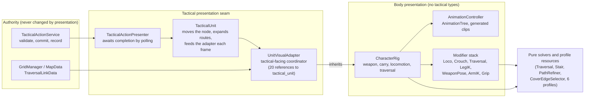
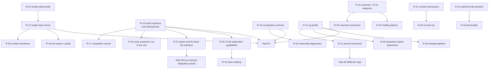
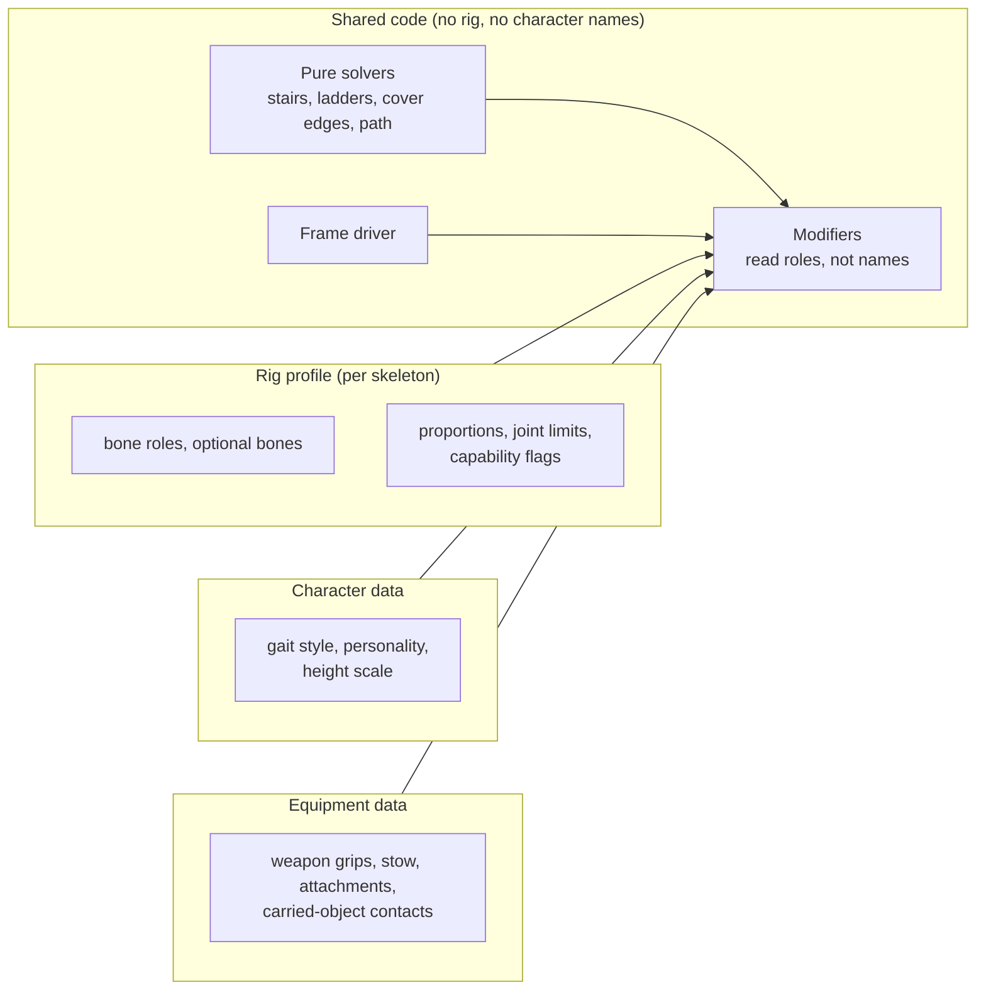
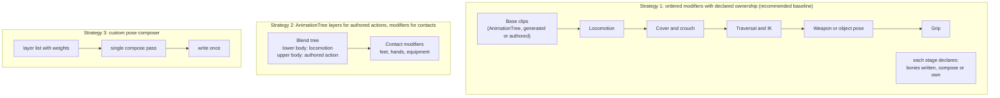

# Animation requirements, research and cross-context feasibility (Task 03)

Research and requirements for a reusable character-animation system serving tactical combat, exploration and base activities. This is analysis, not a migration: no production code was changed. One disposable feasibility scene was added under `research/` (section 12). Task 04 owns the architecture decision; this report supplies the evidence, the requirements and the open questions.

**How claims are labelled.** `[DOC]` a documented fact, with its URL. `[REPO]` evidence read or measured in this repository. `[OBS]` an observation about another game (none is first-hand: see section 6). `[INF]` technical inference. `[REC]` a recommendation. `[OPEN]` an unresolved design decision.

## 1. Executive summary

* **The existing system is already a hybrid.** `[REPO]` Every clip is generated in code (`clip_library` is `null` in the only character scene), and seven skeleton modifiers plus two IK passes adjust the pelvis, spine, legs, arms, hands and rifle every frame from pure solvers and profile resources. The question for Task 04 is therefore not "procedural or authored" but *what owns the pose, what describes the intent, and where does rig-specific data live*.
* **Audit findings re-verified against the source (2026-11-20, HEAD `f838fa2`):** all still hold except F-04 (fixed, composition test added) and F-13 (settled). Sizes are unchanged within a few lines (`CharacterRig` 1,124, `UnitVisualAdapter` 858), bone names are still hardcoded in four files, the adapter still holds the only tactical dependencies (20 references; the rig has only four comments mentioning "tactical" and no tactical type), modifiers still reach the rig through 30 string `get/call/set` sites, and there is still exactly one character, one weapon and no authored clip in use (section 2).
* **A new fact from the experiment:** the production character presentation **already runs with no `TacticalUnit`, no grid, no AP and no battle**: a 12-check headless run walks, stops, turns toward an object, slings the weapon and walks again, with zero script errors. The adapter was built tolerant of a missing unit (`tactical_unit` is guarded by `is_instance_valid` at 13 sites). What it cannot do is also now concrete: no unarmed state, no crouch outside cover, no interaction, no sitting, a built-in 1 m scene offset, and the caller must request clip states itself. So "non-tactical reuse" is closer than the audit suggested for *locomotion and turning* and exactly as far as the audit said for *everything contact-based* (section 12).
* **Research conclusion (provisional):** all three engines separate **intent/parameters from pose production**, and all three layer *procedural adjustment on top of authored or generated base motion*, with **per-weapon or per-context swappable layers** (Unreal's linked layers, Unity's layers and masks, Godot's blend-tree filters). None of the sources supports replacing a working procedural contact system with clips. They support putting a **narrow, context-independent intent/parameter interface** in front of it, **data-describing the rig** (Unity's Avatar, Godot's `BoneMap` and `SkeletonProfileHumanoid`), and **making modifier ownership explicit**.
* **Recommended direction (section 11): an incremental, hybrid path in three small steps** (rig profile, intent seam with a single frame driver, explicit composition contract), then a *separate, small spike* proving one authored clip through the existing `AnimationTree` path before any authored-motion commitment. Revisit animation-driven locomotion (footstep planning) only if authored locomotion becomes a goal; for grid-step movement the evidence argues against it.
* **Not decided here:** the exact intent API shape, how authored clips compose with the modifier stack, how many rig profiles are needed, and the roadmap mapping for Tasks 05-07 and 10-14, whose scope this brief does not define (section 14).

## 2. Verified current architecture and key limitations

Source of truth for the component inventory is the [architecture audit](animation-architecture-audit-2026-11-20.md); only the facts re-checked or changed are repeated here.

### 2.1 Existing tactical animation flow

### 2.2 What was confirmed, what changed

| Audit finding | Status now | Evidence |
| --- | --- | --- |
| F-01 rig identity hardcoded | **Confirmed.** Bone literals: builder 18 `mixamo` branches and 13 `J_Bip` constants, rig 19 and 18, locomotion modifier 5 and 4, controller 12 `J_Bip`. No rig profile exists. The scene overrides the rig's exported arm bones (VRM defaults) with Mixamo names. | `grep` over `presentation/characters/runtime/` |
| F-02 two large classes, duplicated driver | **Confirmed.** `character_rig.gd` 1,124 lines, `unit_visual_adapter.gd` 858 (extends the rig by path). The rig still has no `_process`; the adapter (`unit_visual_adapter.gd:798`) and the workbench (`mira_0_pose_workbench.gd:227`) each own a different per-frame sequence. | line counts, `grep ^func _process` |
| F-03 polling seam, leaked presentation | **Confirmed.** `TacticalUnit` makes 18 adapter calls and the adapter holds 20 `tactical_unit` references. | `grep` |
| F-04 spine twist erased | **Fixed** (`cover_crouch_modifier.gd`, `_set_flexion_keeping_rest`) with `locomotion_cover_composition_test` (13 checks). Residual: a start/stop pitch partly survives while a lean owns the flexion. | foundation-closure |
| F-05 string reflection | **Confirmed.** 19 sites in `weapon_pose_modifier.gd`, 11 in `traversal_pose_modifier.gd`. | `grep` |
| F-09 tests coupled to private state | **Confirmed and broadened.** The test inventory counts 47 scripts touching private members of production objects (the audit counted 14 for the adapter's aim-hold state alone). | `test-inventory-2026-11-20.md` |
| F-10 one weapon, no authored clips | **Confirmed.** `weapon_scene` defaults to the AUG glb and `assert(weapon_scene != null)`; `clip_library` is `null` in `mira_0_unit_visual.tscn`; the imported-clip branch (`character_animation_controller.gd:135`) is unexercised. | source |
| F-12 no replay seek | Unchanged (not re-checked beyond the source). | audit |
| Presentation order | Modifier order `Loco, CoverCrouch, Traversal, TraversalLegIK, WeaponPose, WeaponArmIK, HandGrip` still asserted by five tests. | audit, tests |

**Corrections to the audit.** Its section G1 table says the rig "asserts a weapon exists" blocks unarmed movement; this is true, but the experiment shows the *adapter* is more reusable than the table implied: locomotion, turning, stopping and a slung rifle all work with no tactical unit (section 12). The audit's claim that "`UnitVisualAdapter` is tactical-combat specific" holds for cover, attack sequencing and traversal triggers, not for locomotion presentation.

### 2.3 What is worth keeping (inventory of reusable parts)

| Component | Why it is worth keeping |
| --- | --- |
| `TraversalSolver`, `StairFootPlanner`, `StairModel`, `PathRefiner`, `CoverEdgeSelector` | Pure, deterministic, scene-free, tested (66, 48, 22, 20, 17 checks per the audit). They already depend on no tactical type. |
| Profile resources (`LocomotionProfile`, `CoverPostureProfile`, `WeaponHandlingProfile`, `TraversalProfile`, `StairProfile`, `PathPresentationProfile`) | The existing data-driven layer; the natural home for per-character numbers. |
| `SkeletonModifier3D` stack | A documented Godot mechanism (section 4); order is deterministic and now covered by a composition test. |
| Measured bone axes (`measure_axes`) | A retarget-independent portability primitive: works for any rest orientation. |
| Hand-contact infrastructure (carry contacts reused for ladder rungs) | Proven reuse across two features; the right base for object interaction. |
| `ChestAnchor`, `RescueInteraction` (pure timeline) | Context-free. |
| Position-driven traversal poses | Replay-safe by construction (pose is a function of progress, not history). |
| Workbench | Drives the production rig; found real defects. Its divergent frame driver is the problem, not the workbench. |
| Test and quality infrastructure | `catalog.json`, `fast -Subsystem animation` (10 tests, 27.3 s measured), the composition test. |

### 2.4 Limitations that matter for the requirements

1. Rig identity is code, not data (blocks a second humanoid).
2. There is no presentation-intent interface that is not `TacticalUnit` (blocks exploration and base reuse of anything beyond locomotion).
3. There is no single frame driver component (blocks parity between workbench, tactical and any new context).
4. There is no equipment abstraction: one weapon, no unarmed state.
5. Crouching exists only as a cover function (the experiment shows a direct request is overwritten each frame).
6. Authored-clip integration is unproven.
7. Visual reconstruction after a seek or suppressed action relies on derived-state polling; no pose-comparison test exists.

## 3. Research methodology and sources

* **Repository first.** Reread the audit, developer guide, foundation closure, Movement Foundations documents and Ironclad guide; re-verified the audit's numbers against the source with `grep`/line counts; inspected the adapter's `_process`, locomotion feed, stow code and the workbench driver.
* **Documentation pages were opened (WebFetch) and summarised**, so specific API facts below come from the page text, except where marked "page not opened". The fetched Godot pages are headed **Godot 4.7**, matching the installed engine (`godot_console --version`: `4.7.2.stable`): see section 4.
* **Secondary and partial sources are labelled.** GDC Vault pages for the Ubisoft and Volition talks showed only abstracts (video and slides were not accessible); the third talk was read through a third-party slide copy. Search-result summaries (not opened pages) are marked as such.
* **Tactical-game sources.** No primary technical source on animation architecture was found for XCOM 2 or Jagged Alliance 3. I did not play or capture footage of any game: section 6 therefore separates documented facts from hypotheses to check by observation.
* **Experiment.** One disposable scene (section 12), executed headless with the project's Godot.

Source list (every URL was opened unless noted):

| Ref | Source | Used for |
| --- | --- | --- |
| G1 | Godot 4.7, [AnimationTree](https://docs.godotengine.org/en/stable/tutorials/animation/animation_tree.html) | state machines, blend spaces, deterministic blending, root motion |
| G2 | [SkeletonModifier3D](https://docs.godotengine.org/en/stable/classes/class_skeletonmodifier3d.html) | modifier model, `influence`, `modification_processed` |
| G3 | [Retargeting 3D skeletons](https://docs.godotengine.org/en/stable/tutorials/assets_pipeline/retargeting_3d_skeletons.html) | `BoneMap`, `SkeletonProfileHumanoid`, import-time retargeting |
| G4 | [AnimationMixer](https://docs.godotengine.org/en/stable/classes/class_animationmixer.html) | `callback_mode_process`, `advance`, `deterministic`, root motion track |
| G5 | [Skeleton3D](https://docs.godotengine.org/en/stable/classes/class_skeleton3d.html) | `modifier_callback_mode_process`, `advance`, `skeleton_updated` |
| G6 | [TwoBoneIK3D](https://docs.godotengine.org/en/stable/classes/class_twoboneik3d.html) | the IK modifier the project already uses |
| G7 | [AnimationNodeStateMachinePlayback](https://docs.godotengine.org/en/stable/classes/class_animationnodestatemachineplayback.html) | `travel`, `start`, signals |
| U1 | Unreal, [Animation Blueprints](https://dev.epicgames.com/documentation/en-us/unreal-engine/animation-blueprints-in-unreal-engine) | overview only (the page is thin) |
| U2 | [Animation Blueprint Linking](https://dev.epicgames.com/documentation/en-us/unreal-engine/animation-blueprint-linking-in-unreal-engine) | linked anim graphs, layer interfaces, per-weapon swap |
| U3 | [Control Rig](https://dev.epicgames.com/documentation/en-us/unreal-engine/control-rig-in-unreal-engine) | index page only (runtime and reuse details not on the page) |
| U4 | [Lyra sample game](https://dev.epicgames.com/documentation/en-us/unreal-engine/lyra-sample-game-in-unreal-engine) and [Animation in Lyra](https://dev.epicgames.com/documentation/en-us/unreal-engine/animation-in-lyra-sample-game-in-unreal-engine) | Lyra's layered, data-driven animation |
| Y1 | Unity, [Avatar creation and setup](https://docs.unity.com/en-us/engine/current/manual/animation-section/animation-mecanim/avatar-creationand-setup) | humanoid Avatar mapping (required-bone detail was not on the page) |
| Y2 | [Animation Rigging overview](https://docs.unity3d.com/Packages/com.unity.animation.rigging@1.3/manual/index.html) | procedural rigs over animation (overview page only) |
| Y3 | Unity Animator Controller page | **not obtained** (404); Unity statements about it below are general knowledge and marked `[INF]` |
| D1 | GDC 2016, Bereznyak, [IK Rig: Procedural Pose Animation](https://gdcvault.com/play/1022984/IK-Rig-Procedural-Pose) | abstract only; talk content not accessible |
| D2 | GDC 2017, Jungbluth, [Animating an Agent of Mayhem](https://gdcvault.com/play/1024496/Animating-an-Agent-of) (also [listing](https://gamedeveloper.com/art/video-an-in-depth-look-at-the-animation-of-i-agents-of-mayhem-i-)) | abstract only |
| D3 | Anguelov, Leblanc, Harris, [Animation Driven Locomotion for Smoother Navigation](https://www.gdcvault.com/play/1015614/Animation-Driven-Locomotion-for-Smoother) | read through a third-party copy of the slides ([sambuz.com](https://sambuz.com/doc/animation-driven-locomotion-for-ppt-presentation-730626)); the copy is partly garbled |
| T1 | Gears Tactics: [PCGamesN](https://www.pcgamesn.com/making-it-in-unreal/gears-tactics) and [Vice](https://www.vice.com/en/article/wxevx5/gears-tactics-preview-interview) interviews | search-result summaries only (pages not opened) |

## 4. Godot technical findings and version compatibility

Installed engine: `4.7.2.stable` (`godot_console --version`). The documentation pages fetched under `docs.godotengine.org/en/stable` identify themselves as Godot 4.7, so the `stable` pages match the installed version. Nothing below was taken from a newer or development page. The project already uses `SkeletonModifier3D`, `TwoBoneIK3D` and `AnimationTree`, so these are compatible in practice (the test suite exercises them).

| Topic | Finding | Source | Relevance to FuseFire |
| --- | --- | --- | --- |
| AnimationTree and state machines | `AnimationTree` plays clips from an `AnimationPlayer`; roots may be an animation, blend tree, blend spaces or state machine. State machine transitions are Immediate, Sync or At End; advance mode Disabled, Enabled (only via `travel()`) or Auto; `travel()` finds a path with A* and **teleports if no path exists**. | G1, G7 | The controller already uses a state machine with `playback.travel/start` (`character_animation_controller.gd:74-98`). Intent-driven `travel` is the standard control surface. |
| Blend spaces and sync | `BlendSpace1D/2D`; Sync Mode options None, Independent, Cyclic Mutable, Cyclic Constant (needs `cyclic_length` > 0 and finite animation nodes). | G1 | The project's phase-synchronised gait blend spaces are the documented mechanism. |
| Deterministic blending | Blends are reproducible only when properties have defined initial values: for `Skeleton3D` tracks the initial value is the **bone rest**; a `RESET` animation can define others. `AnimationMixer.deterministic` skips weight normalisation and starts from zero or `RESET`. | G1, G4 | Strongly supports authoring rest poses consistently and is the basis for reproducible presentation. |
| Root motion | Choose a root bone as the root motion track; read `get_root_motion_position/rotation/scale` and feed `CharacterBody3D.move_and_slide`. | G1, G4 | FuseFire's movement is **externally controlled** (grid routes, scripted trajectories) and position-driven poses must not depend on root motion; root motion would invert authority. |
| Mixer update timing | `callback_mode_process` default idle; physics or **manual** (`advance(delta)`) available. `callback_mode_method` default deferred. | G4 | Manual mode plus `advance` gives a deterministic, steppable animation clock (seek, replay, tests). Not used today. |
| Modifier timing | `Skeleton3D.modifier_callback_mode_process` default idle (also physics and manual); `advance(delta)` steps modifiers manually. `skeleton_updated` fires when the final pose is applied; `SkeletonModifier3D.modification_processed` fires per modifier. "If an AnimationMixer is present, the modification always runs after the mixer's playback processing." | G2, G5 | Confirms the project's lesson (read poses in `skeleton_updated`). The docs do **not** describe the order among several modifiers; the project established it empirically (child order) and tests it. `[REPO]` |
| Modifier contract | `influence` (0-1) is applied by `Skeleton3D`; a modifier "should apply the full result without its own interpolation". `_process_modification_with_delta(delta)` supersedes the deprecated `_process_modification()`. | G2 | The project's modifiers should be checked against this: several apply their own weights. `[INF]` A future composition contract can lean on `influence`. |
| IK | `TwoBoneIK3D` (rotation-based, two-circle intersection, **deterministic**, pole target required, `IKModifier3D` family). | G6 | Already used for arms and legs. |
| Retargeting | **Import-time**: `BoneMap` + `SkeletonProfile` (`SkeletonProfileHumanoid` preset), rest-pose fixing (Apply Node Transform, Overwrite Axis, Fix Silhouette), optional scale normalisation by the hips height (`motion_scale`). Reference pose: T-pose, +Z forward, Y up. **Runtime retargeting is not described**; a third-party "Realtime Retarget Module" is mentioned. | G3 | A `BoneMap`-based name layer (and `scale_base_bone`) is the documented way to describe "which bone is the left forearm" for any humanoid; it would replace the 29-odd inline ternaries. Authored clips shared across rigs need the import pipeline. |
| Pose APIs | `set_bone_pose_*`, `reset_bone_pose(s)`, `show_rest_only`, `motion_scale`; `set_bone_global_pose_override` and related are **deprecated**; no formal layering system. | G5 | Confirms that ownership/composition is a project-level convention in Godot, not an engine feature. |
| Resource-based configuration | Everything above (profiles, `BoneMap`, `AnimationLibrary`, `AnimationNode*`) is `Resource`-based. Animation nodes are **shared resources**: changing one affects every tree that uses it. | G1 | Matches the project's profile resources. The shared-resource caveat matters when several characters share one tree. |
| Events and seekability | Animation method-call tracks run under `callback_mode_method` (deferred by default); the docs fetched do not specify seek behaviour of method tracks. | G4 | `[OPEN]` whether authored animation events can be relied on for deterministic completion; needs a spike if clips become authoritative for timing. |

**Compatibility caveats.** `[REPO]` The headless runs show modifiers do execute in the normal frame (the composition test reads their results); the audit noted `Skeleton3D.advance` ran in 0 µs headless, so manual stepping of modifiers still needs its own verification before it is relied on.

## 5. Unreal, Unity and industry findings

### 5.1 Unreal Engine

* `[DOC]` **Linked Anim Layers** (U2): an *Animation Layer Interface* asset defines a fixed set of named layers (for example Full Body, Upper Body, IK); a base Animation Blueprint binds the interface, and specific blueprints (for example one per weapon) supply each layer's logic. The *Link Anim Class Layers* node swaps the logic at run time, optionally covering the switch with a montage (a weapon equip). A weapon interface and a vehicle interface can be active together (a vehicle overrides the full body, a weapon only the upper body); the locomotion state machine stays shared. Stated benefits: modularity by gameplay context, parallel work, memory (only linked layers loaded), scalability.
* `[DOC]` **Lyra** (U4): the main Animation Blueprint's locomotion state machine is shared; each weapon is a child layer blueprint that assigns animations and variables; per-weapon *Anim Set* data holds turn-in-place transitions. Computation is in a thread-safe update function using *Property Access* rather than reading gameplay objects. Gameplay reaches animation through *Gameplay Tag bindings* (from the Gameplay Ability System) and movement values. Layered blend per bone combines locomotion with upper-body actions. Procedural techniques: distance matching, stride warping, orientation warping, root yaw offset for turn in place. Not covered by the page: IK/foot placement, how item data is defined.
* `[DOC]` **Control Rig** (U3, index page): procedural rig graphs with controls, nulls, forward/backward solve, full-body IK, usable from Animation Blueprints and Sequencer; modular rigs. The page does not describe runtime reuse across skeletons.
* `[INF]` Lessons: (1) interface-first layering, where a *contract* (the layer interface) is separate from the *content* (weapon-specific graph); (2) gameplay feeds animation through a small set of *values and tags*, not through the character class; (3) procedural warping sits **on top of** authored locomotion, never replaces its base cycles.

### 5.2 Unity

* `[DOC]` **Humanoid Avatar** (Y1): the Avatar maps a model's bones to standard humanoid roles, so a clip can drive differently proportioned humanoids; muscle settings define joint ranges. The page does not state the required bone list or limitations; a standard-bone-role abstraction is the substantive idea.
* `[DOC]` **Animation Rigging** (Y2): *rigs* are sets of constraints adding procedural motion to animated objects; two named uses are deformation rigs (secondary motion) and **world-interaction rigs built from IK and Aim constraints** (targeting, correcting animation). The overview does not detail layers, weights or the job system.
* `[INF]` From general knowledge of the Animator Controller (the page was not obtained): gameplay writes named *parameters*; layers with masks blend upper/lower body; this is the same "values in, pose out" separation as Lyra.
* `[REC]` Take the principle, not the objects: a rig described by *role* (Avatar), and constraints that adjust authored motion on top (Animation Rigging) are both already how FuseFire's modifiers work; what FuseFire lacks is the role-based description.

### 5.3 Industry presentations (strength of evidence stated)

| Talk | What is actually established | Strength |
| --- | --- | --- |
| Bereznyak, IK Rig: Procedural Pose Animation (GDC 2016) | Abstract `[DOC]`: a technology for sharing animations between different characters and for modifying base animations at runtime to create new actions and motion types; handles uneven terrain, carried weapons and character interactions; borrows from retargeting but reacts in real time to obstacles, props and states such as fatigue or injury. Search results add that his own write-up describes rules applied per frame whose results feed the IK. | Abstract only; talk and write-up content not read |
| Jungbluth, Animating an Agent of Mayhem (GDC 2017) | Abstract `[DOC]`: 12 playable characters in an open world forced "thinking in systems not individual assets"; topics include **universal character charts** for shared setups, **full-body procedural transitions**, a reactive facial mood system and working with outside vendors. | Abstract only |
| Anguelov, Leblanc, Harris, Animation Driven Locomotion | Third-party slide copy `[DOC, secondary]`: animation defines the kinematics ("invalid kinematics break immersion"); footstep planning needs per-stance sets of **6 start, 8 turn, 1 move and 10 stop clips**; path post-processing pushes vertices away from corners to balance clip/path mismatch (about 10% per-segment error accepted); main problem is **latency** (behaviour can change only at footstep markers); stated cons include **high memory use and poor fit for short distances**; the Hitman case used rails, bezier paths and banking blends without footstep planning. Several slides are garbled. | Secondary, partly garbled |

`[INF]` What transfers: a *systemic* approach to shared character setups (D2), runtime adjustment of base animation instead of one clip per case (D1), and the warning that animation-driven locomotion trades authoring cost and latency for fidelity (D3). `[INF]` D3's own stated weakness (short distances) is exactly FuseFire's grid-step movement, which is the reason section 10 does not recommend it now.

## 6. Tactical-game observations and applicability

**What is and is not known.** `[OBS]` I did not play or record any title, and found **no primary technical source** on the animation architecture of XCOM 2 or Jagged Alliance 3 (searches returned general interviews and previews). Nothing below describes any game's internals.

| Item | Source status | Applicability to FuseFire |
| --- | --- | --- |
| Gears Tactics was built on the Gears of War asset pipeline (animations reused from Gears 5) and some enemy animations were exaggerated so units read clearly | `[OBS]` interview summaries (T1); pages not opened | Supports *reusing a mature authored library and exaggerating key actions for readability*; FuseFire has no authored library yet. |
| Gears Tactics treats cover as the spatial structure (cover creates its own grid squares; sliding into cover does not spend movement AP) | `[OBS]` Vice interview summary | Cover as an explicit tactical concept feeding presentation matches `CoverEdgeSelector`; the AP rule is a gameplay choice, irrelevant to animation. |
| XCOM 2: cover modifiers (partial 25%, full 50%), cover per parcel; animation fidelity increased relative to its predecessor | `[OBS]` general coverage | No animation architecture information. |
| Jagged Alliance 3: developers discuss posture and mannerisms of mercenaries | `[OBS]` interview | Supports personality-through-motion as a *desire* (P3 here), not as an architecture. |

**Hypotheses to check later by observation (not claims):** action completion and camera framing are the usual friction points in turn-based games that stage resolved actions; weapon readiness changes, facing changes during movement, carrying and traversal contacts are where procedural fixes appear. `[INF]` FuseFire's tactical-first timing (commit, then draw, one barrier) is a documented, tested design that does not depend on any other game's choices. These hypotheses should be tested by recording reference footage in Task 08/09 rather than asserted here.

## 7. Requirements matrix

**Priorities.** P0 existing behaviour that must remain correct; P1 essential for the reusable architecture; P2 required for a planned future context; P3 optional or exploratory. Priority is not schedule. "Status": **Done** (exists and tested), **Partial**, **Absent**. Roadmap column: Tasks 04, 08 and 09 are the ones named in the brief; **W1-W6 are proposed work packages** (defined in section 14) because Tasks 05-07 and 10-14 are not described in this assignment and should be aligned by the owner.

### 7.1 Authority, determinism and correctness (the P0 contract)

| ID | Requirement | Tac | Exp | Base | Status | Pri | Evidence / rationale | Constraints | Validation | Roadmap |
| --- | --- | :-: | :-: | :-: | --- | :-: | --- | --- | --- | --- |
| R-01 | Presentation never changes legality, AP, occupancy, HP, replay records | Y | n/a | n/a | Done | P0 | `traversal_replay_determinism_test`: identical records and fingerprints with presentation on/off `[REPO]` | Any new intent seam must stay one-way (gameplay to presentation) | Keep the replay-determinism test in every change set | 04, all |
| R-02 | Tactical-first timing: commit, then draw, one completion barrier, deadline follows the walk | Y | n/a | n/a | Done | `traversal_timing_contract_test` | A completion *event* may replace polling but not change when the barrier releases | existing test + event equivalence test | 04 |
| R-03 | Modifier composition correct (turn twist, lean, cover, carry coexist) | Y | Y | Y | Done (F-04 fixed) | `locomotion_cover_composition_test` (13) | Residual pitch interaction bounded and documented | Extend the test for every new modifier or writer | 04 |
| R-04 | Traversal (ladder, stairs, ramps, vaulting prototype) keeps working and keeps position-driven poses | Y | Partial | Y (stairs) | Done | `traversal_*` family (12 scripts) | Solvers are pure; triggers are tactical today | Keep solvers independent of context | existing tests; a non-tactical trigger test later | 04, 08 |
| R-05 | Rescue pickup, carry, release preserved | Y | maybe | maybe | Done | `rescue_*` tests | Trigger is `ObjectiveManager`; timeline is pure | Passenger contacts own the hands: no weapon pose while carrying | existing tests | 04 |
| R-06 | Cover, aim, attack sequencing, readiness preserved | Y | n/a | n/a | Done | `cover_*`, `aim_hold_presentation_test`, `unit_visual_weapon_readiness_test` | Contains policy (cover choice) that is tactical | Keep cover policy on the tactical side of the seam | existing tests | 04 |
| R-07 | Death, interruption and cleanup leave no stale presentation state | Y | Y | Y | **Partial** | `rescue_carrier_loss_test`, ladder and stair defeat tests; **not covered**: hit mid-stair, move order interrupting a climb, carrier death on a ladder (audit F-06) | Manual cleanup calls today | cleanup matrix test | 04 (P0 gap) |
| R-08 | Replay and seek: presentation can be reconstructed (or skipped) without divergence | Y | n/a | n/a | Partial | No seek in `BattleReplayPlayer`; suppressed actions skip presentation (F-12) | Position-driven poses help; modal state (cover, aim) is polled | pose-comparison test after a suppressed action | 04, later |

### 7.2 Architecture and reuse (P1)

| ID | Requirement | Tac | Exp | Base | Status | Pri | Evidence / rationale | Constraints | Validation | Roadmap |
| --- | --- | :-: | :-: | :-: | --- | :-: | --- | --- | --- | --- |
| R-10 | A presentation-intent interface that is not `TacticalUnit` (move leg with kind, face, aim, interact, hit, equip) | Y | Y | Y | Absent (the adapter tolerates a null unit but its API is tactical-shaped) | P1 | Experiment: 12 checks pass with no unit (section 12); `present_move` and `update_locomotion` already work | One-way; no tactical type in its signatures | the probe's checks promoted to a test; adapter-free rig test | **04** (blocks R-30..R-45) |
| R-11 | Rig profile: bone map, measured proportions, capability flags, rig-space constants as fractions of height | Y | Y | Y | Absent | P1 | F-01: bone literals in 4 files, rig-space metre constants | Keep measured axes; consider `BoneMap` semantics | second skeleton fixture | 04 / **09** (blocks R-21) |
| R-12 | One explicit per-frame driver shared by workbench, tactical and other contexts | Y | Y | Y | Absent | P1 | Two divergent `_process` implementations | Order must be declared and tested | parity test: same inputs, same pose | 04 |
| R-13 | Explicit modifier ownership and composition contract (relative vs absolute writes, one writer per bone/field, diagnostics) | Y | Y | Y | Partial | P1 | F-04 root cause; 30 string-reflection sites | Godot gives only `influence` and order `[DOC]` | composition tests per pair of writers; an ownership report tool | 04 |
| R-14 | Unarmed state (no weapon built, normal arm swing, no weapon pose) | Y | Y | Y | Absent (assert) | P1 | Experiment: a slung rifle is the only approximation | A rig without a weapon must still pass all non-weapon tests | rig-level unarmed test | 04 / 09 |
| R-15 | Multiple weapons and handling profiles (grip, stow, stock) | Y | Y | maybe | Absent | P1 | one `WeaponHandlingProfile`, one scene | Equipment data separate from rig data | weapon-swap test | 04 / 09 |
| R-16 | Authored-clip integration composes with the modifier stack | Y | Y | Y | Unproven | P1 (the decision), P2 (the work) | F-10: `clip_library` never used; Godot retargeting is import-time `[DOC]` | rest-pose and axis conventions must match | spike: one authored clip through the existing path | W3 (spike) |
| R-17 | Completion and interruption as events, not polling | Y | Y | Y | Partial (signals unused) | P1 | F-03; adapter signals connected only by tests | Must preserve R-02 exactly | event/polling equivalence test | 04 |
| R-18 | Route-to-presentation expansion (stairs, ramps, ladders, smoothing) outside `TacticalUnit` | Y | Y | Y | Absent (~220 lines in the unit) | P1 | audit F-03 | World-supplied models for non-tactical use | existing traversal tests unchanged | 04 |
| R-19 | Public test seams replace private-state pokes | Y | n/a | n/a | Absent | P1 | 47 scripts touch private members | Migrate together with R-10 | `-List` of the private column goes to zero for animation tests | 04 |
| R-20 | Presentation state has one owner per fact (facing, cover side, aim, carry, stow) | Y | Y | Y | Partial | P1 | F-06 duplicated state | | state-ownership table + tests | 04 |
| R-21 | A second humanoid runs the full modifier stack | Y | Y | Y | Absent | P1 | no second skeleton in the repo; `setup()` fails on the first missing bone | Needs R-11; asset required | fixture rig test | **09** |
| R-22 | Missing optional bones degrade gracefully with a report, not silently | Y | Y | Y | Absent | P1 | `setup()` returns false silently | Capability flags in the profile | rig-profile validation test | 04 / 09 |

### 7.3 Exploration (P2; gameplay not finalised, so these are capabilities only)

| ID | Requirement | Tac | Exp | Base | Status | Pri | Evidence / rationale | Constraints | Validation | Roadmap |
| --- | --- | :-: | :-: | :-: | --- | :-: | --- | --- | --- | --- |
| R-30 | Continuous locomotion from a velocity and heading, no grid | n/a | Y | Y | **Done at rig level** | P2 | probe: walk to a marker, stop, gait settles (speed 0.000) | The adapter turns toward the velocity at 360 deg/s; separate facing intent absent | promote the probe checks | 08 |
| R-31 | Free turning and facing control independent of movement | Y | Y | Y | Partial | P2 | `face_world_position` works (0.00 deg error, twist peak 55.5 deg); body is turned by the adapter | Cover absorbs facing into a yaw offset (tactical) | probe + turn test | 04 / 08 |
| R-32 | Idle, walk, run without cover and weapon dependency | n/a | Y | Y | Partial | P2 | run exists in the gait tables; unarmed absent | R-14 | gait test unarmed | 08 |
| R-33 | Unarmed or stowed movement | Y | Y | Y | Partial (slung rifle) | P2 | probe check passes (foot separation 0.67 m) | R-14 proper | rig unarmed test | 04 / 08 |
| R-34 | Interaction with doors and objects (reach, grasp, operate) | n/a | Y | Y | Absent | P2 | no generic interaction request exists (probe) | Reuse the hand-contact path (carry, ladder rungs) | contact test against a primitive | 08 |
| R-35 | Transition into and out of a tactical context without a pose pop | Y | Y | maybe | Absent | P2 | same rig, different drivers; no test | Needs R-12 | transition test | 08 |
| R-36 | Traversal outside a tactical grid (stairs, ladders from world geometry) | Y | Y | Y | Partial | P2 | solvers pure; `StairModel` built from tactical links today | World-supplied models | stairs-from-geometry test | 08 |
| R-37 | Player- and AI-directed characters through the same intent interface | Y | Y | Y | Absent | P2 | R-10 | | integration test | 08 |
| R-38 | Camera-independent presentation (no camera anchors required) | Y | Y | Y | Partial | P2 | adapter owns camera anchors | split anchors from pose | | 04 |

### 7.4 Base management and daily activities (P2/P3; future capabilities only)

| ID | Requirement | Tac | Exp | Base | Status | Pri | Evidence / rationale | Constraints | Validation | Roadmap |
| --- | --- | :-: | :-: | :-: | --- | :-: | --- | --- | --- | --- |
| R-40 | Sit and rise (a seated pose against an object) | n/a | maybe | Y | Absent | P2 | probe: no sitting capability; crouch exists only as cover and is overwritten when set directly | Needs contact points on the object and a pelvis solve; the crouch solve is the closest relative | pose test against a box | future (W5) |
| R-41 | Generic object interaction with contact points (hands, feet, pelvis) | maybe | Y | Y | Absent | P2 | hand contacts exist for carry and ladders | Do not build a furniture system | contact-targets test | future (W5) |
| R-42 | Attention direction (look at, face toward, conversation facing) | maybe | Y | Y | Absent | P2 | head/neck are written by clips only; `face_world_position` rotates the whole body | A look-at is a modifier on head/neck (Godot has a look-at modifier family `[DOC]`: `LookAtModifier3D`) | look-at test | future |
| R-43 | Holding or using everyday objects (cup, tablet) | n/a | maybe | Y | Absent | P2 | needs equipment abstraction (R-14, R-15) | | | future |
| R-44 | Walk around a base reusing locomotion and stairs | n/a | Y | Y | Partial | P2 | R-30, R-36 | | | 08 |
| R-45 | Activity transitions (stand, sit, work, walk) | n/a | maybe | Y | Absent | P2 | needs a state model beyond tactical states | state machine, not a framework | | future |
| R-46 | Personality expressed through motion (style profiles, per-character gait) | n/a | Y | Y | Partial (gait profile fields exist) | P3 | `LocomotionProfile` is data; generated clips have no style | needs authored or style-varied clips (R-16) | | later |
| R-47 | Gestures during conversation | n/a | n/a | Y | Absent | P3 | | | | later |

### 7.5 Characters, equipment, tooling, boundaries

| ID | Requirement | Tac | Exp | Base | Status | Pri | Evidence / rationale | Constraints | Validation | Roadmap |
| --- | --- | :-: | :-: | :-: | --- | :-: | --- | --- | --- | --- |
| R-50 | Proportion-aware placement (grips, hands, planner numbers derived from the rig, not constants) | Y | Y | Y | Absent | P1 | `RELAXED_HANDS`, `GRIP_OFFSET`, planner `leg_length 0.84` are constants | Measured proportions exist for crouch only | height-scaled rig test (0.9x, 1.1x) | 09 |
| R-51 | Mechanical versus human joint limits (androids, robots) as profile data | Y | Y | Y | Absent (hardcoded 45/130 degrees) | P2 | `StairProfile`, `CoverCrouchModifier` consts | | | 09 |
| R-52 | Render-path performance measurement of the modifier stack | Y | Y | Y | **Absent** | P1 | audit: modifier cost is unmeasured headless | Needs a windowed profile | profile run, documented budget | before 04 migration |
| R-53 | Bone-ownership diagnostics (which modifier last wrote a bone) | Y | Y | Y | Absent | P2 | F-04 needed a hand-built probe to find | Dev-only overlay or report | tool test | 04 |
| R-54 | Authoring and editor tooling (workbench uses the shared driver; profile inspector) | Y | Y | Y | Partial | P2 | workbench exists; divergent driver | | | W6 |
| R-55 | Humanoid retarget pipeline for authored clips (`BoneMap`, import settings) | Y | Y | Y | Absent | P2 (becomes P1 if authored clips are adopted) | G3 | import-time only `[DOC]` | import a test clip | W3 |
| R-56 | Non-humanoid boundary: share only intent, timing and state flags, not skeletal code | Y | Y | Y | n/a | P3 (boundary) | audit G3 | Do not force wheels, tracks, quadrupeds or flyers into the humanoid stack | interface review | future |
| R-57 | Pelvis/stair planner cost acceptable for many characters (cache or event-driven) | Y | Y | Y | Partial | P2 | `pelvis_smoothed` now 15 us (was 505 us); `PathRefiner.refine` 410 us once per move `[REPO]` | only matters for crowds | benchmark | later |

### 7.6 Dependencies and blockers

**Blockers for subsequent tasks:** R-10, R-11, R-12 and R-13 block Task 04's own scope; R-10 and R-37 block Task 08; R-11, R-21, R-50 and R-14/R-15 block Task 09; R-07 is a P0 gap that should be closed before any migration touches cleanup paths; R-52 (render-path profile) is a precondition for judging any change in modifier structure.

## 8. Character, rig and equipment requirements

**Variation to support (and how each is known today).**

| Variation | Today | Needed data |
| --- | --- | --- |
| Skeleton naming (`mixamorig_*`, `J_Bip_*`, others) | 29+ inline branches; rig defaults are VRM, scene overrides with Mixamo | `BoneMap`-style role to bone name table in a rig profile |
| Optional bones (neck, chest, clavicle, toes) | first missing bone aborts `setup()` silently | capability flags and a validation report |
| Height and proportions | one model, scale 1.6, metre constants | proportion fractions or measured values; `scale_base_bone` semantics from `SkeletonProfileHumanoid` `[DOC]` |
| Rest poses | measured axes (good) | keep; document T-pose assumption for authored clips `[DOC]` |
| Arm and leg length, contact and grip points | constants and a `WeaponHandlingProfile` | derive from measured lengths; contact points as equipment data |
| Mechanical vs human joints | hardcoded 45 and 130 degree limits | profile limits |
| Animation style and personality | gait profile only | style data (P3) |
| Equipment (armed, unarmed, other weapons, carried objects) | one rifle, asserted | equipment profiles |

**Where each kind of data belongs `[REC]`.**

**Armed and unarmed.** `[REPO]` A rig needs three equipment states with different pose ownership: weapon in hand (weapon pose owns hands and torso frame), carried or slung (carry or sling anchor), and empty (clip motion with natural arm swing). Today only the first two exist, and "unarmed" is the second. `[REC]` Treat equipment as data attached to a rig profile and make "no weapon" a normal state, not an absence.

**Non-humanoids `[REC]`.** Boundary only: the shareable contracts are intent requests, a movement leg description (speed, heading, kind), a completion event contract, equipment/state flags and the tactical-first timing rule. The modifier stack, gait tables, cover crouch, hand contacts and bone-axis measurement are humanoid-only and should stay in a humanoid package.

## 9. Animation composition and ownership questions

For each open question the options are evaluated on benefits, drawbacks, fit with the code, Godot compatibility, runtime cost, testing, ergonomics, migration risk and maintenance. Ratings: + good, 0 neutral, - poor. These are inferences from the evidence above, not measurements.

### 9.1 Expressing animation intent

| Option | Benefits | Drawbacks | Fit | Godot | Cost | Testing | Migration risk | Notes |
| --- | --- | --- | --- | --- | --- | --- | --- | --- |
| (a) Direct method API (today's adapter: `present_move`, `face_world_position`, ...) | simple, discoverable | shaped by tactical needs; caller must call several methods in the right order (probe: `present_move` plus `update_locomotion` plus `present_idle`) | + (exists) | + | + | 0 | + | The experiment shows it works for locomotion; interaction and unarmed have no method. |
| (b) Parameter/state bag the rig reads each frame (speed, heading, aiming, equipment, context flags), as Unity's parameters and Lyra's property access do `[DOC/INF]` | decouples caller and rig; naturally testable and replayable (state in, pose out); suits AnimationTree and polling-free drivers | one more struct to keep coherent; transient requests (hit, interact) need a different mechanism | 0 (adapter mostly derives these already) | + (`AnimationTree` parameters) | + | + | 0 | Fits position-driven poses. |
| (c) Request objects with completion events | explicit lifecycle, interruption and completion in one place; replaces presenter polling | more types; needs equivalence testing against R-02 | 0 | + (signals) | + | + | 0/- | Best for *transient* actions (attack, hit, interact). |
| (d) Global event bus | very decoupled | hard to debug; ordering | - | 0 | + | - | - | Not recommended. |

`[REC]` provisional: (b) for continuous state and (c) for transient actions, delivered through a *small* typed interface. `[OPEN]` the exact split (Task 04).

### 9.2 Driving the character each frame

| Option | Notes |
| --- | --- |
| Subclass `_process` (today; the workbench and the adapter diverge) | Zero cost; guarantees drift (R-12). |
| An explicit driver node that ticks declared components in a fixed order | Matches the proven order `locomotion feed, aim, readiness, cover/crouch, attack, traversal, weapon pose`; one place to test parity. Low risk if behaviour-preserving. |
| Godot manual mode (`AnimationMixer.callback_mode_process = manual` and `Skeleton3D.modifier_callback_mode_process = manual`, then `advance`) `[DOC]` | Gives a steppable clock for seek and deterministic tests; adds a burden (everything must be advanced). Verify that modifiers actually run under `advance` before relying on it (audit: 0 µs headless). Optional later step. |

### 9.3 Gameplay state versus presentation state; pose ownership and composition order

| Option | Benefits | Drawbacks | Notes |
| --- | --- | --- | --- |
| Linear modifier stack with fields (today) | Matches Godot's model `[DOC]`; deterministic order; one fix landed | Writers mix relative and absolute writes; 30 string-reflection sites; shared mutable fields | F-04 shows the failure mode |
| The same stack with **declared ownership**: each modifier states the bones it writes and whether it composes (multiplies) or owns (replaces) a component; one writer per field; typed references; a debug report | Smallest change that prevents F-04-class defects; keeps everything that works | Needs a convention and a few tests | Recommended baseline |
| AnimationTree layering (Blend2/3 with per-bone filters, OneShot, state machines) for upper/lower body | Documented, editable, matches Unity layers and Lyra's layered blend `[DOC/INF]` | Procedural modifiers still run after the mixer; weights live in two systems | Good for authored upper-body actions |
| A custom pose composer (accumulate layers, then write once) | Clean semantics | New framework; reimplements `influence` and ordering Godot provides | Not recommended |

### 9.4 Authored plus procedural

`[REC]` Keep **contacts** (feet on stairs and ladders, hands on weapon, carry, rungs, objects) and **equipment fit** procedural: they depend on world geometry and equipment, which clips cannot know (Unreal's own IK/warping, Unity's rigging constraints and Ubisoft's IK Rig all exist for exactly this `[DOC]`). Authored (or generated) motion should own **base cycles and transitions** (idle, walk, run, turn, start/stop) and, if adopted, **personality**. `[OPEN]` whether base cycles stay generated; the spike (W3) decides with evidence.

### 9.5 Transitions, interruption, contacts and attachments, seek and diagnostics

* **Transitions/interruption:** use `AnimationNodeStateMachinePlayback.travel()` for clip states and an explicit request lifecycle for actions; the project's `_return_generation` counters are a hand-rolled version `[REPO]`. A defined interrupt table is R-07.
* **Contacts and attachments:** describe contacts as data (a contact has a bone, an offset and an orientation intent), as the carry and ladder code already does, so an object interaction is "one more contact set" rather than new code `[REC]`.
* **Seek and reconstruction:** position-driven poses reconstruct for free; modal state (cover, aim, carry, stow) needs an explicit "snap to state" operation per state, tested against a suppressed action `[REC]`.
* **Diagnostics:** an ownership report (last writer per bone and component for the frame) is the missing tool that F-04 needed `[REC]`.

## 10. Comparison of candidate architectural approaches

| Criterion | A. Incremental extension of the procedural system | B. Authored-clip driven (AnimationTree plus authored library, procedural only for contacts) | C. Hybrid modular (authored or generated motion, procedural adjustment, rig data, context-independent intent) | D. Animation-driven locomotion / footstep planning for path movement |
| --- | --- | --- | --- | --- |
| What it is | Keep the generated clips and the modifier stack; add rig profile, adapter split, composition contract | Replace generated clips with authored ones, retarget through `BoneMap`, keep IK for contacts | A, plus a defined authored-clip path through the same stack, with explicit authored/procedural responsibilities | Plan footsteps from start/turn/step/stop clips (D3) |
| Alignment with requirements | R-10..R-14, R-20 yes; R-16/R-46 weak | R-16, R-46 strong; R-11, R-14 still needed | Covers the full matrix | Only R-30 for locomotion; ignores contacts |
| Reuse of existing code | Highest | Low for the builder; solvers and modifiers remain | High | Reuses `PathRefiner` ideas only |
| Different rigs | Needs the rig profile; clips are generated per rig so no retarget issue | Needs import-time retargeting `[DOC]` and consistent rest poses | Same as A plus retarget import | Needs per-rig clip sets (D3: 25+ clips per stance) |
| Armed and unarmed | Straightforward with equipment data | Clip sets per equipment state (volume) | Equipment data plus layers (Unreal's per-weapon layers are the precedent `[DOC]`) | Clip sets per stance and equipment |
| Contexts | Fine with an intent layer | Fine | Fine | Poor fit for grid steps (D3's own con: short distances) and for tactical-first timing |
| Authoring workflow | Code and profiles; no artists needed; limited visual quality | Animators needed; best visual quality | Mixed; allows incremental clip adoption | Heavy authoring |
| Determinism and timing | Strong today (position-driven, tested) | Clip durations enter the timing contract; needs care with R-02 | Strong if durations are decoupled from the barrier | Latency at footstep markers (D3) conflicts with R-02 |
| Maintainability | Risk of growing code; mitigated by profiles | Asset pipeline cost | Two sources of motion to keep consistent | High |
| Runtime cost | Modifier stack cost unmeasured (R-52) | AnimationTree cost plus the same IK | Both | Planning cost plus clips |
| Migration risk | Low | High (replaces the base layer) | Medium (additive) | High |
| Verdict | Sound but silent on authored motion | Not justified by current evidence: no authored library exists and contacts must stay procedural anyway | **Best fit, if staged** | Not recommended now; revisit only if authored locomotion becomes a goal |

Open questions for Task 04 that this comparison cannot answer are listed in section 13.

### 10.1 Candidate composition strategies

## 11. Recommended provisional direction

`[REC]` **Hybrid, but staged, and anchored on three seams before any content decision.** This is a recommendation for Task 04 to confirm, not a decision.

1. **Rig profile first (R-11, R-22).** A resource describing bone roles, optional bones, proportions and capability flags, read by the builder, rig and modifiers; no behaviour change. Follow Godot's `BoneMap`/`SkeletonProfileHumanoid` semantics `[DOC]` so authored clips can be retargeted later.
2. **Intent seam plus one frame driver (R-10, R-12, R-17, R-18).** A small typed interface that tactical, exploration and base adapters all call; completion/interruption events replacing polling while preserving the barrier; route expansion moved out of `TacticalUnit`; the workbench uses the same driver. The experiment shows the rig already tolerates this.
3. **Composition contract (R-13, R-53).** Each modifier declares written bones and compose-vs-own; typed references replace string reflection; a debug ownership report.
4. **Equipment as data (R-14, R-15).** Unarmed is a normal state.
5. **Authored-clip spike (R-16, W3), separate and small.** Push one authored locomotion clip (or one upper-body action) through the existing `clip_library` and `AnimationTree` path with the modifiers active, using the retarget import; judge by composition tests, not by looks. Only then decide what stays generated.

**Responsibilities.**

| Responsibility | Authored (if/when adopted) | Procedural |
| --- | --- | --- |
| Base cycles: idle, walk, run, start, stop, turn | yes (personality lives here) | speed-driven cadence, lean, banking, turn twist (exists) |
| Upper-body actions: attack, reload, gestures | yes | aim alignment and grip correction |
| Contacts: feet on stairs, ladders, ramps; hands on rungs, carry, objects | no | yes (solvers) |
| Equipment fit: stock, support hand, sling | no | yes |
| Cover crouch and kneel | no (needs wall geometry) | yes |
| Hit and death reactions | yes (clips) | blend and cleanup |
| Sitting, object use | yes (the motion) | contact fit to the object |

## 12. Optional placeholder scene: design and measured results

**Question asked.** Can the existing production character presentation be exercised outside tactical combat, without a `TacticalUnit`, grid, AP or battle?

**What was built.** `research/animation_host_probe/host_probe.tscn` with `host_probe.gd` (and its `.uid`): a floor, a marker, a box standing for a chair, a camera and light, and an instance of the production visual scene `art/characters/mira_0/runtime/mira_0_unit_visual.tscn`. A scripted trajectory drives it through public calls only (`present_move`, `update_locomotion`, `face_world_position`, `present_idle`, `stow_weapon`). Interactive: open the scene and press F6. Headless: `godot_console --headless --path . res://research/animation_host_probe/host_probe.tscn -- --auto`. Nothing in production was modified; the probe is not registered in the test catalog.

**Measured result (headless, 4.7.2): 12 of 12 checks, exit 0, no `SCRIPT ERROR` in the engine log, 1,449 frames, 10.1 scripted seconds.**

| Check | Result |
| --- | --- |
| No `TacticalUnit` exists in the tree; `adapter.tactical_unit == null` | pass |
| Idle with no controller input | pass (`rifle_idle`) |
| Reaches the marker by scripted trajectory | pass (0.049 m) |
| Production locomotion responds | pass: visual speed 1.30 m/s, cadence 1.18 |
| Walking clip state entered | pass (`move` seen) |
| Feet actually step | pass: peak fore-aft foot separation 0.67 m, hips 0.928 to 0.947 m (sampled inside `skeleton_updated`) |
| Stopping settles the gait | pass: visual speed 0.000 after 1.2 s of silence from the controller |
| Turning toward an object | pass: 0.00 degree error; production turn presentation ran (hips twist peak 55.5 degrees, then unwinds) |
| Weapon slung, walking | pass: foot separation 0.67 m, speed 1.30 |

**Observed obstacles (not failures; each is a requirement):**

1. A direct crouch request outside cover is **overwritten every frame** by the adapter's cover sync (depth 0.00 after 0.8 s): crouching is a cover function today (R-14, R-40).
2. No generic interaction request and no sitting capability exist (R-34, R-40, R-41).
3. The rig always builds a rifle (`assert`): "unarmed" can only be a slung rifle (R-14).
4. The production visual scene carries a built-in **-1 m offset** assuming a tactical-unit origin at the body centre; a standalone host must undo it (R-10, R-38).
5. The caller must request clip states itself (`present_move` / `present_idle`); `update_locomotion` only feeds speed and heading, and it turns the **whole body toward the velocity at 360 deg/s**: there is no separate facing intent (R-31).

**Independence, reuse, tactical assumptions.** The character is genuinely independent of `TacticalUnit` (verified by scanning the tree). Reused unchanged: `UnitVisualAdapter`, `CharacterRig`, the animation controller and generated clips, the locomotion profile and modifier, the turn presentation, `stow_weapon`. Tactical assumptions surfaced: the built-in scene offset, the cover-owned crouch, the always-built rifle, and the tactical-shaped method set.

**Validity and limits.** This is valid evidence that *locomotion, stopping, turning and a slung weapon* do not need tactical context and that the adapter tolerates a missing unit. It is **not** evidence about stairs, ladders, interaction, sitting, other rigs, authored clips, many characters or visual quality (nothing was rendered or inspected by eye; only poses and counters were read). It uses one rig on a flat floor with a 10-second script. The primary full non-tactical integration proof remains Task 08; different rigs remain Task 09.

## 13. Remaining technical uncertainties

1. **Render-path cost** of the modifier stack and IK is unmeasured (R-52); it decides whether adding or restructuring modifiers is affordable for many characters.
2. **Manual advance** (`Skeleton3D.advance`, `AnimationMixer.advance`): whether modifiers execute under it in a real frame, which determines whether seek/replay can use it.
3. **Authored clip composition** with the generated/axis-measured conventions (rest pose, T-pose, bone axes); retargeting is import-time only `[DOC]`.
4. **Animation event/seek behaviour** under `AnimationTree` for authoritative completion (the fetched docs do not specify).
5. **Intent interface shape** (parameter bag versus request objects versus both) and where cover policy lives.
6. **Rig profile granularity**: one profile per skeleton, per character, or layered; and its relation to `BoneMap`.
7. **Equipment model**: how attachments, contacts and weapon handling combine for unarmed, sidearm, two-handed and carried objects.
8. **Sitting/interaction**: the closest existing solve is the cover crouch (pelvis drop plus leg solve), but a seated pose needs contacts against an object; unproven.
9. **Facing ownership**: the adapter owns yaw; a context controller may need to own it (or hand it over).
10. **Provisional owner decisions still open** from earlier milestones: presentation speeds, carriers on ladders, round-object navigation.

## 14. Dependencies on Tasks 04 to 14

The brief defines Task 04 (ownership and architecture), Task 08 (non-tactical integration proof) and Task 09 (different humanoid rigs); it does not define the others. `[OPEN]` The owner should align the work packages below to the real roadmap.

| Work package (proposed) | Contains | Depends on | Suggested placement |
| --- | --- | --- | --- |
| W0 prerequisites | R-07 cleanup matrix tests, R-52 render-path profile, test seams plan (R-19) | none | before or at the start of 04 |
| W1 rig profile | R-11, R-22 | W0 | **Task 04** |
| W2 intent seam and frame driver | R-10, R-12, R-17, R-18, R-20 | W1 helpful, not required | **Task 04** |
| W3 composition contract, ownership diagnostics, authored-clip spike | R-13, R-53, R-16, R-55 | W2 | Task 04 end / a following task |
| W4 equipment as data (unarmed, weapons) | R-14, R-15, R-33 | W1, W2 | Task 04 / 09 |
| W5 non-tactical contexts and contacts | R-30..R-38, R-40..R-45 | W2, W4 | **Task 08** (proof), later tasks (features) |
| W6 multi-rig | R-21, R-50, R-51 | W1, W4 | **Task 09** |
| W7 tooling and tests | R-19, R-54, parity tests | W2 | alongside each step |

## 15. Explicit next-step recommendations

1. Treat R-07 (interrupt/cleanup coverage) and R-52 (render-path profile) as the first two items of Task 04, because every later change touches them.
2. Task 04 should decide, in this order: the rig profile contents, the intent interface shape, the frame driver, the composition contract, and the equipment model; *not* the authored-clip policy.
3. Run the authored-clip spike (W3) as a separate, timeboxed experiment with one clip, judged by the composition tests, before any commitment to authored locomotion.
4. Promote the probe's 12 checks into a small rig-level test when the intent seam exists (the probe itself is disposable).
5. Record reference footage of one or two tactical games for the section 6 hypotheses during Task 08/09 instead of relying on interviews.
6. Keep the pure solvers, profiles, the modifier stack, hand contacts and the test infrastructure; change ownership and data, not the working algorithms.

## 16. Files created or modified

| File | Change |
| --- | --- |
| `docs/claude/animation-requirements-research-2026-11-20.md` | new (this report) |
| `docs/claude/README.md` | index row added |
| `research/animation_host_probe/host_probe.gd` (+ `.gd.uid`) | new, disposable feasibility script |
| `research/animation_host_probe/host_probe.tscn` | new, disposable scene |

No production file, test, catalog, runner or workflow was changed. Nothing was committed or pushed. The unrelated Kenney `.import` modifications, `AGENTS.md`, `.agents` and `.codex` were not touched.

## 17. Validation results and limitations

| What | Result |
| --- | --- |
| `.\tools\run_tests.ps1 check` | catalog complete: 234 scripts, 234 entries, 24 explicit-only, 80 FAST, 18 SMOKE |
| `.\tools\run_tests.ps1 fast -Subsystem animation` | 10 passed (project scan plus 9 tests), 0 failed, 27.3 s |
| Probe: `host_probe.tscn -- --auto` | 12 of 12 checks pass, exit 0, no script errors |
| GDScript warning audit | 0 warnings (run after the probe was added) |
| `changed -Since HEAD -List` | the selector mapped the new `research/` files as *unmapped* and broadened to 62 tests (about 460 s of last-measured cost, four long end-to-end tests named as omitted). This behaves as designed; `research/` has no area in `tests/catalog.json`. It was not changed here (testing infrastructure is out of scope for this task). |
| Full regression tier | **not run** (not authorised); no production code changed |
| Visual captures | not run; the probe was observed through counters and poses only, never by eye |

**Limitations.** External research is documentation-based: the GDC talks were available only as abstracts or a partial third-party slide copy, the Unity Animator Controller page was not obtained, the tactical-game material is interview summaries and no game was played. Godot findings were checked against the installed 4.7.2 only through the 4.7-headed `stable` pages, not by exercising every API. The probe is one rig, one floor and ten seconds. The roadmap mapping for Tasks 05-07 and 10-14 is a proposal, not a fact.
