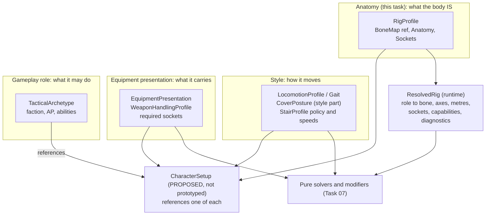
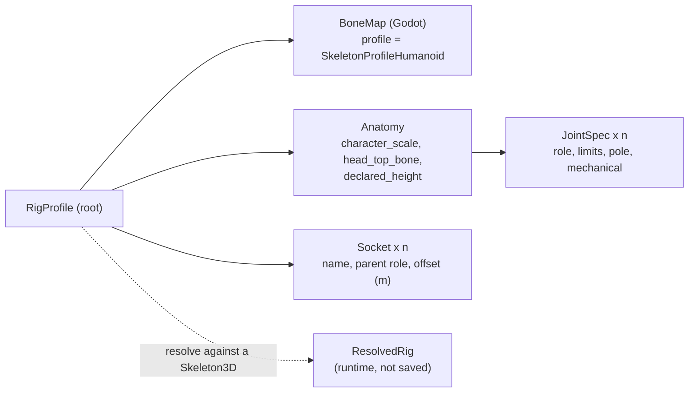

# Rig profiles and character capabilities (Task 05)

Design of how the reusable animation architecture describes different humanoid bodies, plus a small **isolated prototype** that tests the design against two real skeleton configurations. No production file was changed. Nothing is committed. The prototype lives in `research/rig_profile_prototype/` and is exercised by `tests/rig_profile_prototype_test.gd` (43 checks, all passing). It is evidence for the *configuration* design; it does **not** animate the second skeleton (that is Task 09).

**Evidence labels.** `[REPO]` read in the source. `[MEASURED]` measured on the real MIRA skeleton or by the prototype. `[ENGINE]` verified against the installed Godot 4.7.2 (`ClassDB`). `[DOC]` Godot documentation (4.7 pages). `[TESTED]` an executed check. `[PROPOSED]` this design. `[OPEN]` undecided or unverified.

## 0. Part II: the four Task 04 contract corrections

The four clarifications requested for Task 04 (handle completion safety, declared modifier overlaps, presentation time scaling, posture-request priority) were folded into `animation-ownership-contracts-2026-11-20.md` earlier in this assignment series, under a dated "Refinement 2026-11-20" note; they are not redone here. Where they are: handle observation is section 6.3 and 7 (`wait()`, `when_done()`; five executed checks); overlap kinds and validation of *undeclared* conflicts are 8.2 and 8.2a (hips position and the support clavicle are declared ordered overlaps; F-04 is the component-replacement example); time scaling is 8.5 (never scale `delta` by `Engine.time_scale` again; the replay speed is a context multiplier, not a presenter one); source-keyed posture arbitration with integer priority tiers, recency tie-break, release, prefix release, whole-body override layer and teardown is 6.4 (twelve executed checks). The three approved gameplay decisions (facing, unarmed humanoids, base occupancy) are in sections 6.2, 15 and 19 there, and are reflected here in sections 5, 13 and 14: **unarmed is a normal configuration, a rig never requires a weapon, and anatomy is separate from gameplay role and permission.** Unresolved contradictions between the two documents: none known.

## 1. Executive summary and recommended approach

**Recommendation: a hybrid in which Godot supplies the skeleton vocabulary and FuseFire supplies only what Godot does not have.**

* **Godot already solves** (verified in the installed engine) a standard humanoid role vocabulary (`SkeletonProfileHumanoid`: 56 named roles in four groups, `Hips` as scale base), a mapping resource from those roles to a skeleton's bone names (`BoneMap`), import-time retargeting for *authored clips* (rest-pose and axis normalisation, motion scaling by hips height), and a runtime `RetargetModifier3D`. `[ENGINE][DOC]`
* **FuseFire must supply**: the *authored anatomy facts* a skeleton cannot tell it (character scale, the head-top bone or a declared height, joint limits and pole directions, named sockets), the *derived measurements* its procedural solvers need (computed from the rest pose at load, not stored), a *capability report* (what this body can physically present), and the *separation* of anatomy from gait style, equipment and gameplay role.
* **Structure.** One small root `RigProfile` Resource that **references** Godot's `BoneMap` (and through it `SkeletonProfileHumanoid`, so nothing of the humanoid definition is copied) and holds a small `Anatomy` resource (with `JointSpec`s) and a list of `Socket`s. Gait style, equipment presentation and gameplay role are *other* resources that reference the profile; they are never fields of it. A `ResolvedRig` (runtime, not a Resource) holds role-to-bone indices, derived axes and metres-based measurements, resolved sockets, a diagnostics list and the capability map.
* **Proof.** The same schema, resolver and validator described **MIRA** (the real Mixamo skeleton, T-pose, native scale 0.58 m hips shown at 1.6x, local bone axes rotated 90 degrees about Y) and a **synthetic alternate** (Unreal-style names, a root bone, two spine bones, A-pose, shorter legs and arms, wider shoulders, facing -Z, local +X along each bone, no toes, no fingers, no head-top bone). Both validate with no errors; their roles, proportions, conventions, optional missing parts and capabilities are reported correctly; thirteen deliberately broken or degraded configurations each produce a specific diagnostic; and a production pure solver (the stair foot planner) ran from profile-derived proportions for both bodies (section 17).
* **What the prototype taught the design** (and revised it): the production `leg_length` 0.84 is the **hips-to-ankle** span (measured 0.832), not thigh plus shin (0.767); `pelvis_standing_height` 0.86 is a *stance ratio* (0.929) of the hip height (0.926), i.e. style, not anatomy; forward can be **derived from the hips and legs** with no toe bones (agrees with production's toe-based forward within 3.3 degrees); Godot's `required` flag is editor-only and FuseFire's required set differs (it does not require clavicles).
* **Not proven, by design:** the modifier stack on a second skeleton, visual quality, socket offsets, authored-clip retargeting. Those are Tasks 07 and 09.

## 2. Existing profile and rig inventory `[REPO]`

### 2.1 Resources that exist today

| Resource | Exports (counts include export-group lines) | What it describes (classification) | Disposition |
| --- | ---: | --- | --- |
| `LocomotionProfile` | 29 | gait thresholds, cadence, speed filters, turn/bank/accel lean: **style** | Retain; referenced by the character setup, never by the rig profile |
| `LocomotionGait` | 23 | stride, stance, joint-angle tables, bob/sway: **style** (the tables are angles, not lengths) | Retain |
| `CoverPostureProfile` | 23 | cover side choice, yaw, crouch depths and speeds, head and eye clearances: **mixed** (tactical policy, posture style, and a few anatomical clearances) | Retain; extract the anatomical clearances (`head_clearance`, `eye_below_head_top`) as derived or anatomy fields later |
| `WeaponHandlingProfile` | 22 | grips, stock, sight, raise/lower, stow: **equipment** | Retain; becomes part of the equipment presentation |
| `TraversalProfile` | 41 | ladder geometry (world), body windows and offsets (anatomy-related), speeds (style) | Retain; split world geometry, body-relative values, and style when migrating |
| `StairProfile` | 26 | foot policy (style), leg length, ankle height, pelvis height (anatomy/style), speeds | Retain; feed `leg_length`, `ankle_height` from the resolved rig |
| `PathPresentationProfile` | 5 | path smoothing: **style/world** | Retain |
| `RescueInteraction` | 19 | pickup/release timeline (durations, crouch, lift waypoint): **action timeline** | Retain |
| `TacticalArchetype`, `ShieldCapability`, `AIMovementProfile`, `CombatCoverTuning` | n/a | **gameplay role** | Never referenced by the rig profile; the archetype will reference a character setup |
| `TeamPresentationPalette` | | team colours: presentation, not anatomy | Retain |

No rig/anatomy Resource exists. What plays that role today is **44 exports on `CharacterRig`** (`character_scene`, `weapon_scene`, `right_arm_bones` and `left_arm_bones` as VRM defaults overridden by the scene with Mixamo names, `character_scale` 1.6, shoulder and elbow offsets, passenger anchors, profiles) plus literals. There is no duplicate configuration system to merge: the rig profile *replaces the bone-name and proportion parts of those exports*, and references the existing profiles.

### 2.2 Assumptions about the skeleton `[REPO]`

| Where | Assumption | Behaviour when wrong |
| --- | --- | --- |
| `character_fallback_animation_builder.gd` (16 bone literals), `character_animation_controller.gd` (12 `J_Bip` constants), `character_rig.gd` (21), `locomotion_pose_modifier.gd` (5), `passive_passenger_pose.gd` (`PREFIX = "mixamorig_"`), `unit_visual_adapter.gd` (line 235, chest bone), the workbench (1) | Mixamo and `J_Bip` names via inline `mixamo ? a : b` | A third naming fails silently or breaks clips |
| `CoverCrouchModifier.setup(skeleton, bones: Dictionary, forward)` | an ad-hoc **role-keyed dictionary** (`hips`, `left_upper`, `left_lower`, `left_foot`, `right_*`, `spine`, `head_top`, `support_clavicle`, `support_arm`) | `setup` returns false: the modifier is silently not added |
| `HandGripModifier.setup(target, prefix)` | needs all five fingers (four joints each) on both hands by name pattern | returns false: **no grip at all** if any finger is missing |
| `TraversalPoseModifier.setup(rig, skeleton, hips_name)` and `_build_traversal_modifier` | hips and leg names | silent |
| `CharacterFallbackAnimationBuilder.measure_axes` | up = head minus hips; forward from the toe direction; hinge = forward x up | skipped if toes are missing (axes stay default) |
| `CharacterRig._build_character` | `assert(character_scene)`, `assert(arm bones == 3)`, `assert(weapon_scene)` | hard asserts, no diagnostics |
| Weapon attachment | a `BoneAttachment3D` on `right_arm_bones[2]` named "RightHandWeaponSocket" | |
| Scale | `model.scale = character_scale` on the model node; modifiers read the skeleton's global scale | a wrong scale is silent |

**What is already good and should be kept:** the modifiers measure limb lengths and bend axes from the rest pose (`CoverCrouchModifier`: `_upper_length`, `_lower_length`, `_hip_to_ankle`, `standing_head_height`, `_ankle_height`, per-bone forward axes), the grip modifier measures its curl axes, and the role-keyed dictionary already exists. The profile formalises it.

### 2.3 Experimental work (untouched)

The Task 03 probe (`research/animation_host_probe/`), the Exploration Playground (`research/exploration_playground/`, its test, the Match Setup button and catalog line) and the Task 04 update-order probe are all uncommitted and were not modified. Their relevant evidence: the production character runs with no tactical unit (so a rig profile need not know about one), and its unarmed state is only a slung rifle today.

## 3. Native Godot skeleton-profile findings

Verified against the **installed engine (4.7.2.stable)** with `ClassDB`, and against the 4.7-headed documentation pages `[ENGINE][DOC]`:

| Class | Verified facts | Use for FuseFire |
| --- | --- | --- |
| `SkeletonProfile` (Resource) | properties `root_bone`, `scale_base_bone`, `group_size`, `bone_size`; per-bone name, parent, `tail_direction`, `bone_tail`, `reference_pose`, `handle_offset`, `group`, `required`. Described as a virtual skeleton that serves as the *target for retargeting* | the vocabulary and hierarchy |
| `SkeletonProfileHumanoid` | 56 bones in four groups (Body, Face, LeftHand, RightHand), root `Root`, scale base `Hips`; 17 roles flagged required (hips, spine, head, both shoulders, arms, hands, legs, feet) | the **role vocabulary** FuseFire adopts as is |
| `BoneMap` (Resource) | property `profile`; mapping stored in `bonemap`; `get_skeleton_bone_name(role)`, `set_skeleton_bone_name(role, name)`, `find_profile_bone_name(name)`; signals `bone_map_updated`, `profile_updated` | **the semantic-role mapping**: reused, not reimplemented |
| `RetargetModifier3D` (a `SkeletonModifier3D`) | properties `profile`, `use_global_pose`, `enable` (position/rotation/scale flags); transfers the pose of the *parent* skeleton to a *child* skeleton with a different rest in model space | the runtime route for **authored** animation (see section 4); not needed for procedural solvers |
| `Skeleton3D` | `find_bone`, `get_bone_parent`, `get_bone_rest`, `get_bone_global_rest`, `get_parentless_bones`, `motion_scale`, bone meta | what the resolver reads |
| `LookAtModifier3D` | exists in this engine with limits and interpolation | a native option for a future head-attention capability |
| `BoneAttachment3D` | `bone_name`/`bone_idx`, override pose | what sockets become at runtime |

**What the documentation says and does not say** (summaries of the 4.7 pages; the retargeting tutorial was read earlier): retargeting is an *import-time* workflow (bone renamer, remove tracks, "Overwrite Axis" to rewrite bone rests to the reference, "Fix Silhouette" to match T-pose, motion-scale normalisation by hips height); the humanoid reference pose is a T-pose facing +Z, Y-up; Godot 4 poses include the rest transform (unlike Godot 3). The class pages do **not** state: what `required` does outside the editor (it is documented as an editor highlight), how a `BoneMap` is attached to a `RetargetModifier3D`, or which version added the modifier. Automatic name-matching is an editor feature (not used or verified here). The `find_profile_bone_name` description is internally inconsistent about source versus target. `[DOC][OPEN]`

**Division of labour.**

| Information | Native structure | FuseFire-specific |
| --- | --- | --- |
| Role vocabulary and hierarchy | `SkeletonProfileHumanoid` | no |
| Role to bone-name mapping | `BoneMap` | no |
| Which roles FuseFire needs | n/a (`required` is editor-only) | yes (a short list; section 7) |
| Authored-clip retargeting and motion scale | import retargeting, `RetargetModifier3D` | no |
| Rest-pose axes, limb lengths, proportions | the skeleton's rest data | derived by FuseFire's resolver (metres) |
| Character scale, head top, declared height | no | yes (authored facts) |
| Joint limits and pole directions | no | yes |
| Sockets (hands, chest, back, interaction contacts) | `BoneAttachment3D` exists | the named list and offsets |
| Capabilities, equipment compatibility | no | yes |
| Gait style, gameplay role | no | separate resources |

## 4. Retargeting strategy comparison

| Criterion | A. Standardised skeletons plus import retargeting only | B. Semantic role mapping interpreted by the runtime only | **C. Hybrid: engine retargeting for authored clips, runtime profile for procedural work and attachments** |
| --- | --- | --- | --- |
| Different bone names | handled by `BoneMap` at import | handled by the role map | handled by one `BoneMap` used by both |
| Different hierarchy | needs matching roles; intermediate bones tolerated by Godot's mapping | roles tolerate intermediate bones (reported) | same |
| Different proportions | motion scale by hips height; foot sliding differs | measured from the rest pose; solvers parameterised | both: scale for clips, measurements for solvers |
| Different rest orientation | needs destructive "Overwrite Axis" for sharing clips | **measured axes; no rewriting** (proved: MIRA's hips basis is rotated 90 degrees, the alternate's local +X runs along bones) | rewrite only when sharing authored clips; never needed for procedural |
| Procedural modifier compatibility | none (clips only) | full | full |
| Authored animation compatibility | full | none (no clip retargeting) | full |
| Equipment and attachments | not addressed | sockets by role | sockets by role |
| Authoring effort | import settings per character | a profile per character | both, but one mapping serves both |
| Runtime cost | `RetargetModifier3D` per character if used | resolve once at load | resolve once; modifier only if authored clips are used |
| Editor usability | native bone-map editor | inspector of a custom Resource | native editor for the map; inspector for the rest |
| Failure diagnostics | warnings at import | structured diagnostics (this prototype) | both |
| Migration risk | high (replaces the procedural path) | low | low; authored path is additive |

**Recommendation: C.** Do not assume that sharing bone names gives valid retargeting (rest poses and bone roll differ) and do not assume every humanoid needs destructive rest-pose normalisation: the procedural path never needs it, because the solvers already measure their axes (the resolver reproduced production's measured up axis to 0.00 degrees on MIRA). Normalisation is a cost to pay only for characters that must share *authored* clips, at import, as Godot's pipeline intends.

## 5. Anatomy and configuration ownership



* **Anatomy** is the rig profile. Different gameplay roles can reference the same body and different bodies can serve one role, because role references the *setup*, not the profile.
* **Style** is per character and independent of the body (a tall and a short humanoid may share a gait profile or differ).
* **Equipment** is chosen by gameplay and presented through a resource that names the sockets it needs; the rig profile only says which sockets *exist*.
* **Role** contains AP, faction, class and legality. A test (`rig profile contains no gameplay-role field`) scans the profile resources for those words.

## 6. Proposed reusable humanoid profile schema



Prototype files (all under `research/rig_profile_prototype/`, no `class_name`, so nothing leaks into the project namespace): `rig_profile.gd` (root), `rig_anatomy.gd`, `rig_joint_spec.gd`, `rig_socket.gd`, `equipment_presentation.gd`, `rig_roles.gd` (the FuseFire role requirements), `rig_diagnostics.gd`, `rig_resolver.gd` (resolve, measure, validate, capabilities), `fixtures.gd`, `generate_profiles.gd`, and the saved `profiles/*.tres`. **Five small Resources and one reference to a native one**, not a flat resource with hundreds of fields.

A representative profile, the alternate humanoid, as code:

```gdscript
var p := RigProfile.new()
p.skeleton_map = new_bone_map({
	&"Root": &"root", &"Hips": &"pelvis", &"Spine": &"spine_01", &"Chest": &"spine_02", &"Neck": &"neck_01", &"Head": &"head",
	&"LeftUpperArm": &"upperarm_l", &"LeftLowerArm": &"lowerarm_l", &"LeftHand": &"hand_l",   # ... right side, legs
	&"LeftUpperLeg": &"thigh_l", &"LeftLowerLeg": &"calf_l", &"LeftFoot": &"foot_l",
})
p.anatomy = Anatomy.new()
p.anatomy.character_scale = 1.0
p.anatomy.declared_height = 1.43            # no head-top bone on this skeleton
p.sockets = [socket(&"weapon_dominant_hand", &"RightHand"), socket(&"weapon_support_hand", &"LeftHand")]
```

and MIRA, same schema, different data: `character_scale = 1.6`, `head_top_bone = &"mixamorig_HeadTop_End"`, the Mixamo names (`mixamorig_Spine1` as `Chest`, `mixamorig_LeftUpLeg` as `LeftUpperLeg`, and the first three joints of each four-joint Mixamo finger as the three Godot finger roles). Both are also saved as `.tres` (`profiles/mira_rig_profile.tres`, `profiles/alternate_rig_profile.tres`; the `BoneMap` and the `SkeletonProfileHumanoid` serialise inline) and the test confirms a reloaded profile resolves identically. In use:

```gdscript
var resolved := RigResolver.resolve(profile, skeleton)
if resolved.diagnostics.has_errors():
	push_error(resolved.diagnostics.format())
var hips := resolved.bone(&"Hips")                         # a bone index, whatever the name
var leg := resolved.measurements.hips_to_ankle              # metres, scale applied once
if resolved.supports(&"stair_foot_placement"): ...          # structural capability, not permission
```

## 7. Semantic bone roles

**Vocabulary = the bone names of `SkeletonProfileHumanoid`.** The minimum FuseFire's existing code needs:

| Need | Roles | Required? | Existing use |
| --- | --- | --- | --- |
| Pelvis, spine | `Hips`, `Spine`; optional `Chest`, `UpperChest` | Hips, Spine required | locomotion twist shares across the chain (three bones on MIRA); crouch lean uses two |
| Head and neck | `Head`; optional `Neck` | Head required | passenger and sling anchors from the neck; crouch height |
| Legs | `{Left,Right}UpperLeg`, `LowerLeg`, `Foot`; optional `Toes` | legs required | locomotion, crouch solve, stair and ladder IK; toes only for the (replaceable) toe-based forward |
| Arms | `UpperArm`, `LowerArm`, `Hand`; optional `Shoulder` (clavicle) | arms required | arm IK, grip, carry; the support clavicle reach is optional |
| Fingers | the 15 per hand roles | optional | grip curl |
| Not in Godot's profile | head-top end bone | optional, in `Anatomy.head_top_bone` | crouch standing height |

**FuseFire requires 15 roles; Godot flags 17** (the two clavicles are the difference): the clavicles are optional here because only the support-arm reach uses them.

**Failure semantics** (all produce structured diagnostics; none crashes):

| Situation | Code | Severity | Effect |
| --- | --- | --- | --- |
| Optional role absent | `W_OPTIONAL_MISSING` / `W_OPTIONAL_PARTIAL` | warning | the affected capability falls back or is unavailable |
| Required role unmapped | `E_REQUIRED_ROLE_MISSING` | error | the chain's capabilities are UNSUPPORTED |
| Mapped bone not in the skeleton | `E_BONE_NOT_FOUND` | error | as above |
| Two roles on one bone | `E_DUPLICATE_BONE` | error | the second role is not mapped |
| Bone outside its chain | `E_HIERARCHY` | error | locomotion and dependent capabilities UNSUPPORTED |
| Bones between two chain roles | `I_INTERMEDIATE_BONES` | info | ignored by the roles |
| Left/right mixed or swapped | `E_SIDE_INCONSISTENT` | error | detected from geometry (every left role must be on one side) |
| Collapsed or zero-scale rest | `E_REST_DEGENERATE` | error | |
| Non-unit rest scale | `W_REST_SCALE` | warning | solvers assume unit bone scale |

## 8. Rest-pose and transform conventions

* **Godot 4 poses include the rest transform** `[DOC]`: a bone's pose is rest plus pose offset. The resolver reads **rest** data only (`get_bone_rest`, `get_bone_global_rest`), so it is independent of the current animation.
* **Character forward, up and lateral are derived**, not assumed: up = Head minus Hips; lateral = LeftUpperLeg minus RightUpperLeg with the up component removed; forward = lateral x up (for Godot's left +X, up +Y this is +Z). Toes, when present, are only a cross-check (`W_FORWARD_DISAGREES_WITH_TOES`). `[MEASURED]` MIRA: derived up equals production's measured up to 0.00 degrees; derived forward differs from production's toe-based forward by 3.30 degrees (the feet toe out slightly), within the 4-degree tolerance of the test.
* **Non-standard conventions are reported, not rejected:** the alternate faces -Z (`W_FORWARD_NOT_PLUS_Z`); a non-Y-up skeleton raises `W_NOT_Y_UP`. Production code assumes Y-up in places (the crouch modifier reads `.y` directly), so these warnings name exactly what Task 07 must make axis-aware.
* **Local bone axes** are never assumed: MIRA's hips bone has a basis rotated 90 degrees about Y, the alternate's local +X runs down every bone. The resolver derives hinge axes in each bone's *own* rest frame (`bend_axes`), and the existing modifiers' per-bone measured axes (`_measure_axis`) are the same idea; neither needs a normalised skeleton.
* **Scale is applied exactly once** and stated. The profile's `character_scale` converts native units to metres (MIRA: 0.58 native hips x 1.6 = 0.928 m). When the skeleton is inside a scene tree the resolver compares the declared scale with the skeleton's actual global scale (`E_SCALE_MISMATCH`); `[TESTED]` the declared 1.6 matches the production visual's skeleton, and a wrong declaration is an error. All measurements are returned in metres; solvers must not rescale them.
* **IK target coordinates** are in *character space* (Task 04: foot-point origin, metres); sockets are authored in the parent bone's rest frame in metres at character scale and resolved to skeleton-space transforms (native units) with the scale divided out once.
* **T-pose versus A-pose** is detected (`I_REST_POSE`: MIRA 3 degrees below horizontal, the alternate 40 degrees) and informs authored-clip retargeting only; the procedural path does not care.
* **What is derived and what is authored:** derived: axes, limb lengths, widths, heights (when a head-top bone exists), hinge axes. Authored: character scale, head-top bone or declared height (when there is none), joint limits, pole directions, socket offsets.

## 9. Measurements and proportions

Units: **metres**, angles in degrees, scale applied once. `[MEASURED]` on MIRA (hips 0.58 native x 1.6):

| Measurement (meaning) | Prototype value, MIRA | Alternate (B) | Existing constant and where | Classification | Consumer solver | Validation |
| --- | ---: | ---: | --- | --- | --- | --- |
| Hip height | 0.926 | 0.820 | `TraversalProfile.hips_height` 0.90; `StairProfile.pelvis_standing_height` 0.86 | anatomy (the height) and style (the **stance ratio**: 0.86 / 0.926 = 0.929; 0.90 / 0.926 = 0.972) | stair planner, traversal | plausibility against standing height |
| Hips-to-ankle (the planner's "leg") | 0.832 | 0.744 | `StairProfile.leg_length` 0.84 | **anatomy, derivable** (within 1%) | `StairFootPlanner.pelvis`/limits | segment sanity |
| Thigh / shin | 0.388 / 0.379 | 0.360 / 0.360 | assumed equal by the planner (comments in `pelvis`) | anatomy | planner (equal-segment assumption), crouch solve | `W_LEG_SEGMENTS_UNEQUAL` outside 0.8 to 1.25 |
| Ankle height | 0.111 | 0.080 | `StairProfile.ankle_height` 0.09 | anatomy **plus** a tuned sole offset (0.09 is the ankle target above the tread, 0.111 the rest ankle joint height) | stair planner, crouch | 0.02 to 0.25 m |
| Hip half-width | 0.094 | 0.075 | `StairProfile.foot_half_spread` 0.10; ladder `foot_half_spread` 0.14 | anatomy and style (stance width) | stair and ladder planners | |
| Shoulder width (arm joints) | 0.250 | 0.340 | `TraversalProfile.hand_half_spread` 0.20 (a ladder rail grip, world-driven) | anatomy; the ladder number is style/world | ladder solver | |
| Upper arm / forearm | 0.251 / 0.212 | 0.270 / 0.240 | none explicit (arm IK solves from the skeleton) | anatomy | arm IK reach checks | |
| Standing height | 1.615 | 1.430 (declared) | `CoverCrouchModifier.standing_head_height` (1.509 above the ankle; profile 1.504) | anatomy | crouch depth limits, cover clearances | 0.5 to 3.0 m |
| Rig-space constants | | | `RELAXED_HANDS` (-0.22, 0.92, 0.30), `RELAXED_POLES`, `GRIP_OFFSET`, `SIGHT_OFFSET`, `ELBOW_POLE_DISTANCE`, `shoulder_contact_offset`, `passenger_anchor_from_neck` | anatomy-relative (derive from shoulder, hip height and arm length) or equipment (`GRIP_OFFSET`, `SIGHT_OFFSET`) | weapon pose, carry | decide per item in Task 07 |
| Locomotion style | | | `stride_length` 1.1, `walk_until` 1.6, tables | **style**, not derived (a ratio to leg length may be a style parameter) | locomotion | |

**Lessons the numbers taught.** (1) The stair planner's `leg_length` is the hips-to-ankle span, so a naive "thigh plus shin" substitution would have changed MIRA's stairs by 8%; the profile needs `hips_to_ankle` as a named measurement, and the prototype added it after the first solver run clamped the pelvis. (2) `pelvis_standing_height` and `hips_height` are *stance ratios of the hip height*, i.e. style: Task 07 should store `stance_ratio` and compute the height, preserving MIRA's behaviour exactly with ratio 0.929/0.972. (3) Where a production constant is within a percent of the measurement it should be derived; where it encodes behaviour it stays tuned and is expressed as a ratio. Never replace a tuned number with a raw measurement without an equivalence test.

## 10. Joint limits and IK configuration

* **Derived:** the knee and elbow **hinge axes in the bone's own rest frame** (`ResolvedRig.bend_axes`; for MIRA the knee's is mostly local Z because her local frames are rotated, for the alternate local -Y) and the body's forward and lateral directions.
* **Authored (`JointSpec`):** minimum and maximum flexion, a **pole direction** in character space (knees +Z, elbows -Z) for `TwoBoneIK3D` pole targets, and a `mechanical` flag for rigs whose joints are not human-like. The stair planner's 45-degree minimum knee interior angle and the crouch modifier's 130-degree limit are the current hardcoded versions of this data.
* **IK targets** stay `TwoBoneIK3D` chains defined by three role-resolved bones (root, middle, end); the profile supplies roles and poles, not the solver.
* `E_JOINT_LIMITS`, `E_JOINT_POLE` and `E_JOINT_ROLE_MISSING` catch inverted limits, a zero pole and a joint on an unmapped role.

## 11. Attachment points

Named sockets with a parent role and an offset in metres: `weapon_dominant_hand`, `weapon_support_hand`, `sling_chest`, `carry_shoulder` (prototype), later `back`, interaction contacts. They replace the single hardcoded `RightHandWeaponSocket` created from `right_arm_bones[2]` and the neck-relative chest anchors. A missing socket parent is `E_SOCKET_PARENT_MISSING`; duplicates are `E_DUPLICATE_SOCKET`; resolved sockets are skeleton-space transforms. **The prototype's socket offsets are placeholders** (identity): the true values live in the rig scene and the weapon handling profile and are a Task 07 migration item.

## 12. Locomotion-style separation

| Stays style (not derived from the body) | Derives from the body or is validated against it |
| --- | --- |
| gait thresholds (`walk_until`, `jog_at`, `run_at`), cadence limits, speed rise/fall, smoothing, turn twist limit, bank and accel lean, stride length, stance fraction, bob and sway, expressive motion | leg-length-relative sanity (a stride that exceeds reach), foot spread bounds (hip width), the planners' leg and ankle numbers |

A short humanoid and a tall one share one locomotion implementation and may share or differ in **gait profile**. Do not scale every locomotion parameter by height automatically: stride, for example, is a style choice that may be authored as a ratio to leg length (an option for Task 07, validated against the profile), not forced.

## 13. Equipment-presentation separation

`EquipmentPresentation` (prototype) names the sockets an item needs and whether it is two-handed; `Resolver.supports_equipment(resolved, item)` reports `E_EQUIPMENT_SOCKET` or `E_EQUIPMENT_TWO_HANDED` when the body cannot physically carry it. The rest of today's equipment data stays as it is and moves with the item: weapon scene, grips (`GRIP_OFFSET`, `SIGHT_OFFSET`), `WeaponHandlingProfile` (stock, grip, sight, stow, raise/lower), equipment-specific pose parameters and the equipment-dependent animation requests. **No rig profile mentions a weapon**, and `[TESTED]` both bodies can carry the rifle presentation while a body without weapon sockets cannot yet stays fully usable unarmed. Authoritative inventory and legality are the context's (Task 04); this task builds none.

## 14. Capability model

Each capability has a status: **SUPPORTED**, **FALLBACK** (works with a defined degradation), **UNSUPPORTED** (missing anatomy or assets, with the reason), or **NOT_IMPLEMENTED** (the body could, no presentation exists). Capabilities describe what the body and its resources can *physically present*; they are **never a gameplay permission** (a civilian may be able to climb a ladder where mission rules forbid it; a rig that can fire a weapon may belong to a role that may not).

| Capability | Prerequisite | MIRA | Alternate |
| --- | --- | --- | --- |
| `biped_locomotion`, `turn_twist` | hips, both legs, a spine bone | SUPPORTED | SUPPORTED |
| `crouch`, `kneel` | usable legs and a standing height | SUPPORTED | SUPPORTED (declared height) |
| `stair_foot_placement` | usable legs | SUPPORTED | SUPPORTED |
| `ladder_contacts` | legs and arms | SUPPORTED | SUPPORTED |
| `two_arm_ik` | both arm chains | SUPPORTED | SUPPORTED |
| `hand_grip` | five fingers on both hands | SUPPORTED | **FALLBACK** (hands placed, fingers in rest) |
| `weapon_ready_pose` | arms plus the two weapon sockets | SUPPORTED | SUPPORTED |
| `carry_pose` | arms, a head or neck, a chest bone | SUPPORTED | SUPPORTED |
| `unarmed` | legs (no equipment needed) | SUPPORTED | SUPPORTED |
| `object_interaction`, `head_attention` | arms; neck and head | NOT_IMPLEMENTED | NOT_IMPLEMENTED |

A rig with no finger bones is **not** a validation failure for walking; a rig with no usable leg chain is **not** reported as supporting stair foot IK (`[TESTED]`).

## 15. Profile validation rules and diagnostics

Result type: `Diagnostics` (a list of `Entry` with severity INFO/WARNING/ERROR, a stable `code`, the `role`, a message and a fix hint) plus `ResolvedRig.capabilities`. Rule set (all implemented in the prototype and each exercised by a check): required roles; unknown or missing bones; duplicate mappings; chain hierarchy; left/right consistency; degenerate or non-unit rest; zero-height or zero-width body; forward/toes disagreement; non-Y-up and non-+Z conventions (warnings); implausible height, ankle height and leg length; leg asymmetry over 10%; unequal thigh and shin (the stair planner's assumption); declared height inconsistent with the head bone; character-scale mismatch against the in-scene skeleton; socket parents and duplicates; joint limits and poles; equipment sockets; optional missing bones; capability prerequisites.

### 15.1 Developer workflow `[PROPOSED]`

1. Import the model; apply Godot's retargeting configuration only if it must share **authored** clips.
2. Create the profile: assign a `BoneMap` (profile `SkeletonProfileHumanoid`) and map the roles (the native editor works).
3. Run the validator (an editor tool or a test): read the diagnostics. A missing required role names the role; a swapped hand names `E_SIDE_INCONSISTENT`; a bad scale names `E_SCALE_MISMATCH`.
4. Inspect the measured proportions and conventions (`ResolvedRig.measurements`, the `I_REST_POSE` and forward warnings).
5. Set `character_scale`, the head-top bone or declared height, joint limits and poles, and the sockets.
6. Pick the gait profile and equipment presentation in a character setup; review the capability report.
7. Run the profile validation test; try the character in the shared workbench.

Diagnosing: a **missing role** is an `E_REQUIRED_ROLE_MISSING` with the role and the hint; a **bad rest orientation** shows as a forward/up warning with the angle and what production code is affected; a **misplaced hand socket** shows in the resolved socket transform (and in a future workbench overlay). No GDScript file needs editing to add a humanoid once Task 07 consumes the profile.

## 16. Evidence from two different humanoid configurations

| Property | A: MIRA (real skeleton) | B: alternate (synthetic, **not** a production character) |
| --- | --- | --- |
| Source | `mira_0_prototype.glb`, 65 bones | built by `fixtures.gd`, 20 bones |
| Naming | `mixamorig_*` | Unreal-style (`pelvis`, `thigh_l`, `calf_l`...) |
| Hierarchy | no root bone; three spine bones; toes; four-joint fingers | a `root` bone; two spine bones; no toes; no fingers; clavicles |
| Native scale | hips 0.58, shown at 1.6x | metres, scale 1.0 |
| Rest orientation | T-pose (3 degrees); hips basis rotated 90 degrees about Y; faces +Z | A-pose (40 degrees); local +X along each bone; faces **-Z** |
| Head top | end bone (`HeadTop_End`) | none: height **declared** 1.43 m |
| Hips-to-ankle / thigh / shin | 0.832 / 0.388 / 0.379 | 0.744 / 0.360 / 0.360 |
| Shoulder width / hip width | 0.250 / 0.187 | 0.340 / 0.150 |
| Standing height | 1.615 (measured) | 1.430 (declared) |
| Validation errors | 0 (one info) | 0 (warnings: no fingers, no toes, partial spine, forward -Z) |
| Capabilities that differ | `hand_grip` SUPPORTED | `hand_grip` FALLBACK |

The same code path produced both rows; neither needed a copy of the animation system, a rewritten rest pose or a code edit.

## 17. Actual experimental validation

`tests/rig_profile_prototype_test.gd`: **43 checks, 0 failures** (4 s). Executed and what each shows:

* **Same validator, two bodies:** both validate with no errors; every FuseFire-required role resolves on both; the same role resolves to different bone names; optional missing bones are warnings only on the body that lacks them.
* **Conventions and proportions reported correctly:** shorter legs, lower hips and wider shoulders on B; forward +Z versus -Z derived from geometry; T-pose versus A-pose; measured versus declared height; MIRA's measured thigh and upper arm equal independently measured values.
* **Agreement with production on the real rig:** derived up equals `animation_controller.locomotion_axes().up` (0.00 degrees); derived forward within 3.30 degrees of production's toe-based forward; standing head height equals what `CoverCrouchModifier` measures (1.504 versus 1.509 m); the declared scale 1.6 is consistent with the in-scene skeleton and a wrong one is an error; measured hips-to-ankle 0.832 is within 1% of the planner's tuned 0.84.
* **Capabilities:** hand grip FALLBACK on B; walking, stairs and unarmed on both; NOT_IMPLEMENTED reported honestly; both bodies can carry the rifle presentation, a body without weapon sockets cannot but stays usable unarmed.
* **Thirteen broken or degraded configurations** each produce their specific diagnostic (twelve errors or warnings, plus the no-fingers case that must *not* fail): unmapped required role (and the leg capabilities are then *not* claimed while the arms still are), bone not found, duplicate bone, a bone outside its chain, swapped hands, collapsed rest transform, renamed bone, socket on an unmapped role, inverted joint limits, no head top and no declared height (crouch unsupported with the fix named, walking unaffected), no fingers (fallback, not failure), a unit mix-up (scale 100), an inconsistent declared height, and a profile with no bone map.
* **A production pure solver consumed profile data for both bodies:** `StairFootPlanner.pelvis_smoothed` with a `StairProfile` filled from each resolved rig produced valid pelvis heights along a stair; the shorter body's pelvis was lower by 0.106 m (0.876 versus 0.770 above the tread), the difference coming from profile data, not code. (A first attempt that used thigh plus shin clamped MIRA's pelvis at 0.848: the lesson in section 9.)
* **Separation and serialisation:** no gameplay-role property name appears in the profile resources; both saved `.tres` files (BoneMap and `SkeletonProfileHumanoid` inline) load and resolve identically to the code-built ones.

Other checks run: `.\tools\run_tests.ps1 check` (catalog complete, 236 scripts), `fast -Subsystem animation` (9 tests passed, unchanged production code), the GDScript warning audit (0 warnings including the prototype), and the earlier handle and posture scratch checks (Task 04 refinement).

**Not validated (state plainly):** the modifier stack on the alternate skeleton; any visual quality (everything above is headless and structural); real socket offsets; authored-clip retargeting or `RetargetModifier3D` behaviour; a second *production* character asset (the alternate is synthetic: bone positions in a script, not a modelled mesh); twist-bone hierarchies beyond the info diagnostic; the full-tier regression suite.

## 18. Migration impact inventory (for Task 07; nothing migrated)

| Area | File or component | Current hardcoded dependency | Replacement | Impacted consumers | Compatibility | Tests | Risk |
| --- | --- | --- | --- | --- | --- | --- | --- |
| Bone names, clips | `character_fallback_animation_builder.gd` (16 literals + `measure_axes`) | Mixamo/`J_Bip` names; toe-based forward | role lookups via `ResolvedRig`; derived up/forward | controller, rig, all generated clips | identical clips on MIRA (derived axes match: 0.00 / 3.3 degrees) | `locomotion_gait_test`, `locomotion_*` | medium |
| Controller | `character_animation_controller.gd` (12 `J_Bip` constants) | VRM names | role lookups | gait blend, state clips | unchanged | `locomotion_foundation_test` | low-medium |
| Rig bones | `character_rig.gd` (21 literals, 44 exports): arm bone exports, `_build_crouch_modifier` dictionary, `_build_traversal_modifier` leg names, `torso_bone_name`, `neck_bone_name` | names and scene paths | resolved roles feed the existing role-keyed dictionary and IK chains | all modifiers | identical on MIRA | rig, cover, traversal tests | medium |
| Spine/twist | `locomotion_pose_modifier.gd` | names, spine chain 3 | `Spine/Chest/UpperChest` roles (present ones) | turn presentation | identical | composition test | low |
| Crouch | `cover_crouch_modifier.gd` | role dictionary already; head-top from a name | `ResolvedRig` roles and head top; keep its own measuring | cover | identical | `cover_crouch_test`, cover tests | low |
| Grip | `hand_grip_modifier.gd` | five fingers or nothing; name prefix | finger roles; **FALLBACK when absent** | carry, weapon | MIRA unchanged | hand contact diagnostics test | medium |
| Traversal | `traversal_pose_modifier.gd` | hips name; 11 rig string calls (Task 04) | role plus typed input | ladders, stairs | identical | `traversal_*` | medium |
| Passenger | `passive_passenger_pose.gd` (`"mixamorig_"`) | prefix | roles of the passenger's own profile | rescue | MIRA unchanged | rescue tests | low-medium |
| Adapter | `unit_visual_adapter.gd:235` (chest bone) | name | role `UpperChest` or fallback | class marker | identical | adapter test | low |
| Scale | rig (`model.scale = character_scale`) | export | `anatomy.character_scale` (scale once, mismatch check) | everything | 1.6 unchanged | any rig test | low |
| Stairs | `StairProfile` (`leg_length`, `ankle_height`, `pelvis_standing_height`, `foot_half_spread`) | tuned constants | `hips_to_ankle`, ankle, hip height x **stance ratio**, hip width; MIRA keeps explicit equal values | stair planner, rig | **must equal today's numbers on MIRA** (0.84, 0.09, 0.86, 0.10) | `traversal_stair_*`, alignment | medium (replay-sensitive timing is unaffected: presentation only) |
| Traversal body windows | `TraversalProfile` (`hips_height`, windows, spreads) | tuned | hip height x ratio; windows relative to body | ladder solver | identical on MIRA | ladder tests | medium |
| Weapon | `weapon_scene` assert, `GRIP_OFFSET`, `SIGHT_OFFSET`, `RightHandWeaponSocket` | one rifle, always | `EquipmentPresentation` + sockets; **no weapon allowed** | weapon pose, stow, carry | MIRA still gets the rifle | weapon tests; a new unarmed test | medium-high |
| Rig-space constants | `RELAXED_HANDS`, `RELAXED_POLES`, elbow guides, `shoulder_contact_offset`, `passenger_anchor_from_neck` | MIRA metres | anatomy-relative or socket data | rest posture, carry | identical on MIRA | weapon pose, torso frame tests | medium |
| Workbench | `mira_0_pose_workbench.gd` | rig subclass, 1 literal | same profile route | tooling | | | low |

**Suggested sequence:** (1) load and validate a profile for MIRA beside the existing path (diagnostics only, no behaviour change); (2) role lookups in the builder and controller (clips unchanged, checked by existing tests); (3) the rig and modifiers read roles (the role dictionary already exists); (4) stair and traversal profiles take measured fields with explicit MIRA values; (5) sockets and equipment presentation; (6) grip fallback and unarmed; (7) remove literals; at each step the existing animation tests and the replay-determinism test stay meaningful.

## 19. Handoff

### Task 06 (module organisation)
Natural homes: rig-profile Resources and the role vocabulary together (they are data); the resolver and diagnostics together (a pure, scene-free module with its test); equipment presentation beside the weapon handling profile; locomotion style resources unchanged; capability reporting inside the resolver module; rig diagnostics (a future overlay) with the workbench tooling; runtime resolved indices are a plain object held by the presenter or rig. Rule worth enforcing: **no gameplay-role type is imported by the rig-profile module** (checkable by a scan, as the prototype test does for properties). Do not reorganise now.

### Task 07
Section 18. Preserve MIRA's behaviour exactly by migrating tuned constants as explicit values or ratios, never by silently replacing them with measurements.

### Task 09 acceptance tests (what Task 05 can validate now and what stays)

| Test | Task 05 now | Task 09 |
| --- | --- | --- |
| Same shared code, two profile mappings | resolver and validator: **done** | the runtime stack |
| Different proportions reported correctly | **done** | |
| Locomotion, turn, posture | | needed |
| Hand and foot IK | stair pelvis solver ran: **partly** | needed |
| Equipment state changes, unarmed | sockets and compatibility: **done**; presentation | needed |
| Traversal where supported | capability reported | needed |
| Missing optional features | fallback status: **done** | the behaviour |
| Pose composition correctness | | needed |
| Workbench usability | | needed |

### Later
Authored/procedural composition (the same `BoneMap` feeds import retargeting); contacts (sockets and resolved transforms); workbench tooling (overlay of roles, axes, sockets and the capability report); non-humanoid rigs are **out of scope** (wheeled, tracked, quadruped, flying) and must not be forced into this profile; performance (resolution happens once at load; no per-frame cost); replay (presentation only).

## 20. Remaining decisions and uncertainties

* **`CharacterSetup`** (rig profile + gait style + equipment + archetype link) is proposed but not prototyped; its exact shape belongs to Task 06/07.
* **Stance ratios and tuned constants:** which MIRA constants become ratios, which stay explicit overrides (section 9).
* **Whether `ankle_height` includes a sole offset** (measured 0.111 versus tuned 0.09): needs a decision on what the planner's ankle target means.
* **Socket offsets** must be taken from the rig scene and weapon profile.
* **Twist bones and non-trivial hierarchies** are only covered by an info diagnostic and the synthetic skeleton; a real second asset is needed (Task 09).
* **`RetargetModifier3D` behaviour and `BoneMap` attachment** were not exercised; the documentation does not state them.
* **Non-Y-up skeletons** are warned about, not supported; production code assumes Y-up in places.
* **Future variation** (adult proportions, androids, service, military, partly mechanical bodies) should reuse one animation implementation when the skeleton capabilities are compatible; `mechanical` joint flags and capability reports are the extension points. Genuinely non-humanoid robots stay out.

## Files

New: this document; `research/rig_profile_prototype/` (`rig_profile.gd`, `rig_anatomy.gd`, `rig_joint_spec.gd`, `rig_socket.gd`, `equipment_presentation.gd`, `rig_roles.gd`, `rig_diagnostics.gd`, `rig_resolver.gd`, `fixtures.gd`, `generate_profiles.gd`, `profiles/mira_rig_profile.tres`, `profiles/alternate_rig_profile.tres`, and the `.uid` files); `tests/rig_profile_prototype_test.gd` (+ `.uid`). Modified: `tests/catalog.json` (one line), `docs/claude/README.md` (index), `docs/claude/animation-ownership-contracts-2026-11-20.md` (a pointer here). No production animation file, scene, modifier, rig, adapter or tactical file was changed.
