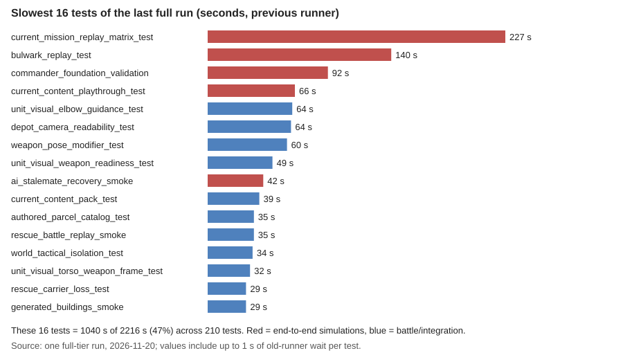
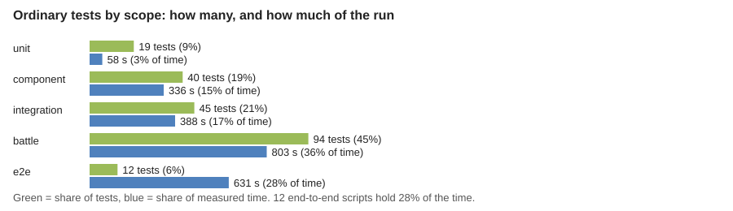
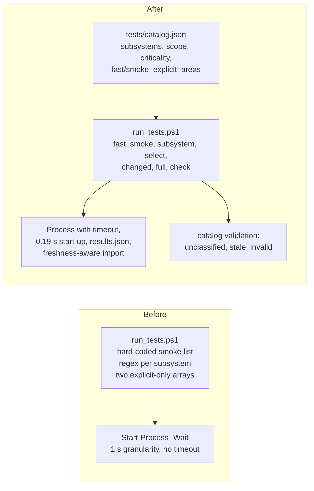

# Test suite efficiency and reliability (Task 02.5)

Evidence, design and results of the test-suite investigation. For day-to-day use read the [testing developer guide](testing-developer-guide-2026-11-20.md); the complete per-test table is the generated [test inventory](test-inventory-2026-11-20.md); policy stays in [Project Ironclad](../quality/project-ironclad.md). No full regression run was executed for this task: every number below is either measured (and says so) or labelled an estimate.

## 1. Baseline

Branch `main`, HEAD `427fdc4` (the accepted foundation checkpoint). The working tree held only the six unrelated Kenney `colormap.png.import` changes, which were left alone, as were `AGENTS.md`, `.agents` and `.codex`.

| What | Before | After |
| --- | ---: | ---: |
| Test scripts discovered by the runner (`tests/*.gd`) | 234 | 234 |
| Ordinary tests (full tier) | 210 | 210 |
| Explicit-only (not in the full tier) | 24 (18 rendered captures, 6 headless batches) | 24, same names |
| Runner entries in a full run (tests plus the project scan) | 211 | 211 |
| Smoke tier | 10 | 18 |
| FAST tier | none | 80 |
| Static assertion call sites (source, not executions) | not counted | 4,193 |

Three quantities are never conflated here. A **test script** is one Godot process and is the unit the runner selects (234). A **test case** inside a script is not a framework object in this project (scripts print their own totals), so a case count is not measurable without rewriting the suite. An **assertion** is counted only statically (`check(` call sites); one site inside a loop runs many times.

## 2. Where the 37 minutes go

The last complete run (one full tier, 2,231 s) has 211 entries: the project scan (15.2 s) and 210 tests (2,215.9 s). Median test 4.05 s, minimum 1.02 s.





| Observation | Measurement | Share of the run |
| --- | --- | ---: |
| 10 slowest tests | 845 s | 38% |
| 20 slowest | 1,148 s | 51% |
| 60 slowest | 1,683 s | 75% |
| The other 150 tests | 548 s | 25% |
| 12 end-to-end simulations (scope `e2e`) | 631 s | 28% |
| 80 tests at or under 3.1 s | 190 s | 8.5% |

### Runner overhead, measured

* A no-op Godot script took **1.02 s** through the old `Start-Process -Wait` launch and **0.19 s** through `System.Diagnostics.Process` (3 runs each; median 0.193 s over 5 runs of `-MeasureStartup`). Every duration in the old full log is a whole number of seconds plus 0.02 to 0.17 s: the launch method quantised each test up to the next second. On the 80 FAST tests the same scripts totalled **189.6 s** in the old log and **149.6 s** in a new measured run (the two are different runs, so treat the 40 s difference as indicative: it equals the 0.5 s per test the quantisation predicts). Extrapolated to the full tier that is roughly 100 s, 4 to 5% of the run, **an estimate, not a measurement**.
* Godot process start-up with an empty script is 0.19 s, so start-up is about 40 s of 2,231 s (1.8%): necessary and not worth batching.
* The project scan (`--import`) costs 12.4 to 15.2 s per run. It is 0.7% of a full run but 16% of a smoke run, so FAST, `select` and `changed` now skip it when no source file is newer than the last successful scan.
* Runner and reporting time (everything outside the Godot processes) is **0.2 to 0.4 s per run**, regardless of size.
* Per-test timeouts did not exist; a hung process would have blocked a run forever. They exist now.

### The hotspots (observed, with what the source visibly does)

| Test | Seconds | Why it is expensive | Necessary? | Cheaper equivalent? | Recommendation and risk |
| --- | ---: | --- | --- | --- | --- |
| `current_mission_replay_matrix_test` | 227 | 48 cases (3 sites x 2 seeds x 8 missions); each builds a full generated battle twice (live, then replay) and captures scenery | Yes: it is the only check that every current site and mission replays exactly | Not without losing combinations | Keep; it is `e2e`, left out of `changed` unless `-Thorough`. Splitting it by site (so a site change runs a third) is possible but changes a critical test; propose, do not do. |
| `bulwark_replay_test` | 140 | 8 simulated AI matches plus a replay of each (header: the AI rarely uses the Shield, so few covered attacks occur) | The replay-identity part, yes | The shield capacity is already proven by `bulwark_shield_test` | Investigate halving the match count; risk: the replay of weapon-scaled damage loses variety. |
| `commander_foundation_validation` | 92 | Not inspected in detail (an AI validation script) | Likely | Unknown | Not profiled inside. |
| `current_content_playthrough_test` | 66 | An AI playthrough of the current content (from its name and replay use) | Likely (mission outcomes) | Unknown | Keep. |
| `unit_visual_elbow_guidance_test` | 64 | Many rig/IK passes over weapon poses | Likely | Possibly fewer poses | Needs an in-test profile first. |
| `depot_camera_readability_test` | 64 | Loops over all current sites, battle per site | Yes | No | Keep. |
| `weapon_pose_modifier_test` | 60 | Rig sweeps | Likely | Possibly | In-test profile first. |
| `unit_visual_weapon_readiness_test` | 49 | 18 fixed `create_timer` waits (16 s static) plus rig passes | Partly | Replace waits with conditions | Safe, modest saving (up to about 16 s). |

What was **not** measured: how the time splits inside each test (scene build, generation, simulation, waits). The Godot script profiler was not run; doing it for the top ten is the most valuable next measurement (see section 12).

Other overhead sources checked and ranked:

| Source | Evidence | Verdict |
| --- | --- | --- |
| Fixed `create_timer` waits | 72 scripts, 189 call sites, 108.9 s if each ran once (static) | Up to about 5%; real saving needs per-test conversion to condition waits. Not changed (each is a timing contract of its own). |
| Serial execution | one process at a time | Parallelism is **not safe yet**: 25 scripts write fixed file names under `res://.godot/` and share one import cache. Not attempted; see recommendations. |
| Logging and debug output | per-test log files, 3 small writes per test | Negligible (runner overhead 0.2 s per run). |
| Discovery | one directory listing | Negligible. |
| Repeated deterministic scenarios | none found identical (see section 8) | Not a source. |

## 3. Classification design

One catalog, `tests/catalog.json`, with one line per test. Runner discovery is still "every top-level `tests/*.gd`", so a script missing from the catalog still runs in the full tier and is reported as `UNCLASSIFIED` (exit 2 from `check`, a warning during a run, an error with `-Strict`). A catalog entry for a deleted file is reported as `STALE ENTRY`.



| Dimension | Values | How it is used |
| --- | --- | --- |
| Subsystem (many per test) | core, actions, combat, equipment, movement, animation, ai, missions, rescue, generation, replay, persistence, ui, assets, tooling | `subsystem -Subsystem`, `fast -Subsystem`, `changed` |
| Scope (one) | unit, component, integration, battle, e2e | Label and the `-Thorough` rule. It is a heuristic reviewed by hand, not a selector. |
| Cadence | `fast` and `smoke` flags, `full` is everything ordinary | Policies, overlapping |
| Execution requirement | `run: explicit`, `req: render`, `kind: capture / batch / benchmark` | Explicit-only and rendering-required tests can never be FAST or SMOKE |
| Criticality and contract | `crit: critical` with `contracts`: authority, legality, movement, replay, mission, presentation-sync, lifecycle, persistence | `-Critical`, `-Contract`, and the central-area rule of `changed` |

Distribution (ordinary tests only unless stated):

| Scope | Scripts | Seconds (last measured) |
| --- | ---: | ---: |
| unit | 19 | 58 |
| component | 40 | 336 |
| integration | 45 | 388 |
| battle | 94 | 803 |
| e2e | 12 | 631 |

| Subsystem | Scripts | Critical | FAST | Explicit-only |
| --- | ---: | ---: | ---: | ---: |
| generation | 59 | 5 | 22 | 7 |
| combat | 44 | 20 | 18 | 1 |
| movement | 42 | 15 | 21 | 2 |
| animation | 41 | 10 | 9 | 9 |
| ai | 39 | 8 | 10 | 2 |
| (others) | see the [inventory](test-inventory-2026-11-20.md) | | | |

66 tests are critical; each carries the contract it protects. The full per-subsystem table, including measured seconds, is in the inventory.

**Backward compatibility, verified.** For every old subsystem name (`combat`, `movement`, `ai`, `replay`, `generation`, `missions`, `assets`, `ui`) the old regex selection is a subset of the catalog selection (checked by script: 0 tests lost; combat 42 to 43, ai 34 to 37 gained). The 24 explicit-only names equal the union of the old `$visualTests` and `$extendedTests` arrays. The old 10 smoke tests are all still in SMOKE, which gained 8 cheap boundary checks (movement, animation composition, action presenter, lifecycle, replay continuity, turn removal, enemy evacuation, vertical traversal) so that each critical contract has at least one smoke test. The full-tier selection is identical to the old one (210 names).

## 4. Selection and risk

`changed` maps each path to subsystems by longest prefix (the `areas` table in the catalog) and runs the FAST, SMOKE and critical tests of those subsystems. A central area (`systems/actions`, `systems/grid`, `systems/objectives`, `systems/replay`, `units`, `levels`, `project.godot`, any other `systems/` path) adds the critical tests of every subsystem; an unmapped path does the same and says so. The four longest end-to-end critical tests (`bulwark_replay_test`, `current_mission_replay_matrix_test`, `current_content_playthrough_test`, `ai_match_determinism_smoke`) are named as omitted unless `-Thorough`. Documentation, `.md`, `.import` and `.uid` paths select nothing. Every selection prints what it did not verify.

| Change | Tests selected | Last-measured sum (old runner) |
| --- | ---: | ---: |
| `presentation/characters/runtime/*` | 17 | 113 s |
| `systems/ai/*` | 18 | 114 s |
| `ui/*` | 14 | 37 s |
| `systems/generation2/*` | 26 | 356 s |
| `systems/grid/*` | 80 | 506 s |
| `systems/actions/*` | 74 | 638 s |
| `systems/objectives/*` | 65 | 692 s |
| `systems/replay/*` | 72 | 919 s |
| an unknown path | 66 | 904 s |

The mapping rests on the directory layout and on documented contracts, not on a computed import graph; confidence is moderate for `presentation`, `ui` and `systems/ai`, low where a directory feeds several systems (`systems/grid`), which is why those are marked central and broadened. It does not guarantee correctness, and it cannot see changes in shared test support (`tests/support`).

## 5. Test health findings

| Finding | Evidence | Classification | Action |
| --- | --- | --- | --- |
| Ramp waypoint count | `surface_vertical_traversal_test` asserted 7 waypoints | Confirmed obsolete assertion | Replaced earlier with behaviour assertions (already committed). |
| Cover muzzle-rate tests | Wall-clock gaps first; then, with the engine delta but an uncapped headless frame rate, **3 of 4 runs still failed** (1,539 to 2,166 deg/s). At a pinned 60 fps the worst single frame is 8 degrees, worst rate 325 to 336 deg/s over 8 consecutive runs. The cause: headless frames of 1 to 5 ms have unstable deltas, so identical smooth motion reads 4 degrees per 2 ms. | Flaky or unreliable, **my previous correction was incomplete** | Both tests now pin `Engine.max_fps = 60` and divide by the engine delta; limit unchanged (900 deg/s). |
| `surface_vault_test` `current_path.size() == 5` | A presentation waypoint count of the same class as the ramp case | Behaviourally valid but implementation-coupled | Candidate to modernise (assert rise, crossing and landing geometry). Not changed: the intended vault shape was not re-established here. |
| Private-member access | 47 scripts touch private members of production objects (top: `camera_obstruction_test`, `depot_camera_readability_test`, `unit_visual_weapon_readiness_test`, `tactical_camera_aperture_test`) | Valid but implementation-coupled | These will need updating when the presentation adapter is split. Tracked by the inventory's "Private" column. |
| Fixed temp-file names under `res://.godot/` | 25 scripts (bulwark, parcel, mesh-boundary, replay tests, captures) | Hazard for parallel execution | Not a defect while serial. Move to `FUSEFIRE_TEST_OUTPUT_DIR` before any parallelism. |
| Workbench parity | `locomotion_cover_composition_test`, `traversal_rig_test` and `tactical_pose_test` use the workbench rig; they protect the shared modifier stack, **not** the workbench's frame-driving path, which differs from production | Gap | No test protects driver parity (listed in section 12). |
| Wall-clock use | 27 scripts call `Time.get_ticks_msec`, mostly as deadlines; only the cover test derived a rate from it | Healthy apart from the fixed case | None. |
| Unseeded randomness | none: 8 scripts call `randf` but on explicitly seeded RNG objects | Healthy | None. |
| Vacuous tests | every non-capture script has failure paths; 7 capture scripts have no assertions by design | Healthy | None. |
| Order dependence | each script runs in a fresh process; none found | Healthy | None. |
| Documentation drift | `project-ironclad.md` listed 11 of 24 explicit-only scripts | Documentation | Fixed. |

## 6. Test retirement

The retirement authorisation was applied with the evidence standard it asks for. Candidates were traced through static references, scenes, dynamic loads and docs (a script over all 466 production scripts and every scene and resource; orphan lists were then checked by hand).

**Retired (1):**

| File | Retired dependency | Evidence | Surviving contract | Replacement | Removed with it |
| --- | --- | --- | --- | --- | --- |
| `tests/character_asset_import_test.gd.uid` | A test deleted in commit `ce46ce8` ("replace beans with animated VRoid tactical units"); only its Godot UID sidecar remained tracked | No `.gd` beside it, no reference anywhere in the repository | None; it protected nothing | n/a | The sidecar only (no registration, no fixture) |

Discovered test count is unchanged (234) because the file was not a test.

**Examined and deliberately kept:**

| Candidate | Why it looked obsolete | Evidence it is live |
| --- | --- | --- |
| `tests/fixtures/legacy_generation/*`, `legacy_battlefields.gd`, and the generator smokes that use them (`flat_map_generator_smoke`, `generated_*_smoke`, `map_generation_batch_smoke`, `container_maps_smoke`, `battlefield_layout_smoke`, `compact_battlefield_test`) | Test-only generators of retired layouts | Production `systems/generation/battlefield_catalog.gd:108` loads `res://tests/fixtures/legacy_battlefields.gd` **at run time** for legacy battlefield ids; `docs/architecture.md` and `tests/fixtures/README.md` state the fixtures guard historical replays and known-seed regressions "until an equivalent fixture preserves their behaviour". A static search alone would have called them dead. |
| `generation_retirement_test`, `retired_tactical_metadata_test` | Names say "retired" | They assert that retired presets and old absolute-coordinate exports are *rejected*: an active contract. |
| `surface_fit_demo_test` | Tests a demo scene | `docs/asset-edge-placement.md` documents the demo scene as a supported lab; the test is the only automated check of its fit logic. |
| `asset_lab` tests, `mira_0_pose_workbench` tests | Reached only from tests and tools | Editor tools and the workbench are supported, documented tooling. |
| `tile_hazard_marker.gd`, `condition_catalog.gd` (production scripts referenced only by tests) | No production user found | **Investigate**: `ConditionCatalog.resolve` has no production caller (production applies `ConditionDefinition` resources directly). The tests use the catalog's constants as fixtures. This is possibly dead production code, but deleting production code to justify removing tests was ruled out, and the tests still protect the condition rules. |

No test was consolidated or deleted for redundancy (section 7), so no coverage was migrated.

## 7. Redundancy review

A source comparison found no identical script and no pair sharing three or more identical assertion messages. Overlapping families were reviewed and **retained**, because each member protects a different failure mode:

* Vault: `vault_smoke` (rules and logical path) and `surface_vault_test` (presentation route and replay).
* Vertical movement: `vertical_traversal_smoke` (links), `surface_vertical_traversal_test` (ramp/ladder presentation), `traversal_ladder_gameplay_test`.
* Elevation: `elevation_smoke`, `elevation_selection_smoke`, `elevation_combat_smoke`, `visible_elevation_picking_test` (rules, selection, combat effects, picking).
* Replay: seven replay tests, each verifying a different mechanic through the same recorder.

Flagged for future consolidation only: the `generated_*_smoke` and `flat_map_generator_smoke` set (about 100 s) overlaps `current_generation_test` and the current-content tests for generator-independent behaviour; consolidating it needs the owner's decision on the legacy generators (section 6).

## 8. Runner implementation

| Area | Change |
| --- | --- |
| Selection | Tiers `fast`, `smoke`, `subsystem`, `select`, `changed`, `full`, `check`; filters `-Subsystem` (several allowed), `-Contract`, `-Critical`, `-Test` (exact or wildcard; a wildcard never pulls in an explicit-only script), `-Changed`, `-Since`, `-Thorough` |
| Discovery | Unchanged in principle (all `tests/*.gd`); catalog validation added; catalog stale/unclassified/invalid reported |
| Transparency | `-List` (no execution), `-Why` (the reason per test), "not verified" summary, omitted long tests named |
| Execution | `System.Diagnostics.Process` with async output capture, per-test timeout (`-TimeoutSeconds`, default 900) that kills the process tree and reports `TIMEOUT`, rendering-only tests reported as `NOT-RUN` instead of failing in headless |
| Import | Always before `smoke`, `subsystem` and `full` (as before); skipped by `fast`, `select` and `changed` when nothing is newer than the last successful scan (`-Import` / `-SkipImport` override) |
| Reporting | Same `[PASS]`/`[FAIL]` lines and `Ironclad summary` line, plus a time split, the slowest tests, `results.json` (status, seconds, exit, why), `UNCLASSIFIED` and `NOT-RUN` counts |
| Instrumentation | `-MeasureStartup` (empty script, 5 runs) |
| Failure handling | `-ProbeFailureHandling` now has three probes: nonzero exit, zero-exit script error, and a never-ending process |
| CI | The smoke workflow runs `run_tests.ps1 check` before the smoke tier |
| Docs | `docs/quality/project-ironclad.md` updated; this report, the guide and the generated inventory added |

## 9. Verified commands

All of these were executed in this session.

```powershell
.\tools\run_tests.ps1 check                                   # catalog complete and consistent
.\tools\run_tests.ps1 fast                                    # 80 tests
.\tools\run_tests.ps1 fast -Subsystem animation               # 9 tests
.\tools\run_tests.ps1 smoke                                   # 18 tests
.\tools\run_tests.ps1 changed -Changed presentation/characters/runtime/cover_crouch_modifier.gd
.\tools\run_tests.ps1 select -Test container_maps_smoke       # an explicit headless batch
.\tools\run_tests.ps1 select -Test pose_review_capture        # reports NOT-RUN, exit 2
.\tools\run_tests.ps1 select -Test replay_schema_test -ProbeFailureHandling   # 1 pass, 3 reported failures, exit 1
.\tools\run_tests.ps1 fast -MeasureStartup
.\tools\run_tests.ps1 full -List                              # 210 selected, 24 explicit-only excluded, no execution
```

## 10. Validation and measured performance

| Check | Result |
| --- | --- |
| `check` | 234 scripts, 234 entries, 24 explicit-only, 80 FAST, 18 SMOKE; complete |
| `check` against injected faults | An unclassified script and a stale entry were both reported and `check` exited 2; the unclassified script still appeared in `full -List`; catalog restored and re-verified |
| FAST (whole tier) | 80 passed, 0 failed, **150.0 s** (149.6 s in Godot, 0.4 s runner), import skipped as fresh |
| SMOKE (whole tier) | 18 tests plus scan: 19 passed, 0 failed, **75.0 s** (scan 12.5 s) |
| FAST, animation only | 9 tests plus scan: 10 passed, **27.2 s** |
| `changed` for the cover modifier | 17 tests plus scan: 18 passed, 0 failed, **118.1 s** (the same selection **failed** once before the frame-rate pin, which is how the incomplete earlier correction was found) |
| Cover tests after the pin | `cover_edge_selection_test` 4 of 4 and `cover_target_aware_test` 4 of 4 passed (28/28 and 41/41), rates 325 to 336 deg/s |
| Explicit headless batch by name | `container_maps_smoke` passed, 28.3 s |
| Rendered capture by name | Not run, reported `NOT-RUN`, exit 2 |
| Failure handling probes | exit 7 reported FAIL; zero-exit script error reported FAIL; never-ending process reported TIMEOUT at 3 s and its process tree killed; run exit 1 |
| Full tier | **Not run** (not authorised). Full discovery was verified with `full -List`: 210 ordinary names, identical to the old selection; the 24 explicit names equal the old lists |
| GDScript warning audit | 0 warnings over all project scripts (run after the runner and probe additions, before the final cover-test pin edit) |

The new full-tier runtime is **unknown**: only the quantisation effect is estimated (about 100 s, section 2). The last executed full result remains PASS=209, FAIL=2, SKIP=24, from before the cover-test corrections; no full run has been made since.

## 11. Coverage reconciliation

| | Before | After | Reason |
| --- | ---: | ---: | --- |
| Test scripts | 234 | 234 | No test deleted or added |
| Ordinary (full) | 210 | 210 | Unchanged names |
| Explicit-only | 24 | 24 | Lists moved from runner arrays to the catalog; names identical |
| Smoke | 10 | 18 | Intentional: 8 cheap boundary tests added |
| Tracked files in `tests/` that are not tests | 1 orphan `.uid` | 0 | Retired |

Two files changed in content: `cover_edge_selection_test.gd` and `cover_target_aware_test.gd` (frame-rate pin, section 5). No threshold was lowered and no assertion was weakened.

## 12. Remaining risks and recommendations

Remaining risks: the full tier has not been run since the cover corrections and the runner rewrite (run it once at the next architectural milestone to confirm 210/210); scope labels and the area map are judgement; `surface_vault_test` and the 47 private-coupled scripts are fragile against refactors; the 25 shared-temp-file scripts block parallelism; the internal cost of the slowest tests was not profiled.

Recommendations, by benefit over risk:

1. **Profile the top ten with the Godot script profiler** (one test at a time) before touching them; most of the 38% lives there.
2. **Move the 25 fixed temp paths to `FUSEFIRE_TEST_OUTPUT_DIR`**, then trial two parallel Godot processes on a small independent sample. Parallelism is the only change that could cut the full run substantially.
3. Convert the fixed `create_timer` waits in `unit_visual_weapon_readiness_test`, `rescue_lifecycle_test` and `rescue_carrier_loss_test` to condition waits (about 40 s potential).
4. Decide the fate of the legacy generators and their generator smokes (about 100 s) with the owner.
5. Modernise `surface_vault_test`'s waypoint assertion.
6. Add a parity test for the workbench's frame-driving path against production.
7. Investigate `ConditionCatalog.resolve` and `TileHazardMarker` as possibly unused production code.
8. When the adapter is split, update the 47 private-coupled scripts together and re-run `check`.
