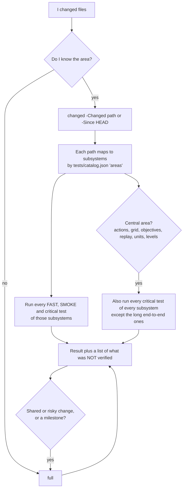

# Testing developer guide: "I changed X. Which tests do I run?"

Companion to [test-suite-efficiency-2026-11-20.md](test-suite-efficiency-2026-11-20.md) (the evidence behind this guide) and [Project Ironclad](../quality/project-ironclad.md) (the policy). All commands run from the repository root in PowerShell. Add `-Godot C:\path\to\godot_console.exe` when `godot_console` is not on `PATH`.

## The short version

| I want to... | Command | Tests | Measured time |
| --- | --- | ---: | --- |
| Quick check while I work | `.\tools\run_tests.ps1 fast` | 80 | 150 s (measured) |
| Quick check of one area | `.\tools\run_tests.ps1 fast -Subsystem animation` | 9 | 27 s incl. import (measured) |
| Check a finished feature | `.\tools\run_tests.ps1 smoke` | 18 | 75 s incl. a 12.5 s import (measured) |
| Test what I changed | `.\tools\run_tests.ps1 changed -Since HEAD` | varies | see below |
| One subsystem, completely | `.\tools\run_tests.ps1 subsystem -Subsystem movement` | 40 | about 250 s (estimate) |
| One test or a family | `.\tools\run_tests.ps1 select -Test traversal_*` | 12 | about 116 s (estimate) |
| Everything | `.\tools\run_tests.ps1 full` | 210 | about 37 min (last measured, old runner) |
| See the plan without running | add `-List` (and `-Why` for the reasons) | | instant |
| Check the catalog itself | `.\tools\run_tests.ps1 check` | | instant |

"Measured" means this session ran exactly that command. "Estimate" is the sum of each test's last measured cost from the previous runner (an upper bound: that runner added up to 1 s of waiting per test).

## How the selection works



`changed` is a convenience, not a proof. It always prints which path mapped where, which long tests it left out (add `-Thorough` to include them) and how many ordinary tests were not selected. An unmapped path broadens the selection instead of narrowing it.

## Recipes

| I changed... | Run | Why |
| --- | --- | --- |
| Locomotion or gait (`presentation/characters/runtime/locomotion_*`) | `.\tools\run_tests.ps1 changed -Changed presentation/characters/runtime/locomotion_pose_modifier.gd` | 17 animation tests: composition, locomotion, cover, traversal rig and solver, presenter. About 2 minutes. |
| A weapon animation or weapon pose | `.\tools\run_tests.ps1 changed -Changed presentation/characters/runtime/weapon_pose_modifier.gd`; then `.\tools\run_tests.ps1 select -Test unit_visual_*,weapon_pose_modifier_test` when the weapon frame itself changed | The default selection is the cheap animation core; the weapon-frame suites are heavier (about 50 s each). |
| Cover posture or the spine modifiers | `.\tools\run_tests.ps1 changed -Changed presentation/characters/runtime/cover_crouch_modifier.gd` | Includes the composition test (F-04) and both cover firing tests. |
| Stairs, ramps, ladders, path presentation | `.\tools\run_tests.ps1 select -Test traversal_*,path_refiner_test,surface_vertical_traversal_test` | The traversal family (12 ordinary scripts; a wildcard never selects the two rendered captures, name them exactly if you want them). About 2 minutes. |
| Traversal link data or pathfinding rules (`systems/grid`) | `.\tools\run_tests.ps1 changed -Changed systems/grid/traversal_link_data.gd` | Central area: movement, core and every critical test (80 tests, about 8 minutes). Replay determinism is in there. |
| AI scoring or planning | `.\tools\run_tests.ps1 changed -Changed systems/ai/ai_plan_evaluator.gd`, then `subsystem -Subsystem ai` before merging | 18 tests first, then the whole AI subsystem (37 tests, about 6.5 minutes). |
| The action service, AP, shields, conditions | `.\tools\run_tests.ps1 changed -Changed systems/actions/tactical_action_service.gd` | Central: 74 tests (about 10 minutes), the long end-to-end critical tests omitted and named in the output. |
| Mission objectives, rescue, extraction | `.\tools\run_tests.ps1 changed -Changed systems/objectives/objective_manager.gd` | Central: 65 tests (about 11 minutes) including carrier loss and rescue lifecycle. |
| Replay recording or the schema | `.\tools\run_tests.ps1 subsystem -Contract replay -Critical` | Every critical test that protects replay or determinism (13 tests); run `full` before a release. |
| UI only (HUD, overlays, camera) | `.\tools\run_tests.ps1 changed -Changed ui/hud.gd` | 14 tests (about 40 s): the UI tests plus the critical presentation checks. No long simulations. |
| Map generation or authored scenes | `.\tools\run_tests.ps1 changed -Changed systems/generation2/authored_scene_map_compiler.gd` | 26 tests (about 6 minutes). |
| A large architectural refactor, a rename across systems, or anything crossing several boundaries | `.\tools\run_tests.ps1 fast` while working, `smoke` at each stable point, then `full` once at the end | One full run per milestone; do not repeat it for small corrections. |
| Release readiness | `.\tools\run_tests.ps1 full`, then `.\tools\run_tests.ps1 select -Test <explicit batches>` and the rendered captures by hand | See "Explicit-only tests". |

For anything in `tests/` itself, `changed` selects the changed test.

## Explicit-only tests

Twenty-four scripts never run in `full`. They are classified in the catalog and are run deliberately:

* **Headless batches and benchmarks (6):** run by name, e.g. `.\tools\run_tests.ps1 select -Test container_maps_smoke` (28 s measured, passed). The others: `ai_match_simulation_smoke`, `map_quality_metrics_smoke`, `battlefield_stress_smoke`, `prototype_1_milestone`, `ai_baseline_report`.
* **Rendered captures (18):** they need a graphics device and a human to look at the pictures. The runner will not pretend to run them headless: `select -Test pose_review_capture` reports "needs rendering" and exits with code 2. Run them directly without `--headless`, using the command in the script's header. A passing headless test never establishes visual correctness.

## Reading the output

* `[PASS]`, `[FAIL]` (nonzero exit or an unhandled script error even when Godot exits 0) and `[TIMEOUT]` (the process tree was killed after `-TimeoutSeconds`, default 900) are distinct. A timeout counts as a failure.
* `SKIP` counts the explicit-only tests excluded from a full or subsystem run. `NOT-RUN` counts selected tests that need rendering. `UNCLASSIFIED` counts scripts missing from the catalog.
* The last lines say how much was **not** verified. A passing `fast` run means only that.
* `results.json` in the run directory has per-test status, seconds and why each test was selected. `-Slowest 10` shows more of the slowest list.
* Exit codes: 0 all selected tests passed; 1 at least one failed or timed out; 2 a usage or catalog problem, a test that cannot run as requested, or (with `-Strict`) catalog problems.

## Registering a new test

1. Put the script in `tests/` (top level only: the runner discovers `tests/*.gd`; helpers go under `tests/support/` or `tests/fixtures/`). It must end with `quit(0)` or `quit(1)`.
2. Add one line to `tests/catalog.json`:

   ```json
   "my_feature_test": {"sub": ["movement", "animation"], "scope": "integration", "crit": "critical", "contracts": ["movement"], "fast": true}
   ```

   | Field | Values | Notes |
   | --- | --- | --- |
   | `sub` | `core actions combat equipment movement animation ai missions rescue generation replay persistence ui assets tooling` | One or more; drives `subsystem` and `changed`. |
   | `scope` | `unit component integration battle e2e` | unit: no scene; component: a scene or node but no tactical controller; integration: tactical controller or fixture without the production battle scene; battle: instantiates the production battle scene; e2e: whole simulated matches, playthroughs, batches. A judgement; it is a label, not a selector. |
   | `crit` and `contracts` | `critical`; `authority legality movement replay mission presentation-sync lifecycle persistence` | Only for tests that protect an authoritative contract. Criticality is separate from cost. |
   | `fast` | true | Headless, not explicit, and cheap (about 3 s or less). |
   | `smoke` | true | A deliberate boundary check; keep the set small. |
   | `run`, `req`, `kind` | `"run": "explicit"`, `"req": "render"`, `"kind": "capture/batch/benchmark"` | Explicit-only and rendered tests. They can never be FAST or SMOKE. |

3. Run `.\tools\run_tests.ps1 check`. It fails (exit 2) on an unclassified script, an entry for a file that no longer exists, an unknown value, or an explicit test marked FAST/SMOKE. Forgetting step 2 does not lose the test (it still runs in `full`, flagged `UNCLASSIFIED`), but CI runs `check` before the smoke tier, so the omission is caught.
4. When you rename or delete a test, edit its catalog line in the same change.

## Writing tests that stay fast and trustworthy

* Prefer the smallest scope that proves the contract: a pure solver test for the maths, one integration test for the wiring.
* Measure rates with the engine's delta and a pinned frame rate (`Engine.max_fps = 60`), not wall-clock gaps between frames. See the cover tests.
* Assert geometry, legality, timing and destination rather than incidental counts of presentation waypoints.
* Do not write shared temporary files under `res://.godot/` with a fixed name if the test might one day run beside another; use `FUSEFIRE_TEST_OUTPUT_DIR`.
* Fixed `create_timer` waits are the most common avoidable cost; wait for a condition with a frame-bounded loop where possible.

## When is a full run warranted?

* A change to a central area (actions, grid, objectives, replay, units, the battle scene).
* The end of an architectural milestone or before a release.
* Whenever a `changed` selection prints an unmapped path you cannot explain.
* After changing the runner or the catalog's structure (one run to confirm the full tier still discovers every ordinary test; `full -List` shows the count without running).

The full run takes about 37 minutes. Do not repeat it for a test-only correction that was verified directly.
