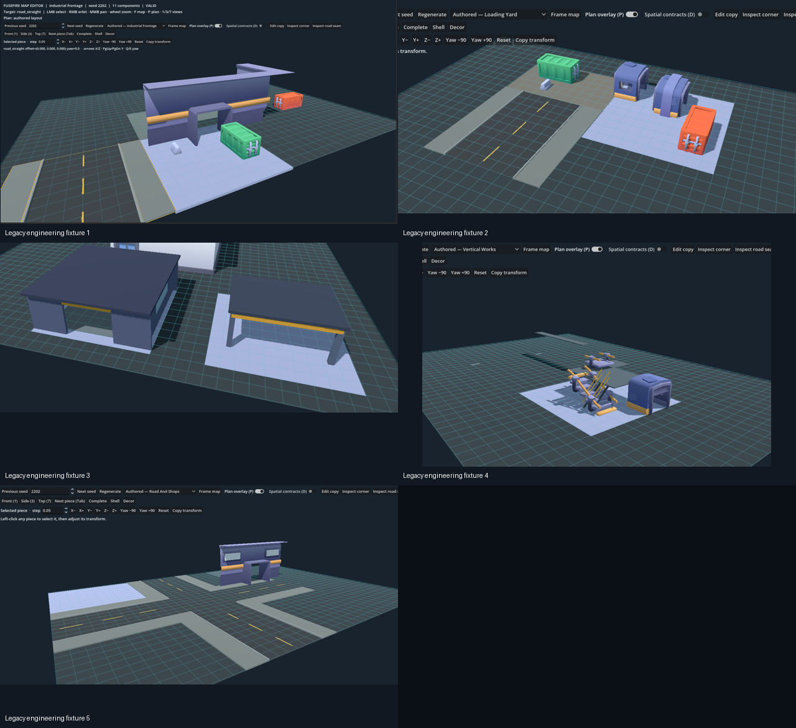
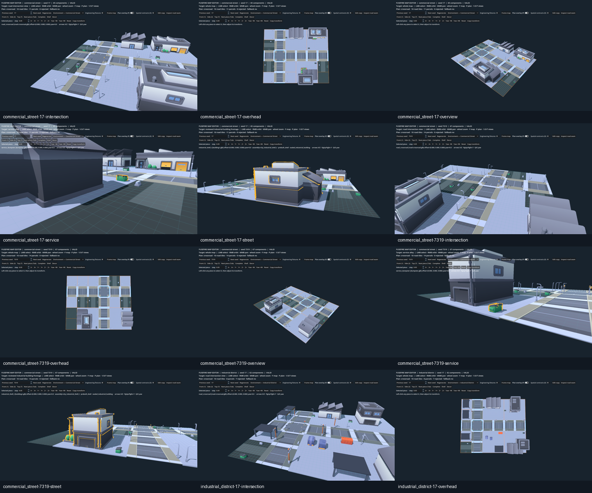

# Environment Pipeline Consolidation

## Pipeline audit

The Map Editor had nine layouts in one undifferentiated picker. Three were current procedural environments, one was the editable composition, and five were Goal 2.2 or structural-regression fixtures. Passing tests did not make those component demonstrations suitable creative starting points.

| Layout | Actual pipeline | Status after consolidation |
| --- | --- | --- |
| Custom Layout | Saved `MapEditorLayoutStore` JSON → `EnvironmentModuleLayout` → shared catalog/writer/presenter | Normal editable workflow |
| Industrial District | `FlatMapGenerator.generate_coherent_environment` → `CoherentEnvironmentAssembler` → shared catalog/writer/presenter | Normal environment; default |
| Commercial Street | Same coherent pipeline with commercial identity | Normal environment |
| Mixed Service | Same coherent pipeline with mixed-service identity | Normal environment |
| Industrial Frontage | `generate_modular_environment_sample` → `ModularIndustrialLayoutBuilder`; loose Factory wall/door/floor seam | Engineering fixture |
| Loading Yard | Same legacy builder; dock/road/paving/container/machine combination | Engineering fixture |
| Road and Shops | Same legacy builder; road cross plus freestanding façade fragments | Engineering fixture |
| Vertical Works | Same legacy builder; stairs, ramp, platform, walkway and traversal links | Engineering fixture retained for tactical regression |
| Building Gallery | Same legacy builder; derived closed shell, open canopy and imported sealed shell | Engineering fixture retained for structural inspection/tests |

The coherent generator was already integrated, but the editor opened on `industrial_frontage` and presented every fixture as a peer. The composer likewise offered loose façade fragments and the generic derived service shell without explaining their diagnostic role.

All 315 current semantic interpretations are now recorded as developer-confirmed following the completed rendered batch review. Procedural approval remains a separate gate: 32 assets currently have authored placement contracts and may become generated visuals. The added five are the City Roads straight, crossroad, intersection, curve, and paving surfaces.

The modular coherent pipeline uses `IndustrialModuleCatalog` for tactical and placement contracts, `SemanticAssetCatalog` for reviewed meaning and procedural approval, `IndustrialBuildingPlacementProfiles` for calibrated shell dimensions/frontage clearances, and `ModularEnvironmentPresenter` for visuals. `MapData` remains authoritative. The older generic flat-map building data/presentation path is outside this editor consolidation and remains available to existing gameplay and tests.

City Roads meshes now supply the visible road network through an authored 2× horizontal adapter over their saved 5-unit calibration. The exact derived cross-section remains beneath them to guarantee continuous seams and document tactical widths. Streetlight working faces are confirmed as model-local `-Z`, and road-side slots rotate that face toward the carriageway.

## Consolidated workflow

The editor now opens directly on **Environment — Industrial District**, seed `17`. Its normal picker contains the three coherent environment identities and the editable composition. Enable **Engineering fixtures** to reveal the five preserved diagnostics. The same toggle reveals loose legacy structural fragments in the composer; saved compositions containing those stable IDs continue to load whether the toggle is enabled or not.

Large road-facing procedural parcels now receive explicit `building_frontage/<module-id>` candidates. Candidate discovery requires all of the following:

- a human-confirmed semantic record;
- procedural visual approval;
- complete-building classification and completeness;
- a reviewed working face;
- the current environment context; and
- calibrated footprint plus protected frontage clearance that fits the parcel.

Candidates are tried transactionally through the existing bounded placement search. Visual-envelope, layer, footprint, clearance, and map-bound failures reject that candidate and allow another reviewed building to be tried. Industrial and mixed-service maps retain the authored loading-yard fallback. The procedural path no longer selects `complete_service_building`, `factory_shop_front`, or `factory_window_wall` as a normal district building.

Four visually reviewed compact City Kit Industrial shells (`building-i`, `building-k`, `building-p`, and `building-t`) are confirmed for commercial as well as industrial and mixed-service exterior use. They remain sealed tactical obstacles; their commercial suitability does not imply an interior.

Small parcels now name recognizable functions: loading bay, equipment compound, service alley, container staging pad, or a paved and lit commercial forecourt. Landlocked land is recorded as a `district_buffer`, making intentional reserved space distinguishable from a failed placement in plan diagnostics.

The existing 60 × 50 grammar now reserves up to four large industrial parcels or three mixed/commercial parcels. This uses more of the already validated building and yard compositions and reduces anonymous rear grid without changing the road grammar or filling deliberate tactical approaches with clutter.

## Inspection and evidence

Launch the normal workflow from the repository root:

```powershell
godot_console --path . res://tools/map_editor.tscn
```

Useful reproducible cases are:

- `industrial_district`, seeds `17` and `2208`;
- `commercial_street`, seeds `7319` and `17`;
- `mixed_service`, seeds `11027` and `2208`.

Use right-drag to orbit, middle-drag to pan, the wheel to zoom, left-click to select, `P` for the spatial plan, and `D` for the selected module's spatial contracts. **Edit copy** moves any generated result into the custom composer; save and reload continue to use the project-local JSON workflow.

Rendered evidence is produced by `tests/coherent_layout_capture.gd`. It captures overhead, overview, intersection, street-frontage, and service-area views. The capture is a manual visual review artifact rather than a pixel assertion.

The preserved before/after sheets make the workflow change reviewable without launching Godot:





The before sheet contains the old frontage, loading-yard, canopy, vertical, and road-and-shops demonstrations supplied during review. The after sheet contains actual `commercial_street` and `industrial_district` seed captures. Full-resolution captures for all listed seeds can be regenerated with the capture script above.

## Preserved fixtures and remaining limits

The fixtures were hidden from normal selection rather than deleted because `vertical_works` protects elevated traversal and `building_gallery` protects shell/decor separation and structural completeness. The other Goal 2.2 layouts remain direct compatibility fixtures while older tests and documentation refer to them.

The road planner still creates one primary crossroad or T-junction with straight approaches. This task deliberately does not expand that grammar. Several large imported shells still need wider campus parcels. The four commercial candidates are exterior shells from the industrial kit, so a future dedicated commercial pack can replace them through metadata and profiles without changing tactical authority. Authored composition still has one working save slot and lacks undo/redo or template promotion.
