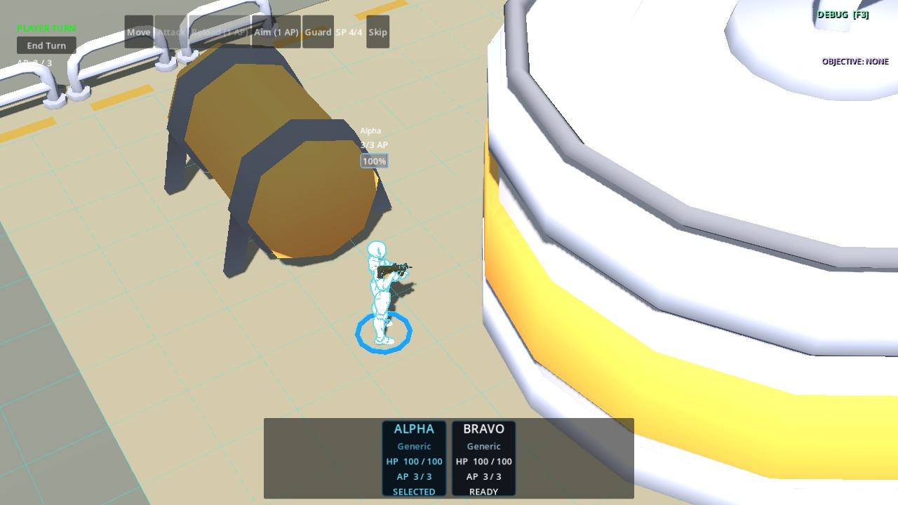
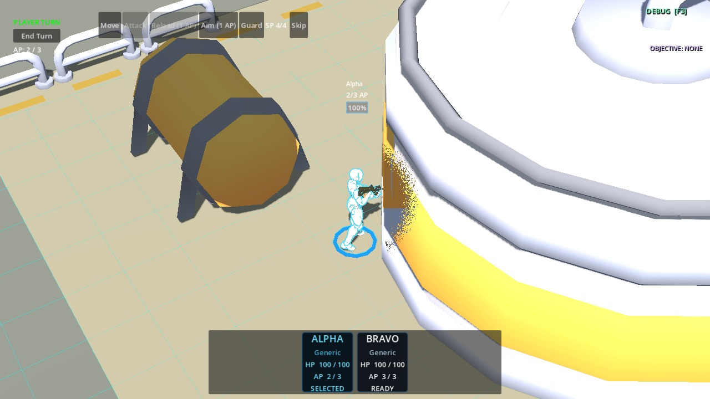
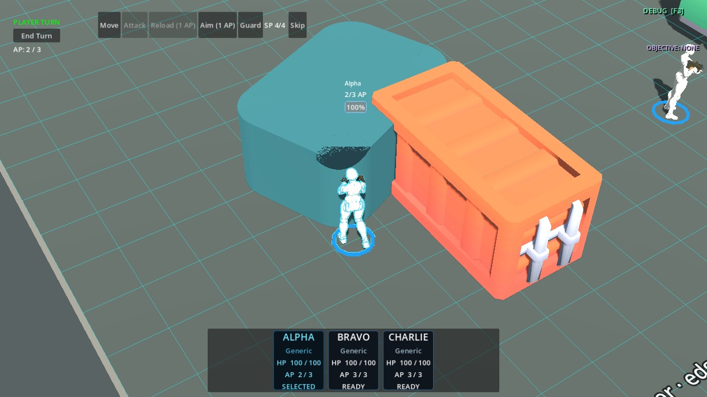

# Curved tactical geometry and partial-tile traversal

This implementation builds on integrated main `0c1184c`, which includes the
planning responsiveness changes from PR #94. Compiler revision 7 connects exact
upright cylinders and yawed rounded rectangles to the existing tactical grid.
Issue #7 is the review and acceptance record. [GitHub issue #7](https://github.com/Melo9002/fusefire-proving-grounds/issues/7)

## Geometry and ownership

| Step | Owner and contract |
| --- | --- |
| Authored solid | `AuthoredSceneMapCompiler` reads asset-local dimensions and shape metadata, composes transforms and registers an analytic solid. Untagged assets retain their existing compiler behavior. Invalid curve metadata, tilt, shear or unequal horizontal scaling use the enclosing box. |
| Deterministic stand | `SurfacePlacement` tests the existing box candidates, projections to curved margins and a fixed within-tile lattice. `SurfaceNavigation` checks the resulting point against floor support and rounds it to 1/10000 tile. The logical grid still has one canonical point per stop. |
| Route and occupancy | `SurfaceNavigation` and `MapGraphBuilder` check full body sweeps before keeping edges. Direct edges and the existing style of supported elbows are considered. Dynamic bodies still use the existing occupied-path clearance checks across the actual route. The AI continues using PR #94's cooperative planning and clearance reuse. |
| Shot and cover | `CombatRules` queries the same shape through the column index for LOS, directional protection, previews, execution and reactions. A curve's open grazing edge doesn't participate in the legacy paired-box seam rule. Ordinary box seams retain their behavior. |
| Visual surface | `TacticalPoseContext` takes the canonical stand and exact surface contact and normal. `CoverVisualizer` draws an arc for cylinder contacts and a tangent marker for rounded boxes. The route builder uses the validated route. |
| Persistence | Authored manifests keep the compiler revision. The standing-point signature includes normalized curved shape records sorted independently of registration order. Revisions 1–6 retain their existing solid and presentation data; the outside pipe's separate obstacle starts at revision 7. |

The rounded prism is the exact union of two rectangular strips and four corner
disks, with a fixed vertical extent. The same footprint answers contact, body
and ray queries. For upright assets the actor uses the existing 0.28 m body
radius, 1.8 m height and 0.04 m extra clearance at the standard 1 m grid.
Rectangular obstacles retain their existing conservative body-box test. The
geometry is compiled once and column-indexed. Tactical queries never scan
render triangles.

Asset definitions carry the shape once, and placed copies inherit it through
the scene transform. The Depot's measured upright shell has a 3.77104 m
radius and a 0.35 m local axis offset. An overlapping authored box covers the
external pipe, including the portion outside the shell. The lying drum keeps
its historical approximation. The rounded cabinet is a reusable authoring
fixture in the real Surface Fit Range battle, with a 3.6 × 2.6 m footprint,
0.65 m corner radius and 0.41 rad yaw. [Asset authoring and replay details](../asset-edge-placement.md)

## Gameplay evidence

| Fixture | Result |
| --- | --- |
| Service Depot, seed 16, upright tank | Revision 7 restored `(26, 0, 6)` beside the shell. A Move from `(25, 0, 6)` committed at world `(6.5, 0, -13.5)`, 0.391 m from the wall. MIRA then followed a four-cell path along the shell to `(26, 0, 9)`. The central tank stayed blocked. The position became unavailable when another unit occupied it. The player move query and AI candidate inventory both offered it once clear. |
| Service Depot, shots and Guard | From `(26, 0, 6)`, the tank blocked the line to `(26, 0, 11)`. Guard agreed. The ray and attack to `(24, 0, 7)` cleared the shell. The player query, AI inventory and committed receipt agreed on 100% chance and cover. A ray entirely inside the newly accessible cell still hit the shell when it entered the solid. An independent ray outside the shell still hit the pipe. Mission adjacency allowed the supported step beside the tank and rejected the step into it. |
| Surface Fit Range, seed 17, rounded cabinet | Revision 7 recovered five stops near the cabinet compared with the revision-6 conservative box. One recovered point, `(4, 0, 8)`, was unreachable from the selected deployment with the available action. The same action could reach `(4, 0, 11)` diagonally from `(3, 0, 12)`; preview and execution agreed on the canonical world endpoint `(-11.6248, 0, -4.001)`. |
| Save and reload | The real Range session archived its exact authored parcel. The saved replay reloaded and recompiled that content, then replayed one Move with the recorded result and state fingerprint. |
| Fitting controls | A path with clear endpoints could still intersect a rounded prism. A rounded corner beside a box rejected a gap smaller than the body. Tangency, rotated geometry, positive vertical scale and conservative fallback for unequal horizontal scaling were exercised. |

The 1280×720 rendered run used mainline battle scenes, the normal presentation
clock and OpenGL compatibility. It passed 48 checks, including four captures.
I inspected frames from the automated run. Human playthrough remains open. The first two views use the same camera
setup either side of the committed Depot move.

| Depot, before the move | Depot, at the recovered stop |
| --- | --- |
|  |  |

[Depot after the four-cell route along the shell](images/curved-tactical-geometry/depot-around-tank.jpg)



```powershell
.\tools\run_tests.ps1 select -Test surface_curved_battle_test,cover_round_presentation_test -Import
New-Item -ItemType Directory -Force artifacts/curved-tactics/rendered | Out-Null
$env:FUSEFIRE_TEST_OUTPUT_DIR = (Resolve-Path artifacts/curved-tactics/rendered).Path
godot_console --path . --resolution 1280x720 --rendering-method gl_compatibility --script res://tests/surface_curved_battle_test.gd -- capture $env:FUSEFIRE_TEST_OUTPUT_DIR
```

## Limits

- Standing-point search is bounded to 32 local parts and 256 tested
  candidates. Mixed geometry can miss a very narrow viable sliver. Accepted
  points still require exact analytic clearance and an independently validated
  route. Surface support and strict diagonal eligibility stay as before.
- The supported shapes are upright extrusions with yaw and equal scale in
  both horizontal axes. Authoring can combine these solids with boxes.
  Arbitrary concavities, hollows, ellipses and walkable curved tops remain
  outside the shape contract. A separate authored floor is required for a
  walkable deck.
- Collision uses the authored body profile. Existing idle and cover poses can still lean or extend a
  weapon near an object. Cover and shots always use the authoritative point
  and ray contract. Debug obstacle envelopes are conservative visual aids.


## Historical replay and deterministic reconstruction

I recorded a complete Service Depot Rescue on detached main `0c1184c`, with
seed 16, Hard difficulty and three units per side plus one ally and the rescue target.
The candidate loaded the resulting revision-6 JSON, reconstructed its
recorded manifest and verified all **166 replay events**, including the
final victory. The recorded event count includes turn commands. The modern
Range replay verified the revision-7 stop and its fingerprint independently.
Five warm compiles per site produced a stable signature on each build.
Freight Yard and Fleet Station signatures matched across both compiler
revisions. The Depot signature changed when its tank geometry changed and
matched before and after the performance optimization.

## Performance and AI comparison

Measured on the same Windows Ryzen 5 5500 host with Godot 4.7.2, headless, in
serial processes. The compiler probe used seed 16, discarded the first
compilation of each site and measured five warm repetitions. “Compile” covers
`BattlefieldCatalog.generate`. “Graph” covers `MapGraphBuilder.build`. Values
are in milliseconds.

| Site | Main compile / graph | Initial revision 7 compile / graph | Final revision 7 compile / graph |
| --- | ---: | ---: | ---: |
| Service Depot | 253.01 / 171.23 | 348.99 / 235.34 | 304.06 / 206.78 |
| Freight Yard | 275.31 / 193.91 | 287.70 / 201.52 | 294.06 / 202.23 |
| Fleet Station | 270.54 / 189.47 | 287.25 / 199.52 | 289.67 / 200.75 |

The initial Depot integration added about 160 ms at battlefield load.
A conservative union envelope skips curves outside the query rectangle. A
single overlapping curve needs no column lookup, and four obstructed corners
prove that a convex expanded footprint fills the cell. These changes removed
73 ms of the added work and left about 87 ms of extra one-time Depot load
time. Warm measurements at the two control sites also rose by 27–30 ms.
CPU and background variance were not independently instrumented, so those
control differences set a useful scale for interpreting the comparison.

| Site and number of decision samples main → final | Mean work (ms) | P95 work (ms) | P95 uninterrupted slice (ms) | Max slice (ms) | P95 decision wall (ms) |
| --- | ---: | ---: | ---: | ---: | ---: |
| Service Depot 194 → 166 | 29.76 → 32.77 | 67.67 → 71.61 | 14.71 → 15.06 | 52.93 → 40.78 | 85.30 → 88.64 |
| Freight Yard 242 → 242 | 38.55 → 40.22 | 85.12 → 91.41 | 18.30 → 19.10 | 38.51 → 40.33 | 104.48 → 113.41 |
| Fleet Station 141 → 141 | 31.04 → 31.97 | 64.52 → 68.73 | 14.01 → 14.14 | 15.66 → 16.52 | 80.49 → 86.62 |

The profiling work metric measures elapsed time inside the planner's work
intervals and excludes suspension and animation. The mix of decisions changed
in Depot, and the comparison is one run per configuration. These headless
samples measure headless planning cost. Rendered frame pacing remains unmeasured.

All six matches completed with zero rejected actions on both builds.
Freight Yard and Fleet Station kept their decision sequences, transaction
outcomes and final states. The Depot's paths changed as intended. Eliminate's
fourth decision moved from `(3, 0, 7)` to `(5, 0, 1)`, and Rescue's
twenty-fourth moved from `(22, 0, 5)` to `(21, 0, 5)`. The first differing
selected scores in both cases were entirely route progress, with no cover,
firing or danger contribution. Eliminate still took six rounds. Rescue went
from 13 to 7 in this seed, which shows the effect of the topology on this
match. The initial and optimized revision-7 builds produced identical
decision records, outcomes and final states in all six matches.

Run the existing AI baseline driver from each imported checkout, using a
different tag per checkout. Compare the resulting JSON directories with
`tools/quality/ai_baseline_compare.py` and analyze profiler logs with
`tools/quality/ai_baseline_summary.py --log`.

```powershell
godot_console --headless --path . --import
godot_console --headless --path . --script res://tests/ai_baseline_report.gd -- tag=curve-compare site=service_depot,freight_yard,fleet_station mission=ELIMINATE,RESCUE seeds=16 players=3 enemies=3 difficulty=HARD profile-ai
```

The small compiler probe, compatibility replay driver, raw timings, replay JSON
and the exact-baseline checkout are preserved locally under the ignored
`artifacts/curved-tactics/` directory. To reproduce the compiler breakdown,
run these measurements inside a deferred `SceneTree` callback, looping
over the three site IDs six times and discarding each site's first sample.

```gdscript
var started := Time.get_ticks_usec()
var data := BattlefieldCatalog.generate(site, Vector2i.ZERO, 16, 1.0)
var compiled := Time.get_ticks_usec()
MapGraphBuilder.build(data, Pathfinder.new())
var finished := Time.get_ticks_usec()
print(site, " ", compiled - started, " ", finished - compiled, " ", data.content_manifest.standing_points_signature)
```

## Verification record

| Run | Result |
| --- | --- |
| Focused integration | 44 checks passed in 7.53 seconds. This covers the actual tank and cabinet battles, occupancy, the four-cell Depot route, same-cell LOS, mission adjacency, player and AI queries, attack receipts and the revision-7 saved move. |
| Rendered 1280×720 | 48 checks passed with four captures. |
| Catalog and hosted smoke | 305 scripts and 305 catalog entries, including 27 smoke members. All 27 passed with project import on optimized commit `a375707` in 122.47 seconds. [Hosted run](https://github.com/Melo9002/fusefire-proving-grounds/actions/runs/45813404521) |
| Full ordinary Ironclad, initial integration | 267 tests passed, one failed, zero timed out. Project import passed. Total 3,195.36 seconds. |
| Full ordinary Ironclad, optimized implementation | **RED**. 267 tests passed, one failed, zero timed out, zero skipped. Project import passed in 28.19 seconds. 37 explicit-only scripts were outside the run. Total 3,159.99 seconds. |

The optimized run passed the 48-case mission/replay matrix in 231.60 seconds, the real-map combat checks, both diagonal suites, the AI clearance-cache regression and the surface geometry suites.

The same MIRA ladder descent ratchet failed in four cases on detached main
and the optimized branch. The baseline reported 121.0–121.9 mm and the
optimized full run reported 121.0–122.3 mm of limb-envelope overlap.
The regression stays active. [Inherited issue #64](https://github.com/Melo9002/fusefire-proving-grounds/issues/64)

```powershell
.\tools\run_tests.ps1 check
.\tools\run_tests.ps1 full -LogDirectory artifacts/curved-tactics/final-full
```

Full run logs and machine-readable results are under
`artifacts/curved-tactics/final-full/20261126-084723970-774ec2db-full`.
The starting baseline ladder log is in `artifacts/curved-tactics/baseline`.

## Review

The reviewed implementation is `a375707` on `codex/curved-tactical-geometry`.
Dense maps with many curved solids remain outside the measured workload.
Issue #7 stays open for owner review. [PR #95](https://github.com/Melo9002/fusefire-proving-grounds/pull/95)
