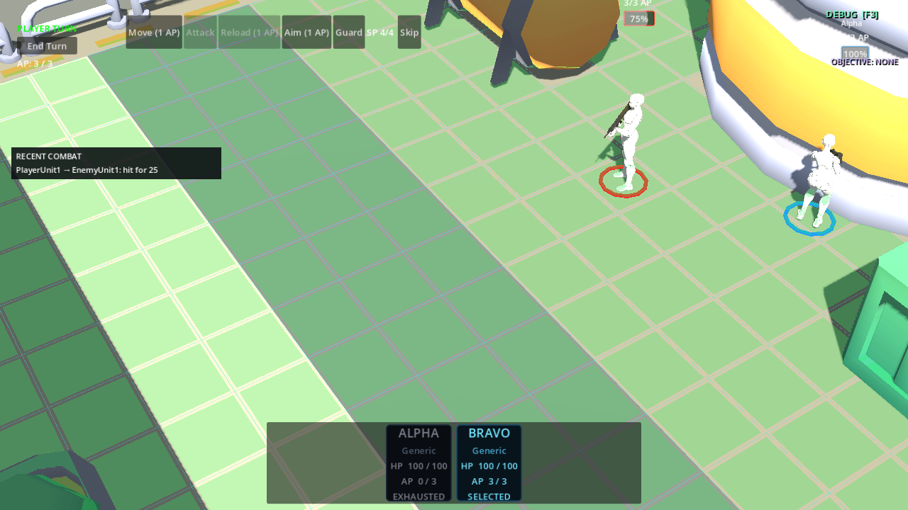
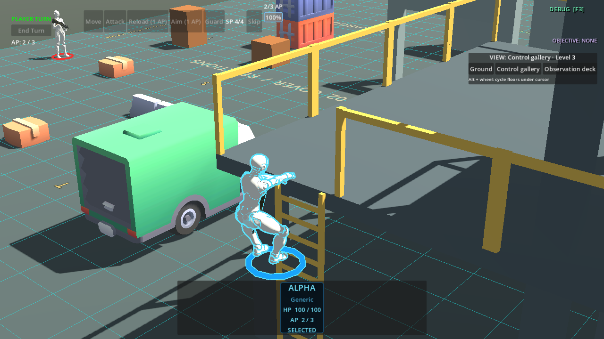

# Reproducing the Milestone 06.01 audit

[Findings and dispositions](../../movement-06-step01-audit.md) · [Mermaid source](../../movement-06-step01-architecture.md)

Run from the repository root on a review checkout containing these scripts. Their production dependency is integrated main `6d125eebd0c16062a4d2ea49e2b4348e48c23a9a`. The probes use production classes and existing fixtures. They are documentation evidence, outside the ordinary test catalog. In the support and Guard probes, exit 0 means the controls ran and the relevant observation was recorded. Read the observation to distinguish the bug from its corrected outcome.

## Ironclad

```powershell
$base = 'artifacts/movement-06-audit'
$primary = @(
  'surface_placement_test', 'surface_navigation_test', 'surface_curved_battle_test',
  'mesh_boundary_test', 'diagonal_movement_test', 'path_refiner_test',
  'tactical_action_service_test', 'surface_vertical_traversal_test', 'surface_vault_test',
  'traversal_classification_test', 'traversal_surface_alignment_test',
  'traversal_stair_gameplay_test', 'traversal_ladder_gameplay_test',
  'traversal_loaded_carrier_test', 'ladder_interrupt_test', 'ladder_landing_test',
  'traversal_replay_determinism_test', 'presentation_authority_test',
  'ai_planning_clearance_cache_test', 'ai_carrier_reservation_test',
  'combat_real_map_closure_test', 'surface_battle_replay_test',
  'path_visualizer_cache_test', 'debug_map_inspector_smoke', 'exploration_actions_test',
  'adda_measurement_integrity_test'
)
$followup = @(
  'overwatch_reactions_test', 'rescue_carrier_loss_test', 'rescue_battle_replay_smoke',
  'tactical_route_builder_test', 'traversal_timing_contract_test', 'ai_scene_lifetime_test'
)

.\tools\run_tests.ps1 check
.\tools\run_tests.ps1 select -Test $primary -List -Why
.\tools\run_tests.ps1 select -Test $primary -Import -LogDirectory "$base/ironclad"
.\tools\run_tests.ps1 select -Test $followup -LogDirectory "$base/followup"
.\tools\run_tests.ps1 select -Test mission_terminal_interaction_test,industrial_roof_movement_test -LogDirectory "$base/interactions"
```

The primary run was RED (exit 1) with 25 passes and one inherited failure. Import passed. The six Guard, Rescue, route/presentation and lifetime follow-ups passed (exit 0), with separate logs and no import. Terminal interaction and industrial roof movement passed in a third run (exit 0). The primary and follow-up logs on the audit machine are in the corresponding timestamped runner directories under `artifacts/movement-06-audit`. Each has `results.json` and per-script logs. The four current failures within the single ladder script are the armed and unarmed regular MIRA descent on posts and rails. The landing assertion measures approximate limb volumes. Separate skinned mesh diagnostics corroborate actual intersections at smaller depth. [Ladder assertion](../../../../tests/ladder_landing_test.gd#L234).

## Controlled probes and rendered evidence

Use separate writable user directories in a temporary PowerShell session. Run the scripts serially. The rendering commands use the same tactical scenes and action service as the running game, with fixture-controlled actors and cameras. No special build or capture framework is required.

```powershell
$probe = 'res://docs/quality/evidence/movement-06'
$out = Join-Path (Get-Location) 'artifacts/movement-06-audit/reproduction'
New-Item -ItemType Directory -Force $out, "$out/app", "$out/local", "$out/results" | Out-Null
$env:APPDATA = "$out/app"
$env:LOCALAPPDATA = "$out/local"
$env:FUSEFIRE_TEST_OUTPUT_DIR = "$out/results"

godot_console --path . --headless --script "$probe/support_probe.gd"
godot_console --path . --headless --script "$probe/guard_carrier_probe.gd"
godot_console --path . --headless --script "$probe/aperture_probe.gd"
godot_console --path . --rendering-method gl_compatibility --resolution 1280x720 --script "$probe/preview_probe.gd" -- capture "$out/depot"
godot_console --path . --rendering-method gl_compatibility --resolution 1280x720 --script "$probe/rendered_traversal_probe.gd" -- "$out/traversal"
godot_console --path . --rendering-method gl_compatibility --script "$probe/movement_query_cost_probe.gd" -- "$out/real-maps"
```

Keep the rendered traversal window visible to watch the four moves at normal speed. It automatically captures three phase samples where the action duration permits, then exits. This is a reproducible live demonstration. The checked-in stills are representative views. They cannot establish visual continuity or measure penetration. The device was an RTX 5060 using OpenGL Compatibility. Color and occlusion may differ in other renderers.

| Probe and output | Current observation |
| --- | --- |
| [Support probe](support_probe.gd), `[Support]` | Missing east floor: fit `(0.33,0,0)` clears, lacks support and causes `can_stop=false`. Alternative `(0,0,0.43)` clears, is supported and has a clear edge from the south. Full-floor control accepts the original point. |
| [Guard/carrier probe](guard_carrier_probe.gd), `[GuardCarrier]` | `(13,4,1)` → `(13,4,2)` → `(13,4,3)`. Lethal checkpoint/receipt `(13,4,2)`. VIP remains at origin despite checkpoint clearance. |
| [Aperture probe](aperture_probe.gd), `[Aperture]` | Merged one-part bake blocks sweep and shot. Same visible split meshes pass both. Center stopping alone does not establish a clear straight edge. |
| [Depot probe](preview_probe.gd), `[Preview]`, `[CurveTank]`, `[DrumWalk]`, `[CurveCabinet]` | Seed 16 Depot executes recovered routes. Known tank center returns `unreachable`, blank hover and blank click feedback. Rounded Range cabinet seed 17 replays. 78 checks passed, 15.56 s. |
| [Traversal probe](rendered_traversal_probe.gd), `[RenderedMove]` | Tactical Test Range, seed 1, regular MIRA, stair up 3.005 s, ramp down 1.399 s, ladder up 3.724 s and ladder down 4.206 s in the side-camera run. All arrived. Total probe 21.43 s. |
| [Movement timing probe](movement_query_cost_probe.gd), `[MoveCost]` | Six real-site configurations. Each has 128 measured iterations after eight warmups. 104 checks passed, 23.53 s. Output includes start, destination, legal destination count and distributions. The JSON file written by the inherited fixture contains combat and hover-option timings. The terminal `[MoveCost]` lines contain movement-query timings. |

## Screenshots

**Service Depot, seed 16.** F3 Map walkability after the route around the upright tank. The green fill describes terrain. The nearby hostile still occupies its cell.



**Tactical Test Range, seed 1.** Side view of regular MIRA during normal Move-driven ladder descent. The pose is sampled from actual tactical presentation. The failing measurements come from the independent ladder landing fixture.



Additional frames show the [Depot drum shoulder](images/depot-drum-shoulder-0.png), the [rounded cabinet stop](images/range-rounded-corner.png) and [MIRA ascending the tactical stairs](images/stairs-up-1.png).

The four diagram blocks render using Mermaid CLI 11.12.0 and headless Edge. The report links to the editable Markdown. Rendered SVGs and full Godot logs are local artifacts under `artifacts/movement-06-audit`.
