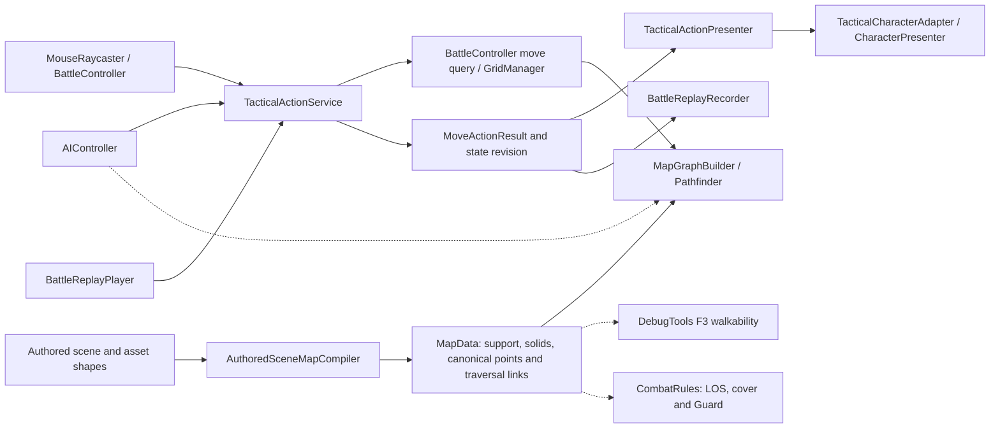
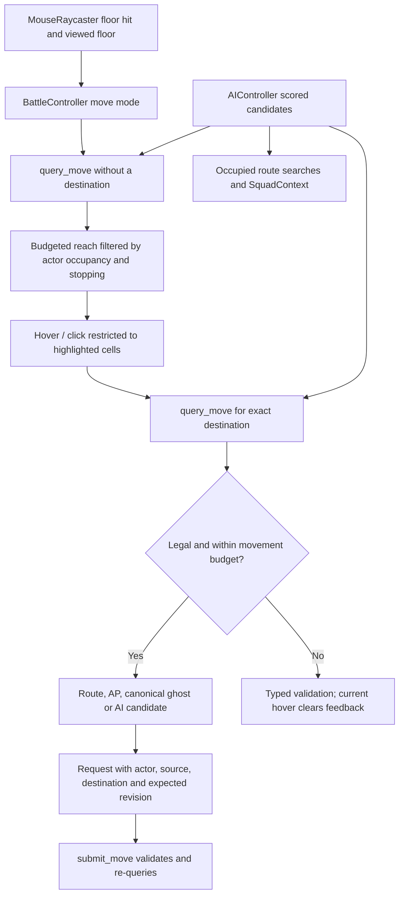
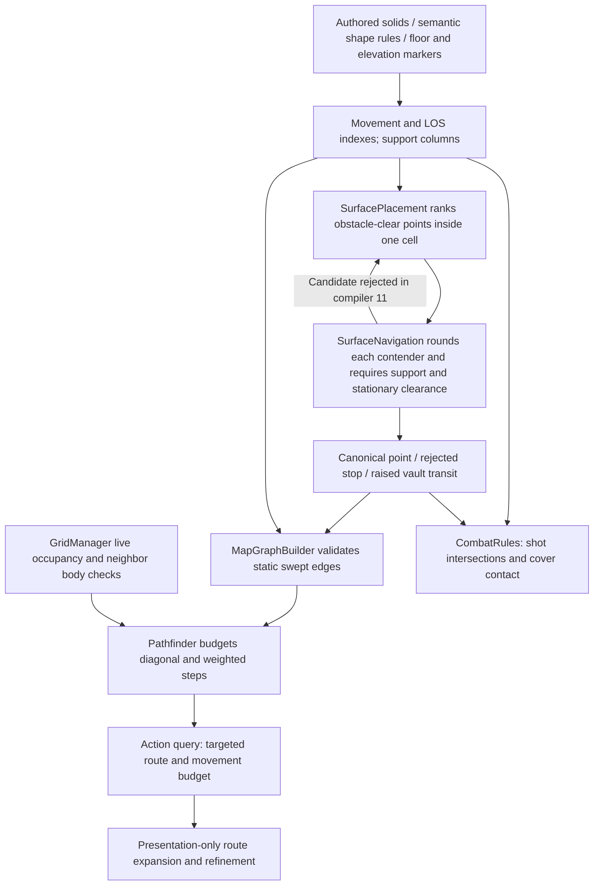
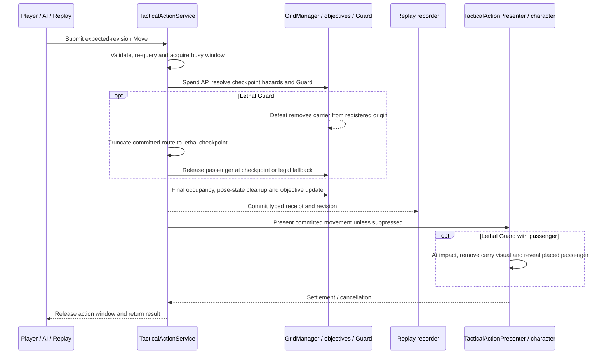

# Milestone 06 movement architecture

This describes integrated main at `6d125eebd0c16062a4d2ea49e2b4348e48c23a9a`. [Audit findings and verification](movement-06-step01-audit.md).

## A. Authority and consumers

Solid arrows show calls, production events or built data. Dotted arrows show dependency or read access. The navigation graph owns connectivity. The action service owns the transaction. The presenter owns visual playback.

Sources: [compiler](../../systems/generation2/authored_scene_map_compiler.gd), [map](../../systems/grid/map_data.gd), [graph](../../systems/grid/map_graph_builder.gd), [AI controller](../../units/ai_controller.gd), [action service](../../systems/actions/runtime/tactical_action_service.gd), [combat rules](../../systems/combat_rules.gd), [F3](../../ui/debug_tools.gd).

## B. Player and AI request lifecycle

The map overlay answers whether a cell has map geometry permitting traversal. A selected actor’s highlighted movement range adds its current budget, occupancy and stopping rules. The targeted query returns the path and feedback data. A click can re-query even after a successful hover. The AI has additional read-only route searches for planning, including hypothetical yielding. A returned route grants no authority to enter occupied cells. Plans are invalidated on relevant changes during cooperative planning.

Sources: [MouseRaycaster](../../systems/grid/mouse_raycaster.gd), [BattleController](../../systems/battle_controller.gd#L331) (`_query_move_data`, `_update_movement_preview`, `_on_floor_clicked`, `try_move`), [move DTO](../../systems/actions/runtime/move_query_result.gd), [planning snapshot](../../systems/ai/ai_planning_snapshot.gd), [squad context](../../systems/ai/squad_context.gd).

## C. Placement, route and combat geometry

A tile has a logical identity, a support center and, when legal, a canonical standing point. Shape authority, line-of-sight indexing and floor support are distinct data sets. A supported destination can be unreachable from a given start. A raised transit cell can contribute to a route while refusing a stop.

Sources: [shape rules](../../systems/generation2/tactical_shape_rules.gd), [asset placement guide](../asset-edge-placement.md), [SurfacePlacement](../../systems/grid/surface_placement.gd), [SurfaceNavigation](../../systems/grid/surface_navigation.gd), [Pathfinder](../../systems/grid/pathfinder.gd), [GridManager](../../systems/grid/grid_manager.gd), [tactical route builder](../../presentation/tactical/tactical_route_builder.gd).

[Step 06.02 documents the supported search and the historical compiler boundary](movement-06-step02-support-placement.md).

## D. Action window, Guard and presentation

The authoritative Move can visit several logical checkpoints in one transaction. Guard and applicable environmental effects run on those checkpoints. A lethal reaction removes the defeated carrier from its registered origin. Move then settles passenger release from the lethal checkpoint before publishing its receipt. The presenter animates the shortened route and reveals the passenger at the lethal impact. [Step 06.10A explains the ordering and historical replay compatibility](movement-06-step10a-passenger-release.md).

Sources: [submit and reactions](../../systems/actions/runtime/tactical_action_service.gd#L605), [defeat callback](../../systems/battle_controller.gd#L1046), [objective release](../../systems/objectives/objective_manager.gd#L289), [presentation](../../presentation/tactical/tactical_action_presenter.gd), [replay](../../systems/replay/battle_replay_player.gd), [fingerprint](../../systems/replay/battle_state_fingerprint.gd).
